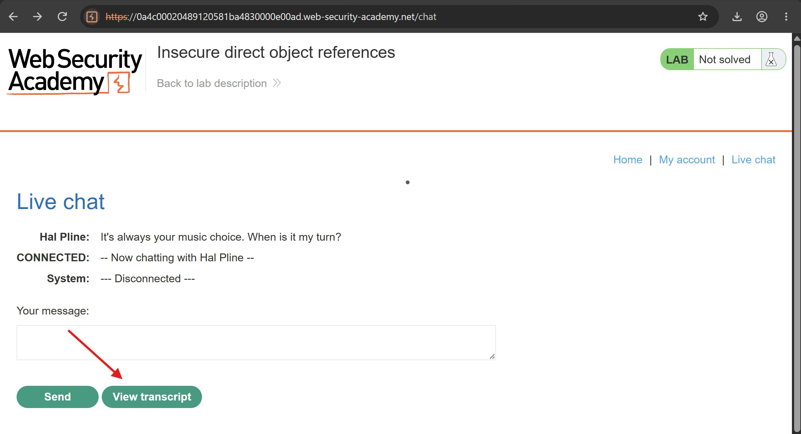
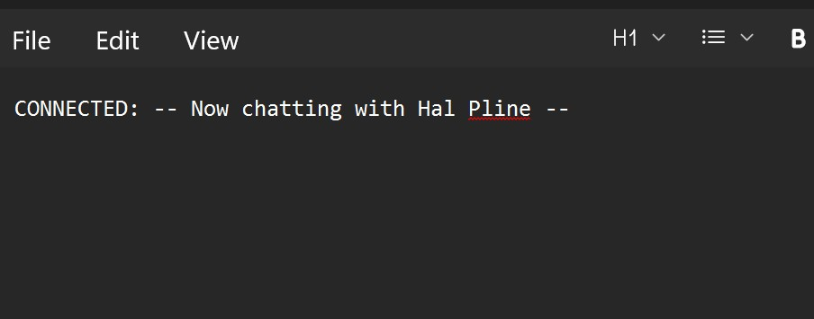
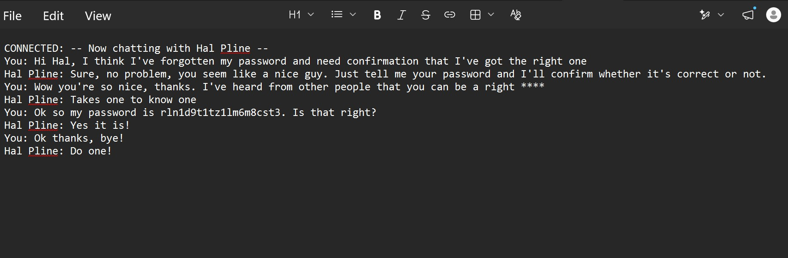
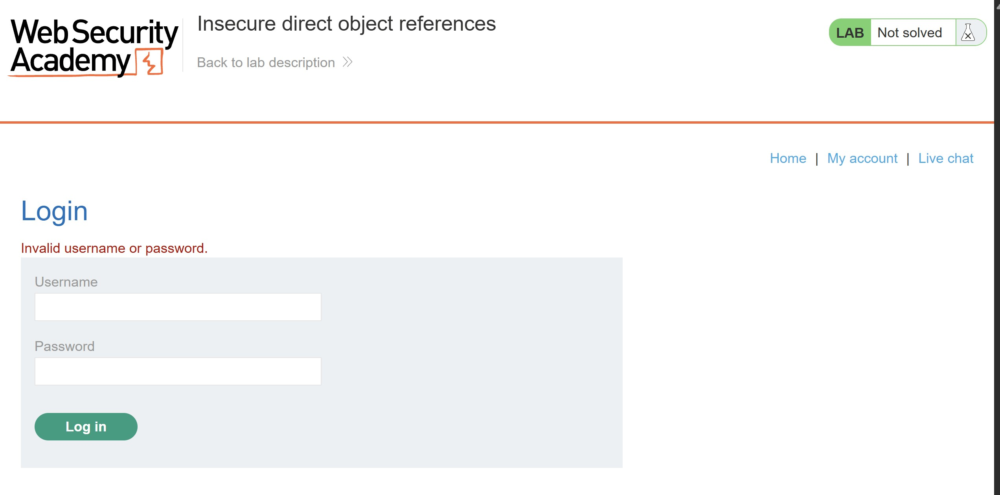
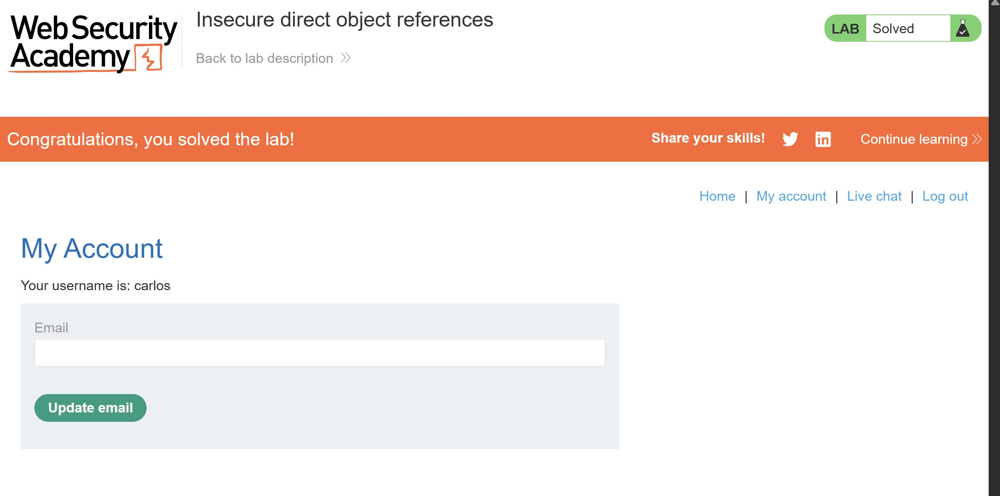

# Insecure Direct Object References (IDOR)

## Objectives

Solve the lab by finding Carlos's password and using it to log in to his account.

## Background

This lab stores user chat transcripts directly on the server's file system and retrieves them using static URLs. If the application does not properly control access to these files, a user may be able to access another user's transcript by modifying the file name in the URL.

## Tools Used

- Burp Suite
- Google Chrome

## Methodology

After loading the lab, I navigated to the Live Chat feature and clicked the option to view the chat transcript.

The application downloaded a file named `2.txt`, which I opened to inspect its contents.

This raised two questions: how were the transcripts stored on the server, and could changing the file name allow me to access other users' transcripts?

To investigate, I checked the HTTP history in Burp Suite and identified the request responsible for downloading the file:

`/download-transcript/2.txt`

Since I wanted to test this directly in the browser, I changed the URL from `/download-transcript/2.txt` to `/download-transcript/1.txt`.

Surprisingly, the file existed and contained what appeared to be user credentials. This suggested that the application allowed access to another transcript simply by changing the file name in the URL.

The transcript revealed the password `rln1d9t1tz1lm6m8cst3`. I initially tried using it to log in to the administrator account, but the credentials were rejected.

I then tried the same password with Carlos's account. This time, the login succeeded, and the lab was marked as solved.

Although I expected to access the administrator account and delete Carlos, the lab's stated objective was actually to find Carlos's password and log in to his account. The successful login therefore satisfied the objective.

## Results

I successfully exploited the insecure direct object reference by changing the transcript file name from `2.txt` to `1.txt`. The exposed transcript contained Carlos's password, which allowed me to authenticate as Carlos and complete the lab.

## Reflection

This basically shows how **Insecure Direct Object References (IDOR)** can expose sensitive information when an application retrieves server-side files using user-controlled identifiers without properly enforcing access controls.

The vulnerability was not that the transcript file names were predictable by themselves, but that changing the file name allowed access to a transcript containing credentials that should not have been exposed. Developers should enforce authorization checks before returning files, avoid storing sensitive information in publicly retrievable locations, and never include passwords or other authentication secrets in chat transcripts.

One important lesson from this exercise is to distinguish between the vulnerability being exploited and the lab's actual objective. I initially assumed that I needed administrator access to delete Carlos, but the stated goal was simply to retrieve Carlos's password and log in to his account. Reading the objective carefully helps ensure that the testing approach matches the intended outcome.