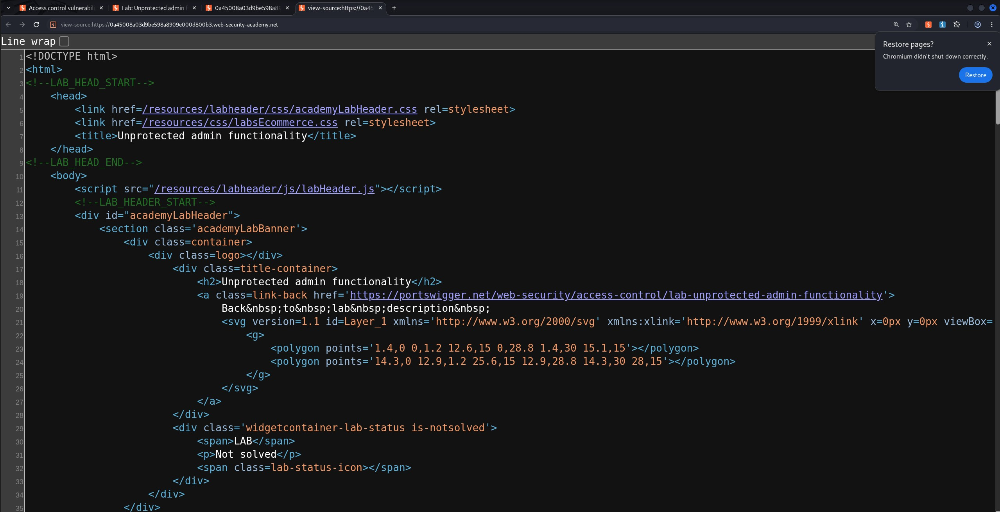
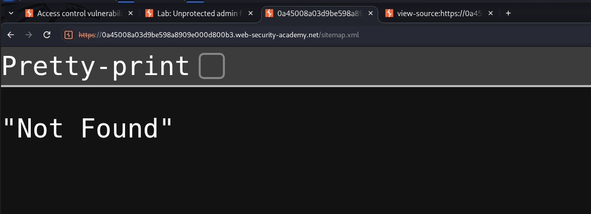
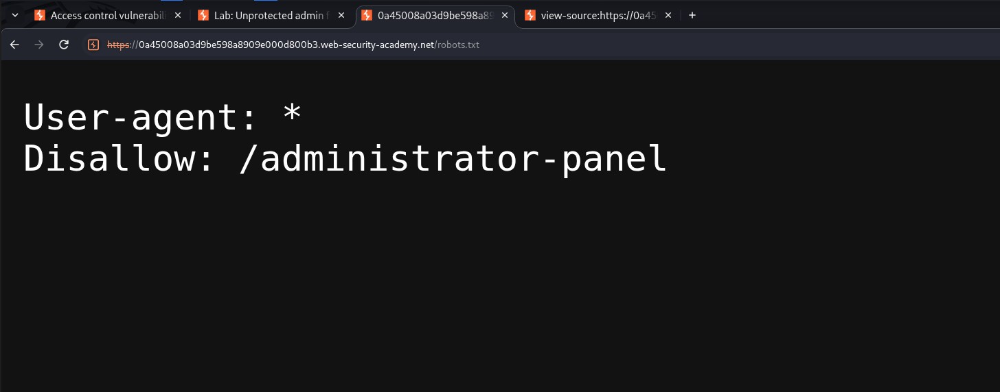
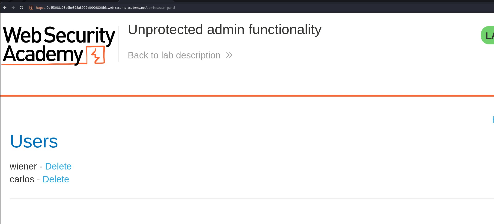
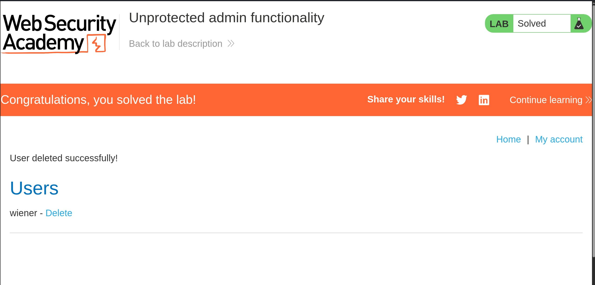

# Unprotected admin functionality

## Objectives
Delete the user Carlos

## Background
This lab demonstrates a web application with an unprotected admin panel, allowing unauthorized users to perform administrative actions.

## Tools Used
- Google Chrome

## Methodology

After opening the lab, my initial thought was to brute-force directories to discover hidden endpoints. However, before doing that, I decided to inspect the page source to see if it revealed any useful information.

Since I found nothing useful in the page source, I moved on to checking the robots.txt and sitemap.xml files to see whether they could reveal any hidden directories or resources.

The sitemap was not found, but the robots.txt file existed and contained a disallowed path: `/administrator-panel`.

I then attempted to access `/administrator-panel` directly to determine whether any access controls were in place.

As shown above, the admin panel was accessible without authentication or authorization checks. This meant that an ordinary user could access administrative functionality and delete user accounts without having the necessary privileges.

## Results 
The main objective of this lab was to delete Carlos's account. Using the exposed admin panel, I located Carlos's account and deleted it successfully, completing the lab.

## Reflection
This highlights how security through obscurity is not an effective access control mechanism. Although the robots.txt file helped me discover the admin panel, the actual vulnerability was the absence of proper authorization checks. Sensitive administrative functions should be restricted to authorized users, with server-side access controls enforced on every request. The exercise also reinforced the value of reconnaissance: inspecting page source files and checking commonly exposed resources can reveal useful clues before moving on to more aggressive enumeration techniques.