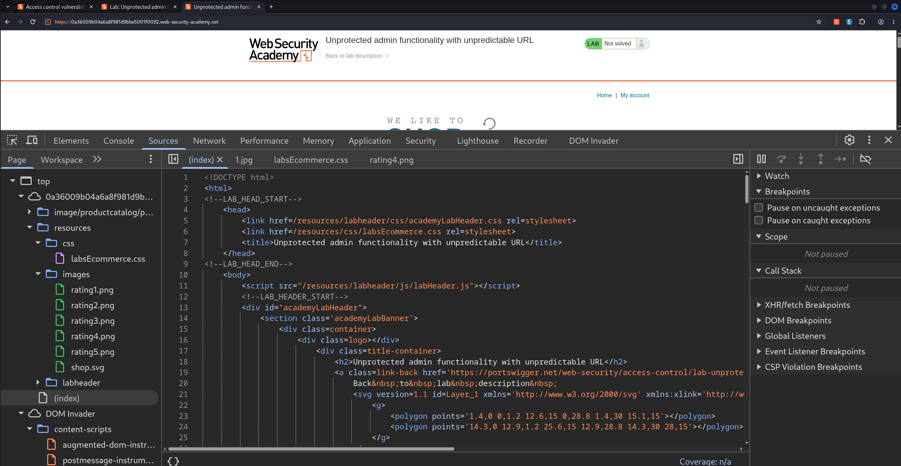
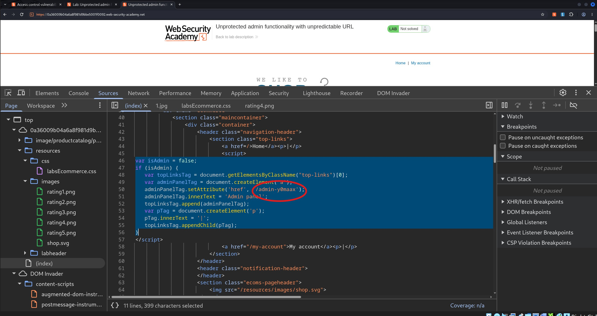
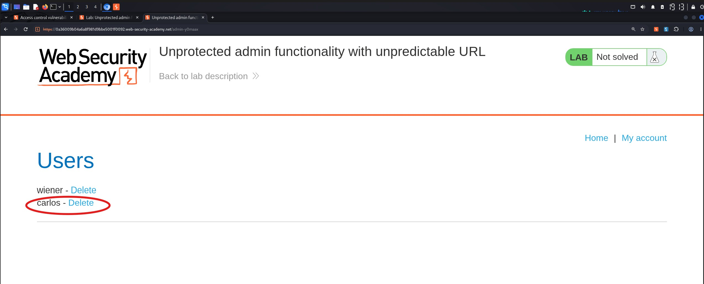
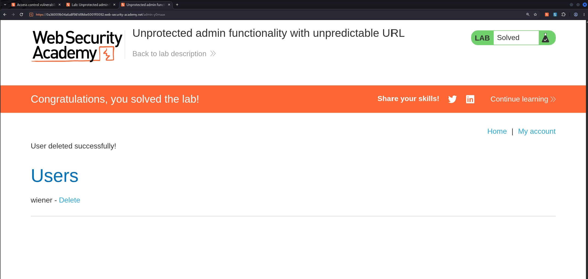

# Unprotected Admin Functionality with Unpredictable URL

## Objectives
Solve the lab by accessing the admin panel, and using it to delete the user carlos.

## Background
This lab has an unprotected admin panel. It's located at an unpredictable location, but the location is disclosed somewhere in the application.

## Tools Used
- Google Chrome
- Browser Dev Tools

## Methodology

Since the admin panel's URL was not directly guessable, I considered whether the application might inadvertently disclose it to users. One possibility was that the URL could be embedded in JavaScript responsible for dynamically constructing the user interface based on the user's role.

To investigate this, I opened Chrome Developer Tools, navigated to the Sources tab, and inspected the application's index.html file.



Scrolling past the header code, I discovered a JavaScript snippet that was interesting ngl:

```bash
var isAdmin = false;
if (isAdmin) {
   var topLinksTag = document.getElementsByClassName("top-links")[0];
   var adminPanelTag = document.createElement('a');
   adminPanelTag.setAttribute('href', '/admin-y0maax');
   adminPanelTag.innerText = 'Admin panel';
   topLinksTag.append(adminPanelTag);
   var pTag = document.createElement('p');
   pTag.innerText = '|';
   topLinksTag.appendChild(pTag);
}
```



The code revealed the admin panel's URL: /admin-y0maax. Although the isAdmin variable was set to false, the URL remained visible in the client-side JavaScript. This meant that hiding the admin link from ordinary users did not prevent them from discovering the endpoint.

I then navigated directly to `/admin-y0maax` in the browser.



The admin panel was accessible without proper authorization checks. This confirmed that the application relied on concealing the admin link rather than enforcing access controls on the administrative functionality itself.


## Results 
Using the exposed admin panel, I located Carlos's account and deleted it successfully, completing the lab.



## Reflection
Hiding an administrative URL is not the same as securing it. Client-side JavaScript is accessible to users and should never be treated as a secure place to conceal sensitive endpoints. Even when an admin link is hidden using a role-based condition, an attacker can inspect the source code and discover the URL. Applications must enforce server-side authentication and authorization checks on every sensitive endpoint, regardless of whether its URL is predictable or exposed. The key lesson is simple: if the only thing protecting an admin panel is a hidden link, the application is already in trouble lol