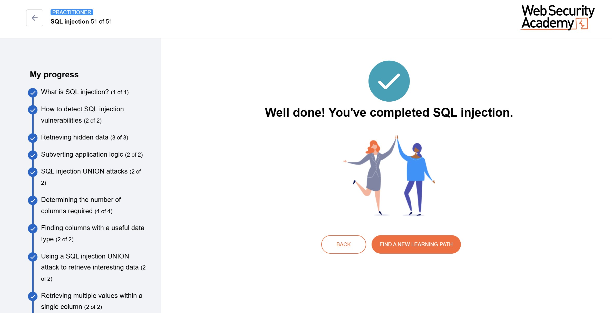

# SQL Injection

## Introduction

SQL Injection (SQLi) is one of the most common web application vulnerabilities. It occurs when an application incorporates untrusted user input into SQL queries without properly separating the input from the query structure.

I explored this vulnerability through the SQL Injection topic of PortSwigger Web Security Academy, where I worked through different labs to understand how SQL injection vulnerabilities arise, how they can be exploited, and the techniques attackers use to retrieve information from databases.

Rather than simply following payloads, I focused on understanding the reasoning behind each attack: identifying injectable parameters, determining the database structure, testing column compatibility, retrieving data, and exploring different techniques for exploiting blind SQL injection.

This repository documents my methodology, observations, challenges, and key takeaways from the labs I completed.

## Objectives

Through these practical exercises, I aimed to:

- Understand how SQL injection vulnerabilities occur and how they can be identified.
- Exploit SQL injection vulnerabilities to retrieve hidden and sensitive information.
- Understand UNION-based SQL injection and how to determine the number of columns returned by a query.
- Identify database types, versions, tables, and column names.
- Explore different approaches to exploiting blind SQL injection.
- Understand how conditional responses, errors, and time delays can reveal information from a database.
- Explore out-of-band techniques for detecting SQL injection and exfiltrating data.
- Understand how security filters can be bypassed through techniques such as XML encoding.
- Learn practical methods for preventing SQL injection vulnerabilities.

## Labs Completed

The following table contains the labs I successfully completed, grouped by the techniques and concepts explored.

### 1. Basic SQL Injection

| Lab | Description |
|---|---|
| [SQL Injection Vulnerability in WHERE Clause Allowing Retrieval of Hidden Data](SQL_injection_vulnerability_in_WHERE_clause_allowing_retrieval_of_hidden_data.md) | Exploited a vulnerable category filter to retrieve hidden products by manipulating the SQL query's `WHERE` clause. |
| [SQL Injection Vulnerability Allowing Login Bypass](SQL_injection_vulnerability_allowing_login_bypass.md) | Manipulated the login query to bypass authentication without knowing the administrator's password. |

### 2. UNION-Based SQL Injection

| Lab | Description |
|---|---|
| [SQL Injection UNION Attack: Determining the Number of Columns Returned by the Query](SQL_injection_UNION_attack_determining_the_number_of_columns_returned_by_the_query.md) | Used `ORDER BY` and `UNION SELECT` statements to determine the number of columns returned by the original query. |
| [SQL Injection UNION Attack: Finding a Column Containing Text](SQL_injection_UNION_attack_finding_a_column_containing_text.md) | Identified which columns could accept and display string values. |
| [SQL Injection UNION Attack: Retrieving Data from Other Tables](SQL_injection_UNION_attack_retrieving_data_from_other_tables.md) | Enumerated database tables and columns before retrieving usernames and passwords from another table. |
| [SQL Injection UNION Attack: Retrieving Multiple Values in a Single Column](SQL_injection_UNION_attack_retrieving_multiple_values_in_a_single_column.md) | Used string concatenation to retrieve multiple database values through a single compatible column. |
| [SQL Injection Attack: Querying the Database Type and Version on MySQL and Microsoft](SQL_injection_attack_querying_the_database_type_and_version_on_MySQL_and_Microsoft.md) | Explored database-specific queries to identify the database type and version. |
| [SQL Injection Attack: Listing the Database Contents on Non-Oracle Databases](SQL_injection_attack_listing_the_database_contents_on_non-Oracle_databases.md) | Used database metadata to enumerate tables and columns on a non-Oracle database before retrieving credentials. |

### 3. Blind SQL Injection

| Lab | Description |
|---|---|
| [Blind SQL Injection with Conditional Responses](Blind_SQL_injection_with_conditional_responses.md) | Used differences in application responses to determine whether injected SQL conditions were true or false and extract information character by character. |
| [Blind SQL Injection with Conditional Errors](Blind_SQL_injection_with_conditional_errors.md) | Triggered database errors conditionally to extract information from the database. |
| [Blind SQL Injection with Time Delays and Information Retrieval](Blind_SQL_injection_with_time_delays_and_information_retrieval.md) | Used conditional time delays to infer database information when the application did not reveal query results directly. |
| [SQL Injection with Time Delays and Information Retrieval](SQL_injection_with_time_delays_and_information_retrieval.md) | Explored time-based SQL injection to retrieve information through differences in query execution time. |
| [Visible Error-Based SQL Injection](Visible_error-based_SQL_injection.md) | Used database error messages to reveal information from the database, including usernames and passwords. |

### 4. Out-of-Band SQL Injection

| Lab | Description |
|---|---|
| [Blind SQL Injection with Out-of-Band Interaction](Blind_SQL_injection_with_out-of-band_interaction.md) | Triggered and verified an external DNS lookup using Burp Collaborator. |
| [Blind SQL Injection with Out-of-Band Data Exfiltration](Blind_SQL_injection_with_out-of-band_data_exfiltration.md) | Used an out-of-band interaction to retrieve sensitive database information through an external request. |

### 5. Filter Bypass

| Lab | Description |
|---|---|
| [SQL Injection with Filter Bypass via XML Encoding](SQL_injection_with_filter_bypass_via_XML_encoding.md) | Bypassed an SQL injection filter by encoding the payload using XML entities, then used a UNION attack to retrieve database credentials. |

## Key Concepts and Techniques Learned

Working through these labs helped me understand several important SQL injection techniques:

- **Authentication Bypass:** Manipulating SQL queries to bypass login mechanisms.
- **UNION-Based SQL Injection:** Combining the results of an injected query with the original query to retrieve information from other database tables.
- **Database Enumeration:** Using database metadata to identify tables, columns, and other useful information.
- **Blind SQL Injection:** Extracting information even when query results are not directly displayed in the application's response.
- **Conditional Responses:** Using differences in application behavior to determine whether injected conditions are true or false.
- **Error-Based SQL Injection:** Leveraging database errors to reveal information.
- **Time-Based SQL Injection:** Inferring information through deliberate delays in database execution.
- **Out-of-Band SQL Injection:** Using external interactions, such as DNS lookups and HTTP requests, to detect vulnerabilities or retrieve information.
- **Filter Bypass:** Using alternative representations, such as XML entity encoding, to bypass security filters.

## Tools Used

| Tool | Purpose |
|---|---|
| Burp Suite | Intercepting, inspecting, and modifying HTTP requests; using Repeater and Intruder to test SQL injection payloads. |
| Burp Collaborator | Detecting out-of-band interactions and verifying DNS or HTTP callbacks. |
| Chrome | Interacting with the target web applications and observing their responses. |
| Hackvertor | Encoding SQL injection payloads using XML entities. |
| CyberChef | Encoding and transforming payloads during testing. |
| Kali Linux | Providing a penetration testing environment for practical exercises. |

## How to Prevent SQL Injection

One of the most effective ways to prevent SQL injection is to use **parameterized queries**, also known as **prepared statements**, instead of concatenating user input directly into SQL queries.

Parameterized queries separate SQL code from user-supplied data. This prevents user input from being interpreted as part of the SQL query structure.

Consider the following Java code, which is vulnerable to SQL injection because user input is concatenated directly into the query:

```java
String query = "SELECT * FROM products WHERE category = '" + input + "'";
Statement statement = connection.createStatement();
ResultSet resultSet = statement.executeQuery(query);
```

An attacker could manipulate the `input` value to alter the intended SQL query.

The code can be rewritten using a `PreparedStatement`:

```java
PreparedStatement statement = connection.prepareStatement(
    "SELECT * FROM products WHERE category = ?"
);

statement.setString(1, input);

ResultSet resultSet = statement.executeQuery();
```

Here, the `?` acts as a parameter placeholder. The `setString()` method binds the user input to that placeholder as data rather than allowing it to modify the SQL query structure.

Other important measures include:

- **Input validation:** Validate user input against expected formats and business rules. However, validation should complement parameterized queries, not replace them.
- **Least privilege:** Configure database accounts with only the permissions they need. An application account that only needs to read product information should not have unnecessary administrative privileges.
- **Safe handling of errors:** Avoid exposing detailed database errors to users. Log useful diagnostic information securely on the server instead.
- **Secure database access:** Avoid dynamically constructing SQL queries from untrusted input, including in stored procedures.
- **Security testing:** Regularly test applications for SQL injection vulnerabilities through code reviews, security assessments, and authorized penetration testing.

## Final Thoughts

Completing these labs has given me a much better understanding of how SQL injection works beyond simply knowing which payloads to use.

I learned that successful exploitation often involves a process of investigation: identifying the injection point, understanding the underlying query, determining the database behavior, and selecting the appropriate technique to retrieve information.

These labs have fr strengthened my understanding of web application security and given me practical experience identifying and exploiting SQL injection vulnerabilities.

