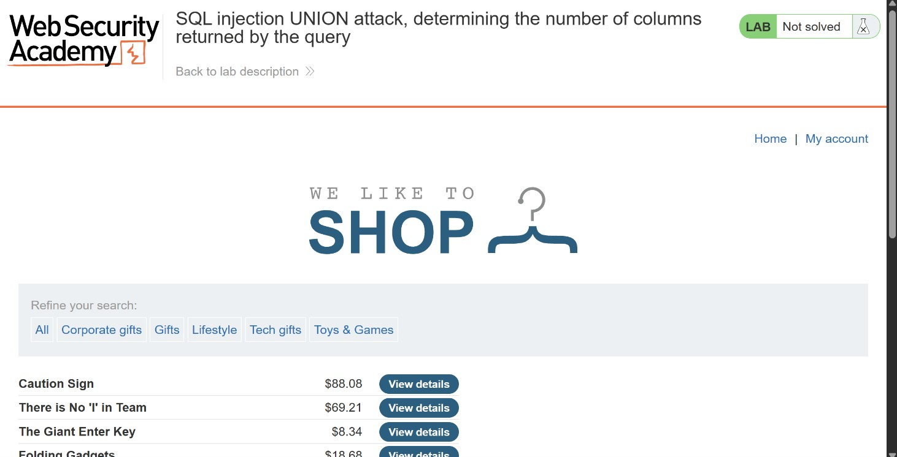
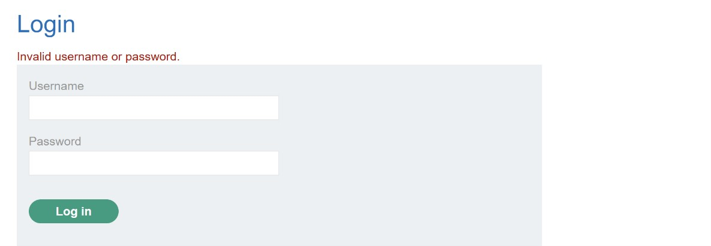
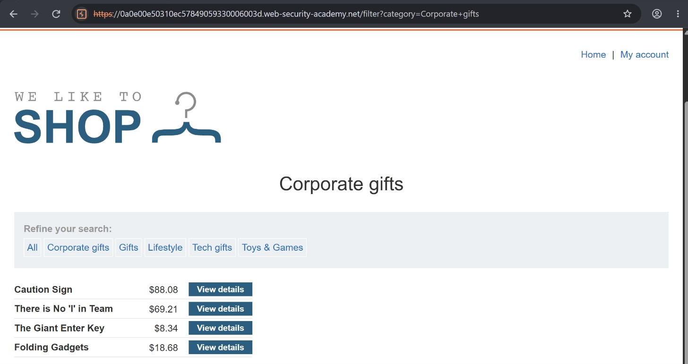
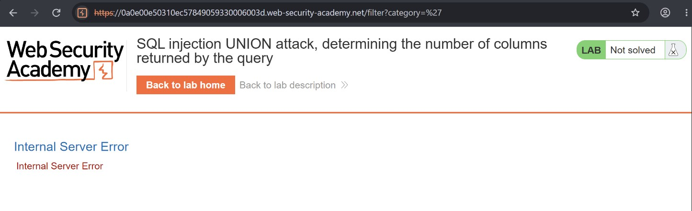
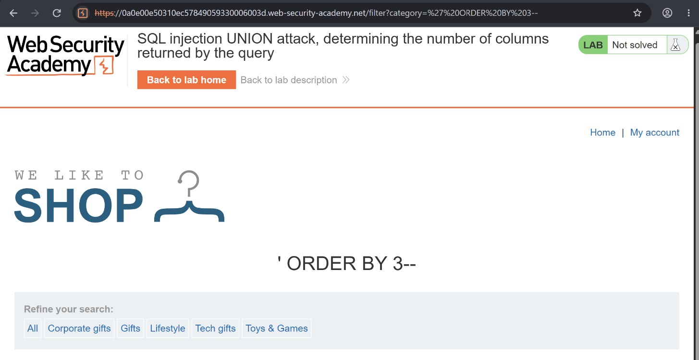
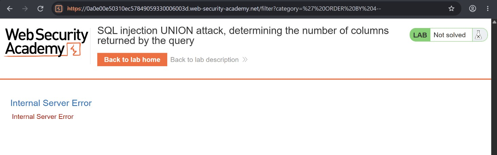
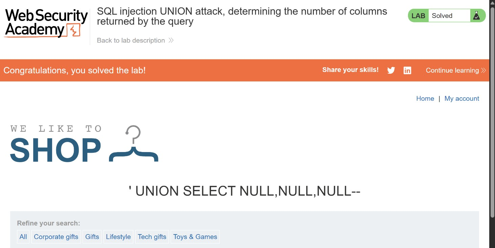

# SQL Injection UNION Attack: Determining the Number of Columns Returned by the Query

## Objective

To solve the lab, determine the number of columns returned by the query by performing a SQL injection UNION attack that returns an additional row containing `NULL` values.

## Background

This lab contains a SQL injection vulnerability in the product category filter. The results of the database query are reflected in the application's response, making it possible to use a UNION attack to retrieve data from other tables.

## Tools Used

- Burp Suite
- Chrome

## Methodology

I started by opening the application and exploring its features and functionality while observing the requests being made.



I noticed that the application had a login functionality, so I initially attempted to test the username and password fields for SQL injection. However, both attempts returned an incorrect username/password response.

This did not necessarily prove that the application was filtering my input, but it suggested that the login functionality was not the most straightforward place to investigate for this lab.



I then moved to the homepage, which displayed several products alongside their respective categories.

After selecting one of the categories, I noticed that the application sent a request containing the following parameter:

```http
/filter?category=Corporate+gifts
```

This gave me a potential injection point: the `category` parameter.



To test whether the parameter was vulnerable, I replaced the category value with a single quotation mark (`'`).

The application returned an Internal Server Error. This suggested that my input had interfered with the SQL query's syntax, potentially indicating a SQL injection vulnerability.



### Determining the Number of Columns

Having identified a potential injection point, my next objective was to determine the number of columns returned by the original query.

There are two common approaches to doing this:

1. Using the `ORDER BY` clause.
2. Using a `UNION SELECT` statement with `NULL` values.

I started with the `ORDER BY` approach.

I modified the category parameter to:

```sql
' ORDER BY 1--
```

I then incremented the column index, testing:

```sql
' ORDER BY 2--
' ORDER BY 3--
' ORDER BY 4--
```

The application continued returning a normal response for column positions 1, 2, and 3.

However, when I tested column position 4, the application returned an Internal Server Error.

This indicated that the original query returned three columns. Referencing a fourth column caused the query to fail.





### Confirming the Column Count Using UNION SELECT

Having established that the query returned three columns, I proceeded to test the `UNION SELECT` approach.

I supplied three `NULL` values in the injected SELECT statement:

```sql
' UNION SELECT NULL,NULL,NULL--
```

The application accepted the request and reflected the resulting response.



The lab was now marked as solved.

Interestingly, although the `ORDER BY` technique had already helped me determine that the query returned three columns, the lab specifically required a successful `UNION SELECT` injection with three `NULL` values to complete the challenge.

And the funny part? I ended up not even needing Burp Suite for this lol.

## Results

- Identified the SQL injection vulnerability in the product category filter.
- Determined that the original SQL query returned three columns using the `ORDER BY` technique.
- Confirmed the column count with a `UNION SELECT NULL,NULL,NULL` payload.

## Reflection

This lab introduced me to an important first step in SQL injection UNION attacks: determining the number of columns returned by the original query.

I learned that `ORDER BY` can help identify the column count by observing when a query begins to fail, while `UNION SELECT` can confirm it by matching the number of columns in both SELECT statements.

One important takeaway is that a successful injection is not always determined by an error message. Understanding how the application responds to different payloads is just as important.