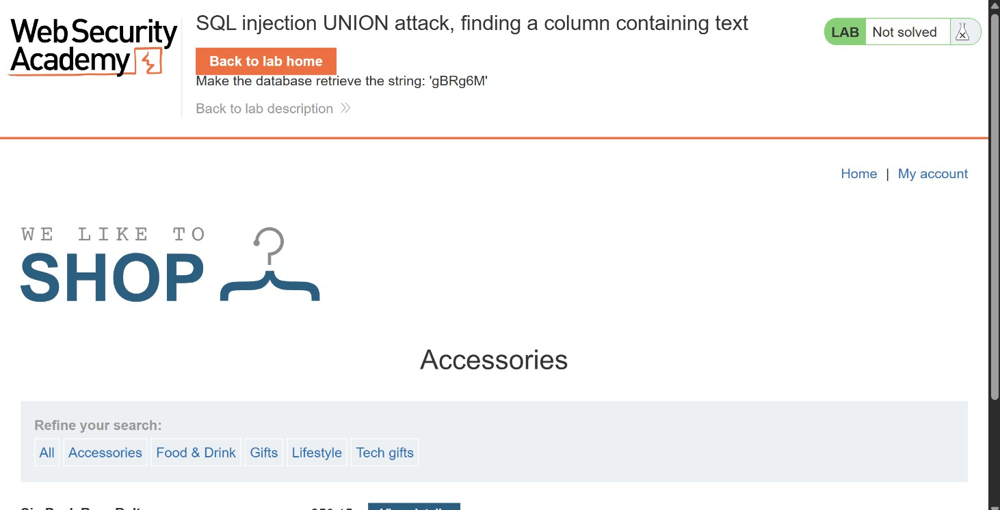
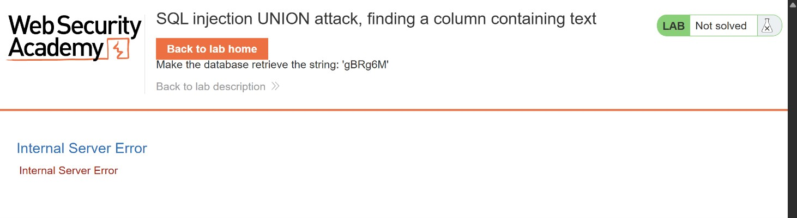
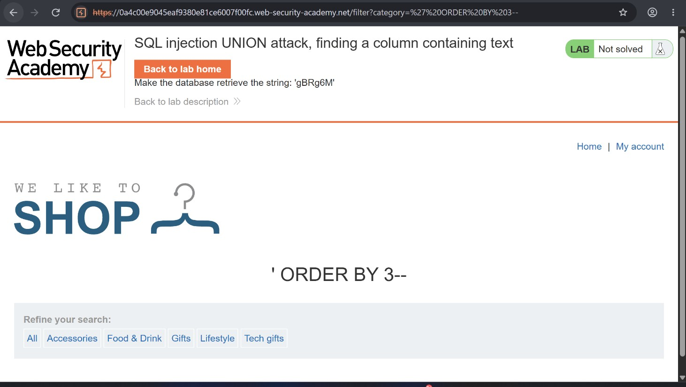
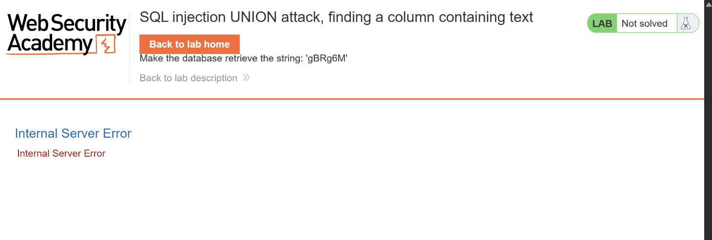
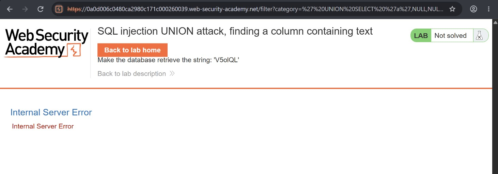
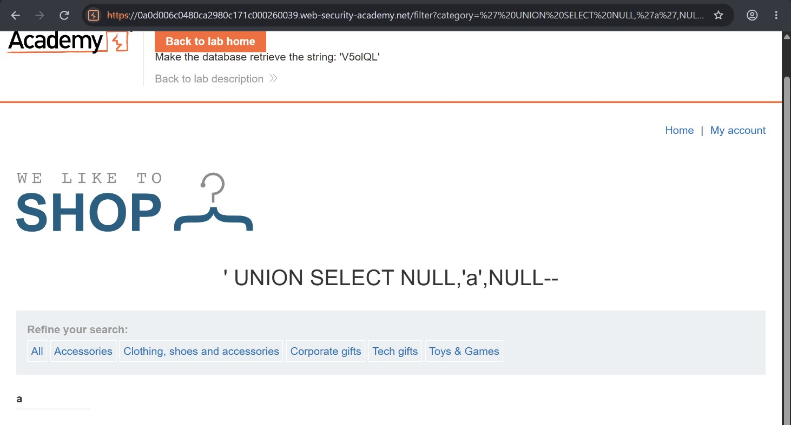
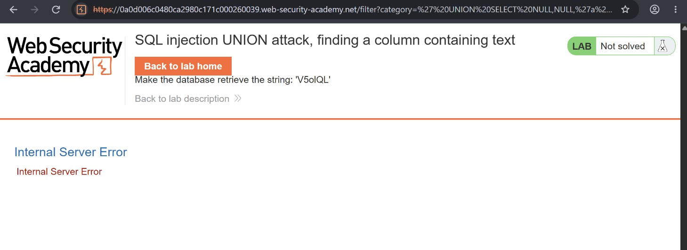
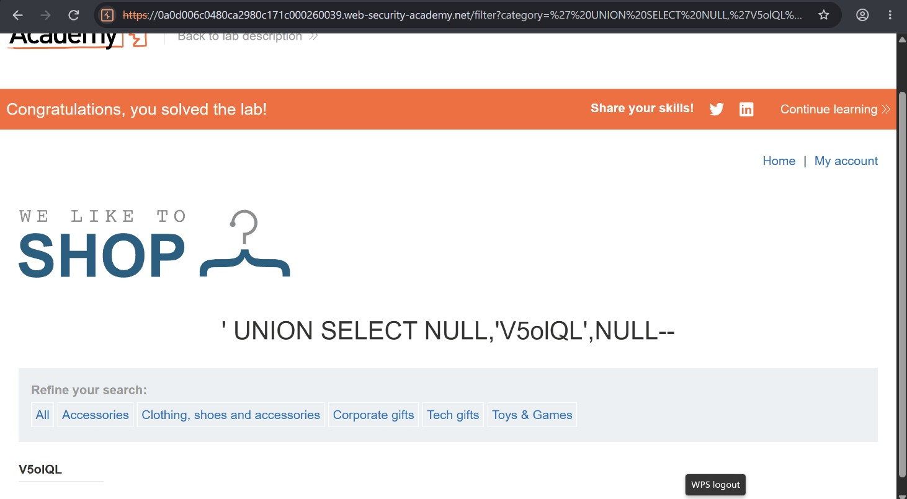

# SQL Injection UNION Attack: Finding a Column Containing Text

## Objective

The lab provides a random value that you need to make appear in the query results.

To solve the lab, perform a SQL injection UNION attack that returns an additional row containing the supplied value. This technique helps identify which columns in the original query are compatible with string data.

## Background

This lab contains a SQL injection vulnerability in the product category filter. The results of the database query are reflected in the application's response, making it possible to use a UNION attack to retrieve additional data.

Before constructing the attack, you need to determine the number of columns returned by the original query. Once that is established, the next step is to identify which of those columns can accommodate string data.

## Tools Used

- Chrome

## Methodology

I started by opening the application and navigating to the **Accessories** category. My objective was to exploit the underlying SQL injection vulnerability using a UNION attack and identify which of the returned columns could accommodate text.



To confirm that the category parameter was vulnerable, I replaced its value with a single quotation mark (`'`). The application returned an Internal Server Error, suggesting that my input had interfered with the SQL query's syntax.



### Determining the Number of Columns

Before identifying a column that could contain text, I first needed to establish how many columns the original query returned.

I used the `ORDER BY` technique, incrementing the column index until the application returned an error.





As shown above, the application returned a normal response for column positions 1, 2, and 3. However, referencing the fourth column resulted in an Internal Server Error.

This indicated that the original query returned three columns.

### Identifying a Column That Accepts Text

Having established that the query returned three columns, my next objective was to identify which of them was compatible with string data.

For this, I used the `UNION SELECT` technique, testing each column individually with the character `a` while keeping the remaining columns as `NULL`.

I started with the first column:

```sql
' UNION SELECT 'a',NULL,NULL--
```

This returned an Internal Server Error.



Next, I tested the second column:

```sql
' UNION SELECT NULL,'a',NULL--
```

This time, the application successfully returned the character `a`.

This confirmed that the second column was compatible with string data.



To verify the third column, I submitted:

```sql
' UNION SELECT NULL,NULL,'a'--
```

The application returned another Internal Server Error.



Based on these tests, I established that the second column was the one compatible with string data.

### Retrieving the Supplied String

With the text-compatible column identified, the final step was to make the application return the random string provided by the lab.

The supplied value was:

```text
V5olQL
```

I replaced the test character with this value and submitted the following payload:

```sql
' UNION SELECT NULL,'V5olQL',NULL--
```



The application displayed the supplied string in the query results, and the lab was successfully solved.

## Results

- Confirmed a SQL injection vulnerability in the product category filter.
- Determined that the original query returned three columns.
- Identified the second column as compatible with string data.
- Successfully used a UNION attack to retrieve the supplied string `V5olQL`.

## Reflection

This lab was built on the previous UNION attack lab I completed. Knowing the number of columns is important, but it is not enough to construct a successful UNION query. You also need to understand the data types supported by the individual columns.

By testing each column with a string value while keeping the others as `NULL`, I was able to identify the correct position for retrieving text.

The key takeaway is that successful UNION-based SQL injection requires matching both the number of columns and the data types expected by those columns.